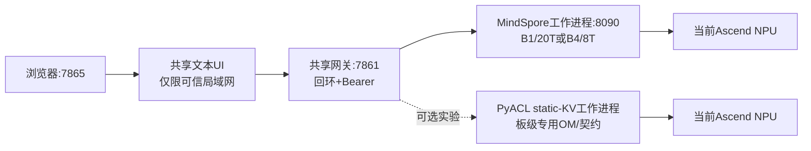

# 昇腾边缘聊天服务（Ascend Edge Chat）

Ascend Edge Chat是面向昇腾边缘硬件的可移植、可扩展文本聊天服务。它通过OpenAI兼容网关和浏览器UI提供一个边界明确的NPU后端。

`v0.2.0`在两个板上使用一个共享聊天应用和一条默认推理路径：MindSpore/MindNLP从同一个固定模型revision运行[Qwen1.5-0.5B-Chat](https://huggingface.co/Qwen/Qwen1.5-0.5B-Chat)。相同的`run-chat.sh`、工作进程、网关、UI和发布模型锁服务于Ascend310B1/20T与Ascend310B4/8T。只有板目标、实测内存预检阈值和各板验收证据不同。

后端选择器还可提供板级专用的PyACL/static-KV候选。这就是预期的对照范围：MindSpore通过MindNLP运行固定checkpoint，而PyACL在显式static-KV张量契约下运行另行转换的OM和tokenizer。二者是不同的推理实现和产物，但共用同一聊天UI、网关、后端监督进程、请求/会话契约和公开API。候选可用性保持fail-closed；仅当该板的锁、OM、tokenizer与契约均已安装并验证时才显示。



## 支持范围

| 项目 | `v0.2.0`状态 |
| --- | --- |
| 共享默认路径 | Ascend310B1/20T与Ascend310B4/8T，MindSpore 2.4.10、MindNLP 0.4.1、CANN 8.0.0、Python 3.9.25 |
| 共享模型 | `configs/release-model.json`中固定revision的Qwen1.5-0.5B-Chat |
| 公开模型名称 | `ascend-edge-chat` |
| API | `GET /v1/models`、`POST /v1/chat/completions`、JSON、SSE |
| 板级设置 | NPU SoC、实测HBM预检阈值、token预算和独立测试证据 |
| 可选PyACL路径 | 由监督进程选择、列入允许列表且具有自身OM、tokenizer、契约与哈希的static-KV候选 |
| 语音控制 | 独立实验能力；默认禁用，并与文本服务启动隔离 |

两个板运行同一MindSpore应用路径，但其证据保持独立。20T的PyACL选项是采用不同计算图和KV缓存执行契约的替代后端。未记录模型、精度、提示词、token数与计时边界时，不得将其与MindSpore比较。输出受上下文限制：`prompt_tokens + completion_tokens <= 1024`。中文语义质量仍须针对两个目标分别审查。

## 可选PyACL静态KV后端

MindSpore在两个板上仍是默认后端。公开B4 static-KV包及其锁保留为经过单独验证的PyACL替代方案，而不是第二个默认应用。该包来自Hugging Face仓库`zhouxzh/ascend310b-llm-om-zoo`的固定revision`0f516070e1c0566e3c652d43c488cd3cfbad89a3`；锁中记录Qwen基础revision和Apache-2.0许可证。在20T上，监督进程还提供单独的B1 static-KV候选。每个板级候选都有各自的OM、tokenizer、契约和锁。只有当这些产物已安装并验证后，共享UI才会切换到该候选。

共享8T启动路径与20T使用同一个固定MindSpore模型和启动器：

```bash
cd /opt/ascend-edge-chat
cp configs/release-8t.env.example .env
# 替换网关token；保留B4目录和8T HBM阈值。
export ASCEND_EDGE_CHAT_ENV_FILE=/opt/ascend-edge-chat/.env
bash scripts/import/download-model.sh
bash scripts/run/run-chat.sh
```

`release-8t-static-kv.lock.json`包仍可用于旧版独立B4产物/验收工作流。它不是默认8T聊天路径，其OM不会被静默替换为共享MindSpore checkpoint。共享UI中的可选PyACL选项使用`configs/8t-backend-catalog.json`指定的候选ID、候选数据目录和候选锁。

两条默认聊天路径具有相同拓扑：

```text
browser :7865 -> UI -> supervisor :7863 -> MindSpore worker :8090 + gateway :7861
```

只有在板级候选产物和契约通过其哈希与SoC门后，才可选择`PyACL 固定KV`。使用`Ctrl+C`停止前台共享启动器；UI先停止，随后监督进程关闭并回收其所属工作进程和网关。

要在任一板上执行固定源码、固定HF的机器验收，请从干净的公开检出运行`scripts/verify/run-release-acceptance.sh`。单独的`run-release-8t-acceptance.sh`脚本保留旧版独立static-KV验收路径，必须将其报告为ACL证据，而不是共享MindSpore路径。

公开源码commit`c11c96eb625403a2e160792c6428f2eaa341018b`上的历史独立B4 static-KV验收返回了`machine_status=passed`。该报告只属于可选PyACL后端，不是共享MindSpore路径的证据。人工中文语义质量审查仍待完成。

## 当前20T验证

`2026-10-18`，运行中的教学配置`qwen2-0.5b-instruct-mindspore`在`Ascend310B1 / 20T`板上通过浏览器路由`:7865 -> :7861 -> :8090`进行了测试。网关与UI契约、JSON、SSE、8/16/32/64-token长度检查、10次短稳定性请求和10次中文探测均已完成。保留的带日期验收报告仍作为被忽略的证据留在板上，不是签入产物。一个性能样本测得首个token为723.051 ms、完成为1370.604 ms、吞吐量为1.459 token/s。这是单样本观测，不是p50基准。

`2026-10-23`，统一的`ascend`环境使用Qwen1.5-0.5B-Chat重复了技术预览机器验收。限速客户端使用1秒JSON间隔和2秒SSE间隔。所有机器门均通过：网关/UI契约、4项长度检查、带`stop`的SSE、10/10次稳定性请求、10次中文探测以及30个无`U+FFFD`的性能样本。首token p50/p95为`705.746/747.193 ms`，完成p50/p95为`1336.014/1412.012 ms`，吞吐量p50/p95为`1.497/1.569 token/s`。原始报告保留在板上`run/reports/release-20261023T013704Z/acceptance.json`，SHA-256为`4a0c19f11af4b39f84a030a0a669c753753fa72f6c7a5ae0d4d68bd244c068e0`。人工中文语义审查仍待完成。

较早的一次无间隔运行在稳定性循环中收到HTTP 429（`Too many request bodies are being read`）。随后的间隔运行通过；该429是请求准入观测，不是模型或NPU故障。中文语义质量仍待完成：一个直接中文提示返回了英文道歉，因此技术完成情况和回答质量必须分开报告。详细证据表见[验证与限制](docs/04-validation-and-limitations.md)。

`2026-10-21`，浏览器路径还在20T板上完成了一轮合成麦克风ASR转文本。`sherpa-onnx 1.13.6`和采用Apache-2.0许可证的`sherpa-onnx-streaming-zipformer-zh-14M-2023-02-23` int8模型现在共用统一的Python 3.9 `ascend`环境。浏览器WAV上传返回HTTP 200，识别出的中文文本到达现有网关，UI显示了助手的文本回复。操作员随后确认，真实浏览器麦克风也能通过同一页面被识别。`2026-10-22`，浏览器路径以`zh-CN`对完整助手回复调用`speechSynthesis`；自动化浏览器测试记录了朗读文本并进入完成状态。实际扬声器可听性和语音质量仍需要人工听测审查。这些观测建立了浏览器ASR转文本技术路径和浏览器原生TTS调用路径，但不代表识别准确率或板端音频行为。

## 可选PyACL对照路径

两个板使用同一个仅限回环的后端监督进程。它提供共享MindSpore工作进程作为默认后端，并且只公开已为检测到的板注册的PyACL/static-KV候选。浏览器提交后端ID和模型ID；路径、OM文件、命令、环境值和哈希仍留在服务器端。切换时会停止先前归监督进程管理的工作进程和网关，验证并启动所选后端，然后清空对话。

20T B1候选和8T B4候选使用不同的OM二进制与独立候选锁。20T候选标记为`offline-experimental`；8T独立公开包有其自身的历史`formal-machine`验收。任一ACL结果都不会被另一SoC或MindSpore继承。要运行可选的独立B4产物验收，请使用`scripts/run/run-static-kv-standalone.sh`；正常的8T和20T启动命令是`scripts/run/run-chat.sh`。

## 共享MindSpore快速开始

在任一受支持的板上，若统一的`ascend`环境以及匹配的CANN/MindSpore/MindNLP已安装，请从GitHub固定commit获取本仓库，再通过配置的镜像从Hugging Face下载同一个锁定模型。唯一的部署选择是板级环境示例：20T使用`release.env.example`，8T使用`release-8t.env.example`。这些命令不会安装或升级驱动、CANN、MindSpore或模型框架。

```bash
git clone https://github.com/zhouxzh/Ascend310.git /opt/ascend-edge-chat
git -C /opt/ascend-edge-chat checkout --detach <commit-sha>
cd /opt/ascend-edge-chat
export ASCEND_EDGE_CHAT_CONDA_ENV='ascend'
source /usr/local/miniconda3/etc/profile.d/conda.sh
conda activate "$ASCEND_EDGE_CHAT_CONDA_ENV"
export PYTHONNOUSERSITE=1
python -m pip install --no-deps .
export ASCEND_EDGE_CHAT_DATA_DIR=/opt/ascend-edge-chat-data
# 8T请改用configs/release-8t.env.example。
cp configs/release.env.example .env
# 编辑.env并替换ASCEND_EDGE_CHAT_GATEWAY_API_KEY。
# 验收报告必须说明锁定模型的获取方式。
export ASCEND_EDGE_CHAT_MODEL_SOURCE=hf

# 仅当现有环境缺少某个发布Web依赖时才需要：
export ASCEND_EDGE_CHAT_WHEELHOUSE=/opt/ascend-edge-chat-wheelhouse
bash scripts/verify/install-service-dependencies.sh

# 下载器使用锁定的Hugging Face仓库/revision，并默认使用
# https://hf-mirror.com；无需复制本地模型。
bash scripts/import/download-model.sh
bash scripts/verify/release-preflight.sh
```

在前台启动共享聊天程序：

```bash
bash scripts/run/run-chat.sh
```

启动器会启动回环监督进程，选择MindSpore/Qwen1.5-0.5B作为默认后端，然后在两个板上启动相同UI。若发布预检失败或所需端口已被占用，它会退出。`Ctrl+C`会停止UI，并要求监督进程停止其所属工作进程和网关。只有在板级产物和契约锁可用后，可选PyACL候选才会出现在`运行设置`中。

打开`http://<board-ip>:7865/`。浏览器UI**无登录**。任何能访问端口`7865`的主机都可以提交提示词，并在启用语音模式时激活允许列表中的板端音频控制，或通过UI代理读取语音状态。仅限可信局域网使用；切勿将此端口暴露到公网。

## 可选语音模式

发布环境默认禁用语音控制。它有两种互斥模式：

- `browser`：处于安全上下文中的浏览器录制16 kHz单声道WAV，通过UI的同源代理发送到本地ASR，并返回助手回复。若配置了板端TTS，其有限时长WAV会在浏览器中播放；否则页面使用带有`zh-CN`偏好的浏览器原生`speechSynthesis`。浏览器麦克风测试使用`http://localhost`；远程浏览器需要HTTPS。2秒自检完全在浏览器内存中录制和回放，不上传音频，也不要求ASR/TTS。
- `board`：回环语音代理拥有选定的USB/3.5mm ALSA设备、自动VAD、ASR、TTS和本地播放。浏览器只控制模式/设备选择并显示文本/状态。板端采集会为自动语音检测校准动态噪声底，并在ASR前对VAD边界内的话语应用有界软件AGC；静音不会被放大。语音回复使用有界默认值32个completion token，使LLM和TTS延迟保持可用；静默监听窗口会返回监听状态，而不会计为代理故障。语音面板还提供按住自检，在内存中录制并通过选定扬声器回放同一PCM，不调用ASR、LLM或TTS。

语音代理是独立进程，但使用同一个统一`ascend`环境。教学UI仍无鉴权：可达的局域网客户端可以读取脱敏语音状态并请求模式/设备变更，但只接受代理枚举允许列表中的ID。语音代理本身仍仅限回环。它不加载CANN环境，不加载文本工作进程，也不安装/下载语音模型：

```bash
# 在共享ascend环境和经审查的本地语音产物就绪后。
bash scripts/verify/voice-preflight.sh
bash scripts/run/start-voice-agent.sh
```

若统一`ascend`环境不可用、未枚举到采集/播放ALSA端点，或当前账户无法通过组成员身份或ACL/直接权限读取采集节点并写入播放节点，`voice-preflight.sh`会停止。ASR和TTS分别独立fail-closed。当前20T配置具有一个经审查的本地ASR模型和用于本地语音的系统级eSpeak NG；浏览器语音回复也可使用浏览器原生TTS。各模式的证据门见[语音模式与板端终端方案](docs/08-board-voice-terminal-plan.md)。

## 稳定命令

```bash
ascend-edge-chat verify --data-dir /opt/ascend-edge-chat-data
ascend-edge-chat model download --data-dir /opt/ascend-edge-chat-data
ascend-edge-chat model import --data-dir /opt/ascend-edge-chat-data --source /mnt/offline/qwen
ascend-edge-chat worker
ascend-edge-chat gateway --check-config
ascend-edge-chat ui
ascend-edge-chat voice --check-config
ascend-edge-chat acl verify --data-dir /opt/ascend-edge-chat-data-8t
ascend-edge-chat acl download --data-dir /opt/ascend-edge-chat-data-8t
ascend-edge-chat acl-worker --data-dir /opt/ascend-edge-chat-data-8t
```

`app.py`和`text_chat_app.py`是短期兼容包装器。新自动化必须使用CLI或`scripts/run/`。

## 文档

- [发布概览](docs/00-release-overview.md)
- [20T部署](docs/01-20t-deployment.md)
- [8T static-KV发布](docs/10-8t-static-kv-release.md)
- [量化ONNX筛选](docs/11-quantized-onnx-screening.md)
- [模型产物](docs/02-model-artifacts.md)
- [API与安全](docs/03-api-and-security.md)
- [验证与限制](docs/04-validation-and-limitations.md)
- [扩展指南](docs/05-extension-guide.md)
- [发布流程](docs/06-release-process.md)

历史实验保留在[docs/archive/](docs/archive/)下；它们不是受支持的发布功能。

## 教学模型测试

浏览器从`configs/tutorial-model-catalog.json`列出教学目录。标记为`selectable`的模型具有已实测的技术路径，即使其`quality_status`为`failed`或`pending`也可测试。在教学模式下，从浏览器选择模型会执行受控工作进程重启：UI验证固定registry和本地缓存，停止当前工作进程，启动所选配置，等待NPU健康状态并清空浏览器对话。若启动失败，它会自动尝试恢复先前的工作进程。它绝不接受来自浏览器的模型路径、任意命令或Python表达式。生成回复期间选择器禁用；浏览器收到终止SSE事件后，服务器还会短暂等待流清理，然后再切换。

```bash
# UI可以执行此受控重启。该命令仍可用于
# 终端恢复或无头板端。
ASCEND_EDGE_CHAT_PROFILE=qwen2-1.5b-instruct-mindspore \
  ascend-edge-chat worker --profile qwen2-1.5b-instruct-mindspore \
  --registry configs/tutorial-models.json
```

教学功能分别记录运行时、文本完整性和语义质量证据。例如，Qwen2和Qwen2.5配置可能通过NPU/API门，同时产生`U+FFFD`；这是tokenizer/解码文本完整性观测，不是NPU无法运行它们的证据，也不足以据此判定中文语义质量。页面按请求发送输出预算。常规默认值为`128` token，已验证的服务上限为`256`；一个token不是中文字符数，且上下文预算仍要求`prompt_tokens + max_tokens <= 1024`。

## 检查多模态USB音频设备

麦克风/扬声器组合设备可能以蓝牙、无线、充电或仅播放模式启动。在诊断ALSA或应用之前，按设备手册将其切换到**有线USB音频**或会议模式，然后直接重新连接到USB Host端口。重新枚举设备：

```bash
lsusb -t
arecord -l
aplay -l
```

三层结果必须一致：

- `lsusb`必须显示新的USB Audio设备，而不能只显示Wi-Fi适配器。
- `aplay -l`必须在测试扬声器前显示其播放PCM。
- `arecord -l`必须在测试麦克风前显示其采集PCM。

设备可以提供播放但无麦克风。PulseAudio monitor源不是麦克风。若`aplay -l`显示设备而`arecord -l`不显示，请停在USB模式/端点层：不要用板载采集设备或monitor源替代。可听的播放测试不能证明麦克风可用。

在8T板上观测到的EDIFIER M16 Pro说明了这一检查。有线模式/重连序列之前，系统只显示板载`ascend310b`声卡。它随后显示为`2d99:a020 EDIFIER M16 Pro`，ALSA为`card 1, device 0`；一个48 kHz立体声测试音已被听到确认。其当前USB描述符仍只暴露播放OUT端点，因此未声明麦克风采集可用。

## 常见故障

| 现象 | 检查 | 处理 |
| --- | --- | --- |
| 工作进程无法导入`acl`或MindSpore | 确认同一shell中激活的Conda环境并已source CANN | 运行目标专用预检；不要添加CPU回退 |
| 预检无法导入FastAPI或Pydantic | 使用`PYTHONNOUSERSITE=1`检查当前环境 | 安装经审查且使用哈希锁定的服务闭包 |
| 网关启动期间退出 | 验证网关密钥、后端、上游模型和回环端口 | 运行`ascend-edge-chat gateway --check-config` |
| UI加载但回复失败 | 检查后端`:8084`或`:8090`，然后检查网关`:7861`，再检查UI日志 | 让各进程保持前台运行，并检查第一个失败的服务 |
| 多模态USB麦克风/扬声器缺失或仅可播放 | 确认设备已切换到有线USB音频/会议模式，然后直接重新连接到Host端口 | 复查`lsusb -t`、`arecord -l`和`aplay -l`；切勿用板载采集或monitor源替代 |
| 8T产物验证失败 | 与`configs/release-8t-static-kv.lock.json`比较字节和SHA-256 | 仅删除被拒绝的数据目录文件，并重新运行`acl download` |
| 8T UI提示外部工作进程不可用 | 检查`127.0.0.1:8084`上的`/health`，确认`ready`、`healthy`、模型ID、描述符标志和启动策略 | 仅在产物/SoC门通过后重启ACL工作进程 |
| 20T模型验证失败 | 与`configs/release-model.json`比较字节和SHA-256 | 仅删除失败产物，并重新导入或重新下载 |

代码采用Apache-2.0许可证。模型文件保留其上游许可证，不在代码许可证覆盖范围内。
