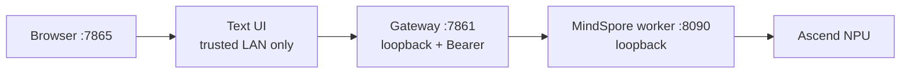

# Ascend Edge Chat

Ascend Edge Chat is a portable, extensible text-chat service for Ascend edge hardware. It exposes a bounded MindSpore worker through an OpenAI-compatible gateway and a browser UI.

`v0.1.0` is a technical preview. The default release target is **Ascend 310B1 / 20T** and the default model is [Qwen1.5-0.5B-Chat](https://huggingface.co/Qwen/Qwen1.5-0.5B-Chat). A separate teaching catalog exposes every model with measured technical-running evidence, including models whose Chinese output is poor. Quality is reported independently and is never silently converted into a runtime claim.



## Support Scope

| Item | `v0.1.0` state |
| --- | --- |
| Verified hardware | Ascend 310B1 / 20T, CANN 8.0.0 |
| Runtime | Python 3.9.25, MindSpore 2.4.10, MindNLP 0.4.1 |
| Default model | Qwen1.5-0.5B-Chat, revision and SHA-256 locked |
| Teaching experiments | Qwen1.5 1.8B, Qwen2/Qwen2.5 0.5B/1.5B, TinyLlama and DeepSeek profiles when their artifacts are present |
| Public model name | `ascend-edge-chat` |
| API | `GET /v1/models`, `POST /v1/chat/completions`, JSON, SSE |
| Not included | Speech, ASR/TTS, device protocol, retrieval, simultaneous multi-model loading |

8T hardware does not inherit the 20T result and is not part of this release validation.

## Current 20T validation

On `2026-10-18`, the running teaching profile `qwen2-0.5b-instruct-mindspore` was exercised through the browser route `:7865 -> :7861 -> :8090` on an `Ascend310B1 / 20T` board. Gateway and UI contracts, JSON, SSE, 8/16/32/64-token length checks, 10 short stability requests, and 10 Chinese probes completed. The preserved raw report is on the board at `run/case9-acceptance-20261018-20t-spaced2.json`; it is ignored by Git. One performance sample measured 723.051 ms first token, 1370.604 ms completion, and 1.459 token/s. This is a single-sample observation, not a p50 benchmark.

An earlier no-interval run received HTTP 429 in the stability loop (`Too many request bodies are being read`). The subsequent spaced run passed; the 429 is a request-admission observation, not a model or NPU failure. Chinese semantic quality remains pending: one direct Chinese prompt returned an English apology, so technical completion and answer quality must be reported separately. See [validation and limitations](docs/04-validation-and-limitations.md) for the detailed evidence table.

## Quick Start

On a 20T board with matching CANN, MindSpore, and MindNLP already installed, copy this repository to a new deployment directory. These commands do not install or upgrade drivers, CANN, MindSpore, or model frameworks.

```bash
cd /opt/ascend-edge-chat
export ASCEND_EDGE_CHAT_CONDA_ENV='<validated-conda-environment>'
source /usr/local/miniconda3/etc/profile.d/conda.sh
conda activate "$ASCEND_EDGE_CHAT_CONDA_ENV"
python -m pip install --no-deps .
export ASCEND_EDGE_CHAT_DATA_DIR=/opt/ascend-edge-chat-data
cp configs/release.env.example .env
# Edit .env and replace ASCEND_EDGE_CHAT_GATEWAY_API_KEY.

# Optional only when the existing environment lacks a release Web dependency:
export ASCEND_EDGE_CHAT_WHEELHOUSE=/opt/ascend-edge-chat-wheelhouse
bash scripts/verify/install-service-dependencies.sh

bash scripts/import/download-model.sh
bash scripts/verify/release-preflight.sh
```

Start each process in a separate terminal:

```bash
bash scripts/run/start-worker.sh
bash scripts/run/start-gateway.sh
bash scripts/run/start-ui.sh
```

Open `http://<board-ip>:7865/`. The browser UI has **no login**. Every host that can reach port `7865` can submit prompts through this board. Use a trusted LAN only; never expose this port to the public internet.

## Stable Commands

```bash
ascend-edge-chat verify --data-dir /opt/ascend-edge-chat-data
ascend-edge-chat model download --data-dir /opt/ascend-edge-chat-data
ascend-edge-chat model import --data-dir /opt/ascend-edge-chat-data --source /mnt/offline/qwen
ascend-edge-chat worker
ascend-edge-chat gateway --check-config
ascend-edge-chat ui
```

`app.py` and `text_chat_app.py` are short-term compatibility wrappers. New automation must use the CLI or `scripts/run/`.

## Documentation

- [Release overview](docs/00-release-overview.md)
- [20T deployment](docs/01-20t-deployment.md)
- [Model artifacts](docs/02-model-artifacts.md)
- [API and security](docs/03-api-and-security.md)
- [Validation and limitations](docs/04-validation-and-limitations.md)
- [Extension guide](docs/05-extension-guide.md)
- [Release process](docs/06-release-process.md)

Historical experiments are preserved under [docs/archive/](docs/archive/); they are not supported release features.

## Teaching model tests

The browser lists the teaching catalog from `configs/tutorial-model-catalog.json`. A
model marked `selectable` has a measured technical path and may be tested even when
its `quality_status` is `failed` or `pending`. In teaching mode, selecting a model
from the browser performs a controlled worker restart: the UI verifies the pinned
registry and local cache, stops the current worker, starts the selected profile,
waits for NPU health, and clears the browser conversation. If startup fails, it
automatically attempts to restore the previous worker. It never accepts a model
path, arbitrary command, or Python expression from the browser. The selector is
disabled while a reply is generating; after the browser receives a terminal SSE
event, the server also waits briefly for stream cleanup before switching.

```bash
# The UI can perform this controlled restart. This command remains useful for
# terminal-based recovery or a headless board.
ASCEND_EDGE_CHAT_PROFILE=qwen2-1.5b-instruct-mindspore \
  ascend-edge-chat worker --profile qwen2-1.5b-instruct-mindspore \
  --registry configs/tutorial-models.json
```

The tutorial records runtime, text-integrity and semantic-quality evidence
separately. For example, Qwen2 and Qwen2.5 profiles can pass NPU/API gates
while producing `U+FFFD`; that is a tokenizer/decoding text-integrity
observation, not evidence that the NPU cannot run them or a sufficient basis
for a Chinese semantic-quality verdict. The page sends a per-request output
budget. The normal default is `128` tokens and the verified service ceiling is
`256`; a token is not a Chinese-character count, and the context budget still
requires `prompt_tokens + max_tokens <= 1024`.

## Common Faults

| Symptom | Check | Response |
| --- | --- | --- |
| Worker cannot import `acl` or MindSpore | Confirm the active Conda environment and source CANN in the same shell | Run `scripts/verify/release-preflight.sh`; do not add a CPU fallback |
| Preflight cannot import FastAPI or Pydantic | Inspect the active environment with `PYTHONNOUSERSITE=1` | Install only the reviewed local wheelhouse via `scripts/verify/install-service-dependencies.sh` |
| Gateway exits during startup | Verify `ASCEND_EDGE_CHAT_GATEWAY_API_KEY` and `ASCEND_EDGE_CHAT_UPSTREAM_BASE_URL` | Run `ascend-edge-chat gateway --check-config` |
| UI loads but replies fail | Check worker `:8090`, then gateway `:7861`, then the UI log | Keep each process in the foreground and inspect the first failing service |
| Model verification fails | Compare file size and SHA-256 with `configs/release-model.json` | Delete only the failed artifact and re-import or re-download it |

The code is licensed under Apache-2.0. Model files retain their upstream license and are not covered by the code license.
