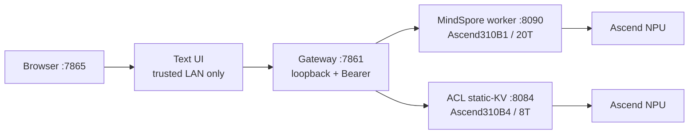

# Ascend Edge Chat

Ascend Edge Chat is a portable, extensible text-chat service for Ascend edge hardware. It exposes a bounded NPU backend through an OpenAI-compatible gateway and a browser UI.

`v0.2.0` contains two separately validated release paths. The default 20T path uses MindSpore/MindNLP with [Qwen1.5-0.5B-Chat](https://huggingface.co/Qwen/Qwen1.5-0.5B-Chat). The 8T path uses the public Qwen2.5 static-KV ONNX/B4 OM bundle with native ACL. A separate teaching catalog still exposes measured experiments whose Chinese language quality may be pending or poor.



## Support Scope

| Item | `v0.2.0` state |
| --- | --- |
| 20T release path | Ascend310B1 / 20T, CANN 8.0.0, Python 3.9.25, MindSpore 2.4.10, MindNLP 0.4.1 |
| 8T release path | Ascend310B4 / 8T, CANN 8.0.0, Python 3.9.25, native ACL, Qwen2.5-0.5B-Instruct static KV |
| Public model name | `ascend-edge-chat` |
| API | `GET /v1/models`, `POST /v1/chat/completions`, JSON, SSE |
| 8T model source | `zhouxzh/ascend310b-llm-om-zoo`, fixed revision and nine artifact hashes |
| 8T output budget | UI choices `64/80`; default `64`, maximum `80`; fixed context `1024` |
| 20T output budget | default `128`, release profile maximum `256`; fixed context `1024` |
| 8T model switching | disabled; the external ACL backend is immutable per launch |
| 20T model switching | controlled MindSpore worker restart across catalog profiles |
| Voice control | Separate experimental capability; disabled in both text release environments |

The 8T release does not inherit MindSpore results from 20T, and the 20T release does not inherit the ACL/OM runtime from 8T. Output is context-limited: `prompt_tokens + completion_tokens <= 1024`. The configured budgets are product limits, not device-memory capacities or guarantees that a model will use every token. Chinese semantic quality remains a separate review for both targets.

## 8T Static-KV Release

Use a clean checkout of the public repository at the release commit. The 8T
assets come only from Hugging Face commit
`zhouxzh/ascend310b-llm-om-zoo@0f516070e1c0566e3c652d43c488cd3cfbad89a3`;
the lock also records the original Qwen base revision and Apache-2.0 license.

```bash
cd /opt/ascend-edge-chat
source /usr/local/miniconda3/etc/profile.d/conda.sh
conda activate ascend
export PYTHONNOUSERSITE=1
source /usr/local/Ascend/ascend-toolkit/set_env.sh

cp configs/release-8t.env.example .env
# Edit .env and replace ASCEND_EDGE_CHAT_GATEWAY_API_KEY.
export ASCEND_EDGE_CHAT_ENV_FILE=/opt/ascend-edge-chat/.env

bash scripts/import/download-static-release.sh
bash scripts/verify/release-8t-preflight.sh
bash scripts/run/run-release-8t.sh
```

The downloader installs only the nine files frozen in
[`release-8t-static-kv.lock.json`](configs/release-8t-static-kv.lock.json) and
verifies their byte counts and SHA-256 values. It writes schema-2 runtime locks
inside the data directory; model binaries stay outside Git.

The fixed topology is:

```text
browser :7865 -> gateway :7861 -> ACL static-KV :8084
```

The gateway continues to expose only `ascend-edge-chat`; the internal ACL model
id is rewritten at the gateway boundary. The UI reports external worker health
from `127.0.0.1:8084/health` and refuses model switching. Stop the foreground
launcher with `Ctrl+C`; it terminates the UI, gateway, and ACL worker with a
bounded TERM/KILL sequence.

For machine acceptance from a clean public checkout:

```bash
ASCEND_EDGE_CHAT_MODEL_SOURCE=hf \
  bash scripts/verify/run-release-8t-acceptance.sh
```

The 8T acceptance path records the public Git commit, the clean working tree,
the HF revision, all artifact hashes, the unified environment, `npu-smi`, JSON
and SSE results, descriptor checks, and machine latency. It is intentionally
slower than the MindSpore path because the static graph executes one token per
ACL invocation.

The acceptance at public source commit
`c11c96eb625403a2e160792c6428f2eaa341018b` returned
`machine_status=passed`. All nine HF artifacts, gateway/UI, JSON/SSE, output
budgets 8/16/32/64, 10/10 stability requests, and 10 Chinese machine probes
passed. Across 30 two-token SSE samples, first-token latency was
`10623.506 ms` p50 / `10656.206 ms` p95, total latency was `10755.880 ms` p50 /
`10786.937 ms` p95, and throughput was `0.186 token/s`. Human Chinese semantic
quality remains pending.

## Current 20T validation

On `2026-10-18`, the running teaching profile `qwen2-0.5b-instruct-mindspore` was exercised through the browser route `:7865 -> :7861 -> :8090` on an `Ascend310B1 / 20T` board. Gateway and UI contracts, JSON, SSE, 8/16/32/64-token length checks, 10 short stability requests, and 10 Chinese probes completed. The preserved dated acceptance report remains on the board as ignored evidence; it is not a checked-in artifact. One performance sample measured 723.051 ms first token, 1370.604 ms completion, and 1.459 token/s. This is a single-sample observation, not a p50 benchmark.

On `2026-10-23`, the unified `ascend` environment repeated the technical-preview machine acceptance with Qwen1.5-0.5B-Chat. The paced client used one-second JSON and two-second SSE intervals. All machine gates passed: gateway/UI contracts, 4 length checks, SSE with `stop`, 10/10 stability requests, 10 Chinese probes, and 30 performance samples with no `U+FFFD`. First-token p50/p95 were `705.746/747.193 ms`, completion p50/p95 were `1336.014/1412.012 ms`, and throughput p50/p95 were `1.497/1.569 token/s`. The raw report is retained on the board at `run/reports/release-20261023T013704Z/acceptance.json` with SHA-256 `4a0c19f11af4b39f84a030a0a669c753753fa72f6c7a5ae0d4d68bd244c068e0`. Human Chinese semantic review remains pending.

An earlier no-interval run received HTTP 429 in the stability loop (`Too many request bodies are being read`). The subsequent spaced run passed; the 429 is a request-admission observation, not a model or NPU failure. Chinese semantic quality remains pending: one direct Chinese prompt returned an English apology, so technical completion and answer quality must be reported separately. See [validation and limitations](docs/04-validation-and-limitations.md) for the detailed evidence table.

On `2026-10-21`, the browser path also completed one synthetic-microphone ASR-to-text turn on the 20T board. `sherpa-onnx 1.13.6` and the Apache-2.0 `sherpa-onnx-streaming-zipformer-zh-14M-2023-02-23` int8 model now share the unified Python 3.9 `ascend` environment. The browser WAV upload returned HTTP 200, the recognized Chinese text reached the existing gateway, and the UI displayed the assistant's text reply. The operator then confirmed that a real browser microphone was also recognized through the same page. On `2026-10-22`, the browser path invoked `speechSynthesis` with the complete assistant reply and `zh-CN`; the automated browser test recorded the spoken text and reached the completion state. Actual speaker audibility and voice quality still require human listening review. These observations establish the technical browser ASR-to-text and browser-native TTS call paths, not recognition accuracy or board-audio behavior.

## 20T MindSpore Quick Start

On a 20T board with matching CANN, MindSpore, and MindNLP already installed, acquire this repository from GitHub at a fixed commit, then download the model from Hugging Face through the configured mirror. These commands do not install or upgrade drivers, CANN, MindSpore, or model frameworks.

```bash
git clone https://github.com/zhouxzh/Ascend310.git /opt/ascend-edge-chat
git -C /opt/ascend-edge-chat checkout --detach <commit-sha>
cd /opt/ascend-edge-chat
export ASCEND_EDGE_CHAT_CONDA_ENV='ascend'
source /usr/local/miniconda3/etc/profile.d/conda.sh
conda activate "$ASCEND_EDGE_CHAT_CONDA_ENV"
export PYTHONNOUSERSITE=1
python -m pip install --no-deps .
export ASCEND_EDGE_CHAT_DATA_DIR=/opt/ascend-edge-chat-data
cp configs/release.env.example .env
# Edit .env and replace ASCEND_EDGE_CHAT_GATEWAY_API_KEY.
# The acceptance report must identify how the locked model was acquired.
export ASCEND_EDGE_CHAT_MODEL_SOURCE=hf

# Optional only when the existing environment lacks a release Web dependency:
export ASCEND_EDGE_CHAT_WHEELHOUSE=/opt/ascend-edge-chat-wheelhouse
bash scripts/verify/install-service-dependencies.sh

# The downloader uses the locked Hugging Face repository/revision and
# defaults to https://hf-mirror.com; no local model copy is required.
bash scripts/import/download-model.sh
bash scripts/verify/release-preflight.sh
```

Start each process in a separate terminal:

```bash
bash scripts/run/start-worker.sh
bash scripts/run/start-gateway.sh
bash scripts/run/start-ui.sh
```

Open `http://<board-ip>:7865/`. The browser UI has **no login**. Every host that can reach port `7865` can submit prompts and, when voice mode is enabled, activate the allowlisted board-audio controls or read voice status through the UI proxy. Use a trusted LAN only; never expose this port to the public internet.

## Optional Voice Modes

Voice control is disabled in the release environment by default. It has two exclusive modes:

- `browser`: a secure-context browser records 16 kHz mono WAV, sends it through the UI's same-origin proxy to local ASR, and returns the assistant reply. If board TTS is configured, its finite WAV is played in the browser; otherwise the page uses browser-native `speechSynthesis` with a `zh-CN` preference. Use `http://localhost` for browser microphone testing; a remote browser needs HTTPS. The two-second self-test records and plays back entirely in browser memory and does not upload audio or require ASR/TTS.
- `board`: the loopback voice agent owns selected USB/3.5mm ALSA devices, automatic VAD, ASR, TTS, and local playback. The browser only controls mode/device selection and shows text/status.

The voice agent is a separate process but uses the same unified `ascend` environment. The tutorial UI remains unauthenticated: a reachable LAN client can read the sanitized voice status and request mode/device changes, but only IDs from the agent's enumerated allowlist are accepted. The voice agent itself remains loopback-only. It does not source CANN, does not load the text worker, and does not install/download speech models:

```bash
# After the shared ascend environment and reviewed local speech artifacts exist.
bash scripts/verify/voice-preflight.sh
bash scripts/run/start-voice-agent.sh
```

`voice-preflight.sh` stops if the unified `ascend` environment is unavailable, no capture/playback ALSA endpoints are enumerated, or the current account cannot read a capture node and write a playback node through either group membership or ACL/direct permission. ASR and TTS are independently fail-closed. The current 20T setup has a reviewed local ASR model and system-level eSpeak NG for local speech; browser voice replies can also use the browser's native TTS. See [Voice Modes and Board Terminal Plan](docs/08-board-voice-terminal-plan.md) for the mode-specific evidence gates.

## Stable Commands

```bash
ascend-edge-chat verify --data-dir /opt/ascend-edge-chat-data
ascend-edge-chat model download --data-dir /opt/ascend-edge-chat-data
ascend-edge-chat model import --data-dir /opt/ascend-edge-chat-data --source /mnt/offline/qwen
ascend-edge-chat worker
ascend-edge-chat gateway --check-config
ascend-edge-chat ui
ascend-edge-chat voice --check-config
ascend-edge-chat acl verify --data-dir /opt/ascend-edge-chat-data-8t
ascend-edge-chat acl download --data-dir /opt/ascend-edge-chat-data-8t
ascend-edge-chat acl-worker --data-dir /opt/ascend-edge-chat-data-8t
```

`app.py` and `text_chat_app.py` are short-term compatibility wrappers. New automation must use the CLI or `scripts/run/`.

## Documentation

- [Release overview](docs/00-release-overview.md)
- [20T deployment](docs/01-20t-deployment.md)
- [8T static-KV release](docs/10-8t-static-kv-release.md)
- [Quantized ONNX screening](docs/11-quantized-onnx-screening.md)
- [Model artifacts](docs/02-model-artifacts.md)
- [API and security](docs/03-api-and-security.md)
- [Validation and limitations](docs/04-validation-and-limitations.md)
- [Extension guide](docs/05-extension-guide.md)
- [Release process](docs/06-release-process.md)

Historical experiments are preserved under [docs/archive/](docs/archive/); they are not supported release features.

## Teaching model tests

The browser lists the teaching catalog from `configs/tutorial-model-catalog.json`. A
model marked `selectable` has a measured technical path and may be tested even when
its `quality_status` is `failed` or `pending`. In teaching mode, selecting a model
from the browser performs a controlled worker restart: the UI verifies the pinned
registry and local cache, stops the current worker, starts the selected profile,
waits for NPU health, and clears the browser conversation. If startup fails, it
automatically attempts to restore the previous worker. It never accepts a model
path, arbitrary command, or Python expression from the browser. The selector is
disabled while a reply is generating; after the browser receives a terminal SSE
event, the server also waits briefly for stream cleanup before switching.

```bash
# The UI can perform this controlled restart. This command remains useful for
# terminal-based recovery or a headless board.
ASCEND_EDGE_CHAT_PROFILE=qwen2-1.5b-instruct-mindspore \
  ascend-edge-chat worker --profile qwen2-1.5b-instruct-mindspore \
  --registry configs/tutorial-models.json
```

The tutorial records runtime, text-integrity and semantic-quality evidence
separately. For example, Qwen2 and Qwen2.5 profiles can pass NPU/API gates
while producing `U+FFFD`; that is a tokenizer/decoding text-integrity
observation, not evidence that the NPU cannot run them or a sufficient basis
for a Chinese semantic-quality verdict. The page sends a per-request output
budget. The normal default is `128` tokens and the verified service ceiling is
`256`; a token is not a Chinese-character count, and the context budget still
requires `prompt_tokens + max_tokens <= 1024`.

## Check Multimodal USB Audio Devices

A microphone/speaker combination may boot in Bluetooth, wireless, charging, or
playback-only mode. Before diagnosing ALSA or the application, switch the device
to its **wired USB audio** or conference mode as described by its manual, then
reconnect it directly to a USB Host port. Re-enumerate the device:

```bash
lsusb -t
arecord -l
aplay -l
```

All three layers must agree:

- `lsusb` must show a new USB Audio device, not only the Wi-Fi adapter.
- `aplay -l` must show its playback PCM before speaker testing.
- `arecord -l` must show its capture PCM before microphone testing.

A device can expose playback but no microphone. PulseAudio monitor sources are
not microphones. If `aplay -l` shows the device but `arecord -l` does not, stop
at the USB mode/endpoint layer: do not substitute the onboard capture device or
the monitor source. An audible playback test does not prove that the microphone
is available.

The EDIFIER M16 Pro observed on the 8T board illustrates this check. Before the
wired mode/reconnect sequence, the system exposed only the onboard `ascend310b`
card. It later appeared as `2d99:a020 EDIFIER M16 Pro` with ALSA `card 1, device
0`; a 48 kHz stereo test tone was audibly confirmed. Its current USB descriptor
still exposed only a playback OUT endpoint, so microphone capture was not
claimed.

## Common Faults

| Symptom | Check | Response |
| --- | --- | --- |
| Worker cannot import `acl` or MindSpore | Confirm the active Conda environment and source CANN in the same shell | Run the target-specific preflight; do not add a CPU fallback |
| Preflight cannot import FastAPI or Pydantic | Inspect the active environment with `PYTHONNOUSERSITE=1` | Install the reviewed hash-locked service closure |
| Gateway exits during startup | Verify the gateway key, backend, upstream model, and loopback port | Run `ascend-edge-chat gateway --check-config` |
| UI loads but replies fail | Check backend `:8084` or `:8090`, then gateway `:7861`, then the UI log | Keep each process in the foreground and inspect the first failing service |
| Multimodal USB microphone/speaker is absent or playback-only | Confirm the device is switched to wired USB audio/conference mode, then reconnect it directly to a Host port | Recheck `lsusb -t`, `arecord -l`, and `aplay -l`; never use onboard capture or a monitor as a substitute |
| 8T artifact verification fails | Compare bytes and SHA-256 with `configs/release-8t-static-kv.lock.json` | Remove only the rejected data-directory file and rerun `acl download` |
| 8T UI says external worker unavailable | Check `/health` on `127.0.0.1:8084` for `ready`, `healthy`, model id, descriptor flag, and launch policy | Restart the ACL worker only after the artifact/Soc gate passes |
| 20T model verification fails | Compare bytes and SHA-256 with `configs/release-model.json` | Delete only the failed artifact and re-import or re-download it |

The code is licensed under Apache-2.0. Model files retain their upstream license and are not covered by the code license.
