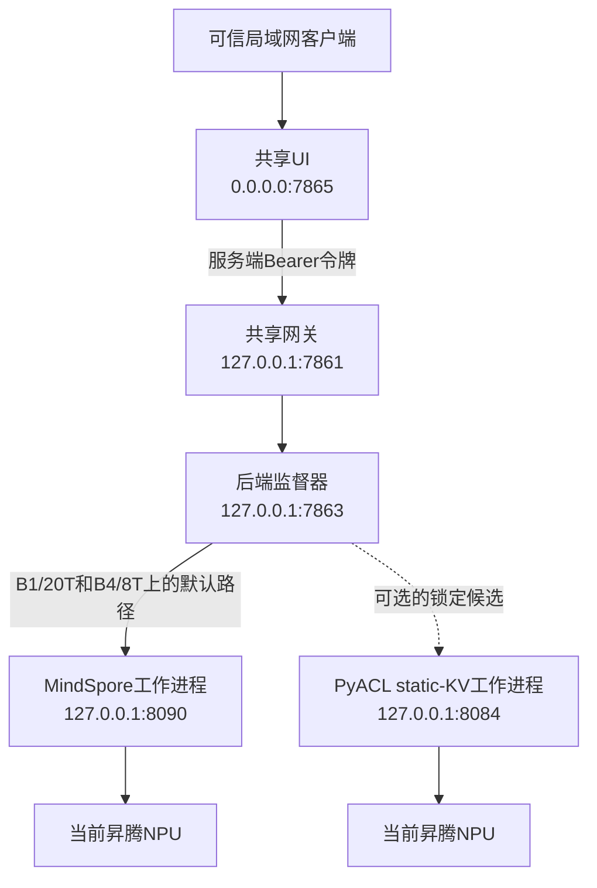

# 发布概览

## 范围

Ascend Edge Chat的`v0.2.0`版本是一个面向昇腾边缘硬件的共享文本聊天应用。两款受支持的板卡均使用相同的OpenAI兼容网关、浏览器UI、MindSpore工作进程、固定版本Qwen1.5-0.5B模型和前台启动器。板卡特定配置会选择HBM预检阈值，并分别记录证据。监督器还可将第二个、已加入允许列表的PyACL/static-KV后端作为比较选项提供；其OM、tokenizer、张量契约、精度和KV缓存路径仍与MindSpore不同。

共享MindSpore环境使用Python版本`3.9.25`、MindSpore版本`2.4.10`、MindNLP版本`0.4.1`和CANN版本`8.0.0`。Ascend310B1/20T与Ascend310B4/8T是同一配置档的独立板卡目标。8T static-KV锁和20T B1候选锁作为可选PyACL路径保留，而不是作为不同的默认聊天应用。

## 运行时架构

公开模型标识符为`ascend-edge-chat`。选定的内部工作进程标识符和端口不能通过API请求配置；网关会拒绝后端、模型和端口的交叉错配。

## 支持矩阵

| 层级 | 发布状态 | 边界 |
| --- | --- | --- |
| 浏览器文本UI | 受支持的正式发布面 | 仅限可信局域网；无浏览器登录 |
| OpenAI JSON与SSE | 受支持的正式发布面 | 有界消息、贪心解码、一次处理一个请求 |
| 共享MindSpore Qwen1.5-0.5B路径 | B1/20T和B4/8T上的机器路径为Observed-pass | 同一配置档、工作进程、网关和UI；板卡特定的HBM门禁与证据；人工中文质量审查pending |
| PyACL/static-KV比较路径 | 可选、候选锁定的后端 | 独立的OM、tokenizer、张量契约、串行化KV解码和token预算；仅当目标板卡的候选门禁通过时才能选择 |
| 教学Qwen2-0.5B配置档 | 20T上的机器/API路径为Observed-pass | 仅用于教学比较；语义质量pending |
| 教学目录 | Qwen1.5 1.8B、Qwen2/Qwen2.5、TinyLlama、DeepSeek | 存在技术证据时可选择；质量是独立字段 |
| 跨目标继承 | 不允许 | 8T和20T分别保留产物、性能和质量证据 |
| 音频与设备协议 | 可选实验能力 | 共享文本启动中禁用；在ALSA输出设备卡死问题未解决期间，20T上排除 |
| 检索增强 | 不包含 | 没有可启用该能力的发布API或运行时配置 |

## 当前20T验证

在`2026-10-18`板端运行期间，活动教学配置档为`qwen2-0.5b-instruct-mindspore`。浏览器访问路径`:7865 -> :7861 -> :8090`
完成了网关和UI契约、JSON、SSE、8至64个token的输出预算检查、十次短稳定性请求和十次中文探测。保留的带日期板端报告是部署目录中被Git忽略的证据，而不是已检入产物。

首次无间隔验收循环触发了HTTP 429，因为请求体到达速度快于服务准入边界。加入间隔后的运行通过。不要把这一客户端突发观测转写成NPU故障，也不要在部署说明中省略单请求准入限制。中文回答质量仍处于pending状态；技术机器路径和语义质量是彼此独立的结论。详细数值见
[验证与限制](04-validation-and-limitations.md)。

## 发布模型

共享MindSpore配置档由`configs/release-model.json`、其产物锁和公共`configs/release-model-catalog.json`定义。该配置档同时声明`Ascend310B1/20T`和`Ascend310B4/8T`；每块板卡的结果仍独立记录。可选PyACL候选由目标特定的`20t-backend-catalog.json`和`8t-backend-catalog.json`描述，并拥有各自的候选锁和数据目录。

浏览器绝不会提供模型路径、OM路径、命令、环境变量值、哈希或Python表达式。它只能从环回监督器的允许列表提交一个后端和模型ID。两块板卡均以MindSpore启动；选择PyACL是一条显式替代执行路径。扩展工作必须使用[扩展指南](05-extension-guide.md)中的受控配置档和提供方工作流。

## 非目标

- 不声称具备生产可用性或安全认证；
- 不同时加载多个模型，也不自动进行后端故障转移（更换教学配置档属于受控的工作进程重启）；
- 不使用CPU、云、Torch、vLLM、MindIE或其他框架回退；
- 不会仅因产物可下载就声称支持某个模型；可选项需要已测得的技术证据；
- 不在8T与20T之间作出跨目标的性能或质量断言。
