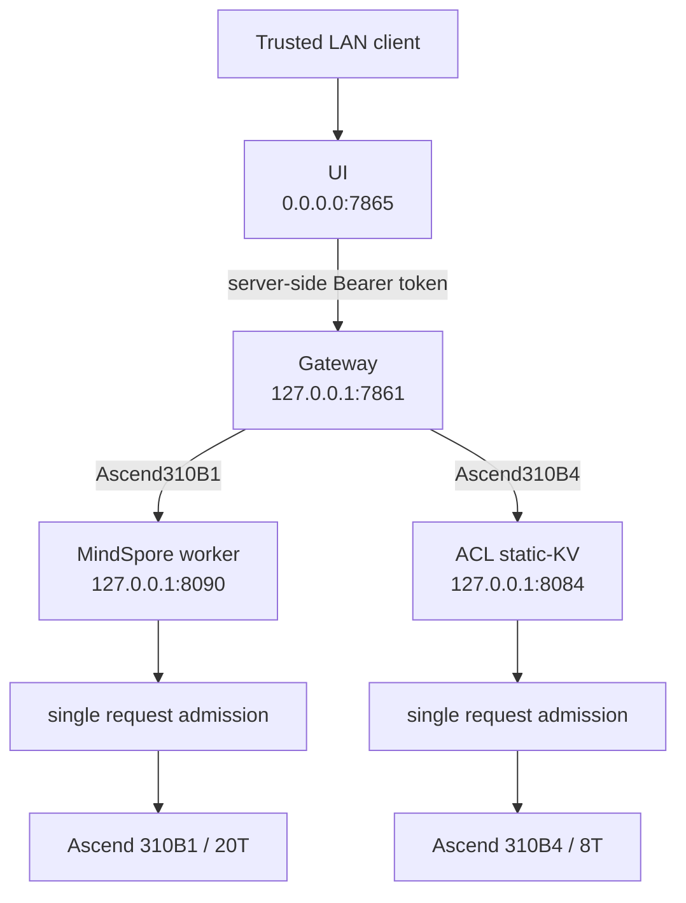

# Release Overview

## Scope

Ascend Edge Chat `v0.2.0` is a portable text-chat reference service for Ascend edge hardware. It provides an OpenAI-compatible gateway, a browser interface for a trusted local network, and two separately validated NPU backends. The teaching catalog is intentionally broader: it exposes measured technical experiments without treating language quality as a runtime gate.

The 20T release uses Ascend310B1 with Python `3.9.25`, MindSpore `2.4.10`, MindNLP `0.4.1`, and CANN `8.0.0`. The 8T release uses Ascend310B4, the same Python/CANN line, and a locked native ACL/OM static-KV backend. Neither tuple inherits the other target's runtime or quality evidence.

## Runtime Architecture

The public model identifier is `ascend-edge-chat`. The selected internal worker identifier and port are not configurable by API requests; the gateway rejects backend/model/port cross-wiring.

## Support Matrix

| Layer | Release state | Boundary |
| --- | --- | --- |
| Browser text UI | Supported formal release surface | Trusted LAN only; no browser login |
| OpenAI JSON and SSE | Supported formal release surface | Bounded messages, greedy decoding, one request at a time |
| MindSpore Qwen1.5-0.5B on 20T | Observed-pass machine path | Human Chinese-quality review remains pending; still testable |
| Qwen2.5 static KV on 8T | Formal machine acceptance passed | Public source/HF artifacts, fixed 51/49 contract, output cap 80; semantic quality pending |
| Teaching Qwen2-0.5B profile | Observed-pass machine/API path on 20T | Teaching-only comparison; semantic quality pending |
| Teaching catalog | Qwen1.5 1.8B, Qwen2/Qwen2.5, TinyLlama, DeepSeek | Selectable when technical evidence exists; quality is a separate field |
| Cross-target inheritance | Not allowed | 8T and 20T retain separate artifacts, performance, and quality evidence |
| Audio and device protocols | Out of scope for the 8T text release | Not installed or started |
| Retrieval augmentation | Not included | No release API or runtime configuration enables it |

## Current 20T Validation

The active teaching profile during the `2026-10-18` board run was
`qwen2-0.5b-instruct-mindspore`. The browser route `:7865 -> :7861 -> :8090`
completed gateway and UI contracts, JSON, SSE, output budgets from 8 through 64
tokens, ten short stability requests, and ten Chinese probes. The preserved
dated board report is ignored evidence on the deployment directory, not a
checked-in artifact.

The first unspaced acceptance loop hit HTTP 429 because request bodies arrived
faster than the service admission boundary. A spaced run passed. Do not turn
that client-burst observation into an NPU failure, and do not omit the
single-request admission limit from the deployment description. Chinese answer
quality remains pending; the technical machine path and semantic quality are
separate claims. Detailed values are in
[Validation and Limitations](04-validation-and-limitations.md).

## Release Model

The 20T runtime profile is defined in `configs/release-model.json`; its accompanying lock is `configs/release-artifacts.lock.json`. The 8T static-KV release is defined by `configs/release-8t-static-kv.lock.json` and its fixed external catalog `configs/release-8t-model-catalog.json`. Both lock their source revision, artifacts, exact bytes, SHA-256 values, runtime limits, and target SoC.

The release does not accept a model path, model revision, provider name, or Python expression from a browser or API request. On 20T the teaching selector accepts only a profile ID already present in the checked-in catalog and registry. On 8T the ACL backend is fixed and browser model switching is rejected. Extension work must use the controlled profile and provider workflow in [Extension Guide](05-extension-guide.md).

## Non-Goals

- no claim of production availability or safety certification;
- no simultaneous multi-model loading or automatic backend failover (a teaching profile change is a controlled worker restart);
- no CPU, cloud, Torch, vLLM, MindIE, or alternate-framework fallback;
- no support claim for a model merely because an artifact can be downloaded; selectable entries require measured technical evidence;
- no cross-target performance or quality assertion between 8T and 20T.
