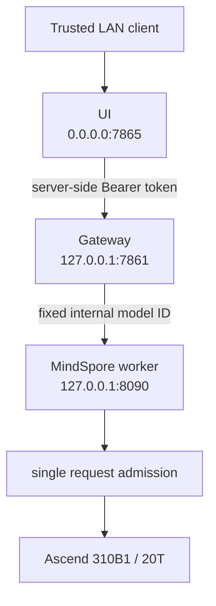

# Release Overview

## Scope

Ascend Edge Chat `v0.1.0` is a portable text-chat reference service for Ascend edge hardware. It provides one immutable default release profile, an OpenAI-compatible gateway, and a browser interface for a trusted local network. The teaching catalog is intentionally broader: it exposes measured technical experiments without treating language quality as a runtime gate.

The release target is `Ascend310B1 / 20T`. The tested runtime tuple is Python `3.9.25`, MindSpore `2.4.10`, MindNLP `0.4.1`, and CANN `8.0.0`. This tuple is an observed deployment target, not a claim that every Ascend board or runtime version behaves identically.

## Runtime Architecture

The public model identifier is `ascend-edge-chat`. The internal worker identifier is not configurable by API requests.

## Support Matrix

| Layer | Release state | Boundary |
| --- | --- | --- |
| Browser text UI | Supported technical preview | Trusted LAN only; no browser login |
| OpenAI JSON and SSE | Supported technical preview | Bounded messages, greedy decoding, one request at a time |
| MindSpore Qwen1.5-0.5B | Observed-pass on 20T | Human Chinese-quality review remains pending; still testable |
| Teaching catalog | Qwen1.5 1.8B, Qwen2/Qwen2.5, TinyLlama, DeepSeek | Selectable when technical evidence exists; quality is a separate field |
| Ascend 310B4 / 8T | Untested for this release | Does not inherit the 20T result |
| Audio and device protocols | Out of scope | Not installed or started |
| Retrieval augmentation | Not included | No release API or runtime configuration enables it |

## Release Model

The default runtime profile is defined in `configs/release-model.json`; its accompanying lock is `configs/release-artifacts.lock.json`. The profile pins the Qwen repository revision, artifact file paths, exact byte sizes, SHA-256 digests, runtime limits, and target SoC. Classroom experiments use `configs/tutorial-models.json` and are described for students in `configs/tutorial-model-catalog.json`.

The release does not accept a model path, model revision, provider name, or Python expression from a browser or API request. The teaching selector accepts only a profile ID already present in the checked-in catalog and registry. It restarts the single worker, waits for its health signal, and rolls back to the previous profile on startup failure. Extension work must use the controlled profile and provider workflow in [Extension Guide](05-extension-guide.md).

## Non-Goals

- no claim of production availability or safety certification;
- no simultaneous multi-model loading or automatic backend failover (a teaching profile change is a controlled worker restart);
- no CPU, cloud, Torch, vLLM, MindIE, or alternate-framework fallback;
- no support claim for a model merely because an artifact can be downloaded; selectable entries require measured technical evidence;
- no 8T performance or quality assertion derived from a 20T run.
