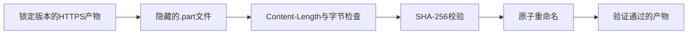

# 模型产物

## 锁定发布产物集

发布配置档存储于`configs/release-model.json`。每个产物都有不可变的仓库修订、相对文件名、字节数和SHA-256。`configs/release-artifacts.lock.json`将配置档绑定到已验证的硬件与运行时元组。

| 产物 | 必需角色 |
| --- | --- |
| `model.safetensors` | Qwen权重 |
| `tokenizer.json` | 分词器实现数据 |
| `config.json` | 模型架构配置 |
| `tokenizer_config.json` | 分词器元数据 |
| `vocab.json`、`merges.txt` | 分词器词表资源 |
| `generation_config.json` | 生成元数据 |

模型数据目录有意置于源码树之外，且必须是绝对的非符号链接路径。默认部署示例为`/opt/ascend-edge-chat-data`。

## 镜像下载

下载器接受Hugging Face镜像源，但要求发布URL源自`https://huggingface.co`。它只替换源，保留仓库、修订、路径和查询。

```bash
export ASCEND_EDGE_CHAT_DATA_DIR=/opt/ascend-edge-chat-data
ascend-edge-chat model download --data-dir "$ASCEND_EDGE_CHAT_DATA_DIR" \
  --mirror https://hf-mirror.com
```

对于每个产物，下载器都会执行以下序列：



仅当现有目标已通过两项检查时才保留。失败的临时下载会被移除，且不会修改此前已验证的目标。

## 离线导入

使用一个绝对目录，其中包含精确的锁定文件名和`offline-bundle.manifest.json`。清单必须声明`source_kind`为`offline-bundle`、发布仓库、修订和许可证，以及每个产物的名称、文件名、字节数和SHA-256：

```bash
ascend-edge-chat model import \
  --data-dir /opt/ascend-edge-chat-data \
  --source /mnt/offline/qwen1.5-0.5b
```

导入器会拒绝符号链接、声明源目录之外的路径、缺失或不匹配的来源清单字段、意外大小和错误摘要值。它通过临时文件复制，并且仅在验证后原子重命名。离线导入记录为`offline-bundle`；它不是公开Hugging Face下载的证明。

## Ascend310B4 Static-KV产物集

8T发布不使用20T safetensors配置档。它使用`configs/release-8t-static-kv.lock.json`，该文件将公开Hugging Face仓库`zhouxzh/ascend310b-llm-om-zoo`固定到修订`0f516070e1c0566e3c652d43c488cd3cfbad89a3`。该锁包含九个产物：

- static-KV ONNX；
- 分词器及分词器配置；
- 控制器/导出契约；
- Ascend310B4 CANN 8.0 OM及描述符契约；
- 上游分词器锁和schema-1 OM来源锁；
- 上游Apache-2.0许可证。

```bash
export ASCEND_EDGE_CHAT_DATA_DIR=/opt/ascend-edge-chat-data-8t
ascend-edge-chat acl download --data-dir "$ASCEND_EDGE_CHAT_DATA_DIR"
ascend-edge-chat acl verify --data-dir "$ASCEND_EDGE_CHAT_DATA_DIR"
```

下载器只接受固定的`hf-mirror.com`源。它拒绝调用方提供的URL、路径穿越、符号链接组件、错误的Content-Length、错误字节数和SHA-256不匹配。验证后，它将公开的schema-1 OM锁保留在`upstream/`下，并在B4 OM旁派生一个schema-2运行时锁。派生锁绑定目标SoC、OM哈希、ONNX哈希、控制器契约和运行时描述符契约。它绝不会覆盖不同的现有运行时锁。

基座模型为修订`7ae557604adf67be50417f59c2c2f167def9a775`上的`Qwen/Qwen2.5-0.5B-Instruct`。公开检查点字节与static-KV产物包记录的源检查点一致。OM和ONNX仍是模型产物，不得提交到Git。

## 每次启动前校验

```bash
ascend-edge-chat verify --data-dir /opt/ascend-edge-chat-data
```

该命令首先校验发布锁，然后校验每个模型文件。它会打印路径、大小和SHA-256值，但绝不会将模型复制到Git中。

## 许可证边界

代码仓库采用Apache-2.0许可证。20T Qwen1.5配置档使用[通义千问研究许可协议](https://huggingface.co/Qwen/Qwen1.5-0.5B-Chat/blob/4d14e384a4b037942bb3f3016665157c8bcb70ea/LICENSE)；其再分发和商业使用条款需要单独审查。

8T Qwen2.5基座模型采用Apache-2.0许可证。固定HF产物仓库将上游许可证保留为锁定产物。CANN、ACL、驱动、固件和板端软件仍受各自条款约束。示例代码许可证绝不会对任何模型或OM文件重新授权。
