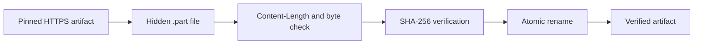

# Model Artifacts

## Locked Release Artifact Set

The release profile is stored in `configs/release-model.json`. Each artifact has an immutable repository revision, relative filename, byte count, and SHA-256. `configs/release-artifacts.lock.json` binds the profile to the validated hardware and runtime tuple.

| Artifact | Required role |
| --- | --- |
| `model.safetensors` | Qwen weights |
| `tokenizer.json` | Tokenizer implementation data |
| `config.json` | Model architecture configuration |
| `tokenizer_config.json` | Tokenizer metadata |
| `vocab.json`, `merges.txt` | Tokenizer vocabulary assets |
| `generation_config.json` | Generation metadata |

The model data directory is deliberately outside the source tree and must be an absolute non-symlink path. The default deployment example is `/opt/ascend-edge-chat-data`.

## Mirror Download

The downloader accepts a Hugging Face mirror origin but requires release URLs to originate from `https://huggingface.co`. It replaces only the origin, preserving the repository, revision, path, and query.

```bash
export ASCEND_EDGE_CHAT_DATA_DIR=/opt/ascend-edge-chat-data
ascend-edge-chat model download --data-dir "$ASCEND_EDGE_CHAT_DATA_DIR" \
  --mirror https://hf-mirror.com
```

For every artifact, the downloader performs this sequence:



An existing target is retained only when it already passes both checks. A failed temporary download is removed without modifying a previously verified target.

## Offline Import

Use an absolute directory containing the exact locked filenames:

```bash
ascend-edge-chat model import \
  --data-dir /opt/ascend-edge-chat-data \
  --source /mnt/offline/qwen1.5-0.5b
```

The importer rejects symlinks, paths outside the declared source directory, unexpected sizes, and bad digests. It copies through a temporary file and atomically renames only after verification.

## Verify Before Every Start

```bash
ascend-edge-chat verify --data-dir /opt/ascend-edge-chat-data
```

The command verifies the release lock first, then every model file. It prints paths, sizes, and SHA-256 values but never copies a model into Git.

## License Boundary

The code repository is Apache-2.0. The locked Qwen revision uses the [Tongyi Qianwen Research License Agreement](https://huggingface.co/Qwen/Qwen1.5-0.5B-Chat/blob/4d14e384a4b037942bb3f3016665157c8bcb70ea/LICENSE). It permits the covered materials for non-commercial purposes; commercial use requires a separate license from Alibaba Cloud. Preserve the upstream license and attribution requirements with any model redistribution. The code license does not grant rights to the model files.
