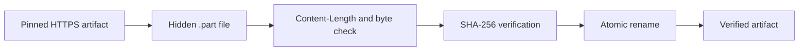

# Model Artifacts

## Locked Release Artifact Set

The release profile is stored in `configs/release-model.json`. Each artifact has an immutable repository revision, relative filename, byte count, and SHA-256. `configs/release-artifacts.lock.json` binds the profile to the validated hardware and runtime tuple.

| Artifact | Required role |
| --- | --- |
| `model.safetensors` | Qwen weights |
| `tokenizer.json` | Tokenizer implementation data |
| `config.json` | Model architecture configuration |
| `tokenizer_config.json` | Tokenizer metadata |
| `vocab.json`, `merges.txt` | Tokenizer vocabulary assets |
| `generation_config.json` | Generation metadata |

The model data directory is deliberately outside the source tree and must be an absolute non-symlink path. The default deployment example is `/opt/ascend-edge-chat-data`.

## Mirror Download

The downloader accepts a Hugging Face mirror origin but requires release URLs to originate from `https://huggingface.co`. It replaces only the origin, preserving the repository, revision, path, and query.

```bash
export ASCEND_EDGE_CHAT_DATA_DIR=/opt/ascend-edge-chat-data
ascend-edge-chat model download --data-dir "$ASCEND_EDGE_CHAT_DATA_DIR" \
  --mirror https://hf-mirror.com
```

For every artifact, the downloader performs this sequence:



An existing target is retained only when it already passes both checks. A failed temporary download is removed without modifying a previously verified target.

## Offline Import

Use an absolute directory containing the exact locked filenames and an
`offline-bundle.manifest.json`. The manifest must declare `source_kind` as
`offline-bundle`, the release repository/revision/license, and every artifact's
name, filename, byte count, and SHA-256:

```bash
ascend-edge-chat model import \
  --data-dir /opt/ascend-edge-chat-data \
  --source /mnt/offline/qwen1.5-0.5b
```

The importer rejects symlinks, paths outside the declared source directory,
missing or mismatched provenance manifest fields, unexpected sizes, and bad
digests. It copies through a temporary file and atomically renames only after
verification. An offline import is recorded as `offline-bundle`; it is not
proof of a public Hugging Face download.

## Ascend310B4 Static-KV Artifact Set

The 8T release does not use the 20T safetensors profile. It uses
`configs/release-8t-static-kv.lock.json`, which pins public Hugging Face
repository `zhouxzh/ascend310b-llm-om-zoo` at revision
`0f516070e1c0566e3c652d43c488cd3cfbad89a3`. The lock contains nine artifacts:

- static-KV ONNX;
- tokenizer and tokenizer configuration;
- controller/export contract;
- Ascend310B4 CANN 8.0 OM and descriptor contract;
- upstream tokenizer lock and schema-1 OM provenance lock;
- upstream Apache-2.0 license.

```bash
export ASCEND_EDGE_CHAT_DATA_DIR=/opt/ascend-edge-chat-data-8t
ascend-edge-chat acl download --data-dir "$ASCEND_EDGE_CHAT_DATA_DIR"
ascend-edge-chat acl verify --data-dir "$ASCEND_EDGE_CHAT_DATA_DIR"
```

The downloader accepts only the fixed `hf-mirror.com` origin. It rejects
caller-supplied URLs, path traversal, symlink components, bad Content-Length,
bad byte counts, and SHA-256 mismatches. After verification it keeps the public
schema-1 OM lock under `upstream/` and derives a schema-2 runtime lock alongside
the B4 OM. The derived lock binds the target SoC, OM hash, ONNX hash,
controller contract, and runtime descriptor contract. It never overwrites a
different existing runtime lock.

The base model is `Qwen/Qwen2.5-0.5B-Instruct` at revision
`7ae557604adf67be50417f59c2c2f167def9a775`. The public checkpoint bytes match
the source checkpoint recorded by the static-KV artifact bundle. The OM and
ONNX remain model artifacts and must not be committed to Git.

## Verify Before Every Start

```bash
ascend-edge-chat verify --data-dir /opt/ascend-edge-chat-data
```

The command verifies the release lock first, then every model file. It prints paths, sizes, and SHA-256 values but never copies a model into Git.

## License Boundary

The code repository is Apache-2.0. The 20T Qwen1.5 profile uses the [Tongyi Qianwen Research License Agreement](https://huggingface.co/Qwen/Qwen1.5-0.5B-Chat/blob/4d14e384a4b037942bb3f3016665157c8bcb70ea/LICENSE); its redistribution and commercial-use terms require separate review.

The 8T Qwen2.5 base model is Apache-2.0. The fixed HF artifact repository preserves the upstream license as a locked artifact. CANN, ACL, driver, firmware, and board software remain under their own terms. The sample code license never relicenses any model or OM file.
