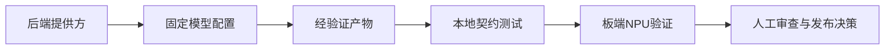

# 扩展指南

## 扩展边界

Ascend Edge Chat发布一个不可变的默认发布配置和一套独立的教学目录。第二个模型必须先通过源码、固定配置、经验证产物、测试覆盖和独立的板端验证报告引入。一旦观测到其技术路径，即使语言质量结果为失败或待定，也可以在教学选择器中公开该模型。在浏览器中选择该模型会对单个NPU worker执行受控停止/启动；这不是进程内模型替换，也不是并发模型替换。

## 后端提供方契约

为新后端实现`ascend_edge_chat.backends.protocol.BackendProvider`。提供方必须公开：

| 成员 | 要求 |
| --- | --- |
| `start()` | 加载经过预验证的本地产物并创建其设备上下文 |
| `healthy` | 报告提供方是否可以接受另一个请求 |
| `status()` | 返回不含密钥的健康与环境元数据 |
| `stream(messages, max_tokens)` | 针对一次贪婪解码请求产出累计文本及token数 |
| `close()` | 确定性地释放设备和模型资源 |

发布worker负责准入、请求串行化、HTTP校验、超时处理、SSE增量计算和fail-closed清理。提供方不得绑定公网端口、读取客户端选择的路径，也不得静默选择CPU/云端回退。

## 配置与产物要求

仅在新的发布分支中创建新的发布配置。该配置必须包含：

- 上游仓库和不可变revision；
- 模型、tokenizer和配置文件名；
- 确切的文件字节大小和SHA-256值；
- 上游许可证状态和分发边界；
- 架构、tokenizer/chat-template行为、贪婪生成限制和上下文预算；
- 目标SoC和完整的运行时指纹；
- 每个目标SoC的显式状态证据。

将`release-model.json`作为结构参考，但不要向已发布的`v0.1.0`配置添加多个配置项。教学配置属于`configs/tutorial-models.json`，可由受控教学选择器启动，也可通过`--profile`显式启动。产物获取实现会拒绝包含多个配置项的发布配置；教学启动器则执行最小本地缓存预检，并保留彼此独立的产物报告。

## 新提供方所需测试

至少为以下各项添加本地测试：

1. 配置与产物锁校验；
2. worker的JSON和SSE请求契约；
3. 服务端重写内部模型标识符；
4. 角色、模型标识符、采样参数、请求体限制和超时的格式错误；
5. 不暴露gateway secret的浏览器UI行为；
6. 加载、生成和失败路径后的提供方资源清理。

随后在每个预期SoC上运行[验证与限制](04-validation-and-limitations.md)中列出的板端门禁。模型成功加载并不能证明NPU生成、回答质量、稳定性或性能达标。

## 晋升规则

将实验性配置保留在不可变发布锁之外。只要已有技术证据，它们就可以在教学目录中对浏览器可见，并在旁边显示其质量结果和失败原因。只有审查者接受确切的产物身份、硬件/运行时组合、API测试证据、稳定性数据、按协议测得的性能以及人工语言质量审查后，模型才能晋升为正式发布版本。
