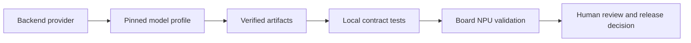

# Extension Guide

## Extension Boundary

Ascend Edge Chat ships one immutable default release profile and a separate
teaching catalog. A second model is not a hot browser switch: it must be
introduced through source code, a pinned profile, verified artifacts, test
coverage, and an independent board validation report. Once its technical path
has been observed, it may be exposed in the teaching selector even when its
language-quality result is failed or pending.

## Backend Provider Contract

Implement `ascend_edge_chat.backends.protocol.BackendProvider` for a new backend. The provider must expose:

| Member | Requirement |
| --- | --- |
| `start()` | Load a prevalidated local artifact and create its device context |
| `healthy` | Report whether the provider may accept another request |
| `status()` | Return non-secret health and environment metadata |
| `stream(messages, max_tokens)` | Yield cumulative text plus token count for one greedy request |
| `close()` | Release device and model resources deterministically |

The release worker owns admission, request serialization, HTTP validation, timeout handling, SSE delta calculation, and fail-closed cleanup. A provider must not bind a public port, read client-selected paths, or silently choose a CPU/cloud fallback.

## Profile and Artifact Requirements

Create a new release profile only in a new release branch. It must include:

- upstream repository and immutable revision;
- model, tokenizer, and configuration filenames;
- exact file byte sizes and SHA-256 values;
- upstream license status and distribution boundary;
- architecture, tokenizer/chat-template behavior, greedy generation limits, and context budget;
- target SoC and complete runtime fingerprint;
- explicit status evidence for each target SoC.

Use `release-model.json` as a structural reference, but do not add multiple
profiles to the released `v0.1.0` configuration. Classroom profiles belong in
`configs/tutorial-models.json` and are started explicitly with `--profile`.
The artifact acquisition implementation rejects a release configuration
containing more than one profile; the tutorial launcher instead performs a
minimum local-cache preflight and preserves the separate artifact reports.

## Tests Required for a New Provider

At minimum, add local tests for:

1. profile and artifact lock validation;
2. worker JSON and SSE request contracts;
3. server-side rewrite of internal model identifiers;
4. malformed roles, model identifiers, sampling parameters, body limits, and timeouts;
5. browser UI behavior without exposing the gateway secret;
6. provider resource cleanup after a load, generation, and failure path.

Then run the board gates listed in [Validation and Limitations](04-validation-and-limitations.md) on every intended SoC. A successful model load is not evidence of NPU generation, response quality, stability, or performance.

## Promotion Rule

Keep experimental profiles outside the immutable release lock. They may be
browser-visible in the teaching catalog when technical evidence exists, with
their quality result and failure cause shown beside them. Promote a model to a
formal release only after a reviewer accepts the exact artifact identity,
hardware/runtime tuple, API test evidence, stability data, measured
performance protocol, and human language-quality review.
