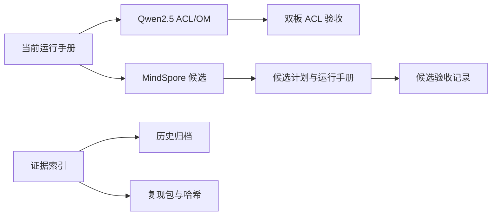

# Case9 文档索引

_案例 9 的运行手册、模型验收记录和历史证据入口。先读当前入口，再按模型路线查阅证据。_

---

## 📍 当前入口

| 文档 | 用途 |
| --- | --- |
| [00-case9-current-runbook.md](00-case9-current-runbook.md) | 当前板卡、端口、启动和回滚 |
| [01-qwen25-dual-board-validation.md](01-qwen25-dual-board-validation.md) | Qwen2.5 ACL/OM 双板门禁 |
| [02-qwen25-reproducibility-and-sync.md](02-qwen25-reproducibility-and-sync.md) | 模型工件、哈希和换板同步 |
| [03-case9-history-and-boundaries.md](03-case9-history-and-boundaries.md) | 历史路线、暂停范围和证据边界 |
| [12-case9-evidence-index.md](12-case9-evidence-index.md) | 全部报告和复现包索引 |

## 🧠 当前模型路线

| 路线 | 入口文档 | 运行状态 |
| --- | --- | --- |
| 正式候选基线 | [00-case9-current-runbook.md](00-case9-current-runbook.md) | Qwen2.5 静态 KV ACL，正式端口保持独立 |
| MindSpore 候选 | [25-chat-model-profile-runbook.md](25-chat-model-profile-runbook.md) | 单 worker、实验性、不可自动替换正式入口 |
| 本地音频 | [03-case9-history-and-boundaries.md](03-case9-history-and-boundaries.md) | ASR/TTS 和 XiaoZhi 暂停 |

## 📊 MindSpore 证据

- [23-mindspore-chat-porting-plan.md](23-mindspore-chat-porting-plan.md)：适配范围和服务契约
- [24-mindspore-chat-validation-record.md](24-mindspore-chat-validation-record.md)：首批候选验收
- [25-chat-model-profile-runbook.md](25-chat-model-profile-runbook.md)：模型切换与回滚
- [31-mindspore-llm-candidate-inventory.md](31-mindspore-llm-candidate-inventory.md)：候选清单
- [32-mindspore-llm-candidate-validation-plan.md](32-mindspore-llm-candidate-validation-plan.md)：统一验收计划
- [33-mindspore-llm-candidate-validation-record.md](33-mindspore-llm-candidate-validation-record.md)：持续账本
- [50-current-model-acceptance-20261015.md](50-current-model-acceptance-20261015.md)：当前 20T 模型判定
- [51-mindspore-20t-complete-acceptance-20261016.md](51-mindspore-20t-complete-acceptance-20261016.md)：20T 完整验收
- [52-mindspore-candidate-recheck-20261016.md](52-mindspore-candidate-recheck-20261016.md)：候选复核
- [54-mindspore-watchdog-timeout-analysis-20261016.md](54-mindspore-watchdog-timeout-analysis-20261016.md)：超时根因
- [56-mindspore-20t-isolated-rerun-20261016.md](56-mindspore-20t-isolated-rerun-20261016.md)：超时修正复测

## 🗄️ 历史和复现

编号 `26` 至 `49` 的文件是按模型或硬件批次保存的历史证据，不能当作当前服务状态。重构前的旧文档原文集中在 [`archive/20260827/`](archive/20260827/README.md)。已停用的本地音频、TinyLlama ACL、旧 ACL 和小智部署代码已从当前源码移除，保留的历史结论可由归档文档和 Git 历史追溯。本地权重、OM、日志、板端快照和报告仍由 `.gitignore` 排除，不进入 Git。

## 🧰 维护规则

- 新的当前结论只更新当前入口文档和对应验收记录，不在 README、模型注册表和多个报告中重复改写同一数字
- 历史失败、旧 IP 和旧工件只追加到验收记录或归档，不删除原始证据
- 代码入口以根目录 Python 模块和 `scripts/` 启动器为准；`__pycache__`、临时 `.part` 和运行日志均可删除并重新生成
- 任何“可用”结论必须同时绑定模型哈希、SoC、CANN、运行环境和实际 NPU 证据
