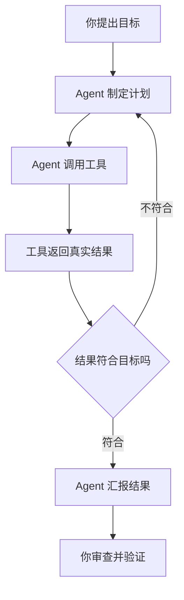
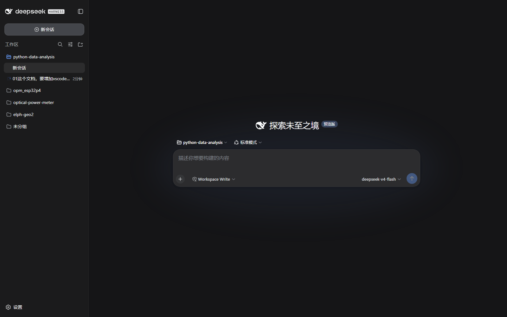
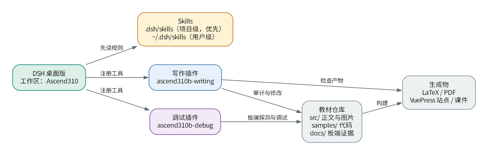
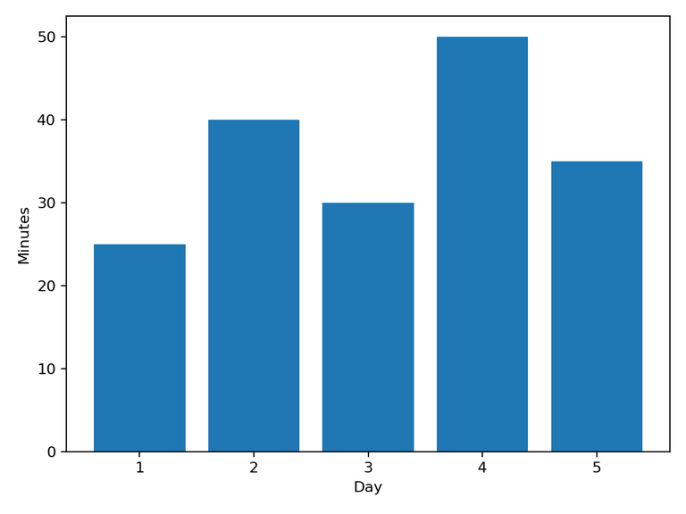

# 附录 4：Vibe Coding

> **本章导读**
> 目标：掌握 Vibe Coding 的基本流程，用 DSH 生成、运行并审查小型本地程序。
> 环境：昇腾 310B 自带 Anaconda，本附录不安装 Python 环境。
> 数据：脚本内置的 5 天学习时长数组，不依赖 case、模型或数据集。
> 输出：个人临时学习目录中的 `study_minutes.py` 与 `study_minutes.png`

Vibe Coding 是用自然语言描述目标，由 AI Agent 写代码并运行，人负责审查和验证。DSH 是这套流程中的执行环境，DeepSeek 负责理解任务和生成方案。本附录只讲基础流程，不要求提前掌握完整 Python 语法。

## Vibe Coding 是什么

Vibe Coding 的基本流程是：人负责目标、边界和结果，Agent 负责代码生成、运行和修改。它的完整循环是：

```text
定义问题 → 要求最小版本 → 运行 → 反馈真实结果 → 追问 → 验证
```

每一步都有明确负责人：

| 工作 | 谁负责 | 检查重点 |
|---|---|---|
| 描述目标 | 你 | 要读什么、做什么、输出到哪里 |
| 制定计划 | Agent | 计划是否只动指定文件 |
| 生成代码 | Agent | 代码是否使用允许的工具和依赖 |
| 运行代码 | Agent | 是否先展示命令，再执行 |
| 解释代码 | Agent | 每一行是否都能讲清楚 |
| 审查结果 | 你 | 输出是否来自真实文件，结论能否复现 |
| 验证安全 | 你 | 是否修改了不该改的文件，是否泄露 Key |

Vibe Coding 适合探索代码、生成初稿、解释报错和快速迭代。它不适合在完全看不懂代码、不了解文件边界或没有验证方法时直接信任结果。

参考教程：

- [datawhalechina/easy-vibe](https://github.com/datawhalechina/easy-vibe)：从零开始学 AI 编程，用“先看示例 + 自己动手做”组织课程。
- [datawhalechina/vibe-vibe](https://github.com/datawhalechina/vibe-vibe)：系统化的 Vibe Coding 教程，强调从“写代码”转向“对话式创作”。

## Agent 与 DSH 基础

AI Agent 不是普通的聊天机器人。聊天机器人只负责生成回答，Agent 还可以读取文件、运行命令、修改代码和搜索网页。DSH（DeepSeek Harness）是一个能执行这些操作的 Agent 工作环境。

一个 Agent 通常由四部分组成：

| 组成部分 | 作用 | DSH 中的例子 |
|---|---|---|
| 大模型 | 理解任务，生成计划和代码 | DeepSeek 大模型 |
| 工具 | 执行文件、命令和网络操作 | 读写文件、运行命令、搜索网页 |
| 记忆 | 记录目标和上下文 | 当前会话、长期目标 |
| 工作区 | Agent 的活动范围 | 当前仓库根目录 |

常见 Agent 可以按权限从低到高分类：

| Agent | 类型 | 是否直接操作本地文件 | 适合用途 |
|---|---|---|---|
| ChatGPT | 网页/App 助手 | 通常不会 | 问答、写作、代码解释 |
| AI IDE | 代码编辑器 | 会，但通常在打开的项目内 | 代码补全、修改当前项目 |
| DSH | 本地 Agent | 会，可以运行命令 | 读取文件、生成脚本、执行验证 |

DSH 的工作方式是一个循环：理解目标，制定计划，调用工具，看到结果，再调整计划。下面是一个简化的流程：



本教程使用 DeepSeek + DSH，因为 DeepSeek 的中文理解、代码和推理表现适合课程任务，DSH 提供了计划模式、工具调用和安全确认机制。模型 API 成本会随厂商调整，实际以官网为准。

参考资料：

- [Hannibal046/Awesome-LLM](https://github.com/Hannibal046/Awesome-LLM)：持续更新的大语言模型论文、工具和教程清单。
- [WangRongsheng/awesome-LLM-resources](https://github.com/WangRongsheng/awesome-LLM-resources)：中文友好的 LLM、Agent、多模态与训练推理资料汇总。
- [luban-agi/Awesome-AIGC-Tutorials](https://github.com/luban-agi/Awesome-AIGC-Tutorials)：面向入门学习的 LLM 和 AIGC 教程合集。
- [e2b-dev/awesome-ai-agents](https://github.com/e2b-dev/awesome-ai-agents)：AI Agent 框架、论文、工具和项目清单。
- [luo-junyu/Awesome-Agent-Papers](https://github.com/luo-junyu/Awesome-Agent-Papers)：以论文为主的 LLM Agent 综述和进展。
- [Shubhamsaboo/awesome-llm-apps](https://github.com/Shubhamsaboo/awesome-llm-apps)：Agent、RAG 和应用案例合集。

## DSH 桌面版安装与插件配置

### 为什么统一用桌面版

本课程统一使用 **DSH 桌面版**（DeepSeek Harness Desktop）。它是带图形界面的安装包，模型、工作区、插件和 Skill 都在界面里配置，不需要学生先装 Node.js，也不需要记命令行参数。

| 方式 | 学生需要准备 | 常见问题 | 课程是否采用 |
| --- | --- | --- | --- |
| **DSH 桌面版** | 下载安装包，双击安装 | 几乎没有环境依赖 | **采用** |
| `npx` / `npm` 安装 | Node.js、npm、网络代理、PATH | 版本冲突、命令找不到、公司网络装不上 | **不再介绍** |
| 源码运行 | Git、Node、pnpm、构建工具 | 步骤多，出错点分散 | 仅插件开发者使用 |

> **不要再用 `npx` 安装 DSH。** 课堂上出现的“命令找不到”“装完打不开”“版本和老师不一样”，绝大多数都来自这一步。桌面版已经把运行时打包好了。

### 安装桌面版

1. 从课程提供的官方安装包获取 Windows x64 版本，文件名类似 `DeepSeek Harness Setup <版本>.exe`；也可以从官方仓库了解版本与文档：<https://github.com/deepseek-ai/deepseek-harness>。
2. 双击安装包，按默认选项安装到当前用户目录。若 Windows 弹出 SmartScreen，先确认安装包来自课程或官方渠道，再选择“更多信息，再选择“仍要运行””。
3. 安装完成后从开始菜单启动 **DeepSeek Harness**。首次启动会自动创建用户配置目录 `%USERPROFILE%\.dsh`。
4. 打开 `设置中的“关于”`，确认版本号。本教材验证的版本是 **0.2.1-rc.2**；版本不同不影响本附录的界面操作，但插件工具名以实际安装为准。
5. macOS 学生使用课程提供的 macOS 安装包，步骤相同：拖入“应用程序”、首次打开允许、确认版本。

安装完成后**不需要**再执行 `npm install`、`npx` 或 `pnpm`。如果终端里还在跟着旧教程敲这些命令，直接跳过。

### 配置模型与工作区

DSH 需要两样配置才能开始工作：模型 API Key 和工作区。

1. 到 DeepSeek 开放平台申请 API Key：<https://platform.deepseek.com/>。
2. 在 DSH 中点开 `设置中的“模型”`，粘贴 API Key 并保存。
3. 回到主界面，点击工作区选择器，选择本仓库根目录：

```text
开发机：选择自己克隆的教材仓库根目录
昇腾 310B 板端：选择教师指定的课程工作区
```

4. 新建一个会话，先问一句：

```text
请告诉我当前工作区路径，以及你加载了哪些 skill。
```

只有回答的路径是本仓库，才继续后面的任务。



API Key 只保存在本地设置里，不要写进教程、代码、聊天内容或 GitHub。

### 安装写作插件与调试插件

本仓库自带两个 DSH 插件，源码分别在：

```text
tools/dsh-plugin-ascend310b-writing/   写作插件
tools/dsh-plugin-ascend310b-debug/     程序调试插件
```

课程镜像已预装两个插件时，只需确认它们在侧栏可见，并在升级后重启 DSH。需要从本仓库更新插件的开发者，在仓库根目录执行下面的安装器；它会把插件打成带内容哈希的 tarball 安装到指定 profile，而不是把源码目录软链进 DSH：

```powershell
node tools/install-dsh-plugins.mjs --profile desktop
node tools/install-dsh-plugins.mjs --profile desktop --check
```

安装器完成后重启 DSH。板卡 IP、SSH 用户、串口密码和默认 target 只保存在本机 profile 配置中，不写入插件源码、教材正文或 Git。插件注册的是工具（tools），模型通过调用工具完成检查；它们和 Skill 是两层东西，下一节会说明。



**写作插件 `ascend310b-writing`** 管的是“教材有没有写对”：

| 工具 | 作用 |
| --- | --- |
| `ascend310b_writing_audit` | 审 Markdown、命名、锚点、链接、图片、标点、PDF 章节表、网页产物 |
| `ascend310b_writing_render` | 读 LaTeX 日志：缺字形、未定义引用、版面溢出、产物是否过期 |
| `ascend310b_writing_push_check` | 推送前门槛：审计、提交内链接、产物新鲜度、预览确认 |
| `ascend310b_writing_style` | 找出营销腔、空话、元话语、对话残留 |
| `ascend310b_writing_progress` | 章节字数、图、代码块、阅读时长、sidebar 覆盖 |
| `ascend310b_writing_build` | 用仓库自己的转换器出 LaTeX/PDF 与站点 |
| `ascend310b_writing_toolchain` | 检查 pandoc、latexmk、xelatex、pnpm 等构建工具 |

**调试插件 `ascend310b-debug`** 管的是“程序在板端为什么不对”。当前版本把发现、身份、环境、外设、执行和证据记录放在同一个工作台中，但每一项结论仍必须来自相应层次的真实输出。

| 分组 | 工具 | 解决的问题 |
| --- | --- | --- |
| 发现与身份 | `ascend_discover`、`ascend_serial_probe`、`ascend_serial_exec` | 扫描当前私有网段；SSH 不可用时由串口读取主机名、IP、MAC 和路由；记录一块板的稳定网口 MAC 别名 |
| 环境与版本 | `ascend_probe`、`ascend_check` | 采集 SoC、NPU 状态、CANN、驱动、Python、PyACL、设备节点和内核模块；将实际组合与仓库记录的配套关系分开判定 |
| 分层定位 | `ascend_debug_plan`、`ascend_sample_index`、`ascend_board_exec` | 将错误映射到 ACL、ATC、OM、DVPP、摄像头、框架、服务、性能或量化层；查找对应样例；执行一条白名单内的只读命令 |
| 摄像头与音频 | `ascend_camera_capture`、`ascend_microphone_record`、`ascend_speaker_test`、`ascend_play_recording` | 枚举并实测 V4L2、麦克风和扬声器；返回实际尺寸、格式、WAV 波形或播放路由，而不是只看设备名 |
| 受控执行 | `ascend_board_run`、`ascend_apt_install`、`ascend_model_download`、`ascend_ui_capture` | 在明确确认后下载、转换、运行样例、安装允许的软件包或采集前端截图；会写文件或运行代码的动作必须显式声明 `allowStateChange: true` |

### 当前调试工作台 {#src-appendix-appendix4-debug-workbench}

打开“昇腾310B调试”后，右侧工作台包含七个页签。它们不是七套独立工具，而是围绕同一块逻辑开发板逐步补充证据：

| 页签 | 当前内容 | 什么时候使用 |
| --- | --- | --- |
| 概览 | SoC、档位、健康/温度、NPU 内存、CANN、驱动和分类更新时间 | 第一次判断这块板是谁、上次数据来自何时 |
| 摄像头 | 设备名称、`/dev/videoN`、能力、FourCC、分辨率、FPS 与单帧预览 | 设备插拔后更新摄像头信息；需要真实帧时再采集 |
| 音频接口 | ALSA、PulseAudio/PipeWire、蓝牙、麦克风录音、扬声器测试和录音回放 | 声卡能枚举不等于可录可放，应分别做实测 |
| 串口记录 | COM/tty、阶段时间线、SSH 验证结果和脱敏 transcript | SSH 找不到板、串口占用、登录超时或网络恢复失败时 |
| 开发板记录 | 逻辑板卡 ID、稳定 MAC 别名、IP、软件变化和显式绑定 | 多块同名板、DHCP 变化或历史记录需要分辨时 |
| 调试 | 症状、分层计划、匹配样例和案例依赖 | 已有错误文本，需要决定下一条最小检查时 |
| 原始输出 | 保存的 facts、版本组合与原始探测节选 | 需要核对模型结论是否真的由板端输出支持时 |

面板启动时读取最近一次保存的设备信息，**不会**自动执行完整探测。顶栏三个按钮也有不同含义：

- “检查在线”只检查 SSH 端口是否可达；绿色只表示本次 SSH 可达，不表示 CANN、PyACL、摄像头或推理已经通过；
- “串口发现”从本机 COM/tty 登录，读取网络信息并尝试恢复 SSH 定位；串口可达、SSH 可达和 NPU 可用是三个不同结论；
- “局域网扫描”只扫描当前私有网络范围，通过板端 MAC 和 SoC 确认身份，不把开放 22 端口的任意主机当成 310B。

开发板按稳定物理网口 MAC 归档，不按 hostname 或临时 IP 归档。两块出厂主机名相同的板仍应是不同记录；同一块板换 DHCP 地址或切换有线/无线网络后，只有在观察到已知 MAC 别名时才归并。8T 与 20T 的环境、性能和精度证据必须分开保存。

### 从“在线”到“可解释结论” {#src-appendix-appendix4-debug-order}

遇到板端问题时，按下面顺序缩小范围。每一步只回答一个问题，避免一上来执行长时间整板探测：

1. 点击“检查在线”。若 SSH 不可达，先检查电源、网线或 SSID；不要将离线写成硬件不支持。
2. 没有已知地址时使用“串口发现”；没有串口时再使用“局域网扫描”。确认面板中的 MAC、IP 和逻辑板卡 ID 是否对应目标设备。
3. 进入概览，点击“更新系统信息”，再用 `ascend_check` 判断 SoC、驱动和 CANN 的证据状态。版本配套完整不等于业务推理已经通过。
4. 设备问题只更新相应类别：摄像头使用“更新摄像头信息”，音频使用“更新音频接口信息”。这样不会用旧外设数据伪装为刚刷新。
5. 需要硬件证据时再执行一次明确的外设动作：摄像头必须取得非空帧；麦克风必须生成非空 PCM；扬声器播放命令完成后仍需人工确认是否听到。
6. 有错误文本时转到调试页，或请求 `ascend_debug_plan`。先满足当前层的停止条件，再进入 ATC、OM 加载、服务、精度或性能层。
7. 需要执行下载、ATC、测试或脚本时，先使用 `dryRun` 检查目标与命令；只有确认写入范围后才传 `allowStateChange: true`。

### 用“串口记录”定位连接失败 {#src-appendix-appendix4-serial-records}

开发板没有出现在 SSH 列表中时，不要反复猜 IP。先运行“串口发现”，再打开“串口记录”。每条记录列出会话时间、COM/tty、结论、耗时、hostname、IP、MAC 和阶段时间线；详情页保存已经脱敏的串口文本。

记录停在不同位置，表示故障层次不同：

- “打开端口”失败，通常是 PuTTY、串口监视器等程序占用了 COM，或当前用户没有权限；
- “等待登录提示”“登录认证”或“确认用户身份”失败，应检查串口线、115200 8N1、端口选择和 `HwHiAiUser` 凭据；
- “读取网络信息”完成而“验证 SSH”失败，说明串口链路正常，仍需检查网段、22 端口、`sshd` 和公钥认证；
- 会话显示“已取消”，只说明本机取消了辅助进程，不等于开发板故障；
- 会话显示 partial，通常表示串口已取得设备信息，但 SSH 身份验证尚未形成可执行 target。

记录默认只保存在 DSH 本机数据目录中。密码、token、key、私钥文本和终端控制字符会被替换；hostname、IP、MAC、COM 口仍属于设备环境信息。单条 transcript 最多保留 64 KiB；默认最多 50 条、30 天、合计 20 MiB。清理记录只删除本机诊断历史，不会修改串口、网络或开发板。不要把完整记录提交到 GitHub 或直接粘贴到公开问题单。

### 给 Agent 的调试提示词 {#src-appendix-appendix4-debug-prompts}

Vibe Coding 不应把“帮我修好开发板”交给 Agent 直接执行。提示词要限定目标、证据、动作和停止条件。例如：

```text
只检查当前选择的昇腾 310B 是否 SSH 在线，不执行完整探测，也不要修改开发板。
如果离线，说明下一步应使用串口发现还是局域网扫描。
```

```text
读取最新一条串口记录。告诉我它停在打开端口、登录、身份确认、网络信息还是 SSH 验证；
只引用脱敏 transcript 中必要的几行，不要清理任何记录，也不要执行写入操作。
```

```text
更新当前板的摄像头信息，列出每个可采集节点的设备名、FourCC、分辨率和 FPS。
不要采集图像；如果需要实测帧，先说明将写入哪个固定目录并等待确认。
```

写作插件产出“可交付的教材”，调试插件产出“可复核的板端证据”，两者共用同一个仓库，但**证据边界不同**：教材通过审计不等于板端跑通，板端跑通也不等于教材写对。

### Skill：给模型的操作规程

Skill 是一份 `SKILL.md`，写清楚“什么时候用、按什么顺序做、哪些结论不能下”。它不直接执行命令，而是让模型在正确的时机调用正确的工具。

DSH 按下面的优先级查找 Skill：

| 优先级 | 位置 | 适用场景 |
| --- | --- | --- |
| 100 | `<仓库>/.dsh/skills` | 本仓库自带，新克隆即生效 |
| 200 | `<仓库>/.agents/skills` | 其他 Agent 工具的约定目录 |
| 300 | DSH 配置里的自定义目录 | 个人扩展 |
| 之后 | `~/.dsh/skills` | 用户级安装，跨仓库可用 |

本仓库的两个 Skill 已放在项目级目录：

```text
.dsh/skills/ascend310b-writing/SKILL.md
.dsh/skills/ascend310b-debug/SKILL.md
```

它们由插件里的版本生成，避免手抄出第三份。改了插件里的 Skill 后执行：

```bash
pnpm run skills:sync    # 同步到 .dsh/skills
pnpm run skills:check   # 只核对，不一致时退出码为 1
```

如果只想装到当前用户：

```bash
node tools/dsh-plugin-ascend310b-writing/scripts/install-skill.mjs
node tools/dsh-plugin-ascend310b-writing/scripts/install-skill.mjs --check
```

**Skill 在会话启动时加载**，所以更新后要新建会话。判断是否生效，可以直接问：

```text
你现在能用哪些 skill？写作任务应该先调用哪个工具？
```

### 界面与常用操作

| 区域 | 作用 | 常见操作 |
| --- | --- | --- |
| 左侧会话栏 | 新建会话、切换历史会话 | 每个独立任务开一个新会话 |
| 中部消息区 | 你与 Agent 的对话记录 | 滚动查看每一步工具调用 |
| 底部输入框 | 输入自然语言任务 | 回车发送 |
| 工作区选择器 | 决定 Agent 能读写哪个目录 | 每次开始前确认是 `Ascend310` |
| 设置 | 模型、工作区、插件、Skill | 只配置一次，之后不要随意改 |
| 工具执行卡片 | 显示读取、编辑、运行了什么 | 展开看命令与输出 |

每次开始任务前，先确认工作区；任务结束后，先看工具输出，再看 Agent 的总结。

### 安全规则

Agent 能做的事情和真人操作电脑一样有后果。看不懂的命令、不确定的文件修改，都可能破坏课程项目或系统环境。使用 DSH 时遵守五条规则：

1. 先看计划，再批准执行。
2. 只修改工作区里的指定文件。
3. 不执行删除、格式化、上传、系统级安装等危险命令。
4. 不把 API Key 写进代码、文档或 GitHub。
5. 结论必须能从文件内容或命令输出中验证。

常见风险与应对：

| 风险 | 表现 | 应对 |
| --- | --- | --- |
| 选错工作区 | DSH 找不到文件，或修改了别的目录 | 先问当前工作区路径，再重新选择 |
| 危险命令 | Agent 要删除文件、安装依赖或改系统配置 | 停下来，要求解释，确认后再继续 |
| 生成看不懂的代码 | 代码能运行，但自己讲不清每一行 | 让 DSH 逐行解释，能复述后再验收 |
| Key 泄露 | API Key 出现在代码或文档中 | 删除 Key，重新生成，绝不提交 |
| 长任务失控 | Agent 连续修改多个文件 | 拆成小任务，每步检查一次结果 |
## 第一次 Vibe Coding 任务

第一次练习不应要求学生知道某个 case 的目录、模型格式或数据字段。公开入门课程通常先让学习者完成一个可见的小结果，再逐步引入项目结构和数据：`easy-vibe` 用简单游戏建立第一次反馈，`vibe-vibe` 将首个练习设计为短时间内可打开的网页。本课程采用同一原则，但把题目换成一张由**内置数字**生成的学习时长统计图。

练习数据直接写在脚本中：5 天的学习分钟数。学生不需要下载数据集、连接开发板或认识案例目录，却能看到两种可验证的结果：终端中的总时长、均值、最大/最小值，以及保存到本地的柱状图。这比纯打印一行“Hello”多了一层真实计算，也比直接进入案例数据更容易理解。

### 第一轮：计算并生成一张图

在 DSH 中输入：

```text
先告诉我当前工作区路径，确认后再执行。
先检查当前 Python 能否导入 numpy 和 matplotlib；如果任一模块不可导入，停止并报告缺少什么，不要安装任何依赖。
只在我的个人临时学习目录中创建 study_minutes.py。
在脚本内写入 5 天学习时长数组：[25, 40, 30, 50, 35]，单位为分钟。
使用 numpy 计算总时长、平均值、最大值和最小值，并在终端以中文标签输出。
使用 matplotlib 生成 5 根柱状图，横轴使用 Day 1 到 Day 5，纵轴使用 Minutes；保存为同目录 study_minutes.png。
只修改这两个新文件，不读取 samples/，不访问网络，不安装依赖，也不修改其他文件。
运行脚本后报告终端输出和 PNG 的完整路径。
```

这份提示词给出了输入数据、输出位置、允许的库、禁止的动作和可观察的验收标准。对初学者而言，第一轮不必理解 NPU 或案例工程；关键是看见数组如何进入计算，数值如何变成一张图。

### 参考实现

Agent 生成的版本可能不同。一个满足最小要求的脚本如下：

```python
from pathlib import Path

import matplotlib
import numpy as np

matplotlib.use("Agg")
import matplotlib.pyplot as plt

minutes = np.array([25, 40, 30, 50, 35])
days = np.arange(1, len(minutes) + 1)

print("总时长:", int(minutes.sum()), "分钟")
print("平均时长:", float(minutes.mean()), "分钟")
print("最大时长:", int(minutes.max()), "分钟")
print("最小时长:", int(minutes.min()), "分钟")

plt.bar(days, minutes)
plt.xlabel("Day")
plt.ylabel("Minutes")
plt.xticks(days)
plt.tight_layout()
plt.savefig(Path(__file__).with_name("study_minutes.png"), dpi=160)
```

这里的 `minutes` 是输入，`numpy` 负责数组计算，`matplotlib` 负责把同一组数字画成图。图中使用英文轴标签，避免初次运行时因中文字体缺失造成无关报错；终端输出仍使用中文标签。

### 预期结果

使用上面的数组时，终端应包含：

```text
总时长: 180 分钟
平均时长: 36.0 分钟
最大时长: 50 分钟
最小时长: 25 分钟
```

目录中还应出现 `study_minutes.png`，图中应有 5 根高度分别为 25、40、30、50、35 的柱子。数值或柱子不一致时，不要立刻让 Agent 重写全部代码；先让它说明数组、求和和绘图各在哪一行。

控制机上的一次实际运行得到下图。控制机为 Intel CPU 的开发机；这张图证明本机 Python 环境完成了数组计算和绘图，不表示 310B 或 NPU 已经通过。


- 控制机使用 Anaconda、NumPy 与 Matplotlib 完成了本次普通 Python 计算和绘图。
- 图中五根柱子从左到右对应 25、40、30、50、35 分钟；数值与终端统计一致。

### 第二轮：只增加一个图形元素

确认第一轮的数字和图片正确后，再提出**一个**可验证的修改：

```text
不要修改 minutes 数组、文件位置或依赖。请在 study_minutes.png 中增加一条表示平均值的虚线，
并添加图例。运行后说明你增加了哪两行绘图逻辑，以及新的平均线应位于哪个数值。
```

第一轮先验证“计算和出图”，第二轮只验证“一处修改是否准确”。将修改限制在一个问题上，学生才能看见 Agent 的变更是否真正对应了自己的要求。

### 验收步骤

完成后按下面顺序验收：

1. 检查计划：只创建个人临时学习目录中的 `study_minutes.py` 与 `study_minutes.png`，没有读取 case 或修改其他文件。
2. 检查环境：若 `numpy` 或 `matplotlib` 不可导入，Agent 是否停止并报告，而不是擅自安装。
3. 检查数值：总时长为 180，平均值为 36.0，最大值为 50，最小值为 25。
4. 检查图片：`study_minutes.png` 存在且有 5 根柱子；横轴是 Day 1 到 Day 5。
5. 检查修改：第二轮只增加平均值虚线和图例，平均线位于 36.0。
6. 用一句话记录：输入数组是什么、`numpy` 计算了什么、图片如何证明结果生效。

### 第二个例子：用调试插件在 310B 上复现图表 {#src-appendix-appendix4-debug-plugin-example}

第一个例子在开发机上建立了“输入数组 → 数值 → 图片”的关系。接下来把**同一个脚本**交给已经配置好的 310B 开发板运行，学习调试插件怎样把目标板、运行环境、命令和输出连在一起。

本例只做 NumPy 和 Matplotlib 的普通 Python 计算，不调用 NPU、ACL、ATC 或模型推理。课程板卡的 Anaconda `base` 环境可直接用于这类非 NPU 小练习，因此这里显式使用 `environment: "base"`。这不是案例运行环境的替代方案：正式案例仍使用统一的 `ascend` 环境，不能因为这个例子能在 `base` 中运行，就把 NPU 程序迁回 `base`。

在 DSH 中输入。把 `<当前板>` 替换为左侧开发板记录中实际选择的设备：

```text
先使用 ascend_probe 对 <当前板> 做只读探测，告诉我实际 SoC、当前 SSH 状态和 base 环境是否可作为普通 Python 计算环境。
不要运行 NPU 推理，也不要安装任何依赖。

然后为同一组数据 [25, 40, 30, 50, 35] 准备一个板端任务：
- 只在教师指定的临时练习目录中创建 study_minutes_board.py 和 study_minutes_board.png；
- 使用 environment: "base"；
- 先检查 numpy 和 matplotlib 能否导入；不可导入时停止并报告；
- 用 numpy 输出总时长、平均值、最大值、最小值；
- 用 matplotlib 的 Agg 后端保存柱状图；
- 先调用 ascend_board_run dryRun: true，展示将执行的命令、工作目录和输出文件名；
- 等我确认后，才使用 allowStateChange: true 实际运行。
```

这里的 `dryRun` 不是模拟结果，而是让学生先核对目标板、`base` 环境、工作目录和写入范围。确认后实际运行时，应保留以下证据：

| 证据 | 应回答的问题 | 不应扩大为 |
| --- | --- | --- |
| `ascend_probe` 的 SoC/SSH 输出 | 这次操作对应哪块板，SSH 是否可达 | CANN、PyACL 或模型推理已经通过 |
| `base` 中的导入检查 | 该板的普通 Python 环境能否导入两个库 | 统一案例 `ascend` 环境已经验收 |
| `ascend_board_run` 的退出码、四个统计量和 PNG 路径 | 同一数组是否在板端完成计算和出图 | NPU 性能、数值精度或业务质量已经通过 |

#### 本次 8T 板端实测

下面是本附录这组数组在一块 8T 310B 开发板上的实际记录。它是一次普通 Python 绘图的 **observed-pass**，不应与 NPU 模型验收混写。

| 项目 | 实际结果 |
| --- | --- |
| 目标板 | 8T 310B 开发板；SSH 探测完成 |
| Python 环境 | Anaconda `base`；NumPy 与 Matplotlib 均可导入 |
| 运行结果 | 退出码 0；总时长 180，平均值 36.0，最大值 50，最小值 25 |
| 图片证据 | 成功生成柱状图，五根柱子从左到右对应 25、40、30、50、35 分钟 |

下图是该板端运行的可见结果。它与控制机图的柱子高度一致，说明同一输入数组在两套普通 Python 环境中得到同一统计和图形；它们仍应作为两次独立运行分别记录，不能只凭视觉相同把文件当成同一产物。



第一次 dry-run 暴露了临时工作目录尚未创建的问题，真实执行在由脚本创建专属目录后通过。这说明 dry-run 应同时核对命令和工作目录；临时输出目录不能只写在脚本正文中而忽略任务启动目录。

本次 `npu-smi` 同时报告 `Health Alarm`、温度约 79–81 ℃。这些是需要保留的设备诊断事实，但没有单独阻断本例，因为这里没有执行 NPU 推理；若后续运行 ACL、模型或性能任务，仍应从具体失败信号而不是单凭 Alarm 判断。

若板端运行失败，先报告失败发生在环境激活、库导入、文件写入还是绘图阶段，再决定下一步；不要让 Agent 自动安装软件包或把失败归因于 310B 的 NPU。

### 第三个例子：用写作插件审计同一练习 {#src-appendix-appendix4-writing-plugin-example}

第二个例子产生了数字、图片和一段可解释的结论。下一步不是直接改正式教材，而是先把结果写成一份小型实验记录。写作插件的 `ascend310b_writing_record_audit` 专门审指定的临时 Markdown 记录：它检查标题层级、代码块语言、相对图片与链接、中文标点、编码和行尾，但不把正式教材的冻结标题、sidebar 或锚点要求强加给学生草稿。

先让 Agent 在与图表同一临时学习目录中创建 `study_minutes_record.md`，记录至少包括：输入数组、控制机环境与结果、8T 的环境/结果、两张图片和“本例不是 NPU 推理”的边界。然后在 DSH 中输入：

```text
不要修改任何文件。运行 ascend310b_writing_record_audit：
- root 指向当前教材仓库；
- file 使用刚创建的临时学习记录相对路径。

解释这份记录是否存在：
1. 标题层级跳跃、手写编号或没有语言标记的代码块；
2. 不能解析的相对图片或链接；
3. 中文半角标点、行尾空白、CRLF 或末尾缺换行；
4. 路径逃逸或不在临时学习工作区下的文件访问。
只报告这份学习记录的发现；不要修改记录，也不要运行全书审计。
```

本工具只允许仓库指定临时工作区下的相对 Markdown 路径，并拒绝绝对路径、`..` 和指向仓库外的符号链接。这样学生可以实际使用写作插件养成记录习惯，又不会让 Agent 读取任意本机文档。

#### 本次学习记录审计结果

本次对一份包含两张已存在图、输入数组、控制机与 8T 环境/结果以及 NPU 边界说明的学习记录运行 `ascend310b_writing_record_audit`：扫描 1 个记录文件，结果为 0 个 error、0 个 warning、0 个提示。没有出现标题层级、链接、图片、编码或 Markdown 卫生问题。

当学生准备把记录迁入正式教材时，再使用 `ascend310b_writing_audit scope=appendix` 审计 `src/` 中的正文，并补做本地网页预览。正式教材审计还会检查冻结标题、sidebar、锚点和跨产物问题，不能与这份临时记录审计混为一谈。

这个例子把同一张统计图从“能跑”推进到“记录能审”。学生应理解三类证据的区别：`numpy` 和 `matplotlib` 的输出证明计算与绘图发生；调试插件证明哪块板和哪个环境执行了任务；学习记录审计证明临时 Markdown 的结构、路径和卫生合格。三者都通过，仍不等于 NPU 推理、模型精度或案例交付已经通过。

## 提示词与审查方法

### 提示词结构

| 要素 | 要求 | 示例 |
|---|---|---|
| 目标 | 说明要做什么 | 计算 5 天学习时长并画出柱状图 |
| 输入 | 明确由谁提供内容 | 提示词中的 `[25, 40, 30, 50, 35]`，不依赖仓库数据 |
| 输出位置 | 说明文件保存到哪里 | 个人临时学习目录中的 `study_minutes.py` 与 `study_minutes.png` |
| 约束 | 说明允许和禁止的操作 | 仅 `numpy`、`matplotlib`，不安装依赖、不读 case、不访问网络 |
| 验收标准 | 说明怎样算完成 | 数值为 180/36.0/50/25，PNG 有 5 根对应的柱子 |

好的提示词让 Agent 少猜测。坏的提示词只有一句话，例如“帮我分析一下”，这时 Agent 可能选错文件、改变工作区或生成无法验证的结论。

### 审查清单

| 项目 | 检查内容 |
|---|---|
| 计划 | Agent 是否先说明将读取什么、运行什么、写入什么 |
| 命令 | 每条命令是否看得懂，是否修改原文件 |
| 代码 | 是否能用标准库完成，是否每一行都能解释 |
| 输出 | 是否来自真实文件，能否复现 |
| 安全 | 是否没有删除、上传、安装系统级依赖，是否没有泄露 Key |
| 记录 | 是否保留了 DSH 修改代码的过程 |

## 参考资料 {#src-appendix-appendix4-references}

- [datawhalechina/easy-vibe](https://github.com/datawhalechina/easy-vibe)：从零开始学 AI 编程，用“先看示例 + 自己动手做”组织课程。
- [datawhalechina/vibe-vibe](https://github.com/datawhalechina/vibe-vibe)：系统化的 Vibe Coding 教程，强调从“写代码”转向“对话式创作”。
- [Hannibal046/Awesome-LLM](https://github.com/Hannibal046/Awesome-LLM)：持续更新的大语言模型论文、工具和教程清单。
- [WangRongsheng/awesome-LLM-resources](https://github.com/WangRongsheng/awesome-LLM-resources)：中文友好的 LLM、Agent、多模态与训练推理资料汇总。
- [luban-agi/Awesome-AIGC-Tutorials](https://github.com/luban-agi/Awesome-AIGC-Tutorials)：面向入门学习的 LLM 和 AIGC 教程合集。
- [e2b-dev/awesome-ai-agents](https://github.com/e2b-dev/awesome-ai-agents)：AI Agent 框架、论文、工具和项目清单。
- [luo-junyu/Awesome-Agent-Papers](https://github.com/luo-junyu/Awesome-Agent-Papers)：以论文为主的 LLM Agent 综述和进展。
- [Shubhamsaboo/awesome-llm-apps](https://github.com/Shubhamsaboo/awesome-llm-apps)：Agent、RAG 和应用案例合集。
- [DSH 官方仓库](https://github.com/deepseek-ai/deepseek-harness)
- [DeepSeek 开放平台](https://platform.deepseek.com/)

## 验证清单 {#src-appendix-appendix4-validation}

- [ ] 能说出 Vibe Coding 的完整循环。
- [ ] 能区分 Agent、大模型、工具和工作区。
- [ ] `python --version` 和 `conda --version` 已确认可用。
- [ ] DSH 桌面版已安装并能从开始菜单启动，`设置中的“关于”` 能看到版本号。
- [ ] 没有使用 `npx`、`npm` 或 `pnpm` 安装 DSH。
- [ ] 已配置 API Key 和本仓库工作区。
- [ ] 写作插件与调试插件已启用，新会话能看到对应工具。
- [ ] 能打开调试面板的“串口记录”，识别会话时间、COM 口、结论、阶段和脱敏文本。
- [ ] 能区分 COM 占用、登录超时和“串口成功但 SSH 失败”，不把串口记录写成 NPU 通过证据。
- [ ] 问“你现在能用哪些 skill？”时，回答包含 `ascend310b-writing` 与 `ascend310b-debug`。
- [ ] `pnpm run skills:check` 通过。
- [ ] 能背出 5 条安全规则。
- [ ] 第一次任务只创建个人临时学习目录中的 `study_minutes.py` 与 `study_minutes.png`，没有读取 case、模型或数据集。
- [ ] 能解释输入数组、`numpy` 统计量和 `matplotlib` 柱状图之间的关系。
- [ ] 终端数值为 180/36.0/50/25，图片中有 5 根对应的柱子和 36.0 的平均值虚线。
- [ ] 通过 `ascend_probe` 确认了第二例实际使用的 310B target，并先通过 `ascend_board_run` 的 `dryRun` 核对板端 `base` 环境、cwd 和写入范围。
- [ ] 能说明此处 `base` 只用于非 NPU 的 Python 绘图练习，正式案例仍使用 `ascend` 环境。
- [ ] 能运行 `ascend310b_writing_record_audit` 审计个人临时学习记录，并解释它与正式 `ascend310b_writing_audit scope=appendix` 的职责差异。

## 常见错误与坑 {#src-appendix-appendix4-pitfalls}

| 现象 | 可能原因 | 处理方式 |
|---|---|---|
| 还在跟着旧教程用 `npx` 安装 | 教程版本过旧 | 停止安装，改用课程提供的 DSH 桌面版安装包 |
| 桌面版装完却找不到命令 | 把桌面版当成 CLI 使用 | 从开始菜单启动图形界面，不需要终端命令 |
| 插件工具没有出现 | 插件目录未启用或没有新建会话 | 在插件设置中启用两个目录，重启并新建会话 |
| Skill 没有生效 | 用了旧会话或用户目录有旧版本 | 新建会话；执行 `pnpm run skills:sync` 后复查 |
| 串口发现提示 COM 被占用 | PuTTY、串口监视器或另一个程序仍打开该端口 | 关闭占用程序，在“串口记录”中确认失败阶段为打开端口，再重试 |
| 串口登录超时 | 端口、波特率、线缆、登录提示或凭据不正确 | 核对 115200 8N1 和 HwHiAiUser；优先显式选择已确认的 COM 口，不连续试未知端口 |
| 串口已读到 IP，但 SSH 仍失败 | 地址不在当前网段、22 端口不可达、`sshd` 或公钥认证未就绪 | 使用记录中的 IP/MAC 核对网络与 SSH；不要把串口成功当成 SSH、CANN 或 NPU 通过 |
| DSH 找不到文件 | 工作区不在本仓库 | 先问当前工作区路径，再重新选择 |
| DSH 修改了原文件 | 文件边界不清晰 | 明确只读路径，检查计划后再批准 |
| `numpy` 或 `matplotlib` 导入失败 | 当前 Python 环境没有该库，或选错了解释器 | 停止并报告模块名与解释器路径；不要让 Agent 自动安装，先由教师确认环境 |
| 数值正确但没有 PNG | 缺少 `savefig`、输出路径不对，或脚本未运行到绘图语句 | 让 Agent 指出保存图片的那一行，确认 `study_minutes.png` 与脚本同目录 |
| 图中中文显示成方块 | 系统没有对应中文字体 | 首例保持 Day/Minutes 英文轴标签；不要为了画图安装字体 |
| Agent 一开始就读取 case 或安装依赖 | 提示词没有限制首例范围 | 重申只使用脚本内置数组；不读取 `samples/`，不安装依赖，不访问网络 |
| 代码能运行但讲不清 | 直接接受了生成结果 | 让 DSH 逐行解释，自己复述后再保存 |
| API Key 出现在代码中 | 配置时把 Key 当数据传给了 Agent | 删除 Key 并重新生成，绝不提交 |
| 数字与图形不一致 | 修改数组后没有重新运行，或绘图使用了另一变量 | 先比对 `minutes` 数组、终端输出和 5 根柱子的高度，再只修对应一处 |
| DSH 页面打不开 | 启动命令还在运行，或端口被占用 | 等显示 `URL: http://127.0.0.1:3080` 后再刷新 |

## 作业 {#src-appendix-appendix4-assignment}

1. 用自己的话写 300 字以内的“Vibe Coding 安全说明”，至少包含：Vibe Coding 是什么、5 条安全规则、3 个绝对不执行的操作、为什么每条结论都要自己验证。保存到个人临时学习目录。
2. 写一份 150 字以内的“提示词设计说明”，解释为什么提示词要包含目标、路径、输出位置和约束。保存到个人临时学习目录。
3. 让 DSH 在个人临时学习目录的 `study_minutes.py` 中把第 6 天的学习时长 45 分钟加入数组。先说明新的总时长 225 分钟和平均值 37.5 分钟，再修改并运行。
4. 让 DSH 只增加一条表示平均值的虚线和图例；检查图片中的平均线是否位于新平均值，不修改数组以外的计算规则。
5. 使用调试插件对一块已配置的 310B 先做 `ascend_probe`，再对同一学习时长数组运行 `ascend_board_run` 的 `dryRun`。在记录中写明 target、`environment: "base"`、cwd、预期输出和为什么这不是 NPU 推理验收。
6. 在同一个人临时学习目录写一份 `study_minutes_record.md`，包含输入、控制机结果、8T 结果、两张图片和 NPU 边界；用 `ascend310b_writing_record_audit` 审计它，修正所有 error 后保留审计摘要。
7. 解释 `ascend310b_writing_record_audit` 与 `ascend310b_writing_audit scope=appendix` 分别审什么文件、为什么不能混用。
8. 把 DSH 生成的代码逐行审查一遍，指出哪一段定义输入数组、哪一段计算统计量、哪一段保存图片，以及哪一种修改可能让数值和图形不一致。

## 评分要点

| 项目 | 要求 |
|---|---|
| 认知 | 能解释 Vibe Coding 和 Agent 的基本概念 |
| 安全 | 能背出红线，看不懂的命令会停下来解释 |
| 提示词 | 提示词包含目标、路径、输出位置、约束和验收标准 |
| 代码审查 | 能逐行解释生成脚本，能指出风险和修改点 |
| 板端边界 | 能说明 target、SSH、`base` 绘图、`ascend` 案例环境和 NPU 推理分别证明什么 |
| 结果验证 | 终端统计量与数组一致，PNG 存在，柱子高度与平均值线都能解释 |
| 写作审计 | 能用记录审计检查自己的 `tmp` 实验记录，并解释它与正式附录审计的区别 |
| AI 协作 | 保留 DSH 修改代码的记录，并说明每处修改为什么安全 |
