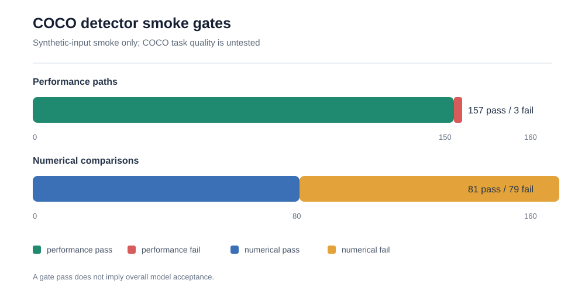
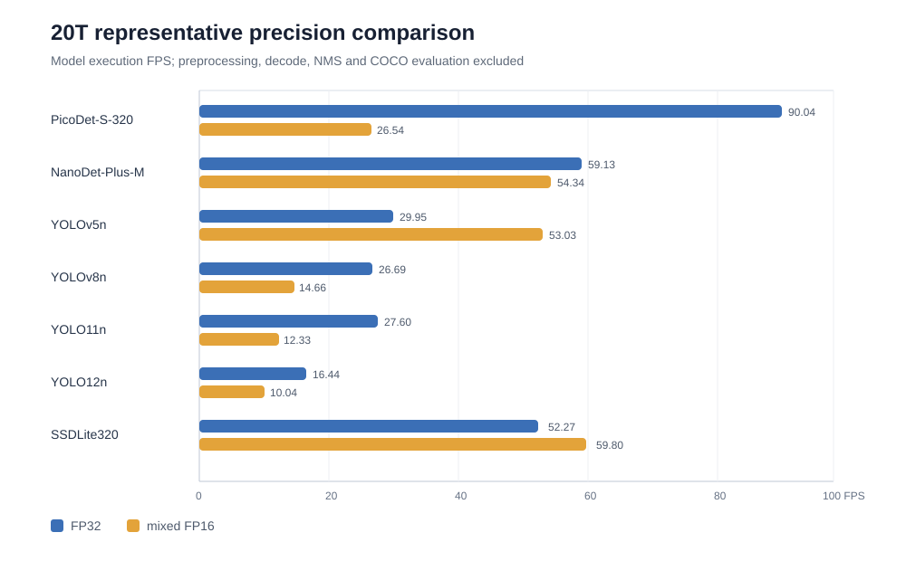
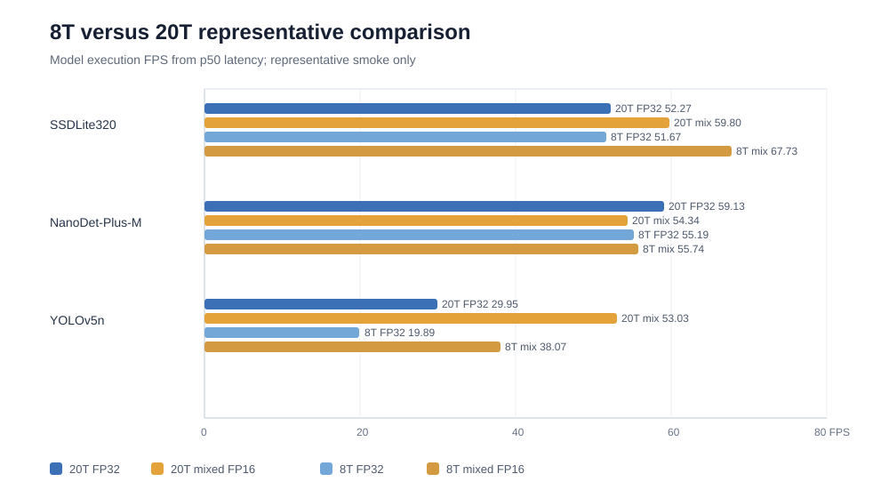

# 附录 9：COCO目标检测器基准与选型

## 为什么需要一套统一的比较方法 {#src-appendix-appendix9-h1}

当多个目标检测器被批量转换到昇腾310B时，单看一张性能表很难回答实际问题：某个模型是否真的转换成功？FP32和mixed FP16谁更适合当前板卡？8T与20T的差异来自算力、OM来源还是模型本身？一个模型在合成输入上能够执行，是否代表它在COCO图像上仍然有可接受的检测质量？

本附录采用“同一模型、同一输入合同、同一执行协议、分层判定”的方式组织结果。转换、ACL执行、原始张量一致性、COCO任务质量和推理性能分别记录，任何一层通过都不替代下一层结论。附录中的图表用于帮助读者发现取舍关系，而不是把某一个指标变成唯一排名标准。

当前批量实验的第一阶段已经覆盖多种常见检测器、两种精度模式以及8T和20T的本板与跨板OM执行。本附录当前引用的本地批次为2026-11-14快照；公开资产入口为[ascend310b-coco-detector-benchmarks](https://huggingface.co/zhouxzh/ascend310b-coco-detector-benchmarks)。现有结果首先属于转换、运行、数值和性能smoke；只有补齐COCO图像、预测框、类别映射和COCOeval协议后，才能写入mAP、AP50、AP75以及小目标指标。

## 先读证据层级 {#src-appendix-appendix9-h2}

一条模型记录至少经过以下门禁。每个状态都只对记录中的模型版本、输入形状、精度、OM来源、执行档位、软件环境和测试协议负责。

| 证据层 | 要回答的问题 | 可以支持的结论 | 不能替代的结论 |
| --- | --- | --- | --- |
| 资产合同 | ONNX、输入输出形状和文件身份是否固定？ | 模型资产可追溯，输入输出合同明确 | 不能证明模型质量或板端可执行 |
| ATC转换 | 指定参数是否生成OM？ | 该模型和参数组合在指定环境中转换成功或失败 | 不能证明ACL执行或数值正确 |
| ACL执行 | OM能否加载、执行和清理？ | 指定输入下运行时路径可用 | 不能证明输出与ONNX一致 |
| 原始数值 | OM输出是否接近ONNX参考？ | 指定输入和容差下的数值一致性 | 不能直接写成检测框准确率 |
| COCO任务质量 | 解码、NMS和类别映射后的检测结果如何？ | mAP、AP50、AP75和分尺度AP | 不能单独代表端到端部署吞吐 |
| 性能与稳定性 | 延迟、FPS和重复运行是否稳定？ | 指定协议下的P50、P95、重复成功率 | 不能替代任务质量或长期服务验收 |

状态统一使用`observed-pass`、`observed-fail`、`untested`和`blocked`。例如，ACL执行通过而原始数值未通过时，只能记录为“ACL执行通过、数值门未通过”，不能合并成一个笼统的“模型通过”。

第一批统一smoke覆盖20个模型和160条性能路径。性能路径中有157条完成重复运行，3条在20T执行跨板OM时中断；原始数值比较中有81条通过、79条未通过，没有因ACL执行失败而缺少输出。COCO图像任务质量尚未进入这批汇总，因此仍标记为`untested`。

图：第一批批量实验的门禁总览。两种“通过”分别属于性能和原始数值门，不能合并为模型整体通过。

## 结果数据如何组织 {#src-appendix-appendix9-h3}

正文不直接堆叠所有原始日志，而是把每个“模型×精度×OM来源×执行档位”作为一条可比较记录。建议的规范化字段如下：

| 字段组 | 关键字段 | 用途 |
| --- | --- | --- |
| 模型身份 | `model_id`、`family`、`variant`、`input_shape` | 比较模型系列、规模和输入分辨率 |
| 精度与转换 | `precision`、`atc_status`、`precision_mode`、`om_bytes` | 比较转换选项和产物大小 |
| 板卡关系 | `origin_tier`、`execution_tier`、`soc`、`cann`、`driver` | 区分本板执行与跨板执行，分开8T和20T证据 |
| 数值门 | `output_count`、`max_abs_error`、`mean_abs_error`、`atol`、`rtol`、`numerical_status` | 判断原始输出是否接近参考 |
| 性能 | `warmup`、`loops`、`repeats`、`p50_ms`、`p95_ms`、`fps`、`repeat_success` | 比较速度和重复运行稳定性 |
| 任务质量 | `dataset_revision`、`sample_count`、`decode_contract`、`nms_contract`、`map`、`ap50`、`ap75`、`aps`、`apm`、`apl` | 只在COCOeval证据齐全后填写 |
| 追溯信息 | `onnx_sha256`、`om_sha256`、`input_sha256`、`golden_sha256`、`report` | 从图表回到原始报告和资产 |

字段中的`dataset_revision`、标注数量、类别映射、预测框文件、解码方式和NMS阈值不能省略。没有这些信息时，性能结果可以先进入性能比较图，但任务质量列必须保持`untested`，不能用其他检测器或其他任务的数据补齐。

## 图表总览：先看门禁，再看取舍 {#src-appendix-appendix9-h4}

后续结果填充按“总览—局部比较—选型建议”的顺序生成图表。每张图只回答一个问题，并在图注中写明板卡、精度、输入协议和证据边界。

| 图表 | 主要问题 | 推荐图形 | 必须保留的分组 |
| --- | --- | --- | --- |
| 转换与执行门禁图 | 哪些模型卡在转换、执行或重复运行？ | 分层漏斗图与状态矩阵 | 模型系列、精度、8T/20T |
| 模型×路径热力图 | 同一模型在不同OM来源和执行板上是否一致？ | 延迟或状态热力图 | `origin_tier`×`execution_tier` |
| 精度选项对照图 | FP32与mixed FP16改变了多少速度、大小和数值误差？ | 成对哑铃图或分组柱状图 | 同模型、同板卡、同输入 |
| 模型性能地图 | 哪些模型位于速度与质量的有效折中区？ | FPS—mAP散点图和Pareto前沿 | 8T、20T分别绘制 |
| 跨板差异图 | 8T和20T的差异是否随模型规模变化？ | 斜率图或相对倍率图 | 同一OM来源、同一精度 |
| 选型决策图 | 不同业务约束下应该优先试哪些模型？ | 约束矩阵和推荐路径图 | 实时、平衡、质量优先 |

图表不使用雷达图表达主结论：雷达图难以比较不同量纲，也容易掩盖“某一门禁失败”的事实。模型数量较多时，先用筛选后的前沿图展示候选，再把完整矩阵放入可检索的结果表。

## 转换性能：比较参数，而不是只看成功数量 {#src-appendix-appendix9-h5}

转换部分记录ATC命令所对应的`framework`、输入格式、静态shape、`soc_version`、精度模式、返回码、OM大小和日志位置。图表可以展示不同精度模式的成功率和产物大小，但不能把OM更小直接解释为推理更快，也不能把ATC成功解释为任务质量通过。

当同一模型在8T和20T分别转换时，两个OM属于不同资产。后续性能图必须保留OM来源，不能把“20T生成的OM在8T上执行”和“8T生成的OM在8T上执行”合并成一条8T曲线。

## 模型结果：把数值一致性与任务质量分开 {#src-appendix-appendix9-h6}

原始张量比较使用固定输入、固定输出顺序和预先声明的容差。它适合定位模型转换或运行时的数值差异，不等于检测框质量。COCO任务质量则必须经过预处理、输出解码、坐标还原、类别映射和NMS，再由固定版本的COCOeval计算。

因此，模型结果表至少分成两栏：

- **数值栏**：输出数量、shape、finite状态、最大绝对误差、平均绝对误差、相对误差和容差门状态；
- **任务栏**：样本数、预测框数量、类别覆盖、mAP、AP50、AP75、APs、APm、APl以及评测脚本版本。

当两栏结论不一致时，正文应保留这种差异。例如，原始输出门通过而mAP下降，说明还需要检查解码或预处理；原始输出门未通过但任务指标接近，则说明任务指标不能替代张量门，仍需确认误差是否在关键框回归通道集中。

### COCO任务质量层的固定合同 {#src-appendix-appendix9-h7}

在生成任何mAP图表前，先固定数据集版本、标注文件、类别映射、预处理、输出解码、坐标还原、分数阈值、NMS阈值和最大检测数。评测结果必须能回指预测框文件和COCOeval报告；只保存一个mAP数字而没有预测框和评测合同，不能作为可复核证据。

当前合同文件已经列出需要填写的字段，但状态仍为`untested`。现有批量JSON明确关闭了后处理，因此不能从这些文件推导COCO框级质量。待合同补齐后，才能把任务质量字段接入性能地图和选型矩阵。

## 性能比较：先固定协议，再解释差异 {#src-appendix-appendix9-h8}

性能图只比较同一输入合同和同一计时边界。至少标注预热次数、每轮循环数、重复次数、计时范围、P50或P95的定义，以及是否包含数据拷贝、预处理、后处理和COCO结果写盘。当前批量smoke属于模型执行路径的性能比较，不能直接当作摄像头到检测框的端到端帧率。

推荐先绘制两张图：第一张用P50或FPS展示模型之间的相对速度，第二张用重复运行的P95、离散程度和成功次数展示稳定性。任何执行中断都保留在状态矩阵中，不用平均值掩盖；性能失败与数值失败也分别着色。

第一批结果先用20T上的七个代表模型展示精度选项差异。图中可以看到，mixed FP16并不必然比FP32更快：不同模型的算子结构、编译策略和执行路径会改变结果。因此，精度选项应按同一模型、同一板卡和同一协议做成对比较，不能根据精度名称直接推断性能。

| 代表模型 | FP32 FPS | mixed FP16 FPS | 计时边界 |
| --- | ---: | ---: | --- |
| PicoDet-S-320 | 90.04 | 26.54 | 模型执行 |
| NanoDet-Plus-M-320 | 59.13 | 54.34 | 模型执行 |
| YOLOv5n | 29.95 | 53.03 | 模型执行 |
| YOLOv8n | 26.69 | 14.66 | 模型执行 |
| YOLO11n | 27.60 | 12.33 | 模型执行 |
| YOLO12n | 16.44 | 10.04 | 模型执行 |
| SSDLite320 | 52.27 | 59.80 | 模型执行 |

表中FPS由20T模型执行路径的P50延迟换算而来，不包含预处理、解码、NMS和COCO评测。该表是代表性协议示例，不是全量模型排名，也不能单独形成生产选型结论。

图：20T上七个代表模型的模型执行FPS对照。该图只用于说明精度选项的比较方法，不代表全量模型排名，也不包含预处理、解码、NMS和COCO评测。

8T与20T不能合并成一个“310B平均速度”。下图把同一模型的OM来源和执行档位分开，展示三种代表模型在两个算力档位和两种精度模式下的模型执行差异。它用于确定下一轮任务质量评测的候选，不用于推导跨板兼容性或端到端帧率。

图：8T与20T代表模型的模型执行FPS对照。所有柱形都来自各自板卡和OM来源的独立协议。

## 从图表得到选型建议 {#src-appendix-appendix9-h9}

选型不采用“mAP最高”或“FPS最高”的单指标排序，而使用约束驱动的三步筛选：

1. 先排除资产合同不完整、ATC失败、ACL不能清理或重复运行不稳定的组合。
2. 再按业务最低要求筛选任务质量和速度，例如实时告警优先检查目标帧率，离线分析优先检查AP75和小目标AP。
3. 最后在同一板卡和同一输入合同内比较FP32、mixed FP16、输入尺寸和后处理边界，并保留一个可回退的基准组合。

最终建议表使用“适用场景、首选组合、备选组合、必须补测的门禁”四列。这样读者能看到推荐理由和未完成的验证，而不是只看到一个脱离条件的冠军模型。

### 当前可用的性能层起点 {#src-appendix-appendix9-h10}

在COCO任务质量尚未完成前，只能给出“性能层起点”，不能称为最终模型推荐。下面的组合同时有模型执行FPS和原始数值门记录，适合用作后续COCOeval实验的候选起点：

| 场景 | 首选起点 | 备选起点 | 当前依据 | 必须补测 |
| --- | --- | --- | --- | --- |
| 20T实时smoke | SSDLite320 mixed FP16，59.80 FPS | NanoDet-Plus-M-320 mixed FP16，54.34 FPS | 当前数值门通过，模型执行路径较快 | COCO mAP、AP75、端到端预处理和NMS |
| 8T实时smoke | SSDLite320 mixed FP16，68.03 FPS | NanoDet-Plus-M-320 mixed FP16，55.70 FPS | 当前数值门通过，8T模型执行路径较快 | COCO mAP、输入图像链路和长期稳定性 |
| YOLO兼容性基线 | YOLOv5n mixed FP16 | YOLOv5n FP32，29.95 FPS（20T） | 两种精度均有数值门和性能记录 | 解码合同、COCO mAP、不同输入尺寸 |
| 精度优先的回退组合 | SSDLite320 FP32 | YOLOv5n FP32 | 当前数值门通过，避免仅按mixed FP16名称选型 | 任务质量、端到端延迟和资源占用 |

这些是“下一轮应优先做COCOeval的候选”，不是生产准入清单。若后续任务质量、预处理或稳定性门禁失败，应从矩阵中移除对应组合，而不是用性能数字覆盖失败。

## 当前阶段的结论边界 {#src-appendix-appendix9-h11}

本附录的第一阶段只建立比较框架和数据合同。现有批量记录可以支撑模型、精度、OM来源、执行档位、原始数值和模型执行性能的对照；现有合成输入不能支撑COCO mAP或真实图像检测质量结论。COCO任务质量部分必须在补齐固定数据集版本、标注、预测框、解码与NMS协议后再填入。

后续每批新增结果都应同时更新规范化数据表、对应图表和证据说明。若某个模型只完成了其中一层，图表中保留其未完成状态；若8T和20T的结果不同，分面展示而不合并平均。这样得到的附录既能帮助读者做模型选型，也能保留转换实验中真正有价值的失败和边界。
