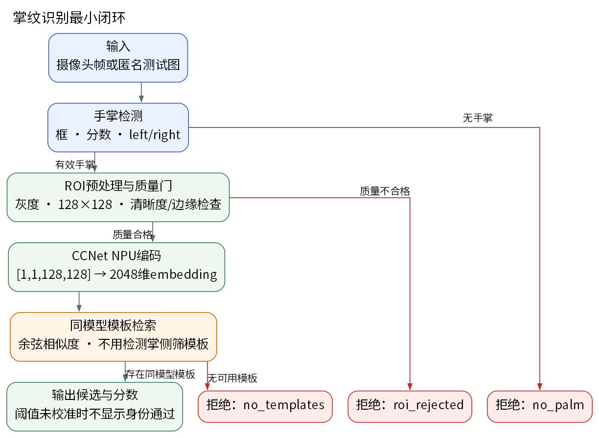
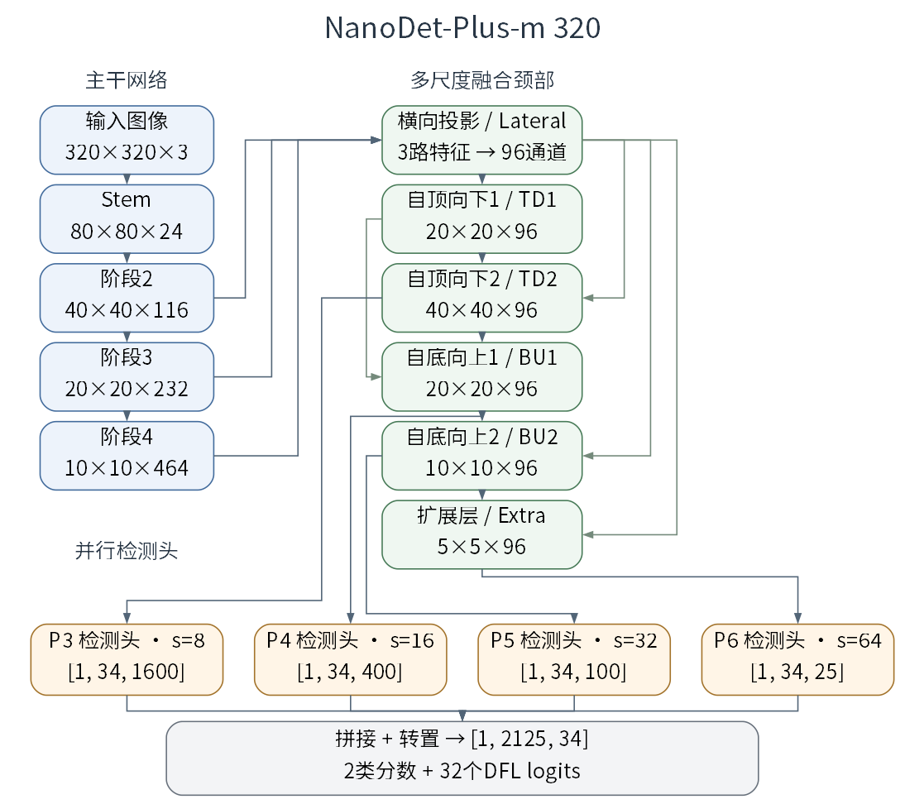
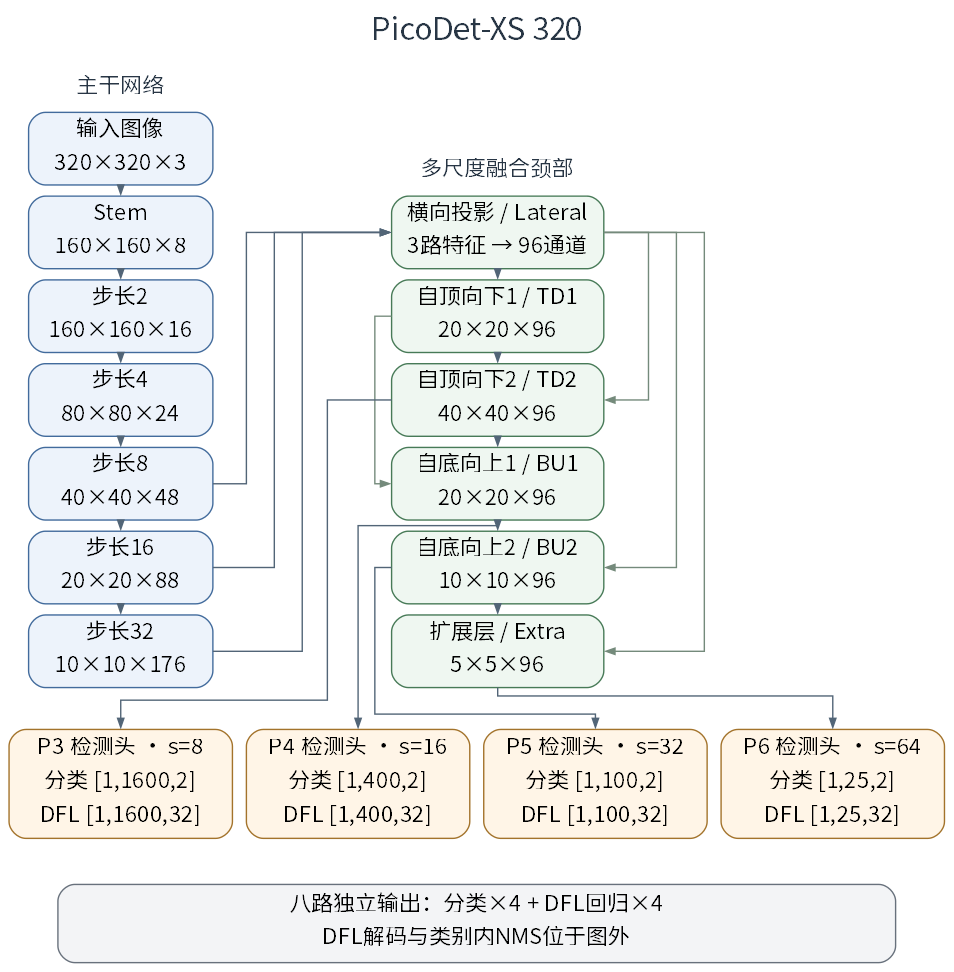
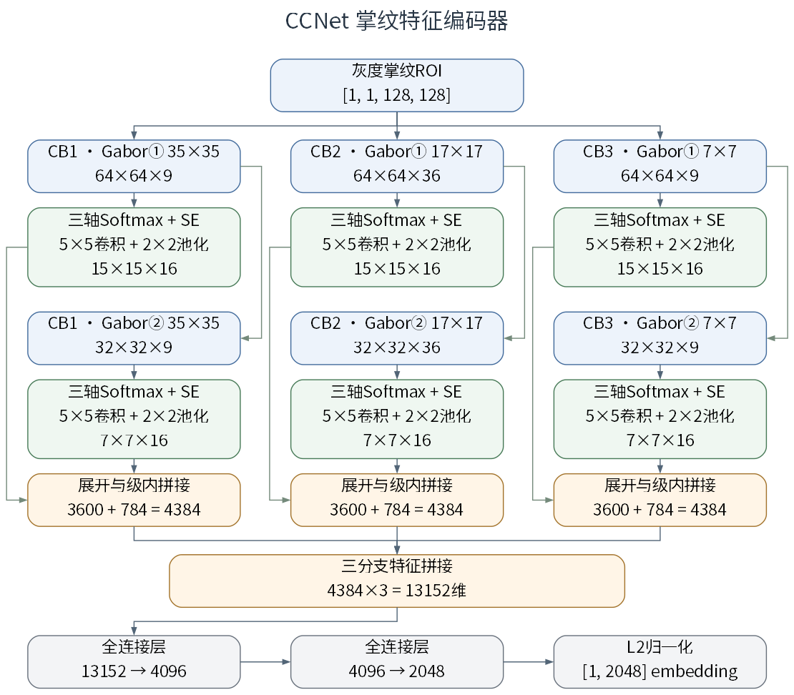

# 案例 4：掌纹识别

掌纹识别把一张手掌图像转换成可用于身份检索的特征。与“图像里有没有手掌”不同，身份识别还要回答三个连续问题：手掌在哪里、它是左掌还是右掌、它属于模板库中的谁。边缘设备必须在有限算力、有限内存和局域网摄像头条件下完成这条链路，同时避免把一次检测、一次HTTP成功或一张截屏误当成身份质量已经通过。

本案例在Ascend310B4 / 8T上构建一套可本地运行的掌纹识别工作台。系统先从整幅画面检测手掌，裁成灰度`128×128` ROI，再由掌纹特征模型生成embedding，最后在同模型、同ROI与光谱合同的模板中执行余弦检索。在线推理固定使用NPU `mixed_fp16`，CPU和EDCC只作为离线研究基线，不作为服务降级路径。

本案例以8T可见光摄像头为验证对象。20T或其他SoC需要独立完成模型、摄像头、阈值和模板验收，不能复用这里的指标作为自己的结论。

配套源码位于[Case4工程](https://github.com/zhouxzh/Ascend310/tree/main/samples/case4)。

## 这项任务解决什么问题 {#src-experiment-case4-problem}

掌纹识别的输入不是一张已经对齐、裁剪好的生物特征图，而是包含背景、光照、手掌距离和多只手候选的整帧画面。如果直接把整帧缩成分类网络输入，模型既要学习定位又要学习身份，训练和解释都会更困难。两阶段流水线把问题拆开：

1. 手掌检测器只定位手掌并给出检测分数及左右掌类别。
2. ROI预处理把检测框转换成统一尺寸的灰度掌纹区域。
3. CCNet把ROI编码成2048维embedding。
4. 模板检索用余弦相似度返回同模型、同ROI和光谱合同的Top-K候选，并显示候选模板掌侧。
5. 只有本机阈值完成校准时，系统才显示身份是否通过；否则只显示候选与分数。

这条链路还解决一个实际工程问题：检测模型可以替换。NanoDet、PicoDet的输入尺寸、输出数量和DFL解码不同，但上层ROI、特征模型、模板和前端结果可以保持一致。读者需要学会分开检查“检测合同”“特征合同”“模板合同”和“任务质量”，不能因为其中一层通过就宣布整个身份系统通过。

### 最小闭环 {#src-experiment-case4-minimal-loop}

最小成功不是识别出某个真实人员，而是完成一条可重复、可解释的匿名闭环：



图中“检测失败”“ROI不合格”和“无可用模板”都进入明确拒绝分支，不会用低质量ROI继续生成embedding，也不会把空模板结果伪装成身份不匹配。

课堂验收应至少观察到一次模板注册、一次同模型检索、一次掌侧不一致拒绝和一次空模板结果。真实人员身份、EER和Rank-1需要独立协议，不由界面截图替代。

Case4仓库中还保留多种检测器和特征模型。同一ONNX有向拓扑的模型变体不重复画成多张结构图，SHA与输入输出合同保存在结构清单中。模型结构相似或文件存在都不代表候选已获生产准入；任务类型、输入合同及准入状态仍需分别核对。当前正文详细展开已准入CCNet和教学中选定的NanoDet/PicoDet；掌静脉、双输入比较及研究嵌入模型分别标注为候选，不混写成同一掌纹识别链路。

## 你将学会什么 {#src-experiment-case4-learning-outcomes}

完成本案例后，读者能够：

1. 解释两阶段掌纹识别为什么要分离手掌检测与掌纹特征提取，并画出从整帧到身份候选的数据流。
2. 读取`detector_manifest.json`，核对输入shape、类别顺序、DFL输出、阈值、模型ID、字节数和SHA-256。
3. 在8T板端启动NPU-only工作台，分别验证health、bootstrap、摄像头和NPU推理。
4. 在界面中独立选择手掌检测模型和掌纹特征模型，并解释两者不是同一个模型选择项。
5. 完成同一人员左右掌模板注册，观察多手拒绝、掌侧不一致拒绝和模板隔离。
6. 区分代码合同、ATC转换、ACL加载、数值一致性、任务质量、性能和UI验收。
7. 根据失败层级定位问题：设备、CANN、模型资产、输入合同、摄像头、模板、前端或应用逻辑。

### 本案例不承诺什么 {#src-experiment-case4-non-claims}

工作台可运行不等于模型已经适合所有人群和场景。光照变化、掌心角度、遮挡、皮肤纹理、摄像头曝光和左右掌姿态都会影响检测或特征质量。PicoDet候选仍处于人工测试状态，原始八输出数值门未通过；不得把其离线mAP写成生产准入。

本案例也不提供公网安全能力。服务默认监听局域网地址，没有账号、TLS、多租户隔离或反欺诈机制。部署范围应限制在本人或受信设备环境。

## 先理解掌纹识别链路 {#src-experiment-case4-concepts}

### 手掌检测与掌纹识别有什么区别 {#src-experiment-case4-detection-vs-recognition}

手掌检测输出的是空间信息。每个框至少包含左上、右下坐标和分数，本案例还包含`left_palm`或`right_palm`类别。它回答“手掌在哪里”，不回答“这个人是谁”。

掌纹特征模型输出的是身份表示。CCNet接收裁剪后的`128×128`灰度ROI，输出2048维向量。向量经过归一化后用余弦相似度比较，超过本机阈值才可能判定匹配。

检测错误会传播到身份链路：框偏了，ROI会带入背景；手张得太开或旋转过大，ROI质量会下降；掌侧标签错误会影响注册拒绝和调试判断，但实时检索不使用检测掌侧过滤模板。因此定位、ROI和身份指标必须分别记录。

### 为什么需要左右掌类别 {#src-experiment-case4-handedness}

同一人员的左右掌是独立模板，稳定ID分别为`人员编号:left`和`人员编号:right`。系统在注册时要求画面只有一只手，而且检测掌侧必须与页面人工选择一致。不一致的帧不会裁剪ROI、不会保存样本，也不会创建模板。

这条规则是身份数据完整性门。当前可见光场景中，某些姿态下检测器可能把左掌判成右掌；系统不能为了“让流程走下去”自动交换人工选择。正确做法是记录调试帧、调整姿态或改进模型，不能用错误掌侧生成模板。

实时检索不使用检测标签过滤模板，避免一次掌侧误判把正确的同侧模板排除。检索结果会显示特征模型的模板掌侧；检测掌侧保留在调试信息中供分析。

### embedding和模板是什么 {#src-experiment-case4-embedding-template}

embedding是掌纹ROI经特征模型得到的定长数值向量。模板不是一个身份字符串，而是同一掌侧多张合格样本的向量集合及其元数据。注册时通常保存3至5个样本，检索时取考生向量与模板样本的最佳若干分数并聚合。

模板命名空间包含特征模型和精度：

```text
<model_id>__npu__mixed_fp16
```

更换特征模型后，旧模型的embedding不能直接与新模型比较。模板还绑定ROI管线`nanodet_palm_bbox_v1`、可见光/红外光谱和摄像头物理设备合同。不同合同的模板必须隔离。

### 为什么需要ROI质量检查 {#src-experiment-case4-roi-quality}

检测框只保证“模型认为这里有手”，不保证ROI适合身份识别。预处理会检查尺寸、亮度、清晰度、边缘裁剪和多余区域。质量不合格时，该手返回`roi_rejected`，不会进入embedding检索。

多手画面可以逐手处理；注册路径更严格，只允许一只手。不能用注册阶段的“多手拒绝”代替实时页的多手能力，也不能用实时页能显示两个框证明模板系统已通过。

## 器件与材料清单 {#src-experiment-case4-bom}

### 最小配置 {#src-experiment-case4-minimum-bom}

| 器件 | 数量 | 用途 | 条件 |
| --- | ---: | --- | --- |
| Ascend310B4 / 8T开发板 | 1 | NPU推理、FastAPI和摄像头处理 | 设备节点、CANN与PyACL可用 |
| 电源和启动存储 | 1套 | 稳定供电与系统启动 | 符合开发板规格 |
| USB摄像头 | 1 | 采集可见光手掌画面 | V4L2可枚举并能输出真实帧；C922为本次验证型号 |
| 局域网和开发电脑 | 1套 | 前端构建、文件同步和浏览器访问 | 可信局域网 |
| 已核验模型资产 | 1套 | 检测OM、CCNet OM和registry | 字节数与SHA-256匹配 |

### 本次验证配置 {#src-experiment-case4-validated-config}

| 项目 | 实测值 |
| --- | --- |
| SoC与档位 | Ascend310B4 / 8T |
| CANN | 8.0.0 |
| NPU驱动 | 25.2.0 |
| Python环境 | `ascend`，Python3.9.25 |
| 摄像头 | Logitech C922 Pro Stream Webcam |
| 可见光节点 | `/dev/video2`，节点编号可能随插拔变化 |
| 前端 | React预构建bundle，由FastAPI托管 |
| 后端 | FastAPI，NPU-only |

设备健康状态中的`Alarm`不能单独作为通过或失败判据。必须继续记录ACL初始化、模型加载、推理返回码、摄像头取帧和实际输出。

## 系统总体架构 {#src-experiment-case4-architecture}

```text
React浏览器
  实时识别 / 掌纹注册 / 模型状态 / 系统状态
        ↓ HTTP
FastAPI
  健康检查 / bootstrap / 摄像头 / 检测 / 注册 / 识别
        ↓
手掌检测runner              掌纹特征runner
NanoDet或PicoDet OM          CCNet mixed_fp16 OM
        ↓                           ↓
框、分数、left/right          2048维embedding
        ↓                           ↓
ROI预处理与质量检查 -------> 同模型模板检索
        ↓                           ↓
页面框与结果                 Top-K分数或匹配结论
```

前端源码入口为[App.tsx](https://github.com/zhouxzh/Ascend310/blob/main/samples/case4/frontend/src/App.tsx)，HTTP边界在[server.py](https://github.com/zhouxzh/Ascend310/blob/main/samples/case4/palmprint_workbench/api/server.py)，检测运行时在[detector.py](https://github.com/zhouxzh/Ascend310/blob/main/samples/case4/palmprint_workbench/runtime/detector.py)。

### 运行时为什么固定NPU {#src-experiment-case4-npu-only}

生产API只接受`backend=npu`和`precision=mixed_fp16`。CANN缺失、PyACL导入失败或OM无法加载时，服务返回明确错误，不会悄悄切换到CPU。CPU fallback会让页面上“可用”的含义变得模糊，也会使性能和数值证据失去可比性。

离线研究可以使用CPU或EDCC，但它们的输出不能进入在线模板namespace，也不能被写成8T NPU结果。

## 手掌检测模型和输入合同 {#src-experiment-case4-detector-contract}

### 可选模型 {#src-experiment-case4-detector-catalog}

检测模型由`detector_manifest.json`登记。界面的“手掌检测模型”选择会向检测接口发送`detector_id`。

| 模型ID | 系列 | 输入 | 状态 |
| --- | --- | --- | --- |
| `nanodet-plus-m-320-handed` | NanoDet | `[1,3,320,320]` | 默认人工测试模型 |
| `picodet-xs-320-seed-42` | PicoDet | `[1,3,320,320]` | 实验模型 |
| `picodet-xs-416-seed-42` | PicoDet | `[1,3,416,416]` | 实验模型 |

每个模型必须核对：

- 唯一模型ID和显示名。
- OM路径、字节数和SHA-256。
- 输入NCHW shape。
- 输出数量和各层shape。
- 类别顺序为`left_palm`、`right_palm`。
- 分数阈值、NMS IoU、最多保留框数。
- 预处理颜色顺序、插值方式、均值和标准差。

### NanoDet输出 {#src-experiment-case4-nanodet-output}

当前NanoDet输出为`float32[1,2125,34]`。前2个通道是已经过sigmoid的左右掌分数，后32个通道是4个方向、每个方向8个DFL logits；stride为`8,16,32,64`，anchor中心偏移为`0.0`。解码时对DFL做softmax，计算期望距离，再由prior中心生成框，两个类别分别执行NMS。



### PicoDet输出 {#src-experiment-case4-picodet-output}

PicoDet不是单张量输出，而是8个输出：

```text
4层分类：[1,N8,2] [1,N16,2] [1,N32,2] [1,N64,2]
4层DFL： [1,N8,32] [1,N16,32] [1,N32,32] [1,N64,32]
```

分类分数已在图内执行对齐sigmoid，不能再次sigmoid。每层DFL按`reg_max=7`解码，anchor中心偏移为`0.5`。PicoDet预处理使用RGB、cubic插值和ImageNet归一化，与NanoDet不同。



### 长方形画面如何进入方形模型 {#src-experiment-case4-direct-stretch}

检测网络只接受固定的方形输入，而原始摄像头和数据集中的画面通常不是正方形。常见做法有两种。

直接拉伸分别计算横向和纵向比例：

```text
320×240  -> 320×320：scale_x=1，scale_y=4/3
640×480  -> 320×320：scale_x=1/2，scale_y=2/3
1280×720 -> 320×320：scale_x=1/4，scale_y=4/9
```

它能用满全部输入像素，但会改变手掌宽高比。LetterBox则先用统一比例缩放，再用黑色像素补齐成方形：

```text
短边缩放到目标尺寸
长边按相同比例缩放
右侧和/或下侧补零
记录scale、pad_x和pad_y
推理后先减padding，再除以scale
```

例如`640×480`输入到`320×320`时，LetterBox先缩放到`320×240`，再在上下补足40像素；手掌宽高比保持不变。检测框反算必须使用同一组`scale`和padding，不能只按原图宽高分别缩放。

### 手掌检测为什么采用LetterBox {#src-experiment-case4-letterbox-contract}

截至2026-11-23 14:20（Asia/Shanghai），单类别手掌训练批次已完成`39/78`项。对其中可以按模型和backbone严格配对的18组训练结果进行比较时，除输入几何外，两组使用相同的输入尺寸、epoch、batch size、学习率、随机种子、翻转、缩放和颜色增强。两种几何在固定test集上的结果如下：

| 框架 | 配对模型数 | LetterBox胜出 | 平均mAP50-95提升 | 中位数提升 |
| --- | ---: | ---: | ---: | ---: |
| NanoDet | 11 | 11 | +0.02425 | +0.02297 |
| PicoDet | 7 | 7 | +0.03119 | +0.03274 |
| 合计 | 18 | 18 | +0.02695 | +0.02701 |

代表结果包括：

```text
NanoDet EfficientLite2-512：
直接拉伸0.60763，LetterBox0.65791，提升0.05028

PicoDet-L-320：
直接拉伸0.63181，LetterBox0.67166，提升0.03985
```

LetterBox的AP50与直接拉伸接近，但AP75在NanoDet和PicoDet配对中分别平均提高`0.0530`和`0.0541`。这说明提升主要来自检测框定位，而不是仅仅“更容易找到手掌”。手掌在不同原始宽高比下保持真实形状，位置和尺寸回归不再同时承担拉伸补偿，是当前数据上更稳定的原因。

因此，后续新训练的手掌检测模型固定采用`mediapipe_letterbox`预处理：

- 训练、验证、ONNX导出和OM推理必须使用同一缩放比例、padding值和插值方式。
- 检测框反算必须减padding、除统一scale，再裁剪到原图；不能继续套用直接拉伸的独立x/y比例。
- 直接拉伸结果只保留为历史对照，不再新增直接拉伸手掌检测训练。
- LetterBox不是脱离数据的通用结论；更换摄像头安装方式、输入宽高比或目标分布后，仍需用固定test集重新比较。

这一合同的证据边界是训练完成后的固定test集mAP。它不替代ONNX/OM转换精度、20T板端任务mAP、真实C922摄像头画质和端到端身份识别验收；这些层级仍要分别测试。

## 掌纹特征和模板合同 {#src-experiment-case4-embedding-contract}

CCNet输入为单通道`[1,1,128,128]`，输出2048维向量。ROI来自检测框，但预处理还会进行灰度化、尺寸调整、亮度与清晰度检查。embedding做L2归一化后使用余弦相似度。



三个并行分支分别使用`35×35`、`17×17`和`7×7`的Gabor卷积核。每个分支将两级特征展开并拼接，三分支汇合后再经两层全连接映射为2048维向量；L2归一化位于模型图内。图中特征图尺寸按高×宽×通道标注，张量尺寸保留ONNX维度顺序。模板检索在网络之外执行。

模板检索必须同时匹配：

- 同一个特征模型ID。
- `npu`后端和`mixed_fp16`精度。
- 同一个ROI管线。
- 相同模态和光谱。
- 相同摄像头物理合同或明确的兼容范围。
- 注册路径要求检测掌侧与人工选择一致；实时检索不使用检测掌侧过滤模板。

系统尚未完成当前板卡、镜头和光照组合的本机阈值校准时，结果只显示候选和分数，不显示“身份通过”。Top-K中存在模板不等于身份匹配。

## 完成最小实验 {#src-experiment-case4-minimum-experiment}

### 获取源码并构建前端 {#src-experiment-case4-build}

在开发电脑上获取课程发行版本，并记录实际commit：

```bash
git clone https://github.com/zhouxzh/Ascend310.git
cd Ascend310/samples/case4
git rev-parse HEAD
python -m compileall -q app.py palmprint_workbench tools
cd frontend
npm ci
npm test
npm run build
cd ..
```

前端构建后确认`frontend/dist/index.html`及其资源存在。开发板不需要Node.js，板端不重新构建前端。

### 准备板端环境和发行目录 {#src-experiment-case4-board-environment}

以下路径是推荐布局，`<release-id>`必须替换为已审核版本：

```bash
ssh HwHiAiUser@<board-ip>
export TIER=8t
export RELEASE_ID=<reviewed-release-id>
export RELEASE_ROOT=/home/HwHiAiUser/Documents/Ascend310/deployments/case4/$TIER/$RELEASE_ID
export ASSET_ROOT=/home/HwHiAiUser/Documents/Ascend310/assets/case4/models/8t/<verified-asset-id>
mkdir -p "$RELEASE_ROOT"
```

源码从固定commit获取。OM、ONNX、模板、数据集和真实摄像头图像不进入Git，单独存放在`ASSET_ROOT`。同步源码时不要使用`--delete`，不要覆盖板端模板和报告。

激活统一环境：

```bash
source /usr/local/miniconda3/etc/profile.d/conda.sh
conda activate ascend
export PYTHONNOUSERSITE=1
source /usr/local/Ascend/ascend-toolkit/set_env.sh
cd "$RELEASE_ROOT"
export PALMPRINT_ROOT="$RELEASE_ROOT"
export PALMPRINT_MODEL_ASSET_ROOT="$ASSET_ROOT"
export PALMPRINT_PROFILE=manual_test
export PALMPRINT_CAMERA_MODALITY=palmprint
export PALMPRINT_CAMERA_SPECTRUM=visible
python -c "import sys, cv2, acl; print(sys.executable); print(cv2.__version__); print(acl.__file__)"
```

`acl`导入失败时先修复CANN/Python环境，不要增加CPU fallback。

### 校验模型资产 {#src-experiment-case4-verify-assets}

严格校验必须同时检查检测模型、CCNet OM和registry：

```bash
python -m palmprint_workbench.tools.verify_assets --strict
```

预期看到每个检测模型的`bytes`、`expected_bytes`、`sha256`和`expected_sha256`一致，最后为：

```json
{
  "ok": true,
  "failures": []
}
```

文件存在、大小相同但哈希不同仍不能使用。PicoDet原始八输出数值门未通过时，界面必须继续显示“实验”或人工测试提示。

### 启动服务 {#src-experiment-case4-start-service}

```bash
python -m palmprint_workbench.api --host 0.0.0.0 --port 7861
```

在另一终端验证：

```bash
curl --fail http://127.0.0.1:7861/api/health
curl --fail http://127.0.0.1:7861/api/bootstrap
curl --fail http://127.0.0.1:7861/api/cameras
curl --fail http://127.0.0.1:7861/
```

浏览器访问`http://<board-ip>:7861/`。health返回`status=ok`只表示服务、运行时和资产状态可用；`inference_smoke`不会主动加载NPU，仍需执行一次检测或识别。

### 选择模型并观察检测 {#src-experiment-case4-select-detector}

在“识别配置”中分别选择：

- 手掌检测模型：NanoDet或PicoDet。
- 掌纹特征模型：当前已准入的CCNet。

`/api/bootstrap`中的`defaults.detector_id`给出默认检测模型，`detectors`列出可用状态。未知`detector_id`应在打开摄像头前返回422。

前后端使用分离的字段：

```text
model_id     掌纹特征模型
detector_id  手掌检测模型
```

不能把这两个ID混用。模型切换后，实时页应清除旧检测框，下一次请求使用新ID。

## 完成匿名模板实验 {#src-experiment-case4-enrollment-experiment}

### 注册第一只掌 {#src-experiment-case4-enroll-first-palm}

进入“掌纹注册”，选择一只掌侧，保持画面中只有一只手并启动自动采集。预期状态依次经历：

```text
camera_opening -> countdown -> waiting_position -> stabilizing -> collecting -> completed
```

系统保存5个合格样本后创建模板。样本必须通过ROI质量和稳定性检查；画面出现多只手时拒绝。检测掌侧与人工选择不一致时，状态回到等待并记录拒绝原因，不能保存样本。

检查模板列表中的稳定ID、掌侧、样本数和特征模型。登记同一人员的另一只掌时，人员编号应保持不变，掌侧模板独立。

### 注册掌侧不一致实验 {#src-experiment-case4-side-mismatch-experiment}

在页面选择左掌，让右掌进入画面。预期接口或会话返回类似：

```text
检测到右掌，与当前选择的左掌不一致
```

检查板端模板数量和`data/captures/index.json`，该帧不应新增注册样本。再让左掌进入画面，状态应恢复采集。若不一致帧仍然保存，应立即停止注册并检查会话日志。

### 未知模型实验 {#src-experiment-case4-unknown-detector}

直接请求不存在的检测模型：

```bash
curl -X POST http://127.0.0.1:7861/api/cameras/%2Fdev%2Fvideo2/detections \
  -H 'Content-Type: application/json' \
  -d '{"resolution":"320x240","detector_id":"not-a-detector"}'
```

预期HTTP422，错误指出未知手掌检测模型。请求应在打开摄像头和初始化NPU前失败。

## 摄像头和实时页面 {#src-experiment-case4-camera}

### 设备节点不是固定编号 {#src-experiment-case4-camera-node}

先读取本机实际节点：

```bash
v4l2-ctl --list-devices
ls -l /dev/video*
id
```

同一块板重插摄像头后，C922可能从`/dev/video2`变为其他编号。ISP虚拟节点也可能存在，但不一定能输出非空帧。服务通过`VIDIOC_QUERYCAP`和`VIDIOC_G_FMT`筛掉不能采集的节点。

### 为什么实时页面曾经卡顿 {#src-experiment-case4-camera-performance}

旧实时页同时轮询`/frame`预览和`/detections`检测。两路都打开同一台C922，造成V4L2读取和JPEG编码争用。实测1280×720下预览请求约373至1476毫秒，检测请求约1660至1692毫秒，检测响应约216KB。

当前页面改为每轮只采集一次：检测响应同时返回缩放后的JPEG预览和框，独立`/frame`请求为零。检测请求完成后再等待60毫秒继续。8T浏览器实测：

| 输入分辨率 | 10秒检测数 | 平均耗时 | 约刷新率 |
| --- | ---: | ---: | ---: |
| 1280×720 | 未切单路前更慢 | 约1660ms以上 | 低于1次/秒 |
| 640×480 | 16 | 520ms | 约1.6次/秒 |
| 320×240 | 34至39 | 219至242ms | 约3.4至3.9次/秒 |

NPU检测本身约20至23毫秒，等待主要来自C922的V4L2逐帧读取和图像处理。实时页默认使用`320×240`；需要更高清晰度时手动选择`640×480`或`1280×720`。注册页默认`1280×720`以提高ROI质量。

### 单帧检测实验 {#src-experiment-case4-detection-smoke}

```bash
curl --fail -X POST \
  http://127.0.0.1:7861/api/cameras/%2Fdev%2Fvideo2/detections \
  -H 'Content-Type: application/json' \
  -d '{"resolution":"320x240","detector_id":"nanodet-plus-m-320-handed"}'
```

返回应包含：

```text
detector_id
detection_count
hands[].bbox_xyxy
hands[].detection_score
hands[].detected_palm_side
capture_resolution
preview_resolution
timing.detection ms
```

只看到HTTP200不够。还要检查实际分辨率、预览是否为有效图像、框是否位于画面内，以及左右掌标签是否与人工观察一致。

## 结果怎样解释 {#src-experiment-case4-results}

### 分层验收 {#src-experiment-case4-evidence-layers}

| 层 | 观察对象 | 通过后仍不能证明 |
| --- | --- | --- |
| 构建 | Python编译、前端测试、bundle | NPU可加载 |
| 资产 | OM字节数、SHA-256、registry | 数值和任务质量 |
| ACL | OM加载、执行、输出有限、资源释放 | 身份准确率 |
| 检测任务 | 框IoU、漏检、误检、左右掌一致率 | 掌纹embedding质量 |
| 特征任务 | EER、Rank-1、阈值 | 摄像头端到端体验 |
| 服务/UI | HTTP、页面、摄像头 | 模型跨场景可靠性 |
| 性能 | warmup、批量、P50/P95 | 准确率和硬件缺陷 |

一次Python测试通过、一次`/api/health`成功或一张页面截图，只能证明对应层。

### 当前8T观察结果 {#src-experiment-case4-current-8t}

本版本在Ascend310B4 / 8T、CANN8.0.0、驱动25.2.0、C922可见光环境完成以下观察：

- 三份检测OM通过严格字节数和SHA-256校验。
- NanoDet、PicoDet XS-320、PicoDet XS-416均可通过C922检测接口加载和执行。
- 前端可在“手掌检测模型”中切换三份模型，未知ID返回422。
- 注册路径保留严格掌侧核对，不一致帧不写入模板。
- 实时页使用单路取流，320×240平均约219至242毫秒。
- 8T检测/API单元测试18项、前端测试18项通过。
- 用户已在当前8T / C922工作台场景完成人工测试，确认本次测试路径无问题，并授权发布为`user-reported`结果。

PicoDet的离线mAP接近NanoDet或更高，但原始八输出数值门未通过，因此它仍是实验模型。上述运行结果不能证明所有姿态的左右掌分类可靠，也不能替代其他人员、姿态和光照下的EER、Rank-1及长期稳定性。

## 常见失败怎样定位 {#src-experiment-case4-troubleshooting}

| 现象 | 优先检查 | 处理 |
| --- | --- | --- |
| `import acl`失败 | 当前Python、CANN环境、`acl.__file__` | 重新激活同一shell的`ascend`与CANN；不切CPU |
| health正常但推理失败 | OM加载、ACL返回码、设备日志 | 保存PID、模型ID和原始异常，停止服务 |
| 模型不在下拉框 | `detector_manifest.json`、检测OM、字节数和SHA | 重新校验资产，不伪造可用状态 |
| 未知detector_id | 请求字段和后端bootstrap | 使用清单中的模型ID；422属于正确拒绝 |
| 摄像头列表为空 | V4L2枚举、权限、设备占用 | 检查`id`、`/dev/video*`和打开进程 |
| 页面卡顿 | 是否仍有双路轮询、输入分辨率、MJPG | 使用单路检测预览，先选320×240 |
| 注册始终不完成 | 手数量、掌侧、ROI质量、亮度 | 只保留一只手，检查拒绝统计 |
| 掌侧与选择不一致 | 检测类别和人工选择 | 该帧拒绝；调整姿态或更换检测模型 |
| 模板检索为空 | namespace、ROI管线、光谱、模型ID | 注册与识别必须使用同一合同 |
| 模板损坏 | `.pstore.bak`与`.pstore.previous` | 停止服务，备份后恢复；不要手工伪造模板 |
| `Health: Alarm` | 设备状态与具体调用结果 | 记录温度和健康，不单独判定模型失败 |

## 调试帧和隐私 {#src-experiment-case4-privacy}

连续摄像头画面默认不保存。确认需要排查时，可以在启动前显式开启有限调试捕获：

```bash
export PALMPRINT_DETECTOR_DEBUG_CAPTURE=1
export PALMPRINT_DETECTOR_DEBUG_CAPTURE_MAX_FRAMES=60
export PALMPRINT_DETECTOR_DEBUG_CAPTURE_MIN_INTERVAL_SECONDS=0.8
```

调试帧只保存在发行目录的`reports/debug/detector/`，每种服务进程独立运行目录，包含原始整帧、带框预览和JSON分数。达到上限后停止写入。排查结束必须关闭服务并以默认环境重启，不设置该变量。

真实掌纹、姓名、embedding、模板和摄像头原图不能进入Git、课件截图或公开报告。课堂演示使用合成或匿名素材。删除模板和图片由操作者在确认服务已停止后执行，不使用通配符删除整个用户目录。

## 分步实验 {#src-experiment-case4-guided-labs}

### 实验一：验证模型选择确实切换了runner {#src-experiment-case4-lab-detector-selection}

分别请求NanoDet和两份PicoDet。记录响应`detector_id`、输入分辨率、检测耗时和框数量。观察三个模型首次加载与后续调用的差异。预期响应中的`detector_id`与请求一致，模型之间不会共用错误解码器。

### 实验二：比较多帧下的掌侧稳定性 {#src-experiment-case4-lab-handedness}

保持同一只手掌，在掌心正对、轻微旋转、距离变化和边缘位置分别采集帧。记录每帧左右类最高分和最终标签。不要因为单帧正确就宣布掌侧稳定，也不要通过固定交换标签掩盖问题。注册路径必须继续拒绝不一致帧。

### 实验三：验证模板隔离 {#src-experiment-case4-lab-template-isolation}

为同一匿名人员注册左掌和右掌。检查稳定ID分别为`:left`和`:right`，样本不互相覆盖。再切换特征模型，确认旧模型模板不会出现在新namespace。

### 实验四：比较分辨率与刷新率 {#src-experiment-case4-lab-resolution}

在320×240、640×480和1280×720下各运行10秒。记录检测次数、平均耗时、预览字节和框位置。解释为什么NPU推理只有约20毫秒，端到端却需要数百毫秒。

### 实验五：制造并修复一个失败 {#src-experiment-case4-lab-failure}

故意使用错误SHA的检测OM，或把不存在的detector_id写入请求。记录失败层级、HTTP状态和日志。修复后重新运行同一请求，确认错误消失；不要用降低阈值或修改前端文字掩盖失败。

## 迁移任务 {#src-experiment-case4-transfer}

1. 增加一份新的检测模型清单项，但保持上层ROI和CCNet不变。说明需要补充哪些预处理、解码和测试。
2. 为红外摄像头建立独立光谱合同，证明可见光模板不会被错误复用。
3. 增加一个只读的检测模型状态页，显示资产ready、实际输入shape和最近一次检测耗时。
4. 在不改变身份阈值的前提下，将实时检测轮询改成后台共享取流，测量页面刷新率和CPU占用。
5. 设计一个小型匿名评价集，分别报告检测IoU、左右掌一致率、ROI拒绝率和特征EER，不合并成单一“准确率”。

## 小结 {#src-experiment-case4-summary}

掌纹识别不是一次分类请求，而是检测、ROI、embedding、模板和任务质量组成的链路。当前工作台把检测模型选择与特征模型选择拆开，使用NPU-only运行时，严格核对注册掌侧，并在实时页通过单路取流降低C922竞争。

最重要的工程习惯是逐层保留证据：模型文件哈希、输入输出合同、ACL返回、检测框、ROI质量、模板namespace、HTTP响应和人工观察不能互相替代。只有把这些层次分开，模型替换和故障定位才不会变成“页面看起来能动就算成功”。

## 进一步阅读 {#src-experiment-case4-further-reading}

- [NanoDet仓库](https://github.com/RangiLyu/nanodet)
- [PicoDet论文](https://arxiv.org/abs/2111.00902)
- [ONNX Resize算子文档](https://onnx.ai/onnx/operators/onnx__Resize.html)
- [OpenCV Video I/O](https://docs.opencv.org/4.x/dd/d43/tutorial_py_video_display.html)
- [V4L2 userspace API](https://www.kernel.org/doc/html/latest/userspace-api/media/v4l/v4l2.html)
