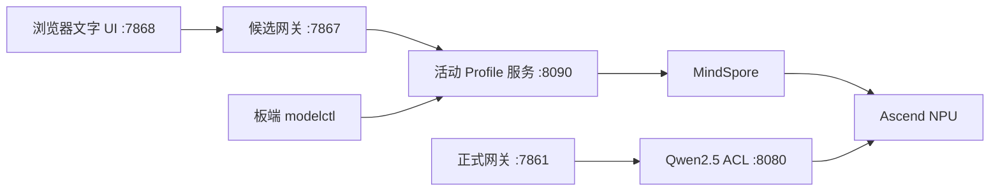

# 案例 9：智能聊天机器人

_本教程面向 Ascend310B4/8T 与 Ascend310B1/20T 的文本 LLM 实验，同时维护两条彼此独立的路线：Qwen2.5 静态 KV的 ONNX -> OM -> 原生 ACL 路线，以及 MindSpore/MindNLP 候选路线。2026-10-16 在当前 20T 地址 `192.168.1.101` 的隔离环境完成了超时修正复测：Qwen1.5-0.5B、Qwen1.5-1.8B 与 Qwen2.5-0.5B 通过技术机器门，保持 `experimental_isolated`；Qwen2-0.5B、Qwen2-1.5B 与 Qwen2.5-1.5B 完成生成和稳定性，但中文探测各出现一次 `U+FFFD`，保持 `blocked`。此前 30 秒客户端超时后的 TBE 子进程日志仅标记为 `timeout-confounded`，不是已确认的模型崩溃。Qwen3 仍在 MindNLP loader 门阻断，MiniCPM3 缺少可复现的固定工件。HF 权重默认通过 `HF_ENDPOINT=https://hf-mirror.com` 下载；这只改变传输入口，不改变哈希和模型来源。8T 仍需独立回归，本教程不会用 20T 结果推断 8T。_

## 1. 当前目标和已暂停范围

本案例的当前目标是把聊天模型以 OpenAI-compatible JSON/SSE 服务运行在昇腾 NPU 上，
再通过 Case9 网关和文字页面访问。当前只验收文字 LLM，不把文字服务当作 XiaoZhi
设备后端的完整证明。

| Profile 或链路 | 当前状态 |
| --- | --- |
| Qwen2.5 静态 KV ACL：`8080 -> 7861 -> 7865` | 现有正式基线不在本次切换；20T 当前 `.101` 的 B1 OM 完整验收通过，但短问候首事件 p50 约 `4.73 s`、约 `0.422 token/s`，不作为当前流畅文字入口 |
| `qwen1.5-0.5b-mindspore`：`.90` B4/8T 与 `.101` B1/20T | 8T 保持 `blocked`；20T 隔离复测完整机器门通过，首事件 p50 `671.868 ms`、`1.531 token/s`，标记 `experimental_isolated`，人工质量/正式准入待签字 |
| `qwen1.5-1.8b-mindspore`：`.90` B4/8T 与 `.101` B1/20T | 20T 隔离复测完整机器门通过；中英机器探测各 `5/5`，首事件 p50 `1561.806 ms`、`0.670 token/s`，标记 `experimental_isolated`；8T 未独立回归 |
| `tinyllama-1.1b-mindspore`：`.90` B4/8T 与 `.101` B1/20T | 20T 工件加载通过，但 32-token 出现 `U+FFFD`、随后服务崩溃；两板均 `blocked` |
| `qwen2.5-0.5b-mindspore`：`.90` B4/8T 与 `.101` B1/20T | 20T 隔离复测完成 JSON/SSE、64-token、10 轮稳定性和 30 次性能，标记 `experimental_isolated`；8T 未独立回归 |
| `qwen2-0.5b-mindspore`、`qwen2-1.5b-mindspore`、`qwen2.5-1.5b-mindspore`：`.101` B1/20T | 长输出与稳定性均已完成，但固定中文加法探测出现 `U+FFFD`，保持 `blocked`，不允许作为聊天后端 |
| 音频、麦克风、ASR/TTS、PTT、XiaoZhi、OTA、设备 WebSocket | 暂停，不安装、不启动、不验收 |

机器门只表示协议、资源和运行检查通过，不表示回答正确或适合生产。正式入口、音频
链路和 XiaoZhi 均须另行批准。

## 1.1 当前 20T 已验收模型与选择

本节的每一项都来自 `192.168.1.101` 的 Ascend310B1/20T 实测，而不是框架文档或
控制机推断。测试环境为 CANN `8.0.0`、Python `3.9.25`；`Health: Alarm` 仅保留为
诊断信息。统一验收包含工件哈希、目标 SoC、实际 NPU 生成、JSON/SSE、`8/16/32/64`
token 长输出、10 轮稳定性、中文机器探测、协议边界和 2 次预热后的 30 次性能测量。

本教程的证据等级按仓库约定标注：`observed-pass` 为板端实测通过，`observed-fail`
为板端实测失败，`blocked` 为前置条件未满足而未执行，`not-run` 为本轮有意未执行；
只有框架文档或控制机静态推断支持的结论分别标为 `documented` 或 `inferred`，不写成
板端通过。

| 模型 | 路线 | 完整机器门 | p50 首 token/首事件 | p50 总耗时 | token/s p50 | 当前选择 |
| --- | --- | --- | ---: | ---: | ---: | --- |
| Qwen1.5-0.5B-Chat | MindSpore 2.4.10 + MindNLP 0.4.1 | `observed-pass` | `671.868 ms` | `1310.003 ms` | `1.531` | 当前首选文字聊天候选 |
| Qwen1.5-1.8B-Chat | MindSpore 2.4.10 + MindNLP 0.4.1 | `observed-pass` | `1561.806 ms` | `2991.879 ms` | `0.670` | `experimental_isolated`，人工质量待审 |
| Qwen2.5-0.5B-Instruct 静态 KV 1024 FP32 OM | 原生 ACL/PyACL | `observed-pass` | `4727.8 ms` | `4741.3 ms` | `0.422` | 功能验证候选，不作为当前流畅入口 |
| Qwen2.5-0.5B MindSpore | MindSpore 2.4.10 + MindNLP 0.4.1 | `observed-pass` | `696.448 ms` | `1314.523 ms` | `1.531` | `experimental_isolated`，人工质量待审 |
| Qwen2-0.5B / Qwen2-1.5B / Qwen2.5-1.5B MindSpore | MindSpore 2.4.10 + MindNLP 0.4.1 | 生成与稳定性通过 | `693.995` / `1343.582` / `1428.028 ms` | `1338.346` / `2577.378` / `2698.279 ms` | `1.494` / `0.776` / `0.742` | 中文探测出现 `U+FFFD`，20T `blocked` |

Qwen1.5 的 64-token 请求实际生成 55 token 后正常 `stop`，10 轮稳定性为 `10/10`；
长中文输出连贯且 UTF-8 完整。它的健康接口同时记录 `device_target=Ascend` 与
`npu-smi=Ascend310B1`，因此本节不把它写成 CPU fallback。该板使用共享 `base`，其中
已有 Torch 相关包；适配器不导入这些包，但环境仍须标记为 `experimental_dirty_base`。

Qwen2.5 OM 的字节数为 `1,266,009,438`，SHA-256 为
`6bca884fbce746efdb02f8c9294cad5b2faa6c8b96cac9ec8c83730126298609`。其 48 个
KV cache 张量、tokenizer 锁、ACL descriptor 与 B1 SoC 均通过核对；运行中 NPU
AICore 约 `75-80%`，设备内存约 `9.0 GB`，证明该路线确实执行在 NPU。它慢的原因是
当前静态图及逐 token ACL 调用的延迟，不是模型无法运行或退回到 CPU。

因此，当前应优先在候选链使用 Qwen1.5 MindSpore；OM/ACL 路线继续保留作可复现的
低层功能验证和优化对象。两者均未自动替换正式 `8080 -> 7861 -> 7865` 入口。

当前 `.90` 的只读设备快照还显示周期性 `DRV_LPM_FAULT 0x80E3A203`，NPU 内存约
`13598/15610 MB`；在用户确认设备恢复前，暂停新的重模型加载和长压测。`Health: Alarm`
仅作为诊断记录，不单独替代模型门禁；快照、哈希和处理边界见
`samples/case9/docs/12-case9-evidence-index.md` 及其列出的验收记录。

## 1.2 MindSpore 候选模型范围

候选注册表同时保存已测试、失败和未执行的 Profile。下表是本教程当前固定的首批范围；
条件候选只用于记录研究状态，不下载、不安装，也不能由 `case9-modelctl` 启动。

| Profile | 8T B4 | 20T B1 | 首轮结论 |
| --- | --- | --- | --- |
| `qwen1.5-0.5b-mindspore` | 历史测得但本次 SSH 不可达，不能重测 | 20T 隔离机器门通过 | B1 `experimental_isolated`；8T 不从 B1 推断 |
| `qwen1.5-1.8b-mindspore` | 本次未运行 | 20T 隔离机器门通过 | B1 `experimental_isolated`；中英文机器探测各 `5/5` |
| `tinyllama-1.1b-mindspore` | 已测 | 已测 | 长输出/中文质量失败，保持 `blocked`；英文单独报告 |
| `deepseek-r1-qwen-1.5b-mindspore` | 历史兼容性报告保留 | 工件与 Ascend 加载通过，首次生成发生 TBE 子进程失败 | 当前组合 `blocked`；不把旧地址结果替代当前验收 |
| `qwen2-0.5b-instruct-mindspore` | 本次未运行 | JSON/SSE、64-token、稳定性和性能通过；中文 `U+FFFD` | B1 `blocked` 于文本完整性 |
| `qwen2-1.5b-instruct-mindspore` | 本次未运行 | JSON/SSE、64-token、稳定性和性能通过；中文 `U+FFFD` | B1 `blocked` 于文本完整性 |
| `qwen2.5-0.5b-mindspore` | 历史 context-only 诊断，非完整验收 | JSON/SSE、64-token、稳定性和性能通过 | B1 `experimental_isolated`；8T 不从 B1 推断 |
| `qwen2.5-1.5b-mindspore` | 历史短输出诊断，非完整验收 | 低占用重测完成生成、稳定性和性能；中文 `U+FFFD` | B1 `blocked` 于文本完整性 |
| `qwen3-0.6b-mindspore` | `blocked`：MindNLP 0.4.1 无 Qwen3 loader | `blocked`：同一 loader 探测确认无 Qwen3 loader，未下载权重 | 不升级环境 |
| `qwen3-1.7b-mindspore` | `blocked`：MindNLP 0.4.1 无 Qwen3 loader | `blocked`：同一 loader 探测确认无 Qwen3 loader，未下载权重 | 不升级环境 |
| `minicpm3-4b-mindspore` | 不执行 | `blocked`：专用类可见，但官方权重来自 Modelers；当前 `main` 未形成固定 revision/哈希锁，未下载权重 | 不把工件来源阻断写成模型不兼容 |

OpenPangu、EE-Model、TeleChat、BitCPM、MiniCPM5、MiniMind 和 Haidass 等条件候选
若依赖 Torch/Torch-NPU、vLLM、MindIE、新版 CANN 或缺少 310B 证据，则登记为
`blocked`/`not-run`，不得作为失败回退。模型来源、证据等级和具体阻断原因见
`samples/case9/docs/31-mindspore-llm-candidate-inventory.md` 和
`samples/case9/docs/12-case9-evidence-index.md`；框架支持不能替代当前板端 NPU 证据。

## 2. 浏览器、网关、ACL 和 NPU 架构

候选链一次只运行一个 MindSpore worker。浏览器没有管理接口，Profile 切换只能在板端
执行 `case9-modelctl`；网关密钥只存在板端环境。ONNX -> OM 路线和 MindSpore 路线
共享 NPU，但不共享进程、模型实例或验收结论；同一时刻只启动明确记录的那一条路线。

本案例的运行代码位于 `samples/case9/`：`app.py` 是 Bearer 保护的 OpenAI 兼容网关，
`mindspore_chat_service.py` 与 `mindspore_chat_providers.py` 是 MindSpore Profile 服务，
`qwen25_kv_acl_runtime.py` 与 `qwen25_kv_acl_service.py` 是原生 ACL/OM 路线，
`configs/chat_model_profiles.json` 是 Profile 注册表，`scripts/` 保存环境检查、启动、
验收和同步命令，`tests/` 保存单元与合同测试。操作者从 `samples/case9/README.md`
开始执行；编号工程文档和验收证据的索引入口是
`samples/case9/docs/12-case9-evidence-index.md`。



| 用途 | 服务 | 网关 | 页面 |
| --- | --- | --- | --- |
| MindSpore 候选 | `127.0.0.1:8090` | `127.0.0.1:7867` | `0.0.0.0:7868` |
| 正式 Qwen2.5 基线 | `127.0.0.1:8080` | `127.0.0.1:7861` | `0.0.0.0:7865` |

候选 UI 是实验页面，任何同网段主机都可能提交文字；只允许在可信实验网络使用。

## 3. 两种板卡和无 Torch 边界

`.90` 是 Ascend310B4/8T（`.11.14` 是此前活动地址，报告采集地址为 `.178`）；`.101` 是 Ascend310B1/20T。
`.11.14`、`.178`、`.95` 和 `.210` 都是历史地址，不应再用于新批次。两块板的 CANN、Python、MindSpore、MindNLP、驱动和
`npu-smi` 版本必须在每个批次重新快照，不能把一块板的环境结论复制给另一块板。
Qwen1.5、TinyLlama 和 DeepSeek 使用板端已有 `base`，因此逐板机器门全部通过后也只能标记
`experimental_dirty_base`；Qwen1.5 B4 当前身份门不完整而保持 `blocked`，TinyLlama 的既有失败证据仍保持 `blocked`，DeepSeek 的
质量和准入在双板数据补齐前保持未决。

每次在板端同一个 shell 中准备环境：

```bash
source /usr/local/miniconda3/etc/profile.d/conda.sh
conda activate base
source /usr/local/Ascend/ascend-toolkit/set_env.sh
# 版本以本批次 environment snapshot 为准；不要从另一块板复制版本结论。
# PYTHONNOUSERSITE=1 只用于负向诊断，不能作为服务启动环境。
unset PYTHONNOUSERSITE
cd ~/case9-mindspore-chat
export PYTHONPATH="$PWD${PYTHONPATH:+:$PYTHONPATH}"
# HF 权重默认经由镜像传输；固定 revision、大小和 SHA-256 校验不能省略。
export HF_ENDPOINT=https://hf-mirror.com
# mirror=modelers 的 Profile（例如 MiniCPM3）走 Modelers 独立 URL，不能用 HF_ENDPOINT 替代。
```

MindSpore 路线直接调用 MindSpore/MindNLP；现有 `torch`、`torch_npu`、`torchaudio`
和其他污染包只记录，不删除、不升级，适配代码不得导入它们。ONNX -> OM 路线使用
独立的 `case9-acl-om` 环境和原生 ACL，板端不安装 Torch、Transformers、ONNX Runtime、
vLLM 或 MindIE。两条路线都不修改系统 CANN、驱动、kernel 或 OPP。控制机 `sci-agent`
只用于静态检查、前端构建和外部参考，不把其运行时复制到板端。

## 4. 模型工件与哈希校验

### 4.1 CANN 8.0 隔离 MindSpore 扩展批次

在不改变正式 ACL 链路的前提下，新增模型必须先使用 `case9-ms240-cann80`
隔离环境。20T `192.168.1.101` 先做 loader、工件、NPU 单 token、JSON/SSE、
长输出、稳定性和性能门，再把轻量模型单独回归到 8T `192.168.1.90`；一块板的
结果不能推断另一块板。启动环境固定为：

```bash
source /usr/local/miniconda3/etc/profile.d/conda.sh
conda activate case9-ms240-cann80
source /usr/local/Ascend/ascend-toolkit/set_env.sh
export PYTHONNOUSERSITE=1
```

当前扩展候选包括 Qwen1.5-1.8B、Qwen2-0.5B、Qwen2-1.5B 和 InternLM2-1.8B；
InternLM2 只使用 MindNLP 原生 Auto* 映射，禁止 `trust_remote_code`。请求的
`01-ai/Yi-1.5-1.5B-Chat` 在 HF mirror 不存在，因此注册表只保留一个
`conditional/blocked` 事实记录，不下载，也不把 Yi-Coder 误当作通用聊天模型。
Qwen3、MindSpore Lite 和 XiaoZhi 转入后续版本/固件门控。

新批次使用通用 runner：

```bash
bash scripts/run_mindspore_board_campaign.sh --board 20t \
  --profile qwen2-0.5b-instruct-mindspore --model-root "$PWD" \
  --run-id qwen2-05b-20t-<utc>
```

旧的 `run_mindspore_20t_campaign.sh` 仍兼容，默认目标为 20T；任何 8T 调用必须
显式 `--board 8t`，以免错误复用 B1 的 SoC 检查。完整实施记录见
`samples/case9/docs/53-mindspore-isolated-extension-implementation-20261016.md`。

注册表是 `configs/chat_model_profiles.json`。两条路线的工件必须分开登记：ONNX -> OM
路线记录 ONNX、每块 SoC 对应的 OM、ATC 日志和 ACL descriptor；MindSpore 路线记录
checkpoint、tokenizer、配置、源码 revision 及环境锁。已有历史工件位于本地忽略目录：

```text
samples/case9/repro/qwen25-kv1024-dual-board-20260827/
samples/case9/repro/mindspore-chat-20260829/
```

补齐批次由 `scripts/sync_case9_gap_bundle.sh` 写入新的时间戳目录，不覆盖上述历史
证据。每个目录应含板端环境快照、原始验收报告、源码快照、`bundle-manifest.json`
和 `SHA256SUMS.txt`；清单记录来源 IP、SoC、字节数和 SHA-256，模型文件不提交 Git。
DeepSeek 的当前目标板是 `.101`；`.95` 和 `.210` 上的旧路径或旧缓存不能作为当前工件证明。

Qwen2.5 静态 KV 的已登记哈希（用于启动前核验）为：ONNX
`b4870df5da9c8cbef4163ceb65d4dc13433f2fd8ed5d2083ef3223d07d1a3c0e`，B4 OM
`f6650e52ff3908288763ef7957832ade606b0e554fa8fde986932f1ca1140eb8`，B1 OM
`6bca884fbce746efdb02f8c9294cad5b2faa6c8b96cac9ec8c83730126298609`，tokenizer
`c0382117ea329cdf097041132f6d735924b697924d6f6fc3945713e96ce87539`。哈希只证明
工件完整性，不证明目标板上的 ATC、ACL 或中文质量门通过。

启动前只读核验 Profile 声明的每个文件：

```bash
python scripts/verify_mindspore_profile_artifacts.py \
  --profile qwen1.5-0.5b-mindspore \
  --root "$PWD" \
  --output reports/mindspore-chat/qwen1.5-0.5b-mindspore/artifact-verify.json
```

返回 `passed` 才能记录 `artifact_verified`。下载或同步必须使用临时文件、远端字节数、
本地 SHA-256 和原子改名；不使用未验证的 LFS 指针、缓存目录或可变 `main` 作为模型证明。

## 5. 新板环境检查和模型门禁

在 `.90` 和 `.95` 分别记录 SoC、CANN、Python、磁盘、内存、HugePages、`npu-smi`
和污染包；`.178`/`.210` 只用于查阅历史报告：

```bash
python - <<'PY'
import importlib.metadata, sys
print("python", sys.version)
for name in ("mindspore", "mindnlp", "numpy", "pytest"):
    try:
        print(name, importlib.metadata.version(name))
    except importlib.metadata.PackageNotFoundError:
        print(name, "missing")
PY
npu-smi info
bash scripts/case9-modelctl.sh list
bash scripts/case9-modelctl.sh status
```

MindSpore Profile 没有 OM 转换步骤；其门禁是工件核验、MindSpore Ascend context、
tokenizer 导入、单 token 生成、JSON/SSE 契约、长输出、稳定性、质量和性能。Qwen2.5
的 ONNX -> ATC -> OM -> ACL 门禁属于独立正式基线，必须逐板确认 `Ascend310B4`
或 `Ascend310B1` 的 descriptor、输入输出 byte size、ACL smoke 和 NPU 采样，不能用
MindSpore 结果替代。任何门失败都记录为 `observed-fail`、`blocked` 或 `not-run`，不自动切换
CPU、云端或其他推理框架；没有当前 `.101` 的完整环境和工件快照前，不得把 `.210` 的
历史报告当作 20T 通过证据。

ONNX -> OM 路线的候选端口先使用 `127.0.0.1:8084`；通过完整门禁后才有资格替换正式
`127.0.0.1:8080`。MindSpore 路线使用 `127.0.0.1:8090`，两者不能同时占用同一 NPU
模型实例。

## 6. 候选 Profile 服务和 OpenAI API

`case9-modelctl` 负责停止旧 worker、启动新 worker、轮询健康状态和记录活动状态；失败
时尝试回滚，回滚也失败则 fail-closed：

```bash
CASE9_ALLOW_EXPERIMENTAL=1 bash scripts/case9-modelctl.sh switch qwen1.5-0.5b-mindspore
# 正式注册表中的 blocked/not-run Profile 会被 CLI 拒绝；测试批次只能使用明确标记
# 的临时注册表，不能用参数绕过工件、环境或质量门禁。
```

DeepSeek 的当前目标板是 `.101`；`.95` 与 `.210` 只保留为历史地址。服务固定监听
`127.0.0.1:8090`，内部模型名为 `case9-active`，请求限制如下：

- `messages` 只接受 `system`、`user`、`assistant`，使用 Profile tokenizer/chat template；
- batch 为 1，单进程单请求串行，实际 token 化后检查 context `1024`；
- `max_tokens` 默认 `32`、上限 `64`，只接受 `temperature=0`、`top_p=1`；
- 请求体上限 `256 KiB`，支持普通 JSON 和 OpenAI SSE；
- SSE 只发送前缀差量；实现包含超时 watchdog 和客户端中断清理，但 watchdog 实际触发、
  自动回滚及浏览器会话清空仍未获得本轮正向验收；
- 客户端不能指定 Profile、权重路径、后端或任意 Python 表达式。

接口为 `GET /health`、`GET /v1/models` 和 `POST /v1/chat/completions`。`/health` 返回
Profile、revision、环境指纹、NPU 型号、worker PID、busy、缓存清理和 admission 状态。

## 7. 网关和文字 UI 验证

Profile 服务健康后，在另一个板端 shell 启动候选链：

```bash
export GATEWAY_API_KEY="<板端内部 token>"
bash scripts/run_mindspore_chat_gateway.sh
bash scripts/run_mindspore_chat_text.sh
```

候选网关固定转发到 `http://127.0.0.1:8090/v1`，对外模型名是 `case9-rag`，并关闭 RAG
注入：

```dotenv
UPSTREAM_BASE_URL=http://127.0.0.1:8090/v1
UPSTREAM_MODEL=case9-active
RAG_ENABLED=false
MAX_CONCURRENT_REQUESTS=1
PUBLIC_MODEL_ID=case9-rag
```

浏览器按实际运行板卡访问 `http://192.168.1.90:7868/`（8T）或
`http://192.168.1.101:7868/`（20T）。已归档的候选链 smoke 报告包含未授权 `401`、授权
`/v1/models`、JSON/SSE 和 UI health 的历史响应；这些是协议/UI 证据，不是双板缺口批次
的自动通过。每次新批次都必须保存请求、响应、服务 PID 和板卡 IP，不能把 `.90` 的 UI
结果复制给 `.101`。

正式 `8080 -> 7861 -> 7865` 由本教程和候选脚本保持不变。

## 8. 长输出、稳定性、中文质量和性能测试

验收脚本只访问已启动的 loopback 服务，不管理 PID：

```bash
python scripts/mindspore_chat_acceptance.py \
  --profile qwen1.5-0.5b-mindspore --execute \
  --run-id qwen-full-20260829b --timeout 600 \
  --probe-file tests/fixtures/qwen25_chinese_probe.json \
  --output reports/mindspore-chat/qwen1.5-0.5b-mindspore/qwen-full-20260829b
```

已有可复核的历史数据如下；它们用于说明基线，不等于当前双板缺口批次已经通过：

| 路线/Profile | 板卡和采集地址 | 协议/批次 | 已测指标或门结果 | 当前解释 |
| --- | --- | --- | --- | --- |
| Qwen2.5 静态 KV ACL | B4/8T（当前 `.90`；历史采集 `.11.14`/`.178`） | 2 warmup + 30 SSE，`max_tokens=2` | 总耗时 p50/p95 `8,693.731/8,707.133 ms`；首事件 p50/p95 `8,563.591/8,576.954 ms`；约 `0.230/0.231 token/s` | 正式基线历史证据；本轮只补身份、工件和 descriptor 索引 |
| Qwen2.5 静态 KV ACL | B1/20T（旧采集 `.210`；当前 `.101`） | 同协议 | 总耗时 p50/p95 `6,486.422/6,506.085 ms`；首事件 p50/p95 `6,364.634/6,383.111 ms`；约 `0.308/0.310 token/s` | 只作为 B1 历史对照，不能与 B4 合并排名 |
| `qwen1.5-0.5b-mindspore` | B4/8T（当前 `.90`；历史报告 `.11.14`） | 2 warmup + 30 SSE，`max_tokens=2` | 历史报表机器门 `9/9`；历史身份字段缺失按 `8/9`，当前 G0 已补齐但严格 placement 仍失败 | 历史输出和性能保留，但 B4 当前 `blocked`；人工质量、重复故障定位和准入未完成 |
| `tinyllama-1.1b-mindspore` | B4/8T（当前 `.90`；历史报告 `.11.14`） | 同协议 | 总耗时 p50/p95 `3,114.857/3,185.731 ms`；首事件 p50/p95 `3,110.338/3,181.192 ms`；约 `0.642/0.651 token/s`；机器门 `8/9` | 32-token 输出含 `U+FFFD`，保持 `blocked` |
| `deepseek-r1-qwen-1.5b-mindspore` | B1/20T（`.95`） | 隔离 API 2 warmup + 30 SSE，`max_tokens=2` | 总耗时 p50/p95 `2,484.751/2,557.242 ms`；首事件 p50/p95 `2,478.495/2,551.004 ms`；约 `0.805/0.815 token/s` | 仅隔离实验；双板统一门、中文质量和准入仍未完成 |
| `qwen2.5-0.5b-mindspore` | B4/8T（当前 `.90`；旧 `.11.14`/`.178`） | loader 诊断 + 并发 `npu-smi` 采样 | 固定权重 `988,097,824` bytes；加载 `48.223862 s`；16 token 中文生成 `27.194196 s`；AICore 非零峰值约 `37%`、设备内存约 `38% -> 91% -> 46%` | context-only 活动旁证；无显式 placement metadata，严格 worker `blocked`；未启动 API/网关，不是正式候选通过 |

缺口批次必须在两块板分别执行，状态只能引用相应原始报告：

| 缺口门 | 当前 `.90` B4/8T（历史报告 `.11.14`/`.178`） | `.101` B1/20T |
| --- | --- | --- |
| Qwen2.5 ONNX/OM 当前身份、descriptor、ACL smoke | `observed-pass`（identity-only；历史性能不重跑） | `blocked`（当前 ONNX/OM/contract/lock 缺失，未执行 ACL load） |
| Qwen1.5 MindSpore 长输出、稳定性、质量、性能 | 历史报表 9/9，但严格身份门 8/9，当前 `blocked`；共享 `base`，人工质量待审 | `observed-pass`，9/9 机器门，人工质量待审，`experimental_dirty_base` |
| TinyLlama MindSpore 长输出、稳定性、质量、性能 | `blocked`（历史长输出/中文质量失败） | `observed-fail`，8/9；32/48 token UTF-8 失败，保持 `blocked` |
| DeepSeek MindSpore API、稳定性、质量、性能 | `observed-pass`，9/9 机器门，人工质量待审，`experimental_dirty_base` | 已有隔离 API 机器门；中文质量和正式准入 `blocked` |
| Qwen2.5-0.5B MindSpore loader/placement | `blocked`；固定工件和 NPU 活动诊断已记录，严格 placement 缺失 | `observed-pass`；隔离环境完成 API、64-token、稳定性、机器质量与性能，`experimental_isolated` |
| Qwen2.5-1.5B MindSpore 配置/权重加载 | `blocked`；初次污染环境 SIGSEGV（exit 139）保留为历史证据，正确 CANN v4 已加载并生成 2 token，但 placement/API/质量/性能未运行 | 非质量机器门 `observed-pass`；中文 `U+FFFD`，故 `blocked` |
| Qwen3-0.6B/1.7B MindSpore loader | `blocked`；MindNLP 0.4.1 无 Qwen3 loader，未下载权重 | `blocked`；同一 loader 探测，未下载权重 |

上述状态直接对应本地复现包中的原始报告；`not-run` 只保留有意未执行的跨 SoC 兼容性组合，
不是对板端能力的推断。历史两批错误边界为 `6/6`，
协议边界包含超上下文、超大正文和客户端中断后的 health 检查；这些结果仍需在双板批次
中分别复核。早期 Qwen 日志曾有 TBE 进程、leaked semaphore、dtype、`top_p` 和 attention
mask 告警；post-mask n 批次已固定 `top_p=1.0` 并显式传入 mask。`Health: Alarm` 只作为
诊断记录，不单独阻断结果。

在 post-mask n 批次后，8T 内核记录了重复 `DRV_LPM_FAULT 0x80E3A203`，blackbox 描述为
`lpm get current error`。原 worker 退出后，受控启动的新 worker `15897` 完成了缩小恢复
批次（2/4 token 长输出、1 次稳定性、1 次性能、错误与协议边界）和候选链复核；这只证明
服务恢复，不证明硬件稳定。恢复时 NPU 内存约 `14.9/15.6 GB`、HugePages `547/547`，应先
解决或定位该诊断事件，再重新执行完整稳定性和性能批次。

机器有效不等于中文正确。Qwen 的历史硬件探测存在事实错误，TinyLlama 主要面向英文；
正式中文/英文人工评分、`quality_reviewed` 和 `admitted` 仍未完成。任何一块板的性能
数字都必须带 SoC、环境、warmup、循环数、百分位方法和报告路径，不能只抄到教程表格。

## 9. 失败处理、回滚和证据保存

每次批次使用唯一 UTC 目录，保存命令、PID、服务日志、环境指纹、模型哈希、原始响应和
`npu-smi` before/during/after 快照。失败时：

1. 只停止本批次明确记录且命令行匹配的 worker PID；
2. 保留失败日志、哈希和报告，不删除系统 CANN、conda 缓存、其他模型或正式服务；
3. 维持 `blocked`、`not-run` 或具体失败状态，不自动切换 CPU、云端、Torch、vLLM、MindIE
   或其他模型；
4. 切换失败先回滚上一个已验证 Profile，回滚失败则保持候选链不可用；
5. 新板复现时重新做环境、工件、加载、API、稳定性、质量和性能门，不能因相同模型名
   或 IP 别名自动继承正式状态。

若出现 `DRV_LPM_FAULT`、设备重置、worker 非正常退出或 NPU 内存持续增长，先保存
`dmesg -T`、`npu-smi info`、`modelctl status`、监听端口和本批次 PID，再停止扩大测试；
不得把一次受控恢复写成模型稳定性通过。

详细原始文件位于 `repro/mindspore-chat-20260829/`、
`repro/qwen25-kv1024-dual-board-20260827/` 以及每次生成的
`repro/case9-dual-board-gap-<timestamp>/`（本地忽略）；板端对应
`~/case9-mindspore-chat/run/`、`reports/`。TinyLlama 的 `U+FFFD`、`.210` 历史地址的
连接失败记录和任何新的 `.95` 门禁失败都必须保留，不能改写成当前地址的成功结果。

## 10. XiaoZhi 后续边界

本轮不安装或启动 `xiaozhi-esp32-server`，不提供 OTA、设备 WebSocket、Opus、ASR/TTS
或真实设备命令。文字 LLM 的 JSON/SSE 成功不能证明 XiaoZhi 语音闭环可用。恢复该阶段
前，需单独审核无 Torch 的语音组件、设备协议、鉴权、音频资源和真实设备端到端验收。

模型候选的来源、证据分级、逐板执行顺序和验收记录由 `samples/case9/docs/` 下的编号
工程文档维护，索引入口是 `samples/case9/docs/12-case9-evidence-index.md`。本教程正文
可以独立阅读，只保留可复现的命令、边界和已测结果，不把工程文档当作理解正文的前置
条件。

参考：[MindSpore Orange Pi 在线推理目录][mindspore-orange-pi]、[Qwen1.5 模型卡][qwen15]、
[TinyLlama 模型卡][tinyllama]、[DeepSeek 模型卡][deepseek]、[昇腾 ATC 文档][atc]。

[mindspore-orange-pi]: https://www.mindspore.cn/tutorials/zh-CN/master/orange_pi/model_infer.html "MindSpore Orange Pi"
[qwen15]: https://huggingface.co/Qwen/Qwen1.5-0.5B-Chat "Qwen1.5-0.5B-Chat"
[tinyllama]: https://huggingface.co/TinyLlama/TinyLlama-1.1B-Chat-v1.0 "TinyLlama"
[deepseek]: https://huggingface.co/MindSpore-Lab/DeepSeek-R1-Distill-Qwen-1.5B-FP16 "DeepSeek-R1-Distill-Qwen-1.5B-FP16"
[atc]: https://www.hiascend.com/document/detail/en/canncommercial/800/devaids/atc/atlasatcparam_16_0036.html "ATC soc_version"
