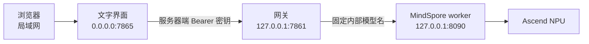
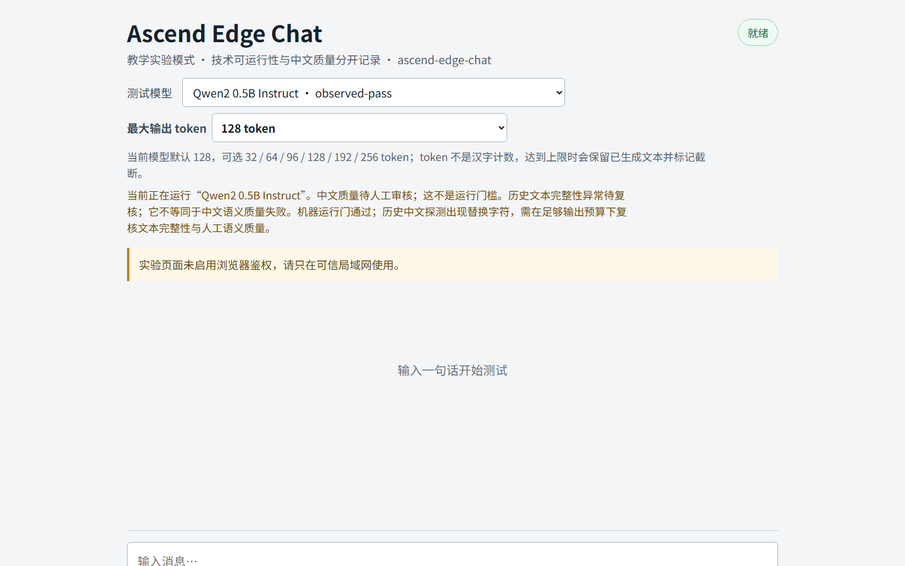

# 案例 9：智能聊天机器人

本案例实现 **Ascend Edge Chat**：一个部署在昇腾边缘设备上的文字聊天服务。它将浏览器文字界面、带 Bearer 鉴权的 OpenAI 兼容网关和 MindSpore 推理 worker 分成三个进程。这样既能在局域网中提供易用的聊天页面，也能让后续应用通过标准接口调用模型。

本案例的发布基线是 Ascend 310B1 / 20T，默认模型为 Qwen1.5-0.5B-Chat。它是技术预览，不包含语音、ASR/TTS、设备协议或知识检索。教学目录还保留所有已经出现技术运行证据的模型；模型是否能运行与中文回答质量分开判断。其他硬件、模型或软件版本不能直接继承本案例的结论，必须重新执行本章的验证门。

## 1. 学习目标

完成本章后，你应能：

1. 说明浏览器、网关、推理 worker 和 NPU 的职责边界；
2. 用固定模型锁文件验证权重、tokenizer 和配置文件；
3. 部署 OpenAI 兼容的 JSON 与 SSE 文字聊天接口；
4. 理解局域网网页未鉴权的风险，以及为什么 Bearer 密钥不能进入浏览器；
5. 为一个新模型设计受控的 Provider、模型配置、工件锁和板端验收流程；
6. 区分“技术可运行”“输出质量”和“正式发布准入”三个不同结论。

## 2. 系统架构

浏览器不直接访问模型，也不知道网关密钥。网页进程在服务器端保存密钥，再调用回环地址上的网关。网关验证请求后，将固定的内部模型名转发给回环地址上的 MindSpore worker。worker 一次只加载一个 profile 并串行执行生成，避免多个大模型同时争用边缘 NPU。页面可以选择教学目录中的实验模型，但模型切换必须停止并重启 worker，不能在请求中偷偷替换模型。



三个端口承担不同角色：

| 端口 | 绑定地址 | 职责 | 安全要求 |
| --- | --- | --- | --- |
| `7865` | `0.0.0.0` | 浏览器文字页面 | 仅可信局域网；没有网页登录 |
| `7861` | `127.0.0.1` | OpenAI 兼容网关 | Bearer 鉴权 |
| `8090` | `127.0.0.1` | MindSpore 推理 worker | 不向网络暴露 |

网页没有浏览器登录功能。因此，同一可达网段中的主机都可以发送消息。不要做端口映射，不要将 `7865` 放到公网反向代理之后，也不要在不可信网络使用本页面。

## 3. 发布模型与工件锁

模型来自 [Qwen1.5-0.5B-Chat](https://huggingface.co/Qwen/Qwen1.5-0.5B-Chat)。程序不会根据模型名称自动下载任何版本，而是读取 `configs/release-model.json` 中的固定 revision、文件名、大小和 SHA-256。

需要的工件包括：

| 文件 | 用途 |
| --- | --- |
| `model.safetensors` | 模型权重 |
| `tokenizer.json` | tokenizer 数据 |
| `config.json` | 模型结构配置 |
| `tokenizer_config.json`、`vocab.json`、`merges.txt` | tokenizer 元数据与词表 |
| `generation_config.json` | 生成元数据 |

下载或离线导入都必须执行相同的完整性流程：


模型目录应位于源代码目录之外，例如 `/opt/ascend-edge-chat-data`。模型、日志、缓存和报告都不应提交到 Git。源代码使用 Apache-2.0；锁定的 Qwen revision 使用 [Tongyi Qianwen Research License Agreement](https://huggingface.co/Qwen/Qwen1.5-0.5B-Chat/blob/4d14e384a4b037942bb3f3016665157c8bcb70ea/LICENSE)，仅覆盖非商业用途；商业使用需要向模型发布方另行取得许可。不能从代码许可证推断模型使用权。

正式发布锁只包含默认 Qwen1.5 profile。教学实验使用 `configs/tutorial-model-catalog.json` 展示模型的技术状态、质量状态和失败原因，使用 `configs/tutorial-models.json` 作为显式 worker registry。这样既不会污染正式发布工件锁，也不会把“中文质量失败”误写成“模型不能运行”。

## 4. 环境准备

本案例不安装或升级驱动、固件、CANN、OPP、MindSpore 或 MindNLP。先在目标开发板上选择一个已经验证的 Conda 环境，再在同一个 shell 中激活 CANN 环境。

```bash
cd /opt/ascend-edge-chat
export ASCEND_EDGE_CHAT_CONDA_ENV='<已验证的 Conda 环境名称>'
source /usr/local/miniconda3/etc/profile.d/conda.sh
conda activate "$ASCEND_EDGE_CHAT_CONDA_ENV"
python -m pip install --no-deps .
export ASCEND_EDGE_CHAT_DATA_DIR=/opt/ascend-edge-chat-data
cp configs/release.env.example .env
chmod 600 .env
```

编辑 `.env`，将 `ASCEND_EDGE_CHAT_GATEWAY_API_KEY` 改成至少 24 个 ASCII 字符的随机值。不要将密钥写入源代码、浏览器 JavaScript、终端截图或 Git 提交。

若预检发现当前环境缺少 FastAPI、Pydantic、Uvicorn 或 dotenv，不要依赖 user-site。应先准备经过审核的本地 wheel 目录，再执行带哈希的最小服务依赖安装：

```bash
export ASCEND_EDGE_CHAT_WHEELHOUSE=/opt/ascend-edge-chat-wheelhouse
bash scripts/verify/install-service-dependencies.sh
```

该脚本使用 `--no-index --no-deps --require-hashes`，只安装发布锁中的服务层依赖，不升级 CANN、MindSpore、MindNLP，也不安装新的模型推理框架。

执行环境预检：

```bash
bash scripts/verify/release-preflight.sh
```

预检会显示 Python 可执行文件，导入 `acl`、MindSpore 与 MindNLP，显示 `npu-smi info`，核对所有模型文件，并解析网关配置。预检失败时应先定位环境、CANN 或模型文件问题；不能为了获得响应而自动改用 CPU、云端或其他推理框架。

## 5. 获取或导入模型

通过镜像下载时：

```bash
bash scripts/import/download-model.sh
```

通过离线目录导入时：

```bash
bash scripts/import/import-model.sh /mnt/offline/qwen1.5-0.5b
```

两种方法都会先写入临时文件，再检查服务端声明长度、本地实际长度和 SHA-256。校验失败的临时文件会被删除，已验证的目标文件不会被覆盖。可在启动前再次核验：

```bash
ascend-edge-chat verify --data-dir "$ASCEND_EDGE_CHAT_DATA_DIR"
```

## 6. 启动服务

分别打开三个终端，在项目根目录执行：

```bash
# 终端一：NPU worker
bash scripts/run/start-worker.sh

# 终端二：网关
bash scripts/run/start-gateway.sh

# 终端三：文字页面
bash scripts/run/start-ui.sh
```

三个脚本都在前台运行，便于查看错误并按 `Ctrl+C` 停止对应进程。不要使用宽泛的进程名匹配来结束其他 NPU 任务。

命令行入口等价于：

```bash
ascend-edge-chat worker
ascend-edge-chat gateway --check-config
ascend-edge-chat ui
```

### 6.1 选择教学模型

页面会列出教学目录。`selectable=true` 表示已有技术运行证据，哪怕
`quality_status` 是 `failed` 或 `pending` 也仍可选；`blocked`/`not-run` 表示
尚未完成 loader、工件或 NPU 前置门，暂时不能启动。页面选择不同模型后会提示
重启命令，而不是热切换已经占用 NPU 的进程。

```bash
export ASCEND_EDGE_CHAT_PROFILE=qwen2-1.5b-instruct-mindspore
ascend-edge-chat worker \
  --profile "$ASCEND_EDGE_CHAT_PROFILE" \
  --registry configs/tutorial-models.json
```

如果选择的模型没有完整本地缓存，启动器会在加载 MindSpore 前失败；它不会
自动改用 CPU、云端或未锁定的远程权重。完成测试后停止该 worker，再恢复默认
profile：

```bash
ascend-edge-chat worker --profile qwen1.5-0.5b-chat
```

`app.py` 与 `text_chat_app.py` 仅为短期兼容包装器。新部署和二次开发脚本应使用 `ascend-edge-chat` 命令。

## 7. 调用 OpenAI 兼容接口

网关公开模型名固定为 `ascend-edge-chat`。调用方必须携带 Bearer 密钥。

```bash
curl http://127.0.0.1:7861/v1/models \
  -H "Authorization: Bearer $ASCEND_EDGE_CHAT_GATEWAY_API_KEY"

curl http://127.0.0.1:7861/v1/chat/completions \
  -H "Authorization: Bearer $ASCEND_EDGE_CHAT_GATEWAY_API_KEY" \
  -H 'Content-Type: application/json' \
  -d '{
    "model":"ascend-edge-chat",
    "messages":[{"role":"user","content":"请用一句中文介绍你自己。"}],
    "temperature":0,
    "top_p":1,
    "max_tokens":32
  }'
```

将 `stream` 设置为 `true` 可获得 Server-Sent Events。网关会将 worker 的内部模型名改写为公开模型名，再把增量返回给客户端。

接口限制如下：

- 仅接受 `system`、`user`、`assistant` 三种角色；
- 仅支持 greedy 解码：`temperature=0`、`top_p=1`；
- 最大上下文为 1024 token，最大输出为 64 token；
- 单进程、单请求串行执行；
- 请求体最大 256 KiB；
- 超时或运行时错误时 fail-closed，不自动切换后端。

浏览器会话只保存在 UI 进程内存中，最多保留 4 条消息和 4,000 个字符。清空会话、重启页面服务或停止进程都会丢弃这些消息。

## 8. 验收方法

不能用“服务已启动”代替模型验收。每个目标板都应独立记录以下证据：

1. SoC、CANN、Python、MindSpore、MindNLP、驱动和模型 SHA-256；
2. worker NPU 初始化和单 token 生成；
3. `/health`、`/v1/models`、JSON 与 SSE；
4. `8`、`16`、`32`、`64` token 的 UTF-8、结束原因和截断检查；
5. 连续 10 轮短请求的 PID、RSS、文件描述符和 NPU 快照；
6. 浏览器页面通过网关完成一次对话；
7. 明确 warmup、轮数、百分位算法的首 token、总延迟和 token/s；
8. 保存中文和英文完整响应，分别标注“可理解、部分可理解、不可理解”；
9. 将技术门和质量门分别写入报告，不因为质量失败而删除可运行模型。

本案例在 20T 参考硬件的历史测量中记录过约 `672 ms` 的首 token p50、约 `1.31 s` 的完成 p50 与约 `1.53 token/s` 的吞吐 p50。该数据只描述特定日期、环境、负载和提示词条件，不能外推到 8T、另一块 20T 板、不同 CANN、不同模型 revision 或并发负载。

## 9. 教学模型的实测结果与原因

下表是本案例已有板端证据的摘要。`observed-pass` 只说明机器和接口路径
通过；它不等同于中文回答优秀。相反，`quality_status=failed` 也不等同于
NPU 不能运行。

| 模型 | 技术结果 | 质量结果 | 现象原因 |
| --- | --- | --- | --- |
| Qwen1.5 0.5B | 20T 机器门通过 | 待人工审核 | 默认基线，先用它验证环境和协议 |
| Qwen1.5 1.8B | 20T 机器门通过 | 待人工审核 | 更大模型，速度和内存需要单独测量 |
| Qwen2 0.5B/1.5B | 20T API、长输出、稳定性通过 | 中文探测含 `U+FFFD` | tokenizer/解码文本完整性问题；不是 NPU 加载失败 |
| Qwen2.5 0.5B | 修正客户端超时后机器门通过 | 待审核 | 早期 30 秒超时误杀了测试，不能当作模型崩溃 |
| Qwen2.5 1.5B | 低占用路径可运行；另有高占用 `Alloc failed` | 中文探测含 `U+FFFD` | 内存占用路径和文本解码问题必须分开记录 |
| TinyLlama 1.1B | 短请求可运行；长输出退化 | 中文弱，长输出出现 `U+FFFD`/TBE | 主要面向英文，短 smoke 仍适合课堂复现边界 |
| DeepSeek-R1 Distill 1.5B | 两板有 NPU/API 证据，速度较慢 | 推理前缀或事实错误 | `<think>` 预算和模型行为影响结果，不代表没有 NPU 推理 |
| Qwen3 0.6B | 未进入加载 | 未测试 | 当前 MindNLP 没有 loader，属于前置阻断 |
| MiniCPM3 4B | 未测试 | 未测试 | 专用 loader、权重和内存门尚未完成 |

学生应先复制原始响应，再分析 tokenizer、chat template、`finish_reason`、
设备内存和 `npu-smi`。不要把中文质量表格改写成硬件兼容性结论。

## 10. 二次开发

新模型不是通过任意请求参数注入路径或 Python 代码。教学模型通过受控 registry
和目录加入页面；正式发布模型仍需要独立锁文件。新模型需要实现
`BackendProvider` 协议，并提供：

- `start()`：加载已验证工件并初始化设备；
- `healthy`：报告是否可以继续服务；
- `status()`：返回不含密钥的运行状态；
- `stream()`：为一次 greedy 请求产生累计文本与 token 数；
- `close()`：按确定顺序释放模型和设备资源。

为新模型建立固定 revision、文件大小、SHA-256、tokenizer、chat template、许可证、目标 SoC 和运行时指纹。先完成本地 JSON/SSE 契约测试，再在每一种目标硬件上完成上述 NPU、稳定性、性能和人工质量门。技术门通过即可进入教学目录；质量结论必须原样保留。只有经过独立复核并人工批准的模型才能进入正式发布配置。

## 11. 板端实测记录（2026-10-17 至 2026-10-18） {#src-experiment-case9-board-evidence}

本案例的发布目标是 **Ascend310B1 / 20T**，本轮在 20T 上使用已验证的 `case9-ms240-cann80` 环境运行；8T 不是该版本的发布目标，因此没有 8T 结果，也没有把 20T 结果混入 8T。原始日志与响应保存在 [`docs/case-board-runs-20261017/case9/`](../../docs/case-board-runs-20261017/case9/README.md)。

| 项目 | 20T |
| --- | --- |
| SoC | `Ascend310B1` |
| CANN / 驱动 | 8.0.0 / 25.2.0 |
| Python | 3.9.2 |
| release preflight | 通过；MindSpore 2.4.10、MindNLP 0.4.1、ACL 导入成功 |
| worker | 启动并监听 `127.0.0.1:8090` |
| gateway | 启动并监听 `127.0.0.1:7861` |
| UI | HTTP 200，监听 `0.0.0.0:7865` |
| 真实 chat completion | 通过；`finish_reason=length`，16 completion tokens |
| UI 截图 | 通过，1440×900 |

请求使用固定 Qwen1.5-0.5B Chat 模型与低 token 预算，返回内容是生成结果，不代表准确率或长上下文能力；UI 未启用登录，仅用于可信局域网。

**证据等级**：worker/gateway/UI 启动与一次真实 completion 为 `observed-pass`（20T）。
**本轮未验证**：回答质量评估、长上下文、并发、8T 兼容性。



## 12. 小结

Ascend Edge Chat 将网页、鉴权网关和 NPU worker 分离，使文字聊天服务具备清晰的网络边界、模型完整性边界和二次开发边界。固定发布模型和严格工件校验提高了复现性；回环 worker、Bearer 网关和局域网安全提示降低了误配置风险。后续扩展应以实测硬件证据为准，而不是以目录中存在的历史实验、模型名称或文档推断为准。
