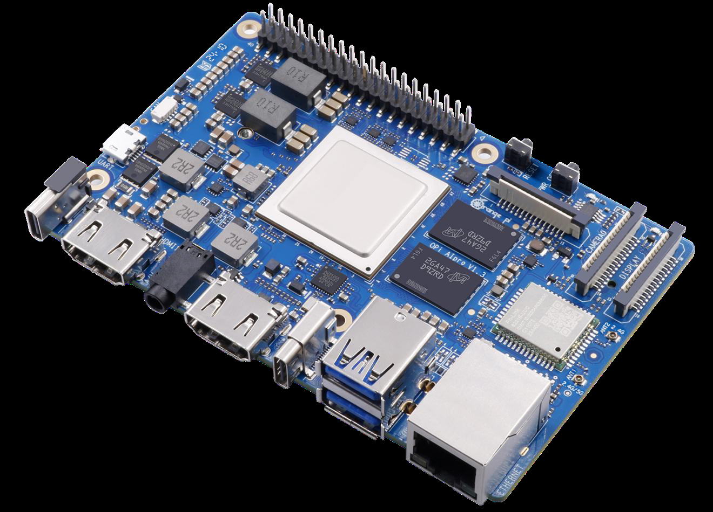
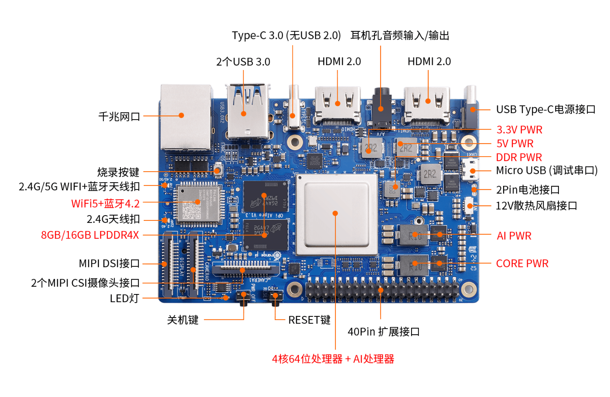

<!-- _class: cover -->

# 第1章：昇腾310B边缘计算基础

周贤中 · zhouxzh@gdut.edu.cn

## 从云边边界到可验证的算力选择

理论章节课件 · 教师授课版

依据：<a href="../book/chapter1.md">src/book/chapter1.md</a>、<a href="../appendix/appendix1.md">src/appendix/appendix1.md</a>

<!--
开场先说明本章不是产品参数朗读课，而是一条从任务约束到 310B 档位选择的决策链。
-->

---

## 先问：数据在哪里产生，决策在哪里发生

| 比较项 | 云计算 | 边缘计算 |
|---|---|---|
| 计算位置 | 集中数据中心 | 数据源、网关或设备附近 |
| 主要价值 | 弹性资源、集中运维、训练 | 本地处理、低时延、带宽节省 |
| 主要代价 | 网络往返、持续回传成本 | 节点分散、现场维护更复杂 |
| 适合任务 | 非实时批处理、全局训练 | 实时推理、局部控制、离线自治 |

云和边不是替代关系。合理的系统会同时使用端、边、云，而不是把全部任务压到一侧。

教材：<a href="../book/chapter1.md#边缘计算简介"><code>src/book/chapter1.md</code>「边缘计算简介」</a>

<!--
让学生先按数据源、时延和网络条件判断，不要从“哪个芯片更强”开始。
-->

---

## 选边还是上云：用约束而不是口号

| 约束 | 优先放云 | 优先放边 | 决策证据 |
|---|---|---|---|
| 时延 | 非实时分析 | 控制闭环、连续推理 | 端到端SLO |
| 上行带宽 | 可稳定上传原始数据 | 原始视频或传感器流量大 | 链路容量与成本 |
| 数据治理 | 集中合规可控 | 敏感数据需就地保留 | 数据分类与法规 |
| 全局能力 | 训练、跨区域调度 | 离线运行、本地告警 | 业务连续性要求 |

把功能放到边缘的理由必须能被时延、带宽、隐私或离线能力量化，否则应先留在云端。

教材：<a href="../book/chapter1.md#何时采用边缘计算"><code>src/book/chapter1.md</code>「何时采用边缘计算」</a>

<!--
强调“边缘优先”不是默认答案，任何下沉决定都要有可观测指标。
-->

---

## 边缘 AI 卡演进：从连接到专用推理

1. 早期节点以低功耗 CPU 为主，承担采集、协议转换与转发。
2. FPGA 与 VPU 进入视觉现场，用可重构或专用数据通路降低延迟。
3. GPU 与 CUDA 把并行计算带到边缘，也带来成熟的软件生态。
4. SoC 集成 CPU、NPU 与多媒体单元，面向低功耗、小型化设备。
5. 当前竞争不只看 TOPS，还看功耗、成本、软件栈、接口与行业生态。

教材：<a href="../book/chapter1.md#边缘计算卡的发展历史"><code>src/book/chapter1.md</code>「边缘计算卡的发展历史」</a>

<!--
带学生比较技术路线的目标，而不是背厂商时间线。
-->

---

## 三条路线：先看任务，再看芯片

| 路线 | 代表形态 | 主要优势 | 需要核对的边界 |
|---|---|---|---|
| 华为昇腾 310B | Atlas 模组、开发板、边缘服务器 | CANN 全栈、本地视频与推理 | 版本配套、生态成熟度 |
| NVIDIA Jetson | 模组与开发套件 | CUDA、TensorRT 生态 | 价格、功耗与供应链 |
| 瑞芯微 RK3588 | 集成 SoC 与核心板 | CPU、NPU、多媒体集成度高 | 绝对算力与软件栈 |

三条路线面向不同系统边界。选型时先写清模型、接口和实时约束，再比较具体型号。

教材：<a href="../book/chapter1.md#常见的边缘计算卡"><code>src/book/chapter1.md</code>「常见的边缘计算卡」</a>

<!--
不要用跨厂商的单一 TOPS 数字直接排序，先确认各自能完成什么系统工作。
-->

---

## 选型先过五道门

- **任务门**：模型、输入尺寸、精度和端到端时延是否明确。
- **软件门**：框架、算子、驱动、固件和 CANN 是否有可运行组合。
- **媒体门**：摄像头、编解码、显示和总线带宽是否满足数据流。
- **环境门**：现场温度、散热、供电和封装是否允许长期运行。
- **交付门**：版本能否固定，故障能否诊断，升级是否可以回退。

教材：<a href="../book/chapter1.md#昇腾310B简介"><code>src/book/chapter1.md</code>「昇腾310B简介」</a>

<!--
把五道门写在黑板上，要求后续每个硬件选择都引用对应证据。
-->

---

<!-- _class: visual -->

## 真实对象：OrangePi AIpro 8T 整板

图片：<a href="../appendix/img1/aipro.png"><code>src/appendix/img1/aipro.png</code></a>；说明：<a href="../appendix/appendix1.md#昇腾310b开发板介绍"><code>src/appendix/appendix1.md</code></a>

<!--
这张图只证明 OrangePi AIpro 8T 整板外观，不代表 20T 板。正文的 310B 8T 模块表列出 LPDDR4X 4GB，而画册材料写整板可配 8GB/16GB，课堂必须区分模块规格与整板配置。
-->

---

## 接口决定实验能否成立

<figure><figcaption>真实开发板的正面接口标注，不代表其他板卡型号。</figcaption></figure>
<ul><li>显示：两路 HDMI，另有 MIPI-DSI。</li><li>视觉：两路 MIPI-CSI，可外接兼容摄像头。</li><li>调试：Micro USB 串口，不依赖图形桌面。</li><li>扩展：TF、M.2、千兆网口与 USB 3.0。</li></ul>

图片：<a href="../appendix/img1/1.png"><code>src/appendix/img1/1.png</code></a>；接口：<a href="../appendix/appendix1.md#昇腾310b开发板介绍"><code>src/appendix/appendix1.md</code></a>

<!--
先问实验需要哪些接口，再看板子是否具备。Type-C 的 USB 3.0 兼容边界、MIPI 摄像头型号和供电规格都要单独核对。
-->

---

## 8T 与 20T：同架构，不同资源上限

| 项目 | Ascend 310B4 / 8T | Ascend 310B1 / 20T |
|---|---|---|
| INT8 / FP16 | 8 TOPS / 4 TFLOPS | 20 TOPS / 10 TFLOPS |
| CPU | 4核 × 1.0 GHz | 4核 × 1.6 GHz |
| 模块内存 | LPDDR4X 4 GB，25.6 GB/s | 最高 12 GB，最高 51.2 GB/s |
| 1080P30 编 / 解 | 12 / 20 路 | 20 / 40 路 |
| 典型功耗 | 21 W | 25 W |

两档共享核心架构、接口与外形，但硬件资源不同。最终档位以 `npu-smi` 和实际板卡配置为准。

教材：<a href="../book/chapter1.md#昇腾310b技术规格详解"><code>src/book/chapter1.md</code>「昇腾310B技术规格详解」</a>

<!--
表格只说明模块规格。不能把 20T 的理论参数直接换算成某个模型的帧率，也不能把模块内存与整板内存混写。
-->

---

## 双板证据：从第一天就分栏

| 项目 | 8T 证据集 | 20T 证据集 |
|---|---|---|
| SoC | `Ascend310B4` | `Ascend310B1` |
| 计算档位 | 8T | 20T |
| 系统与 CANN | Ubuntu 22.04.3，CANN 8.0.0 | 同左，但仍是独立证据集 |
| 驱动与 npu-smi | 25.2.0 | 25.2.0 |
| 健康与温度快照 | Alarm，78 C | Alarm，70 C |
| chapter1 样例状态 | `N/A` | `N/A` |

这次记录用于 chapter2 至 chapter9 的样例；第1章本身没有可执行样例，因此不产生本章性能数字。

记录：<a href="../../docs/ascend310b-chapter-board-comparison-20261017.md"><code>docs/ascend310b-chapter-board-comparison-20261017.md</code> §2</a>

<!--
8T 与 20T 的每行都要分开保存。Alarm 是已知板况，只能作为诊断背景，不能当作通过或失败结论，也不能把两块板的数字合并排名。
-->

---

## 本次双板记录：方向并不单一

| 同一测试协议 | 8T 观测 | 20T 观测 | 能说明什么 |
|---|---:|---:|---|
| chapter2 `msame` 单次推理 | 13.232 ms | 11.748 ms | 本次该模型路径 20T 较低 |
| chapter3 NPU 50 epochs 墙钟 | 56.908 s | 78.532 s | 本次任务 20T 反而较慢 |
| chapter8 ResNet18 Execute mean | 4.9787 ms | 3.7255 ms | 本次该基线 20T 较低 |

这些是两块板的记录值，不是第1章基准，也不是纯算子性能。它们只能支持具体测试路径的判断。

记录：<a href="../../docs/ascend310b-chapter-board-comparison-20261017.md"><code>docs/ascend310b-chapter-board-comparison-20261017.md</code> §3、§5</a>

<!--
重点讲“方向不同”，不要做整机排行榜。墙钟时间包含编译、数据管线和后台负载，不能把 78.532 s 解释成 NPU 算子慢了同样比例。
-->

---

## 为什么不把 TOPS 直接换算成现场吞吐

- **图编译与首次加载**会进入任务总时间，但不等同于稳定推理耗时。
- **数据预处理**可能受 CPU、内存搬运和图像解码限制。
- **Host 与 Device 拷贝**会把端到端时间拉长。
- **编解码与传感器 I/O**可能先于 NPU 成为瓶颈。
- **温度、后台负载和版本差异**会改变重复运行的结果。

依据：<a href="../../docs/ascend310b-chapter-board-comparison-20261017.md"><code>docs/ascend310b-chapter-board-comparison-20261017.md</code> §1、§5</a>

<!--
用具体测试路径解释差异来源。不要把“TOPS 更高”写成任何场景都更快。
-->

---

## 把场景翻译成档位候选

| 场景问题 | 8T 候选条件 | 20T 候选条件 |
|---|---|---|
| 单路图像、轻量模型 | 输入、内存和时延先通过 | 只有实测收益值得额外资源时 |
| 多路视频、并发模型 | 编解码与内存余量足够 | 重点验证多路和并发 |
| 边缘训练或微调 | 内存、时间和热约束可控 | 仍需单独测量，不能按 TOPS 推定 |
| 离线低时延节点 | 先满足现场功耗和接口 | 先证明资源上限确实被需要 |

“8T 足够”与“20T 更快”都不是结论。它们分别是需要被测试验证的候选假设。

教材：<a href="../book/chapter1.md#其他常见的边缘计算卡的对比"><code>src/book/chapter1.md</code>「其他边缘计算卡对比」</a>

<!--
让学生把场景写成候选和验证项，而不是只写一个型号。强调具体模型、输入和协议决定结果。
-->

---

## 现场约束会先于峰值算力淘汰方案

- **供电**：整板需要符合要求的 Type-C PD 电源，模块功耗不能代替整板预算。
- **散热**：高负载需要主动散热，温度是持续性约束而不是一次性检查。
- **存储**：TF、eMMC、M.2 的启动与寿命边界不同。
- **外设**：摄像头、显示、串口和 USB 版本必须逐项核对。
- **运维**：版本冻结、远程维护、日志和回退能力属于交付条件。

依据：<a href="../appendix/appendix1.md#配件准备"><code>src/appendix/appendix1.md</code>「配件准备」</a>

<!--
现场约束往往在样机阶段被忽略，到部署阶段才暴露。让学生先列硬约束，再看算力。
-->

---

## 可复现的选型流程

1. 固定业务指标、模型文件、输入形状与精度模式。
2. 估算内存、并发流数和媒体接口需求。
3. 检查供电、散热、存储与远程运维。
4. 在 8T、20T 上分别执行同一套烟测与测量。
5. 记录版本、原始日志、失败原因和回退边界。

依据：<a href="../book/chapter1.md#实践任务"><code>src/book/chapter1.md</code>「实践任务」</a>；<a href="../../docs/ascend310b-chapter-board-comparison-20261017.md"><code>双板记录</code> §6</a>

<!--
强调双板实验要分开留证。失败、N/A 和 blocked 都是选型结论的一部分，不能删掉后只保留最好看的数据。
-->

---

## 课堂任务：用证据做一次选型

| 交付项 | 必须回答 |
|---|---|
| 场景卡 | 输入、输出、时延目标与部署环境 |
| 候选卡 | 8T、20T 各自假设与不选理由 |
| 证据卡 | 命令、版本、原始日志和测试协议 |
| 决策卡 | 选择哪档，哪些结论仍未验证 |

完成标准是：别人能按记录复现测试，并能说明结果为什么不能跨算力档位外推。

作业要求：<a href="../book/chapter1.md#实践任务"><code>src/book/chapter1.md</code>「实践任务」</a>；证据口径：<a href="../../docs/ascend310b-chapter-board-comparison-20261017.md"><code>双板记录</code></a>

<!--
收尾时让学生复述“场景、候选、证据、决策”四张卡。没有板端证据的部分必须标为 untested 或 blocked。
-->
