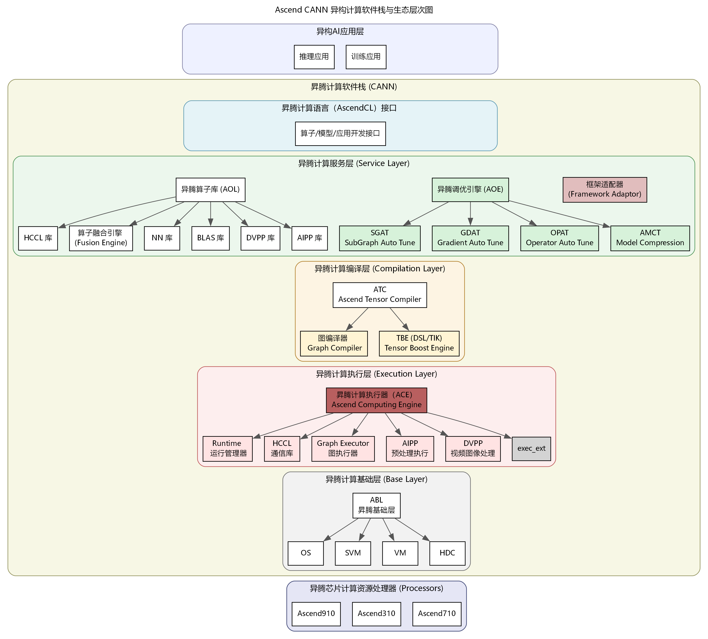
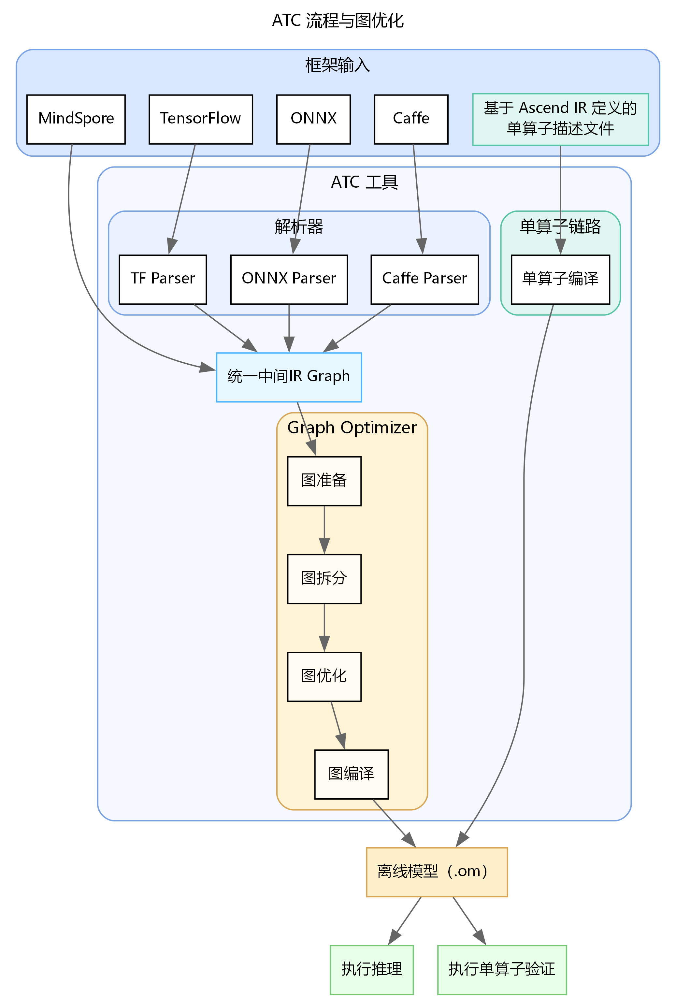

<!-- _class: cover -->

# 第2章：CANN软件栈核心组件解析

<div class="byline">周贤中 · zhouxzh@gdut.edu.cn</div>

## 从 ONNX 到可核验的 OM 推理


<div class="source">依据：<a href="../book/chapter2.md">src/book/chapter2.md</a>；样例：<a href="../../samples/chapter2/sample_resnet_quick_start/README.md"><code>samples/chapter2/sample_resnet_quick_start</code></a></div>

<!--
本章不只讲“把模型转过去”，而是讲模型如何经过 CANN、ATC、OM 和 msame 形成可复核的证据链。
-->

---

## 一条链路，三种不能互相替代的证据

| 阶段 | 关键输入 | 核心动作 | 产物 | 首先证明什么 |
|---|---|---|---|---|
| 模型交换 | 训练框架导出 ONNX | 固定图、算子与张量契约 | `.onnx` | 输入语义是否明确 |
| 离线编译 | ONNX、目标 SoC、输入形状 | 图优化、算子选择、内存规划 | `.om` 与编译日志 | 编译器是否完成 |
| 工件检查 | OM 路径与目标平台 | 大小、哈希、文件名、版本核验 | 可追踪工件记录 | 文件身份是否可信 |
| 运行验证 | OM 与匹配的输入 | ACL 加载、执行、输出、释放 | `msame` 日志与结果 | 该组合能否实际执行 |

ATC 成功、OM 存在、推理成功是三道独立的门。任何一道没有证据，都不能用下一道的结果替代。

<div class="source">教材：<a href="../book/chapter2.md#cann异构计算架构"><code>src/book/chapter2.md</code> §CANN异构计算架构、ATC模型转换详解</a></div>

<!--
先建立证据分层。学生最容易把 ATC 打印 success 当成推理已经通过，后面用双板记录纠正这个误解。
-->

---

<!-- _class: visual -->

## CANN 把框架语义接到硬件执行



<div class="source">图片：<a href="../book/img2/CANN_Architecture.png"><code>src/book/img2/CANN_Architecture.png</code></a>；出处：<a href="../book/chapter2.md#cann的架构"><code>src/book/chapter2.md</code>「CANN的架构」</a></div>

<!--
从上到下带读：应用、AscendCL、服务层、编译层、执行层和基础层。强调 ATC 只属于编译层，不负责应用服务和运行时资源生命周期。
-->

---

## 五层架构各自回答一个问题

| 层次 | 主要职责 | 课堂追问 |
|---|---|---|
| 计算语言接口 | 设备、上下文、流、内存、模型和媒体 API | 应用从哪里进入 CANN |
| 计算服务层 | 算子库、图调优、梯度优化与模型压缩 | 谁来复用和优化计算 |
| 计算编译层 | ATC、图编译与 TBE 算子开发 | 前端图如何变成设备可执行体 |
| 计算执行层 | Runtime、图执行、AIPP 与 DVPP | 任务怎样被调度和搬运 |
| 计算基础层 | 共享虚拟内存、虚拟化和主机设备通信 | 资源底座由谁管理 |

CANN 的复杂度来自跨层协作。排障时必须先确定故障发生在哪一层。

<div class="source">教材：<a href="../book/chapter2.md#cann的架构"><code>src/book/chapter2.md</code>「CANN的架构」</a></div>

<!--
让学生用自己的话说明 ATC、Runtime、AIPP 和 DVPP 各自在哪一层，避免把所有问题都归因于 NPU。
-->

---

## CANN 与 CUDA：目标相近，抽象不同

| 维度 | CANN | CUDA |
|---|---|---|
| 硬件绑定 | 昇腾达芬奇架构 | NVIDIA GPU |
| 主要优化对象 | 模型图、算子融合与设备执行 | 通用并行核函数与线程组织 |
| 预处理协同 | AIPP、DVPP 进入设备侧链路 | 通常由框架与推理引擎组合实现 |
| 可观测手段 | 日志、精度 Dump、Profiling | 日志、Profiler 与调试工具 |

共同点是都需要把模型或程序转换成设备指令。差异在抽象层次、硬件耦合和软件生态。

<div class="source">教材：<a href="../book/chapter2.md#cann与cuda"><code>src/book/chapter2.md</code>「CANN与CUDA」</a></div>

<!--
不要把生态成熟度描述成单一输赢。课堂重点是理解两套栈的抽象对象和证据工具不同。
-->

---

## ONNX 不是“万能模型文件”，而是一份契约

- **Model Proto** 保存版本、生产者和图入口等元数据。
- **Graph Proto** 描述节点、输入、输出与初始化器。
- **Node Proto** 给出算子类型、输入输出张量和属性。
- **Tensor Proto** 保存权重、形状和数据类型。
- ATC 只支持目标 CANN 版本实际覆盖的算子、控制流和数据类型。

<div class="source">教材：<a href="../book/chapter2.md#onnx格式介绍"><code>src/book/chapter2.md</code>「ONNX格式介绍」</a></div>

<!--
让学生区分“ONNX 文件能打开”和“ONNX 合同能被目标 CANN/ATC 接受”。动态控制流、自定义算子和极端 Shape 都要单独核对。
-->

---

## ATC 流程：从统一图到离线模型

<div class="split"><figure><figcaption>ATC 将框架模型解析为统一 IR，再经图优化生成 OM。</figcaption></figure><div><ol><li>环境准备并确认目标 SoC。</li><li>解析 ONNX，形成统一 IR Graph。</li><li>执行图准备、拆分、融合与编译。</li><li>生成离线模型，交给运行时执行。</li></ol></div></div>

<div class="source">图片：<a href="../book/img2/atc.png"><code>src/book/img2/atc.png</code></a>；出处：<a href="../book/chapter2.md#atc工具介绍"><code>src/book/chapter2.md</code>「ATC工具介绍」</a></div>

<!--
图中左侧是模型输入，右侧是单算子路径；下方汇入 OM。课堂强调 ATC 是编译阶段，不是运行时服务。
-->

---

## ATC 做的事不只是文件后缀转换

- 解析模型并把节点映射到统一中间表示。
- 进行图准备、拆分、融合和形状推理。
- 根据目标硬件选择算子实现与精度策略。
- 规划权重重排与内存复用。
- 输出 OM，并留下转换日志和融合摘要。

<div class="source">教材：<a href="../book/chapter2.md#atc工具使用流程"><code>src/book/chapter2.md</code>「ATC工具使用流程」</a></div>

<!--
转换成功是编译结果，不是精度或性能结果。融合摘要只能说明图优化发生了什么，不能替代运行和数值验证。
-->

---


## 版本门：ATC 之前先固定四个对象

| 检查对象 | 8T 板 | 20T 板 | 通过标准 |
|---|---|---|---|
| SoC 与档位 | `Ascend310B4`，8T | `Ascend310B1`，20T | `npu-smi` 实际显示一致 |
| CANN 环境 | 同一 shell 加载 8.0.0 | 同一 shell 加载 8.0.0 | `set_env.sh` 生效 |
| Toolkit 与 Kernels | 同一发布号 | 同一发布号 | 版本不混装 |
| 模型合同 | `1×3×224×224` | `1×3×224×224` | 名称、布局和精度一致 |

`Name` 为 `310B4` 或 `310B1` 时，目标参数分别追加 `Ascend` 前缀。健康状态单独记录，不能替代版本检查。

<div class="source">教材：<a href="../book/chapter2.md#cann的快速安装"><code>src/book/chapter2.md</code>「CANN的快速安装」</a>；环境：<a href="../../docs/ascend310b-chapter-board-comparison-20261017.md"><code>双板记录</code> §2.2</a></div>

<!--
先确认板卡和环境，再运行 ATC。8T 与 20T 用各自的 soc_version，不能复用同一个编译目标来掩盖版本身份。
-->

---

## 读懂一条真实的 ATC 命令

```bash
export TE_PARALLEL_COMPILER=1
export MAX_COMPILE_CORE_NUMBER=1
atc \
  --model=resnet50.onnx \
  --framework=5 \
  --output=resnet50 \
  --input_shape="actual_input_1:1,3,224,224" \
  --soc_version=Ascend310B4
```

<div class="source">命令：<a href="../../samples/chapter2/sample_resnet_quick_start/README.md"><code>samples/chapter2/sample_resnet_quick_start</code></a>；教材：<a href="../book/chapter2.md#模型转换-以resnet50为例"><code>src/book/chapter2.md</code>「模型转换-以ResNet50为例」</a></div>

8T 使用 `Ascend310B4`；20T 使用 `Ascend310B1`。命令结构相同，不代表 OM 字节相同或结果可以互相继承。

<!--
逐项解释 framework=5、静态 input_shape、output 前缀和 soc_version。两个并行度变量用于降低编译资源压力，不是性能优化结论。
-->

---


## 第一层证据：ATC 编译成功

| 板卡 | 目标 SoC | 退出码 | 原始 stdout 关键行 |
|---|---|---:|---|
| 8T | `Ascend310B4` | 0 | `ATC run success, welcome to the next use.` |
| 20T | `Ascend310B1` | 0 | `ATC run success, welcome to the next use.` |

这两行证明本次 ATC 进程成功结束，并分别记录了两块板的目标 SoC。它仍不证明 OM 文件完整、推理正确或结果准确。

<div class="source">原始记录：<a href="../../docs/chapter-board-runs-20261017/tool-execution/tool-matrix.json"><code>docs/chapter-board-runs-20261017/tool-execution/tool-matrix.json</code> 的 `atc8`、`atc20`</a></div>

<!--
只把 exitCode 0 和 ATC 成功行作为编译层证据。不要从“ATC 成功”跳到“模型可用”。
-->

---

## 第二层证据：OM 工件必须能被追踪

```bash
ls -lh model/resnet50.om
sha256sum model/resnet50.om
```

<div class="source">命令依据：<a href="../book/chapter2.md#atc工具使用流程"><code>src/book/chapter2.md</code>「ATC工具使用流程」</a>；加载证据：<a href="../../docs/chapter-board-runs-20261017/tool-execution/tool-matrix.json"><code>tool-matrix.json</code> 的 `msame8`、`msame20`</a></div>

- 路径要能对应转换批次和目标 SoC。
- 文件大小必须非零，哈希用于区分同名的不同工件。
- 当前双板记录能证明运行时加载了各自板上的 `model/resnet50.om`。
- 但原始 JSON 没有保留该文件的独立大小与 SHA-256，不能补造这两项。

因此，本轮能确认“该路径的 OM 被 msame 成功加载”，不能宣称已经完成完整的工件身份核验。

<!--
这是本章最重要的证据缺口。现有记录已证明路径可加载，但缺独立 size/hash。课堂上要明确写“未记录”，不能从一次成功加载推导内容一致。
-->

---

## 第三层证据：msame 把 OM 变成可观察的运行

- 初始化 ACL，打开设备并创建上下文与流。
- 加载 OM，读取模型输入输出描述。
- 把与模型合同匹配的二进制输入送入设备。
- 执行推理，把结果写到指定目录。
- 卸载模型，并按顺序释放流、上下文和设备。

<div class="source">教材：<a href="../book/chapter2.md#模型推理工具msame工具概览"><code>src/book/chapter2.md</code>「msame工具概览」</a></div>

<!--
把 msame 定位成运行时烟测工具。它证明加载和执行链，不证明数据预处理一致，也不替代完整精度和性能基准。
-->

---

## 一张 JPG 不能直接喂给 msame

<div class="split"><figure><figcaption>教材中的示例图片，仅用于说明输入预处理。</figcaption></figure><div><ol><li>读取为 RGB。</li><li>缩放到 256×256。</li><li>中心裁剪到 224×224。</li><li>转为 float32 并按通道归一化。</li><li>变为 NCHW，加入 batch 维。</li></ol></div></div>

<div class="source">图片与流程：<a href="../book/chapter2.md#图片预处理"><code>src/book/chapter2.md</code>「图片预处理」</a>；<code>src/book/img2/dog1_1024_683.jpg</code></div>

<!--
预处理必须与训练和 ATC 的输入合同一致。顺序、均值、方差、颜色通道或布局任一改变，都可能让 msame 正常执行但输出异常。
-->

---

## msame 命令与成功链

命令来源：`src/book/chapter2.md`「图片预处理」

```bash
./msame \
  --model "./model/resnet50.om" \
  --input "./data/dog1_224_float32.bin" \
  --output "./out" --outfmt BIN
```

日志来源：`src/book/chapter2.md`「图片预处理」

```text
[INFO] acl init success
[INFO] load model model/resnet50.om success
[INFO] model execute success
[INFO] output data success
[INFO] unload model success
[INFO] end to finalize acl
```

关键不是某一行单独出现，而是加载、执行、输出和释放形成连续闭环。

<div class="source">双板结果：<a href="../../docs/chapter-board-runs-20261017/tool-execution/tool-matrix.json"><code>tool-matrix.json</code></a></div>

<!--
可以让学生指出每一行属于哪个阶段。只有前后顺序完整，才能排除只加载未执行、只执行未取回或未释放资源。
-->

---


## 双板运行环境：同版本，不同证据集

| 项目 | 8T 板 | 20T 板 |
|---|---|---|
| SoC | `Ascend310B4` | `Ascend310B1` |
| 系统 | Ubuntu 22.04.3，aarch64 | Ubuntu 22.04.3，aarch64 |
| CANN | 8.0.0 | 8.0.0 |
| 驱动与 npu-smi | 25.2.0 | 25.2.0 |
| 健康快照 | Alarm，80 C | Alarm，70 C |

相同软件版本降低了一部分干扰，但不能把两个 SoC 的结果合成一个硬件排名。

<div class="source">环境：<a href="../../docs/ascend310b-chapter-board-comparison-20261017.md"><code>docs/ascend310b-chapter-board-comparison-20261017.md</code> §2.2</a>；原始快照：<a href="../../docs/chapter-board-runs-20261017/8t/run1/meta.txt"><code>8T meta</code></a>、<a href="../../docs/chapter-board-runs-20261017/20t/run1/meta.txt"><code>20T meta</code></a></div>

<!--
两块板处于同一 CANN 和驱动版本，但 SoC、内存和算力档位不同。Alarm 只记录为已知板况，不直接判定程序失败。
-->

---


## 双板 msame：保留各自的单次结果

| 板卡 | SoC | 运行状态 | msame 报告值 | 测试范围 |
|---|---|---|---:|---|
| 8T | `Ascend310B4` | 加载、执行、输出、释放成功 | 13.232 ms | 单模型、单输入、单次 |
| 20T | `Ascend310B1` | 加载、执行、输出、释放成功 | 11.748 ms | 单模型、单输入、单次 |

这两块板各有独立的 ATC 目标与 OM 路径。11.748 ms 只表示本次 20T 记录中的一次 `msame` 报告值，不能外推成整机性能，也不能据此宣布 20T 全面更快。

<div class="source">原始结果：<a href="../../docs/chapter-board-runs-20261017/tool-execution/tool-matrix.json"><code>tool-matrix.json</code> 的 `msame8`、`msame20`</a>；结论边界：<a href="../../docs/ascend310b-chapter-board-comparison-20261017.md"><code>双板记录</code> §3、§5</a></div>

<!--
必须把 13.232 ms 和 11.748 ms 读成两个独立记录，而不是平均值、吞吐或端到端时延。这里不重跑板端，只引用已有原始记录。
-->

---


## 从日志到结论：先核证据，再下判断

| 证据门 | 必须看到什么 | 本轮已有记录 |
|---|---|---|
| ATC | 退出码、目标 SoC、成功行 | 两板均为 0，并打印成功 |
| OM 工件 | 路径、大小、SHA-256、目标平台 | 路径被加载；大小与哈希未记录 |
| msame | 加载、执行、输出、释放完整链 | 两板均成功 |
| 范围 | 单次还是重复、是否含预处理 | 单模型、单输入、单次运行 |

原始 `run1` 日志保留了首次 `./msame: Permission denied`；后续成功结果来自 `tool-matrix.json`。失败记录不能删除，也不能仅凭这一行判定 NPU 故障。

<div class="source">失败与修正：<a href="../../docs/chapter-board-runs-20261017/8t/run1/chapter2_msame.log"><code>8T raw log</code></a>、<a href="../../docs/chapter-board-runs-20261017/20t/run1/chapter2_msame.log"><code>20T raw log</code></a>、<a href="../../docs/chapter-board-runs-20261017/README.md"><code>记录说明</code></a></div>

<!--
收束成四道门。强调缺失的 OM size/hash 必须保持“未记录”，不能为了让课件看起来完整而编数字。课堂作业要求学生补齐每道门的证据。
-->
