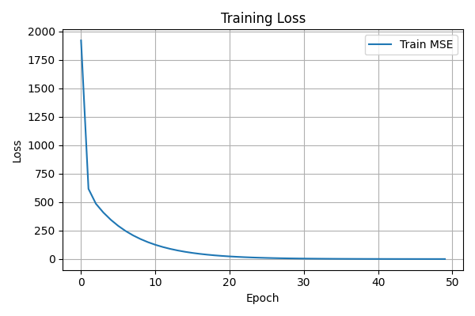
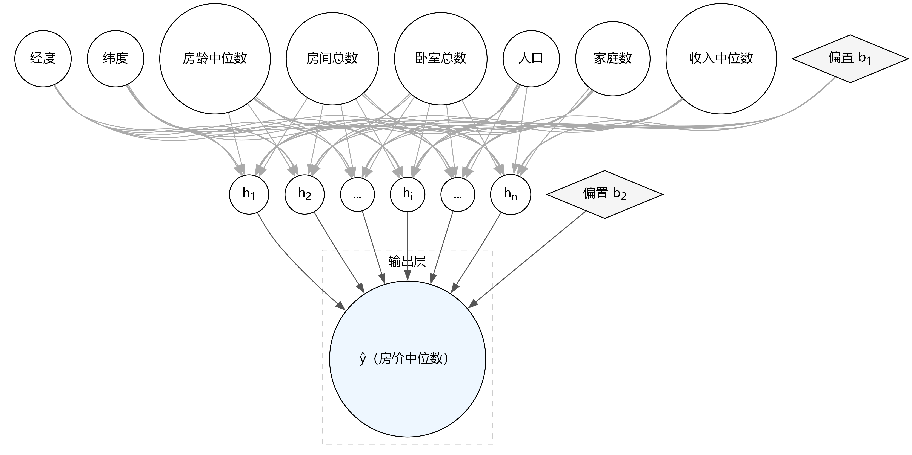
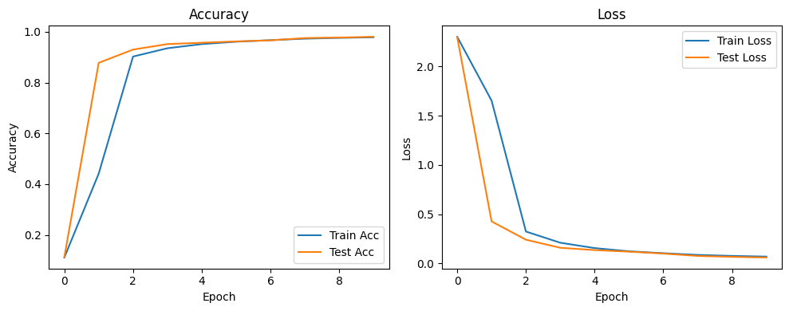
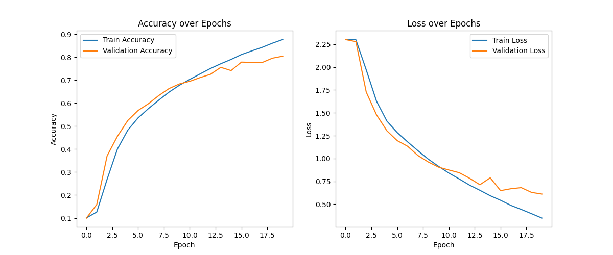

<!-- _class: cover -->

# 第3章：昇腾PyTorch扩展迁移基础

<div class="byline">周贤中 · zhouxzh@gdut.edu.cn</div>

## 从 PyTorch 脚本到 NPU 训练证据


<div class="source">依据：<a href="../book/chapter3.md">src/book/chapter3.md</a>；样例：<a href="../../samples/chapter3/README.md"><code>samples/chapter3</code></a></div>

<!--
本章主线不是背 API，而是让已有 PyTorch 代码在明确版本、设备和证据边界下迁移到 NPU。
-->

---

<!-- _class: center -->

## 本讲目标与路线

- 分清 PyTorch、torch_npu 与 CANN 三层
- 核对版本并用最小烟测看见 NPU 张量
- 完成线性回归、MLP、LeNet、AlexNet 迁移
- 按同一协议记录双板训练结果

> 本讲主线：环境 → 烟测 → 迁移 → 证据

<div class="source">教材：<a href="../book/chapter3.md"><code>src/book/chapter3.md</code></a></div>

<!--
先给出本讲路线图；后续每一段都对应这里的一行，最后回到路线收束。
-->
---


<!-- _class: section -->

# 01

## 框架、桥接与硬件

---

<!-- _class: center -->

## 先分清三层：框架、桥接层和硬件

| 层次 | 主要职责 | 首先要验证什么 |
|---|---|---|
| PyTorch 前端 | 张量、动态图、自动微分和优化器 | 原始脚本能否运行 |
| torch_npu | 设备管理、算子分发与 CANN 对接 | 是否真正生成 `npu:0` 张量 |
| CANN 与 NPU | 图编译、算子执行和运行时管理 | 版本、设备和结果是否正确 |

迁移问题时，先判断失败在 PyTorch 语义、torch_npu 桥接，还是 CANN 与硬件执行层。

<div class="source">教材：<a href="../book/chapter3.md#架构速览"><code>src/book/chapter3.md</code>「架构速览」</a></div>

<!--
学生经常只看到一个 Python 异常，就把问题归到 NPU。先按三层定位，后面的验证才有意义。
-->

---

<!-- _class: center -->

## torch_npu 保留 PyTorch 开发方式

- 常见算子、自动微分与优化器继续沿用 PyTorch 接口。
- 模型和数据通过 `.to(device)` 进入 NPU 设备。
- 训练循环仍包含前向、反向、参数更新和指标记录。
- 可通过 `torch_npu.npu` 访问设备状态与同步接口。
- 复杂模型仍要核对算子、精度和内存是否受支持。

<div class="source">教材：<a href="../book/chapter3.md#核心能力纵览"><code>src/book/chapter3.md</code>「核心能力纵览」</a></div>

<!--
强调 PyTorch 兼容性降低代码改写量，但不会自动保证所有算子在目标 CANN 和精度下都可用。
-->

---

<!-- _class: center -->

## 安装前先过版本门

| 检查项 | 要确认的内容 | 记录方式 |
|---|---|---|
| 驱动与固件 | 板端可用且版本匹配 | `npu-smi info` |
| CANN | Toolkit 与 Kernels 发布号一致 | 安装信息与版本文件 |
| Python | 位于受支持的版本范围 | `python -V` |
| PyTorch | 与 Python、架构匹配 | `torch.__version__` |
| torch_npu | 与 PyTorch、CANN、架构匹配 | 插件版本与导入路径 |

教材示例给出 Python 3.11、PyTorch 2.8.0、torch_npu 7.2.0、CANN 8.3.RC1 的一组组合，不是唯一的版本答案。

<div class="source">教材：<a href="../book/chapter3.md#pytorch安装教程"><code>src/book/chapter3.md</code>「PyTorch安装教程」</a></div>

<!--
版本组合必须来自可核对的配套表，不能从“最新版”推断兼容。双板旧记录也不能拿来替代当前安装核对。
-->

---

<!-- _class: center -->

## 两套记录不能拼成一个版本结论

| 项目 | 教材安装示例 | 双板原始记录 |
|---|---|---|
| Python | 3.11 | 3.9.2 |
| CANN | 8.3.RC1 | 8.0.0 |
| PyTorch | 2.8.0 | 本轮日志未保留版本号 |
| torch_npu | 7.2.0 | 本轮日志未保留版本号 |

安装示例用于说明配套关系；双板记录只支持当次 `torch_npu` 训练结果。两者不能互相补成“已完全匹配”。

<div class="source">教材：<a href="../book/chapter3.md#安装昇腾torch_npu插件"><code>src/book/chapter3.md</code>「安装昇腾torch_npu插件」</a>；记录：<a href="../../docs/chapter-board-runs-20261017/8t/run1/meta.txt"><code>8T meta</code></a>、<a href="../../docs/chapter-board-runs-20261017/20t/run1/meta.txt"><code>20T meta</code></a></div>

<!--
这页专门防止证据拼接。教材中的版本是安装示例，双板实际记录是 Python 3.9.2 和 CANN 8.0.0，且日志没有保留框架插件版本号。
-->

---

## 最小烟测必须看见 npu 设备张量

```python
import torch
import torch_npu
a = torch.randn(3, 4).npu()
print(a + a)
```

<div class="source">代码：<a href="../../samples/chapter3/README.md"><code>samples/chapter3/README.md</code></a>；教材：<a href="../book/chapter3.md#torch_npu安装后测试"><code>src/book/chapter3.md</code>「torch_npu安装后测试」</a></div>

输出中的 `device='npu:0'` 比“导入成功”更有价值。若出现 CANN 路径所有者警告，先记录它；若运算失败或没有 NPU 张量，不能把普通 CPU 结果当作迁移成功。

<!--
导入 torch_npu 只证明模块可加载，最小张量运算才证明请求到达 NPU。出现 warning 时要保存原文，但 warning 本身不等于失败。
-->

---


<!-- _class: section -->

# 02

## 从脚本迁移到训练证据

---

<!-- _class: center -->

## 手工迁移只改五类位置

1. 导入 `torch_npu`，确认设备后端可用。
2. 把计算设备改为 `torch.device("npu:0")`。
3. 把模型与每批输入、标签迁移到该设备。
4. 检查 `.item()`、`.cpu()`、`.numpy()` 引起的同步与拷贝。
5. 核对算子、数据类型和内存是否被当前版本支持。

<div class="source">教材：<a href="../book/chapter3.md#torch_npu插件的使用"><code>src/book/chapter3.md</code>「torch_npu插件的使用」</a>；样例：<a href="../../samples/chapter3/linear_regression/linear_regression_npu.py"><code>samples/chapter3/linear_regression</code></a></div>

<!--
迁移要保持算法不变，只替换设备与必要兼容点。任何算子替换、精度改变和 batch 改变都要进入实验记录。
-->

---

<!-- _class: visual -->

## 第一个闭环：线性回归损失下降



<div class="source">图片：<a href="../book/img3/linear_regression_training_loss.png"><code>src/book/img3/linear_regression_training_loss.png</code></a>；代码：<a href="../../samples/chapter3/linear_regression/linear_regression_npu.py"><code>samples/chapter3/linear_regression</code></a></div>

<!--
曲线证明这组代码在该记录中完成训练并收敛，不证明推理性能或整机吞吐。横轴是 epoch，纵轴是训练 MSE。
-->

---

<!-- _class: center -->

## 双板 50 epochs：保留同一协议的两个结果

| 板卡 | SoC | 结果 | 任务墙钟 | 最终拟合参数 |
|---|---|---|---:|---|
| 8T | `Ascend310B4` | 50/50 | 56.908 s | R=118.6330，b=0.7559 |
| 20T | `Ascend310B1` | 50/50 | 78.532 s | R=118.6330，b=0.7559 |

两块板使用同一份样例源码与同一套测试命令。时间来自任务工具墙钟，包含预热、图编译、数据处理和板端后台负载，不是纯 NPU 算子耗时。

<div class="source">记录：<a href="../../docs/ascend310b-chapter-board-comparison-20261017.md"><code>docs/ascend310b-chapter-board-comparison-20261017.md</code> §4 chapter3</a></div>

<!--
严格保留 8T 的 56.908 s 和 20T 的 78.532 s，不能互换，不能平均。最终参数相同说明本次训练路径得到了同组拟合值，不说明速度排名。
-->

---

<!-- _class: center -->

## 20T 较慢，不等于“算力更低”

- 训练任务包含首次图编译和运行时准备。
- 小模型计算量低，调度和拷贝可能主导墙钟时间。
- 数据管线、批大小和同步频率会影响每个 epoch。
- 板端后台负载、温度和系统状态会改变实测结果。
- `torch_npu` 的图编译策略与版本也会影响启动阶段。

<div class="source">记录边界：<a href="../../docs/ascend310b-chapter-board-comparison-20261017.md"><code>双板记录</code> §4、§5</a></div>

<!--
这页解释为什么更高档位的单次墙钟可能更长。不能把总时间除以 epoch 就称为 NPU 算子性能。
-->

---

<!-- _class: visual -->

## 从线性模型走到多层感知机



<div class="source">图片：<a href="../book/img3/mlp_network.png"><code>src/book/img3/mlp_network.png</code></a>；代码：<a href="../../samples/chapter3/california_housing/california_housing_mlp.py"><code>samples/chapter3/california_housing</code></a></div>

<!--
MLP 通过隐藏层和非线性激活突破线性模型限制。迁移时要继续检查每层算子、激活函数和输入维度，而不是只把设备改成 NPU。
-->

---

<!-- _class: visual -->

## LeNet：卷积链与 FP16 适配



<div class="source">图片：<a href="../book/img3/accuracy_loss_curve.png"><code>src/book/img3/accuracy_loss_curve.png</code></a>；代码：<a href="../../samples/chapter3/LeNet/lenet_npu.py"><code>samples/chapter3/LeNet</code></a></div>

<!--
LeNet 教材实现把 Sigmoid 调整为 ReLU，并使用 FP16。曲线说明该配置在记录中完成训练，不能替代兼容性测试和最终质量评估。
-->

---

<!-- _class: center -->

## 兼容性测试要覆盖算子和边界

| 测试区域 | 覆盖内容 | 教材记录 |
|---|---|---|
| 基础算子 | Add、MatMul 的 FP16/FP32 | 大部分通过 |
| 网络层 | Linear、Conv2d、激活、归一化、池化 | 多数通过，池化有失败 |
| 边界结果 | AvgPool 奇数核与 padding | 13 项失败 |
| 总分 | pytest 汇总 | 76 passed，13 failed |

失败集中在 FP16 `AvgPool2d` 和 FP32 `MaxPool2d`。这说明“模型能训练”不能替代逐算子兼容性验证。

<div class="source">教材：<a href="../book/chapter3.md#torch_npu插件兼容性测试套件"><code>src/book/chapter3.md</code>「torch_npu插件兼容性测试套件」</a>；样例：<a href="../../samples/chapter3/test"><code>samples/chapter3/test</code></a></div>

<!--
这里记录的是教材中的 CANN 8.3.RC1 + PyTorch 2.8.0 环境，不是双板任务记录。失败项和通过项都必须保留，不能用“多数通过”掩盖阻塞问题。
-->

---

<!-- _class: visual -->

## AlexNet 迁移后的训练曲线



<div class="source">图片：<a href="../book/img3/training_metrics.png"><code>src/book/img3/training_metrics.png</code></a>；代码：<a href="../../samples/chapter3/AlexNet/alexnet_npu.py"><code>samples/chapter3/AlexNet</code></a></div>

<!--
这条曲线是教材历史训练结果，不属于本次双板 50 epochs 线性回归记录。它说明该配置曾完成训练，不能与双板墙钟或其他硬件直接排名。
-->

---

<!-- _class: center -->

## 三个卷积网络：适配点各不相同

| 网络 | 迁移适配 | 精度与资源边界 |
|---|---|---|
| AlexNet | 输入改为 CIFAR-10 的 32×32，池化改为 AvgPool | FP16 可在 8 GB 记录中运行；FP32 对内存更敏感 |
| VGG16 | 配置驱动堆叠 3×3 卷积，缩减全连接头 | 教材实验只记录 FP32 |
| ResNet18 | 残差块与 shortcut；CIFAR 版改为 3×3 初始卷积 | 教材实验只记录 FP32 |

三者共用训练骨架，但算子替换、输入尺寸、精度和内存门槛必须分别记录。

<div class="source">教材：<a href="../book/chapter3.md#现代卷积神经网络的移植"><code>src/book/chapter3.md</code>「现代卷积神经网络的移植」</a></div>

<!--
不能用一个网络通过就推断另一个网络可用。尤其关注池化替换、BN 与 FP16 稳定性，以及更深的图编译内存。
-->

---

<!-- _class: center -->

## 每类结果只能证明自己的那一层

| 证据 | 可以证明 | 不能证明 |
|---|---|---|
| `device='npu:0'` | 张量请求到达 NPU | 训练精度与性能 |
| 损失或精度曲线 | 该配置完成了训练 | 整机吞吐或跨板排名 |
| CPU 数值对照 | 结果可作为数值基线 | CPU 运行能证明 NPU 可用 |
| 双板任务墙钟 | 当次任务的端到端时间 | 纯算子耗时或普遍快慢 |

CPU 路径可以用于语义参考，但任何 NPU 结论都必须来自 NPU 设备张量和板端日志。

<div class="source">依据：<a href="../../docs/ascend310b-chapter-board-comparison-20261017.md"><code>双板记录</code> §3、§5</a>；测试边界：<a href="../book/chapter3.md#测试目标与验证维度"><code>src/book/chapter3.md</code>「测试目标与验证维度」</a></div>

<!--
这是本章的证据纪律。CPU 能跑、Python 能导入、曲线好看，都不能替代 NPU 设备路径和板端原始记录。
-->

---

<!-- _class: center -->

## 迁移失败时按固定顺序排查

1. 查 CANN、Python、PyTorch、torch_npu 的版本与导入路径。
2. 跑最小 `npu:0` 张量运算，确认设备和运行时。
3. 跑单算子测试，区分算子、精度和形状问题。
4. 缩小 batch 与输入，判断是否由图编译或内存触发。
5. 再恢复完整训练，记录设备、版本、日志和指标。

<div class="source">教材：<a href="../book/chapter3.md#torch_npu插件兼容性测试套件"><code>src/book/chapter3.md</code>「兼容性测试套件」</a>；样例：<a href="../../samples/chapter3/test"><code>samples/chapter3/test</code></a></div>

<!--
排查顺序从环境到设备，再到最小算子，最后才进完整模型。这样可以避免把 OOM、算子缺陷和版本不匹配混成同一个问题。
-->

---

<!-- _class: center -->

## 课堂交付：一页迁移证据卡

| 交付项 | 必须包含 |
|---|---|
| 版本 | CANN、Python、PyTorch、torch_npu 与板卡档位 |
| 设备 | `npu:0` 输出与最小算子结果 |
| 模型 | 代码路径、输入形状、精度与 batch |
| 训练 | 原始日志、损失曲线与验证指标 |
| 边界 | CPU 对照、失败项、未验证项和双板墙钟范围 |

完成标准是另一位同学能按卡片复现同一路径，并解释哪些数字不能跨设备、跨版本或跨精度外推。

<div class="source">作业：<a href="../book/chapter3.md#总结"><code>src/book/chapter3.md</code>「总结」</a>；原始记录：<a href="../../docs/chapter-board-runs-20261017/README.md"><code>docs/chapter-board-runs-20261017</code></a></div>

<!--
最后检查学生是否同时提交通过证据和失败边界。没有 NPU 设备证据、没有版本、没有原始日志的结果不计为完成。
-->
