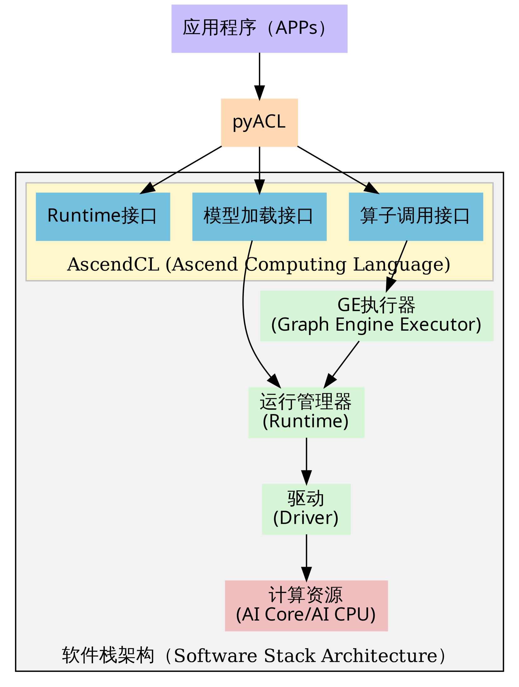
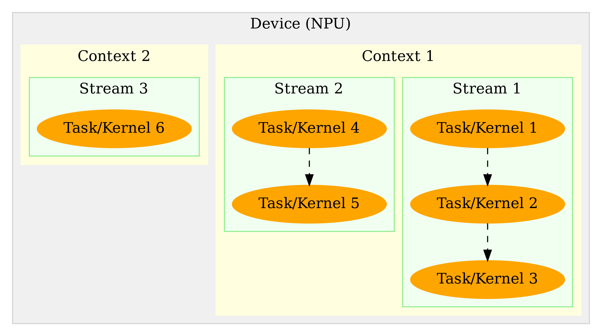

<!-- _class: cover -->

# 第4章：PyACL应用开发基础

## 从设备枚举到可核验的推理流水线

理论章节课件 · 教师授课版

<div class="source">依据：<a href="../book/chapter4.md">src/book/chapter4.md</a>；样例：<a href="../../samples/chapter4/README.md"><code>samples/chapter4</code></a></div>

<!--
本章要讲清 PyACL 的生命周期，也要讲清证据边界。设备枚举成功只是第一级证据。
-->

---

## 四级证据，不能越级签字

| 证据层级 | 典型动作 | 能证明什么 | 不能证明什么 |
|---|---|---|---|
| Python 导入 | `import acl` | Python 绑定可加载 | 设备可用 |
| 设备枚举 | `get_device_count()` | ACL 初始化与设备可见 | OM 可加载、可推理 |
| 模型烟测 | 加载 OM 并执行一次 | 指定模型和输入能走通 | 精度、吞吐、完整应用 |
| 应用验收 | 预处理、推理、后处理、接口 | 业务链路可运行 | 未覆盖场景也可用 |

本课件把设备枚举和完整推理严格分开。

<div class="source">依据：<a href="../book/chapter4.md#pyacl应用开发环境"><code>src/book/chapter4.md</code>「PyACL应用开发环境」</a>；<a href="../../docs/ascend310b-chapter-board-comparison-20261017.md"><code>双板记录</code> §2.1</a></div>

<!--
先建立证据等级。学生最容易把 Found 1 Ascend devices 误写成完整推理通过，后面用原始日志纠正。
-->

---

<!-- _class: visual -->

## PyACL 位于应用与硬件之间



<div class="source">图片：<a href="../book/img4/logic_arch.png"><code>src/book/img4/logic_arch.png</code></a>；出处：<a href="../book/chapter4.md#pyacl的逻辑架构"><code>src/book/chapter4.md</code>「PyACL的逻辑架构」</a></div>

<!--
从应用层向下带读 PyACL、AscendCL、Runtime、Driver 和 AI Core。出现错误时，先定位在哪一层，不要直接归因于硬件。
-->

---

<!-- _class: visual -->

## Device 包含 Context，Context 包含 Stream



<div class="source">图片：<a href="../book/img4/device_context_stream.png"><code>src/book/img4/device_context_stream.png</code></a>；出处：<a href="../book/chapter4.md#基本概念与运行模型"><code>src/book/chapter4.md</code>「基本概念与运行模型」</a></div>

<!--
一个设备可有多个上下文，一个上下文可有多个流，但流不能脱离所属上下文。释放顺序必须是 Stream、Context、Device。
-->

---

## 生命周期必须按序闭合

```python
acl.init("")
acl.rt.set_device(device_id)
context, ret = acl.rt.create_context(device_id)
acl.rt.set_context(context)
stream, ret = acl.rt.create_stream()
# 模型加载、传输、执行与结果取回
acl.rt.destroy_stream(stream)
acl.rt.destroy_context(context)
acl.rt.reset_device(device_id)
acl.finalize()
```

来源：`samples/chapter4/check_ascend_device/check_ascend_device.py` 与教材资源生命周期示例。

<div class="source">教材：<a href="../book/chapter4.md#运行管理资源生命周期"><code>src/book/chapter4.md</code>「运行管理资源生命周期」</a>；样例：<a href="../../samples/chapter4/check_ascend_device/check_ascend_device.py"><code>samples/chapter4/check_ascend_device</code></a></div>

<!--
真实工程必须检查每个 ret；这里突出顺序。显式资源按 Stream、Context、Device 逆序释放，最后 acl.finalize。
-->

---

## 内存搬运有四个方向

| 方向 | 典型用途 | 关键风险 |
|---|---|---|
| Host → Host | CPU 缓冲整理 | 无需 Device，但仍要管理生命周期 |
| Host → Device | 送入模型输入 | 异步时未同步就提前释放 |
| Device → Host | 取回推理结果 | 未等待计算和拷贝完成 |
| Device → Device | 设备内重排或拷贝 | 缓冲与对齐错误 |

Host 与 Device 内存相互隔离。输入张量必须按模型合同完成布局、精度和连续内存准备。

<div class="source">教材：<a href="../book/chapter4.md#异构内存管理"><code>src/book/chapter4.md</code>「异构内存管理」</a></div>

<!--
记住数据流而不是死背常量。无论同步还是异步，Host 可读之前必须有明确的完成条件。
-->

---

## 同步机制按等待范围选择

- 同步拷贝逻辑简单，但会阻塞 Host。
- `synchronize_stream` 等待一条 Stream 中已提交任务。
- Event 可标记特定完成点，由 Host 等待。
- `stream_wait_event` 在设备侧建立跨流依赖，不阻塞 Host。
- `synchronize_device` 范围最大，通常只用于调试或退出。

<div class="source">教材：<a href="../book/chapter4.md#同步等待机制"><code>src/book/chapter4.md</code>「同步等待机制」</a></div>

<!--
向学生区分“Host 等待”与“Stream 等待”。异步任务投递成功不代表数据已经可读，也不代表资源可以立即释放。
-->

---

<!-- _class: visual -->

## 一次推理的标准主线


<div class="source">图片：<a href="../book/img4/inference.png"><code>src/book/img4/inference.png</code></a>；出处：<a href="../book/chapter4.md#模型推理开发流程解析"><code>src/book/chapter4.md</code>「模型推理开发流程解析」</a></div>

<!--
主流程开发与应用运行逻辑要分开。运行阶段从导入、初始化、资源申请、数据传输，到执行、后处理、释放和去初始化。
-->

---

## 加载 OM 后先读模型描述

- 使用 `acl.mdl.load_from_file` 加载与目标 SoC 匹配的 OM。
- 创建模型描述并查询每个输入、输出的字节数。
- 按模型合同准备 Host 数据，申请 Device 输入与输出缓冲。
- 将缓冲封装成 Dataset，调用模型执行接口。
- 取回结果后销毁描述、卸载模型并释放资源。

<div class="source">教材：<a href="../book/chapter4.md#核心实现模型推理脚本"><code>src/book/chapter4.md</code>「核心实现：模型推理脚本」</a></div>

<!--
模型描述是内存申请和结果解析的依据。不要根据训练脚本猜输入大小，也不要把任意长度的 NumPy 数组直接送进 Device。
-->

---

## ResNet18：分类推理路径

| 项目 | 内容 |
|---|---|
| 输入 | `1×3×64×64` Tiny-ImageNet 图像张量 |
| 输出 | `1×200` 分类 logits |
| 入口 | `samples/chapter4/resnet18/inference_npu.py` |
| 后处理 | Softmax、Top-K 与类别映射 |
| 双板状态 | 本次未部署模型与数据，完整推理 `untested` |

训练和 ONNX 导出在 GPU 服务器完成，板端只负责 ATC 转换后的 PyACL 推理。

<div class="source">教材：<a href="../book/chapter4.md#实例分析resnet-18"><code>src/book/chapter4.md</code>「实例分析（ResNet-18）」</a>；样例：<a href="../../samples/chapter4/resnet18/inference_npu.py"><code>samples/chapter4/resnet18</code></a></div>

<!--
ResNet18 是完整 PyACL 流程的教学实例，但当前双板记录没有执行它。课件只能展示代码路径和模型合同，不能写成已在两板通过。
-->

---

## SSD 与 SSDLite：输出合同更复杂

| 模型 | 输入与输出 | 后处理 |
|---|---|---|
| SSD300 | `300×300`，边界框与类别分数多输出 | Decode、NMS、COCO 评估 |
| SSDLite320 | `320×320`，boxes `1×4×3234`、scores `1×81×3234` | Decode、NMS、可视化 |
| 双板状态 | 资产未部署 | ResNet18、SSD、SSDLite 均 `untested` |

分类只做单向量解析；检测必须理解多输出、候选框和 NMS，不能用 ResNet18 结果替代。

<div class="source">教材：<a href="../book/chapter4.md#目标检测推理"><code>src/book/chapter4.md</code>「目标检测推理」</a>；样例：<a href="../../samples/chapter4/SSD"><code>samples/chapter4/SSD</code></a>、<a href="../../samples/chapter4/SSDLite"><code>samples/chapter4/SSDLite</code></a></div>

<!--
两个检测模型的输入尺寸、输出张量和后处理不同。双板运行记录没有部署这些资产，因此不能从设备枚举推导检测通过。
-->

---

## 双板环境先固定，再启动测试

| 项目 | 8T 板 | 20T 板 |
|---|---|---|
| SoC | `Ascend310B4` | `Ascend310B1` |
| 计算档位 | 8T | 20T |
| 系统 | Ubuntu 22.04.3，aarch64 | Ubuntu 22.04.3，aarch64 |
| CANN 与驱动 | 8.0.0，25.2.0 | 8.0.0，25.2.0 |
| Python | 3.9.2 | 3.9.2 |

两块板的环境字段相同，仍是两个独立证据集；后续模型和性能结果不能合并排名。

<div class="source">环境：<a href="../../docs/ascend310b-chapter-board-comparison-20261017.md"><code>docs/ascend310b-chapter-board-comparison-20261017.md</code> §2.2</a>；原始快照：<a href="../../docs/chapter-board-runs-20261017/8t/run1/meta.txt"><code>8T</code></a>、<a href="../../docs/chapter-board-runs-20261017/20t/run1/meta.txt"><code>20T</code></a></div>

<!--
双板环境相同不等于硬件相同。检查时也保留 Health Alarm 和温度背景，但它们不能单独决定推理成败。
-->

---

## 现有双板证据只到设备枚举

| 板卡 | 实际样例 | 原始输出 | 结论 |
|---|---|---|---|
| 8T / `Ascend310B4` | `check_ascend_device.py` | `Found 1 Ascend devices.` | 设备枚举通过 |
| 20T / `Ascend310B1` | `check_ascend_device.py` | `Found 1 Ascend devices.` | 设备枚举通过 |

本次最小部署只复制了设备检查目录。ResNet18、SSD、SSDLite 的模型和数据集未部署，因此完整推理状态是 `untested`。

<div class="source">记录：<a href="../../docs/ascend310b-chapter-board-comparison-20261017.md"><code>双板记录</code> §2.1、§4 chapter4</a>；原始输出：<a href="../../docs/chapter-board-runs-20261017/8t/run1/chapter4_check.log"><code>8T log</code></a>、<a href="../../docs/chapter-board-runs-20261017/20t/run1/chapter4_check.log"><code>20T log</code></a></div>

<!--
这张表是本章的证据锚点。两行 Found 1 只能支持枚举结论。没有 OM、没有输入、没有 execute、没有输出，就不能写推理通过。
-->

---

## “Found 1”是一条窄证据

- 它说明 ACL 初始化和设备计数接口返回成功。
- 它不证明设备能加载指定 OM。
- 它不证明模型输入输出合同正确。
- 它不证明模型执行产生有效结果。
- 它不证明业务精度、吞吐或长期稳定性。

<div class="source">证据边界：<a href="../../docs/ascend310b-chapter-board-comparison-20261017.md"><code>双板记录</code> §4 chapter4、§5</a>；教材：<a href="../book/chapter4.md#环境验证"><code>src/book/chapter4.md</code>「环境验证」</a></div>

<!--
逐条让学生说明缺失了哪一级证据。特别禁止把设备检查、CPU ONNX 推理或 API 健康响应写成 NPU 完整推理。
-->

---

## 完整推理的排障阶梯

| 层级 | 检查 | 停止条件 |
|---|---|---|
| 环境 | CANN、`acl`、板卡档位 | 导入与设备可见 |
| 资源 | Device、Context、Stream | 生命周期创建成功 |
| 工件 | OM 路径、SoC、输入输出描述 | 模型成功加载 |
| 执行 | Host→Device、execute、Device→Host | 单次输出有限且形状正确 |
| 应用 | 预处理、后处理、接口、释放 | 业务链路与资源回收通过 |

不要跳到下一层。当前证据只完成了第一层的前半部分。

<div class="source">教材：<a href="../book/chapter4.md#模型推理开发流程解析"><code>src/book/chapter4.md</code>「模型推理开发流程解析」</a></div>

<!--
排障顺序对应证据等级。当前双板记录停在设备枚举，所以不能出现“模型加载失败”或“精度差异”的结论。
-->

---

## 常见故障先归到正确的层

| 现象 | 优先检查 | 不要误判 |
|---|---|---|
| `import acl` 失败 | Python、CANN 环境、架构 | NPU 坏 |
| 设备数为0 | 驱动、设备节点、权限 | 模型不兼容 |
| OM 加载失败 | SoC、OM 路径、版本 | 精度下降 |
| execute 返回错误 | 输入输出描述、DataSet、内存 | 应用界面故障 |
| 输出异常 | 预处理、布局、精度、后处理 | 只归因于硬件 |

错误码、命令行、板卡档位和版本必须一起保存。

<div class="source">教材：<a href="../book/chapter4.md#pyacl应用开发环境"><code>src/book/chapter4.md</code>「PyACL应用开发环境」</a>；样例：<a href="../../samples/chapter4/README.md"><code>samples/chapter4/README.md</code></a></div>

<!--
每一类故障先停在对应层。没有日志和版本时，只能写 blocked 或 unknown，不能写 unsupported。
-->

---

## 课堂交付：一张四级证据卡

| 证据 | 必须提交 |
|---|---|
| 枚举 | 命令、设备数输出、板卡档位 |
| 工件 | OM 路径、大小、哈希、目标 SoC |
| 单次推理 | 输入合同、execute、输出形状与数值 |
| 应用 | 后处理结果、资源释放和失败日志 |

在现有双板记录上只能勾选“枚举”。其余三级必须补做后才能称为完整推理通过。

<div class="source">任务：<a href="../book/chapter4.md#总结"><code>src/book/chapter4.md</code>「总结」</a>；双板证据：<a href="../../docs/ascend310b-chapter-board-comparison-20261017.md"><code>双板记录</code></a></div>

<!--
课堂任务不是再跑一遍设备查询，而是补齐从 OM 到单次推理再到应用输出的证据。没有完成的格子必须保留 untested。
-->
