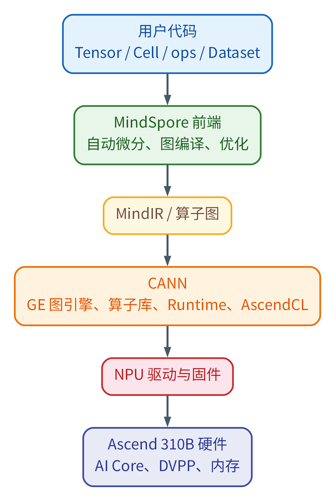

<!-- _class: cover -->

# 第5章：MindSpore开发基础

<div class="byline">周贤中 · zhouxzh@gdut.edu.cn</div>

## 从 Tensor 与 Cell 到 MindIR 交付边界


<div class="source">依据：<a href="../book/chapter5.md">src/book/chapter5.md</a>；样例：<a href="../../samples/chapter5/README.md"><code>samples/chapter5</code></a></div>

<!--
本章把 MindSpore、MindSpore Lite、MindNLP 和 CANN 拆开讲，并分别保存 8T 与 20T 的证据。
-->

---

## “MindSpore”不是单一运行时

| 组件 | 职责 | 不能混淆的对象 |
|---|---|---|
| MindSpore | 张量、自动微分、训练与图执行 | CANN、MindSpore Lite |
| MindSpore Lite | 独立端侧推理运行时 | 全量 MindSpore |
| MindNLP | MindSpore 上的 NLP 模型与加载器 | MindSpore 核心包 |
| CANN/驱动/固件 | 算子编译、运行时与设备访问 | 由不同安装包提供 |

四个组件各有版本和 ABI。一个组件导入成功，不能证明另一组件的执行路径可用。

<div class="source">教材：<a href="../book/chapter5.md#mindspore开发基础"><code>src/book/chapter5.md</code> §本章组件边界</a></div>

<!--
先拆词再写代码。全量 MindSpore 与 Lite 是两个运行时；MindNLP 是上层模型与加载器，不是设备运行时。
-->

---

<!-- _class: visual -->

## MindSpore 把图交给 CANN，而不是直接驱动寄存器



<div class="source">图片：<a href="../book/img5/mindspore_ascend_stack.png"><code>src/book/img5/mindspore_ascend_stack.png</code></a>；出处：<a href="../book/chapter5.md#从框架到硬件的纵向分层"><code>src/book/chapter5.md</code>「从框架到硬件的纵向分层」</a></div>

<!--
从上向下看用户代码、MindSpore、MindIR/算子图、CANN、驱动固件和硬件。图编译失败与 ACL 初始化失败属于不同层。
-->

---

## 8T 基础闭环先固定版本与导入路径

| 项目 | 实测值 |
|---|---|
| 板卡 | `Ascend 310B4 / 8T` |
| Python / CANN | `3.9.2` / `8.0.0` |
| MindSpore / Lite | `2.4.10`，用户 site / `2.2.11` |
| MindNLP / NumPy | `0.4.1` / `1.22.4` |
| 设备状态 | `Health: Alarm`；最小加法 `observed-pass` |

同板可能残留其他版本的 `dist-info`，因此必须同时记录解释器和导入路径。

<div class="source">记录：<a href="../../samples/chapter5/docs/01-board-validation-record-20261016.md"><code>samples/chapter5/docs/01-board-validation-record-20261016.md</code> §硬件与软件环境</a></div>

<!--
Alarm 不单独构成失败。版本与导入路径决定实际加载的是哪个包，不能只看版本字符串。
-->

---

## 三组证据必须分栏保存

| 证据组 | 板卡与软件 | 允许的结论 |
|---|---|---|
| 8T 基础闭环 | 310B4/8T，MindSpore 2.4.10，Lite 2.2.11 | Tensor、训练、导出、Lite 阻断 |
| 双板基础子集 | 8T 与 20T，同源 MindSpore 样例 | 只比较本次基础子集 |
| 20T 大模型 | 310B1/20T，MindNLP 0.4.1 | 只描述该板该环境的模型状态 |

20T 的基础子集不能证明 MindNLP 大模型可用；8T 的 MindIR 结果也不能外推到 20T。

<div class="source">教材：<a href="../book/chapter5.md#mindspore开发基础"><code>src/book/chapter5.md</code> §两套板端证据</a>；双板记录：<a href="../../docs/ascend310b-chapter-board-comparison-20261017.md"><code>docs/ascend310b-chapter-board-comparison-20261017.md</code> §2</a></div>

<!--
这是全章的证据分栏规则。后续每张表都要注明来自哪一组，不能把 Qwen 模型状态和 Lite 错误混在一条结论里。
-->

---

## Tensor 的结果必须以取回数值为准

```python
import mindspore as ms
from mindspore import Tensor, ops
ms.set_context(mode=ms.PYNATIVE_MODE, device_target="Ascend", device_id=0)
a = Tensor([[1.0, 2.0], [3.0, 4.0]], ms.float16)
print(ops.matmul(a, a).asnumpy())
```

<div class="source">代码与结果：<a href="../../samples/chapter5/01_tensor_ops.py"><code>samples/chapter5/01_tensor_ops.py</code></a>；教材：<a href="../book/chapter5.md#张量数据类型与设备上下文"><code>src/book/chapter5.md</code> §5.4</a></div>

同板记录：`fp16` 矩阵乘通过；`fp32` 矩阵乘在取回数值时被 `EZ1001` 拒绝。只打印 shape 会出现 2/2 假阳性。

<!--
.asnumpy() 是设备到主机的同步点，也是算子实际执行的证据。只得到 shape 可能没有物化计算结果，不能判定通过。
-->

---

## Cell 管参数，ops 管无状态计算

```python
class Fp16Linear(nn.Cell):
    def __init__(self, in_dim, out_dim):
        super().__init__()
        self.weight = ms.Parameter(Tensor(np.ones((in_dim, out_dim), np.float16), ms.float16))
        self.bias = ms.Parameter(Tensor(np.zeros((out_dim,), np.float16), ms.float16))

    def construct(self, x):
        return ops.matmul(x, self.weight) + self.bias
```

<div class="source">代码：<a href="../../samples/chapter5/chapter5_models.py"><code>samples/chapter5/chapter5_models.py</code></a>；教材：<a href="../book/chapter5.md#用-cell-与-ops-构建网络"><code>src/book/chapter5.md</code> §5.5</a></div>

显式 `fp16` 参数与输入是 8T 记录中的可运行路径。`nn.Dense(...).to_float(fp16)` 出现过多结果不一致，不能作为交付写法。

<!--
Cell 相当于带参数的模块，construct 是图入口；ops 是不可训练函数。参数漏出 trainable_params() 会表现为梯度算了但权重不更新。
-->

---

## 数据管道先保证可复现

| 阶段 | 本课样例 | 验证信号 |
|---|---|---|
| 生成 | Python 生成固定种子样本 | 同种子首批一致 |
| 映射 | 显式 dtype 与形状 | 不产生 unknown type |
| 批处理 | `batch=8` | 64 个样本得到 8 个批次 |
| 图输入 | 固定批形状 | 批形状 `[8, 4]` |

`map` 返回未定型标量会在数据管道阶段失败。不要在这个阶段访问设备上下文。

<div class="source">样例：<a href="../../samples/chapter5/03_dataset_pipeline.py"><code>samples/chapter5/03_dataset_pipeline.py</code></a>；教材：<a href="../book/chapter5.md#数据集与预处理"><code>src/book/chapter5.md</code> §5.6</a></div>

<!--
数据管道的错误归数据管道，不要归 NPU。固定随机源、dtype 和批次形状，才有可比较的训练曲线。
-->

---

## 先在 PyNative 调通，再切 Graph

| 模式 | 特点 | 本课用途 |
|---|---|---|
| PyNative | 逐行执行，便于定位 | 调通张量、网络和错误 |
| Graph | 先构图再执行 | 验证图模式一致性 |
| PyNative 与 Graph | 同一计算均返回 `13.0` | 本次 `observed-pass` |
| 迁移顺序 | 先动态图，后静态图 | 避免错误混层 |

`ms.jit` 需要真实源码文件；图模式中不要依赖 Python 副作用或随张量值变化的控制流。

<div class="source">样例：<a href="../../samples/chapter5/04_graph_mode.py"><code>samples/chapter5/04_graph_mode.py</code></a>；教材：<a href="../book/chapter5.md#静态图与函数式编程"><code>src/book/chapter5.md</code> §5.7</a></div>

<!--
两种模式得到同一个结果，只能证明这段最小计算一致。图模式不等同于更快，本章没有做性能比较。
-->

---

## 自动微分的关键是参数被优化器看见

- `value_and_grad` 同时返回损失与梯度。
- `weights=net.trainable_params()` 明确更新对象。
- `set_train(True/False)` 切换训练与推理状态。
- 用取回的 loss 数值确认参数真的变化。
- 图模式与 PyNative 结果要做一致性对照。

<div class="source">样例：<a href="../../samples/chapter5/05_autograd_train.py"><code>samples/chapter5/05_autograd_train.py</code></a>；教材：<a href="../book/chapter5.md#自动微分优化器与训练循环"><code>src/book/chapter5.md</code> §5.8</a></div>

<!--
重点解释参数可见性和 dtype。训练结果必须包含 loss 数值和退出状态，不能只看脚本是否启动。
-->

---

## 8T 训练记录：链路通过，不作性能榜

| 项目 | 记录 |
|---|---|
| 配置 | `Fp16Linear` + Adam，200 步，学习率 0.05 |
| loss | `4.644531` → 约 `7e-06` |
| 三轮耗时 | `74.68 s`、`33.46 s`、`30.28 s` |
| 板况 | 温度由80℃升到95℃，`Health: Alarm` |
| 判定 | `observed-pass`，只证明训练链路连通 |

耗时波动与温度和会话背景相关，不能当作稳定性能数字，也不能用 CPU 结果替换 NPU 训练证据。

<div class="source">记录：<a href="../../samples/chapter5/docs/01-board-validation-record-20261016.md"><code>board-validation-20261016</code> §训练、导出与端侧加载</a></div>

<!--
Health Alarm 只是诊断背景，不是自动失败原因。这里的耗时不能用于不同算法的性能比较，更不能包装成 benchmark。
-->

---

## CKPT 与 MindIR 解决两个问题

| 工件 | 用途 | 8T 实测 |
|---|---|---|
| CKPT | 继续训练、参数恢复 | 60 bytes，重载误差 `0.0` |
| MindIR | 跨环境推理交付 | 2796 bytes |
| 最小核对 | 哈希、形状、dtype、数值 | 已记录 |
| 版本边界 | MindIR 版本由 MindSpore 决定 | `2.4.10` 导出 version 2 |

文件很小是因为样例只有一个4×1的 FP16 线性层，不能把文件大小外推为真实模型规模。

<div class="source">样例：<a href="../../samples/chapter5/06_checkpoint_mindir.py"><code>samples/chapter5/06_checkpoint_mindir.py</code></a>；记录：<a href="../../samples/chapter5/docs/01-board-validation-record-20261016.md"><code>board-validation</code> §训练、导出与端侧加载</a></div>

<!--
CKPT 是参数字典，MindIR 带计算图和参数。导出成功不等于 Lite 可加载，下一步必须检查运行时版本和数值对齐。
-->

---

## 8T 的 Lite 阻断发生在格式校验

| 检查层 | 8T 记录 | 结论 |
|---|---|---|
| Lite 导入 | 2.2.11 可导入 | 运行时存在 |
| MindIR 版本 | MindSpore 2.4.10 导出 version 2 | 工件已生成 |
| CPU 后端 | 仅支持到 version 1 | `blocked` |
| Ascend 后端 | 同样停在格式校验 | 未进入后端 |

这不是“Lite 在 310B 上不可用”，而是 MindSpore 与 Lite 的 MindIR 版本不配套。

<div class="source">记录：<a href="../../samples/chapter5/docs/01-board-validation-record-20261016.md"><code>board-validation</code> §端侧加载</a>；样例：<a href="../../samples/chapter5/07_lite_inference.py"><code>samples/chapter5/07_lite_inference.py</code></a></div>

<!--
CPU 后端先失败说明问题在格式版本检查，不能拿它证明 Ascend 后端不可用。双板 2026-10-17 环境还出现 Lite import undefined symbol，那是另一条版本问题记录。
-->

---

## 双板基础子集：只比较这组 MindSpore 结果

| 板卡 | SoC | 选定子集 | 任务墙钟 | 结果 |
|---|---|---|---:|---|
| 8T | `Ascend310B4` | 03/04/05/06 | 258.832 s | 全部通过 |
| 20T | `Ascend310B1` | 03/04/05/06 | 344.313 s | 全部通过 |

两块板执行同源 MindSpore 基础子集，不代表 20T 的 MindNLP 大模型通过。双板任务墙钟包含环境、编译和数据流程，不当作纯算子性能。

2026-10-17 两板环境日志另报 `mindspore_lite` 导入失败（`undefined symbol`）；该轮子集不包含 Lite，不能与前述 MindIR v2/v1 格式阻断合并。

<div class="source">记录：<a href="../../docs/ascend310b-chapter-board-comparison-20261017.md"><code>双板记录</code> §3 chapter5、§4 chapter5</a>；原始日志：<a href="../../docs/chapter-board-runs-20261017/8t/run2/chapter5_subset.log"><code>8T subset</code></a>、<a href="../../docs/chapter-board-runs-20261017/20t/run2/chapter5_subset.log"><code>20T subset</code></a></div>

<!--
这是第二组证据：同源基础子集。它只覆盖 03、04、05、06。2026-10-17 两板环境中的 Lite 导入另有 undefined symbol，不能与本章 8T 的 MindIR 格式阻断合并。
-->

---

## 20T 最新隔离复测：只列这六个模型

| Profile | run ID | 机器协议与稳定性 | 中文探测 | 判定 |
|---|---|---|---|---|
| Qwen1.5-0.5B | `qwen15-timeout-control-20t-20261016` | 11/11，10/10 | 10/10 | `experimental_isolated` |
| Qwen1.5-1.8B | `qwen15-18b-20t-20261016` | 11/11，10/10 | 中英各5/5 | `experimental_isolated` |
| Qwen2-0.5B | `qwen2-05-timeout-retest-20t-20261016` | JSON/SSE/64-token/10轮通过 | 9/10，加法项含`U+FFFD` | `blocked`，UTF-8失败 |
| Qwen2-1.5B | `qwen2-15b-20t-retry2-20261016` | JSON/SSE/64-token/10轮通过 | 中4/5、英5/5；加法项含`U+FFFD` | `blocked`，UTF-8失败 |
| Qwen2.5-0.5B | `qwen25-05-timeout-retest-20t-20261016` | 11/11，10/10 | 10/10 | `experimental_isolated` |
| Qwen2.5-1.5B | `qwen25-15-low-occupancy-retry-20t-20261016` | JSON/SSE/64-token/10轮通过 | 9/10，加法项含`U+FFFD` | `blocked`，UTF-8失败 |

环境为 20T / `Ascend310B1`、Python 3.9.25、MindSpore 2.4.10、MindNLP 0.4.1、CANN 8.0.0，`PYTHONNOUSERSITE=1`。

<div class="source">逐行来源：<a href="../../samples/case9/docs/archive/legacy-pre-release/56-mindspore-20t-isolated-rerun-20261016.md"><code>56-mindspore-20t-isolated-rerun-20261016.md</code> L15-L22；旧超时因果：<a href="../../samples/case9/docs/archive/legacy-pre-release/54-mindspore-watchdog-timeout-analysis-20261016.md"><code>54号记录</code></a></div>

<!--
这是最新 20T 隔离复测，不混用旧 dirty-base 结论。早期 30 秒客户端超时与后续 TBE 清理日志存在因果混淆，不能直接把旧日志写成模型崩溃。experimental_isolated 仍需人工质量与准入签字；8T 对这些模型尚未独立复测。
-->

---

## 8T Qwen3 loader 检查是另一证据组

| 检查项 | 8T 观测 |
|---|---|
| 板卡与环境 | `Ascend310B4 / 8T`；Python 3.9.2；MindSpore 2.4.10；MindNLP 0.4.1；CANN 8.0.0 |
| loader 可用性 | Qwen2、MiniCPM3 与 `Qwen2ForCausalLM` 存在 |
| loader 缺失 | `qwen3`、`Qwen3ForCausalLM` 不存在 |
| 实际执行范围 | 只做只读 loader 探针；未下载权重、未加载模型、未启动 worker |
| 结论 | Qwen3-0.6B/1.7B 在该组合中 `blocked` |

这页只说明 8T 当前 MindNLP loader 能力，不是“Qwen3 在 310B4 上永久不可运行”的硬件结论。

<div class="source">来源：<a href="../../samples/case9/docs/archive/legacy-pre-release/35-qwen3-loader-compatibility-check-20260903.md"><code>35-qwen3-loader-compatibility-check-20260903.md</code> L3-L14、L29-L43</a>；教材：<a href="../book/chapter5.md#mindnlp与大模型加载"><code>src/book/chapter5.md</code> §5.11</a></div>

<!--
Qwen3 检查发生在 8T，不属于上一页的 20T 模型表。它没有下载或加载权重，因此只能证明 loader 缺失，不能扩写成模型运行失败或硬件不支持。
-->

---

## 一次实验必须留下六类证据

| 类别 | 最少记录 |
|---|---|
| 硬件与软件 | 板卡档位、CANN、Python、MindSpore、Lite、MindNLP |
| 工件 | 文件名、字节数、SHA-256、revision |
| 命令 | 完整命令、工作目录与环境变量 |
| 数值 | shape、实际输出、loss、误差或协议结果 |
| 判定 | `observed-pass`、`observed-fail`、`blocked`、`not-run` |
| 路径 | 原始报告与日志位置 |

缺任何一项都不能把一次运行当作可复用结论。

<div class="source">教材：<a href="../book/chapter5.md#在310b上运行的边界与证据记录"><code>src/book/chapter5.md</code> §5.12</a></div>

<!--
要求学生按六类证据记录。失败与阻断必须保留；CPU 结果可以作数值参考，但不能填补 NPU 证据。
-->

---

## 排障顺序与课堂任务

1. 先确认解释器、CANN 与各运行时导入路径。
2. 用取回数值的最小张量确认设备执行。
3. 再验证数据管道、网络、图模式和梯度。
4. 导出 CKPT/MindIR，记录哈希；Lite 先过格式检查。
5. MindNLP 按模型、loader、工件与 8T/20T 证据组记录。

<div class="source">任务：<a href="../book/chapter5.md#实践任务"><code>src/book/chapter5.md</code> §5.15</a>；记录规范：<a href="../../samples/chapter5/README.md"><code>samples/chapter5/README.md</code></a></div>

<!--
最后检查证据组标签。8T基础、双板基础子集、20T MindNLP三者不能共用性能数字，也不能互相替代通过结论。
-->
