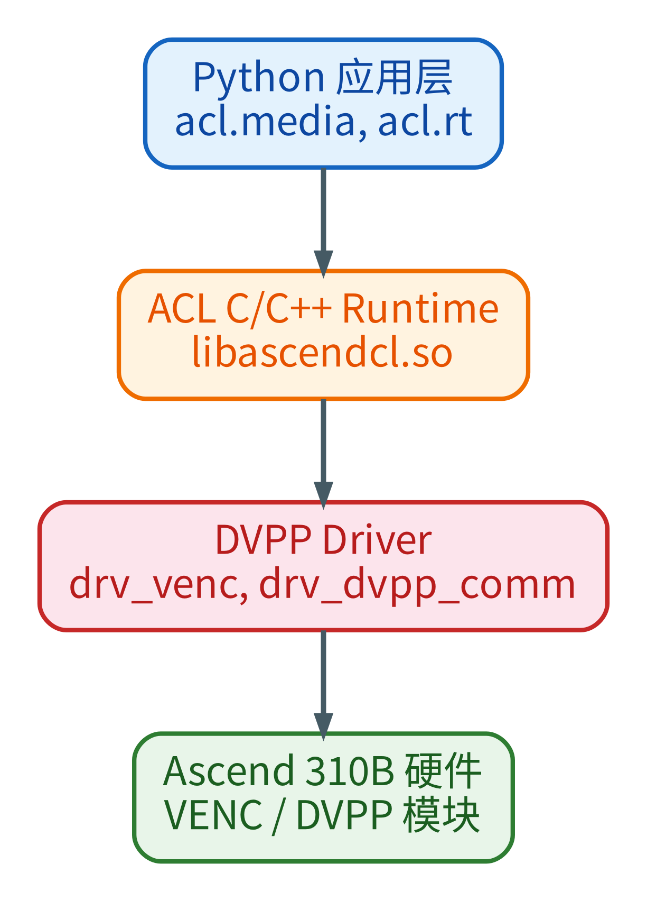
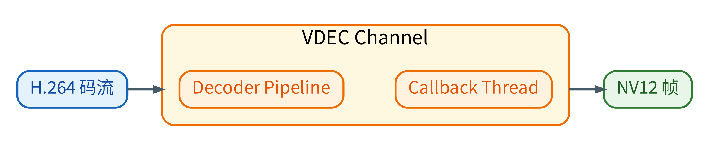
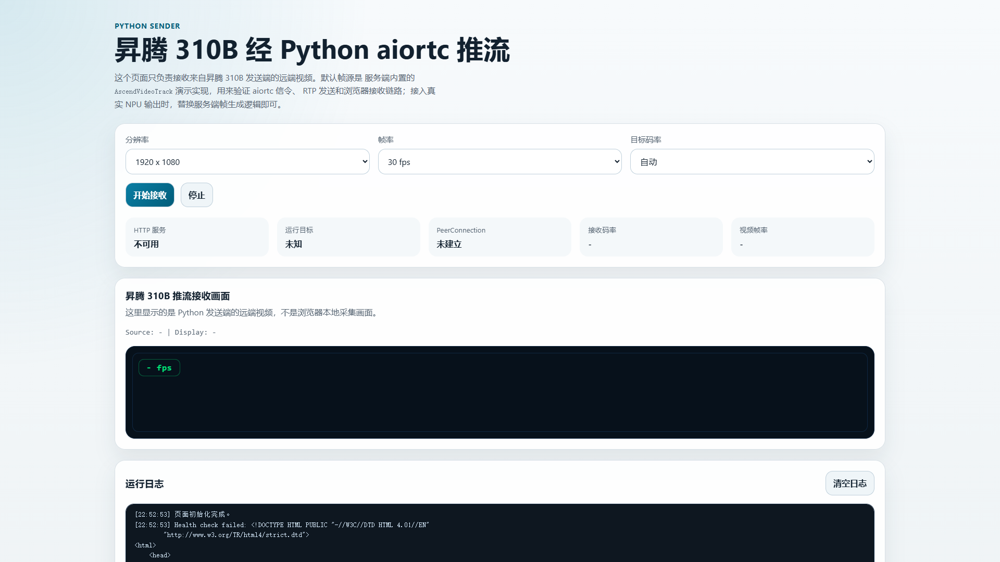

<!-- _class: cover -->

# 第6章：DVPP视频处理基础

<div class="byline">周贤中 · zhouxzh@gdut.edu.cn</div>

## 从 NV12 数据流到可核验的媒体链路


<div class="source">依据：<a href="../book/chapter6.md"><code>src/book/chapter6.md</code></a>；样例：<a href="../../samples/chapter6/README.md"><code>samples/chapter6</code></a></div>

<!--
本讲的主线是媒体数据如何经过 DVPP 通道、内存约束和异步回调，而不是背一组 API 名称。
-->

---

<!-- _class: center -->

## 本讲目标与路线

- 理解 DVPP 通道与异步回调
- 掌握 NV12、stride 与缓冲区约束
- 对照 VENC、VDEC、VPC 与 JPEG 的能力
- 用分层证据排查媒体链

> 本讲主线：数据格式 → 硬件通道 → 证据链

<div class="source">教材：<a href="../book/chapter6.md"><code>src/book/chapter6.md</code></a></div>

<!--
先给出本讲路线图；后续每一段都对应这里的一行，最后回到路线收束。
-->
---


<!-- _class: section -->

# 01

## DVPP 编程模型

---

<!-- _class: center -->

## DVPP 把媒体处理放到专用单元

DVPP 处理图像和视频的格式转换、缩放、裁剪与编解码，不承担神经网络图执行。

| 模块 | 主要职责 | 典型输入与输出 |
|---|---|---|
| VPC | 缩放、裁剪和组合变换 | NV12 → NV12 |
| VENC | H.264/H.265 硬件编码 | NV12 → 视频码流 |
| VDEC | H.264/H.265 硬件解码 | 视频码流 → NV12 |
| JPEG | JPEG 硬件编解码 | NV12 ↔ JPEG |

<div class="source">教材：<a href="../book/chapter6.md#dvpp-basics"><code>src/book/chapter6.md</code>「DVPP 基础概念与编程模型」</a></div>

<!--
先让学生区分 AI Core 和媒体处理单元。DVPP 的通过不能直接证明模型推理通过，模型推理通过也不能替代媒体链路验证。
-->

---

## PyACL 是应用进入 DVPP 的边界

<div class="split"><figure><figcaption>Python 应用通过 acl.media 与 acl.rt 调用 ACL Runtime，再由 DVPP 驱动访问硬件。</figcaption></figure><div><ul><li>应用层调用 <code>acl.media</code> 和 <code>acl.rt</code>。</li><li>ACL Runtime 负责设备、上下文、通道和内存接口。</li><li>VENC、VDEC、VPC 与 JPEG 走各自的 DVPP 路径。</li><li>媒体模块的调用结果要单独记录。</li></ul></div></div>

<div class="source">图片：<a href="../book/img6/cann_acl_dvpp_stack.png"><code>src/book/img6/cann_acl_dvpp_stack.png</code></a>；正文：<a href="../book/chapter6.md#src-book-chapter6-h1"><code>src/book/chapter6.md</code>「DVPP 在芯片中的位置」</a></div>

<!--
带学生从应用层向下定位。Python 报错可能来自导入、Runtime、驱动或某个媒体模块，不能一律归因于硬件故障。
-->

---

<!-- _class: center -->

## 编程模型：显式通道加异步回调

1. 初始化 ACL，设置 Device、Context 和 Stream。
2. 创建对应模块的通道描述符与通道。
3. 准备符合格式和 stride 要求的设备内存。
4. 提交异步任务，在回调线程接收结果。
5. 按通道、描述符、内存和 ACL 的顺序释放资源；回调线程必须绑定正确的 ACL 上下文。

<div class="source">教材：<a href="../book/chapter6.md#channel-model"><code>src/book/chapter6.md</code>「通道模型」与「回调线程模型」</a>；样例：<a href="../../samples/chapter6/venc/venc_minimal.py"><code>samples/chapter6/venc/venc_minimal.py</code></a></div>

<!--
强调“创建通道”和“提交任务”是不同阶段。507018 发生在通道创建阶段，不应该被描述成编码质量或推理精度问题。
-->

---

<!-- _class: center -->

## NV12 的宽度、stride 和缓冲区大小

| 检查项 | 规则 | 失败风险 |
|---|---|---|
| 像素格式 | 常用 NV12，Y 平面后接交错 UV | 格式不符导致拒绝或颜色异常 |
| 宽度 stride | 通常按 16 对齐 | 按紧凑宽度分配会造成越界或花屏 |
| 高度 stride | 按 2 对齐 | 输出/输入描述不一致 |
| 缓冲区大小 | `stride_w × stride_h × 3 / 2` | 小算一段就可能踩坏内存 |
| 数据搬运 | Host/Device 方向与同步必须匹配 | 提前释放或读取未完成结果 |

<div class="source">教材：<a href="../book/chapter6.md#src-book-chapter6-h4"><code>src/book/chapter6.md</code>「DVPP 内存管理」与「NV12」</a>；样例：<a href="../../samples/chapter6/vpc/vpc_minimal.py"><code>samples/chapter6/vpc/vpc_minimal.py</code></a></div>

<!--
用 640 宽举例：640 已经 16 对齐；638 要补到 640。NV12 还必须考虑 UV 平面，因此不能只分配 width×height。
-->

---

<!-- _class: visual -->

## VENC 的输入是受约束的 NV12


编码链路包含格式准备、通道提交和回调取流；回调成功后才得到可读取的码流。

<div class="source">图片：<a href="../book/img6/venc_encode_flow.png"><code>src/book/img6/venc_encode_flow.png</code></a>；正文：<a href="../book/chapter6.md#src-book-chapter6-h14"><code>src/book/chapter6.md</code>「编码流程（端到端）」</a></div>

<!--
本页只解释设计上的编码链路，不代表当前双板已经编码成功。当前运行结果在下一页，必须明确是失败。
-->

---

<!-- _class: center -->

## VENC 参数决定能否建立合法通道

| 参数 | 课堂检查点 | 常见错误 |
|---|---|---|
| `entype` | H.264 与 H.265 使用不同编码类型 | codec 名称和 entype 混用 |
| 宽高与 stride | 输入尺寸和内存布局一致 | 只改宽高，没有重算缓冲区 |
| 码率 | `max_bit_rate` 使用 kbps | 把 bps 当成 kbps |
| GOP | 关键帧间隔必须在有效范围 | GOP 为 0 |
| 像素格式 | 输入为 NV12 | 把 BGR/JPG 直接送入 VENC |

<div class="source">样例：<a href="../../samples/chapter6/venc/venc_minimal.py"><code>samples/chapter6/venc/venc_minimal.py</code></a>；教材：<a href="../book/chapter6.md#src-book-chapter6-h22"><code>src/book/chapter6.md</code>「通道参数详解」</a></div>

<!--
逐项对照代码中的 create_venc_channel。码率单位、GOP、NV12 和 stride 是最容易在通道创建前就出错的四个对象。
-->

---

## 双板记录：H.264 Baseline 都在创建通道时失败

| 板卡 | 目标 SoC | 验证路径 | 原始结果 |
|---|---|---|---|
| 8T | `Ascend310B4` | `venc_minimal.py`，H.264 Baseline | `507018 (0x7bc8a)` |
| 20T | `Ascend310B1` | `venc_minimal.py`，H.264 Baseline | `507018 (0x7bc8a)` |

```text
alloc encoder node buffer failed
H.264 Baseline venc_create_channel 失败: 507018 (0x7bc8a)
```

两板停在同一个 H.264 Baseline 通道创建路径，不能据此比较算力。脚本在该错误后立即退出，H.265 未执行，记为 `untested`；也不能把 WebRTC 硬编链路写成已验证。

<div class="source">原始日志：<a href="../../docs/chapter-board-runs-20261017/8t/run1/chapter6_venc.log"><code>8T chapter6_venc.log</code></a>、<a href="../../docs/chapter-board-runs-20261017/20t/run1/chapter6_venc.log"><code>20T chapter6_venc.log</code></a></div>

<!--
这是本章最重要的边界：H.264 Baseline 在 venc_create_channel 阶段失败，失败码 507018。通道没有建立，就没有后续编码帧可谈。
-->

---

<!-- _class: visual -->

## VDEC 走反向链路并回调 NV12



码流进入 Decoder Pipeline，回调线程交付 NV12；当前双板最小记录没有执行 VDEC，不能写成已通过。

<div class="source">图片：<a href="../book/img6/vdec_channel_model.png"><code>src/book/img6/vdec_channel_model.png</code></a>；正文：<a href="../book/chapter6.md#vdec"><code>src/book/chapter6.md</code>「VDEC—硬件视频解码」</a></div>

<!--
不要把 VENC 和 VDEC 写成同一个通道。它们方向相反，回调参数顺序、码流描述和清理顺序都不同。
-->

---


<!-- _class: section -->

# 02

## VPC、JPEG 与媒体链路

---

<!-- _class: center -->

## VPC：双板最小样例确实通过

| 操作 | 8T / Ascend310B4 | 20T / Ascend310B1 | 证据 |
|---|---|---|---|
| Resize | `640×480 → 320×240`，115200 bytes | 同一结果 | resize 路径可执行 |
| CropResize | `640×480 → 640×480`，460800 bytes | 同一结果 | 裁剪再缩放可执行 |

VPC 通过只能证明这两条图像处理路径。教材记录的 CANN 8.3.RC1 板端环境中，`dvpp_vpc_convert_color_async` 返回 `100000`，这是特定版本的 `observed-fail`，不等于 310B 永久不支持该能力。

<div class="source">原始日志：<a href="../../docs/chapter-board-runs-20261017/8t/run1/chapter6_vpc.log"><code>8T chapter6_vpc.log</code></a>、<a href="../../docs/chapter-board-runs-20261017/20t/run1/chapter6_vpc.log"><code>20T chapter6_vpc.log</code></a>；样例：<a href="../../samples/chapter6/vpc/vpc_minimal.py"><code>samples/chapter6/vpc/vpc_minimal.py</code></a></div>

<!--
两项 VPC 输出是本次双板实测。不要把“VPC 通过”扩大成所有媒体模块都通过，也不要把不支持 CSC 写成整个 VPC 不可用。
-->

---

<!-- _class: center -->

## JPEG 编解码是 NV12 与压缩帧的闭环

1. JPEGE 读取 NV12，预测输出缓冲，提交异步编码。
2. 同步或回调完成后，读取实际 JPEG 大小。
3. JPEGD 读取 JPEG 头，获得宽高与格式。
4. 预测解码大小，输出 NV12。
5. 核对闭环尺寸、内容与资源释放；JPEG 结果不能替代 VENC 证据。

<div class="source">教材：<a href="../book/chapter6.md#jpeg"><code>src/book/chapter6.md</code>「JPEG—硬件编解码」</a>；样例：<a href="../../samples/chapter6/jpeg/jpeg_minimal.py"><code>samples/chapter6/jpeg/jpeg_minimal.py</code></a></div>

<!--
JPEGE 的输出是 JPEG 字节，不是 stream_desc；JPEGD 则从 JPEG 信息推导输出 NV12 大小。两者共用 NV12，但 API 合同不同，也没有 VENC 视频编码的语义。
-->

---

<!-- _class: center -->

## WebRTC 把 DVPP 接入浏览器媒体链

| 层 | 实现边界 | 当前状态 |
|---|---|---|
| 浏览器 | 接收页、协商与状态显示 | 8T 前端已截图 |
| 信令 | HTTP `/offer`，不属于媒体数据面 | 截图未证明 |
| 帧源 | demo、USB 摄像头或 V4L2 MJPEG | 未在本轮截图证明 |
| 预处理 | JPEGD/色彩转换与 NV12 准备 | 未在本轮截图证明 |
| 编码 | CANN VENC → aiortc/RTP | H.264 Baseline 两板 `507018`；H.265 `untested` |

`dvpp_camera` 严格要求硬件路径成立；VENC 失败时应终止该路径，不能改用软编后仍宣称硬编通过。

<div class="source">实现说明：<a href="../../samples/chapter6/WebRTC/README.md"><code>samples/chapter6/WebRTC/README.md</code></a>；正文：<a href="../book/chapter6.md#src-book-chapter6-h145"><code>src/book/chapter6.md</code>「WebRTC 推流性能对比」</a></div>

<!--
这页把 UI、信令、采集、预处理和编码分成五层。当前 507018 阻断的是编码层，浏览器能画出来并不代表后四层通过。
-->

---

<!-- _class: screenshot -->

## 8T 板载 WebRTC 前端布局



**证据边界：仅证明板载前端布局，不证明信令/媒体/VENC。**

<div class="source">manifest id：<code>chapter6-webrtc-demo</code>；8T / <code>Ascend310B4</code>；1920×1080；SHA-256：<code>7e0002ba5f7f73d9191e7b6fd044ef71ff1b62698f0186fbd3eee1f60392a69a</code></div>

<!--
截图来自 8T 的静态 HTTP 页面。画面中的 HTTP 服务“不可用”和 PeerConnection“未建立”必须保留，不能用页面存在推导 aiortc、RTP、媒体接收或 VENC 成功。
-->

---

<!-- _class: center -->

## 截图清单把图片绑定到证据边界

| 字段 | 本次记录 |
|---|---|
| manifest id | `chapter6-webrtc-demo` |
| 图片文件 | `screenshots/book/chapter6-webrtc-demo-1920x1080.png` |
| 板卡与视口 | 8T / `Ascend310B4`；1920×1080 |
| 字节数 | 231915 |
| SHA-256 | `7e0002ba5f7f73d9191e7b6fd044ef71ff1b62698f0186fbd3eee1f60392a69a` |
| 证据边界 | 仅证明板载前端布局，不证明信令/媒体/VENC |

<div class="source">清单：<a href="screenshots/capture-manifest.json"><code>src/presentation/screenshots/capture-manifest.json</code></a>；截图只使用 demo 数据，不含个人图像。</div>

<!--
字节数和 SHA-256 用于绑定这张 PNG。清单中的 application digest 绑定 HTTP、client.js 与 styles.css 的组合；它们证明页面资产身份，仍不证明 WebRTC 媒体通过。
-->

---

<!-- _class: center -->

## 双板证据矩阵

| 检查 | 8T / Ascend310B4 | 20T / Ascend310B1 | 边界 |
|---|---|---|---|
| `check_cann.py` | 通过，API 38 个 | 通过，API 38 个 | 环境和函数可见 |
| VPC minimal | Resize、CropResize 通过 | Resize、CropResize 通过 | 两条图像路径通过 |
| VENC minimal（H.264 Baseline） | `507018` | `507018` | 通道创建失败；H.265未执行 |
| VDEC / JPEG | 本轮未执行 | 本轮未执行 | `untested` |
| WebRTC 媒体链 | 前端已截图 | 未截图 | 媒体未证明 |

<div class="source">汇总依据：<a href="../../docs/ascend310b-chapter-board-comparison-20261017.md"><code>双板记录</code> §4 chapter6</a>；原始日志目录：<a href="../../docs/chapter-board-runs-20261017/README.md"><code>docs/chapter-board-runs-20261017</code></a></div>

<!--
让学生从表中指出每个“通过”的最小证明。VENC 同行同错误码不是硬件排名；前端截图也不是媒体链通过。
-->

---

## 最小复现命令

```bash
source /usr/local/Ascend/ascend-toolkit/set_env.sh
python samples/chapter6/check_cann.py
python samples/chapter6/vpc/vpc_minimal.py
python samples/chapter6/venc/venc_minimal.py
python samples/chapter6/vdec/vdec_minimal.py
python samples/chapter6/jpeg/jpeg_minimal.py
```

命令必须在板端 CANN 环境中运行。`venc_minimal.py` 当前应在通道创建处失败，并保留失败日志。

<div class="source">命令来源：<a href="../../samples/chapter6/README.md"><code>samples/chapter6/README.md</code></a>；脚本：<a href="../../samples/chapter6"><code>samples/chapter6/</code></a></div>

<!--
先运行 check_cann，再按 VPC、VENC、VDEC、JPEG 顺序验证。VENC 失败时不要删除日志，也不要把后续 WebRTC 启动当作 VENC 恢复。
-->

---

<!-- _class: center -->

## 媒体故障按层排查

1. `import acl` 失败：先查 Python、CANN 环境变量与架构。
2. Device 不可见：查驱动、设备节点、权限和 `npu-smi`。
3. 通道创建失败：查格式、stride、尺寸、码率、GOP 和驱动日志。
4. 回调无结果：查回调线程的 ACL Context、完成条件和队列。
5. 画面异常：查 NV12 平面、stride、裁剪坐标和颜色转换路径。

<div class="source">依据：<a href="../book/chapter6.md#src-book-chapter6-h8"><code>src/book/chapter6.md</code>「开发注意事项」</a>；VENC：<a href="../book/chapter6.md#src-book-chapter6-h24"><code>「开发过程与常见问题」</code></a></div>

<!--
507018 先停在通道创建层。不要因为日志里出现 venc 就继续分析 H.264 码流，因为通道还没有建立。
-->

---

<!-- _class: center -->

## 课堂交付：一条分层证据链

| 交付项 | 必须提交 |
|---|---|
| 环境 | `check_cann.py` 输出、SoC、CANN 版本 |
| 图像处理 | VPC 输入/输出尺寸、stride 与日志 |
| 编码 | VENC 命令、结果、`507018` 或成功码流 |
| 集成 | 前端截图、manifest id、哈希与媒体链路状态 |
| 边界 | 哪些是实测，哪些仍是 `untested` |

完成标准是另一位同学能复现同一路径，并说明截图、VPC、VENC 和 WebRTC 各自只证明什么。

<div class="source">教材：<a href="../book/chapter6.md"><code>src/book/chapter6.md</code></a>；截图清单：<a href="screenshots/capture-manifest.json"><code>capture-manifest.json</code></a>；样例：<a href="../../samples/chapter6/README.md"><code>samples/chapter6</code></a></div>

<!--
最后要求学生同时提交失败证据。当前正确结论是 VPC 通过、H.264 Baseline 两板 `507018`、H.265 与 WebRTC 媒体链 `untested`，而不是“VENC 通过”。
-->
