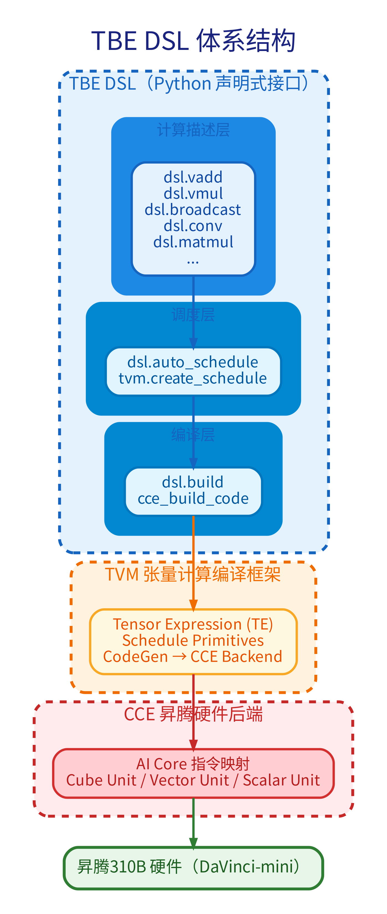

<!-- _class: cover -->

# 第7章：算子开发实战

<div class="byline">周贤中 · zhouxzh@gdut.edu.cn</div>

## 从 TBE DSL 原型到 Ascend C 硬件证据


<div class="source">依据：<a href="../book/chapter7.md">src/book/chapter7.md</a>；样例：<a href="../../samples/chapter7/add_tbe/add.py"><code>samples/chapter7</code></a></div>

<!--
本章既讲算子怎么写，也讲“什么证据才算算子真的编译并在 NPU 上执行”。后一层是本次双板记录没有完成的边界。
-->

---

<!-- _class: center -->

## 本讲目标与路线

- 判断什么时候需要自定义算子
- 理解 TBE DSL 与 Ascend C 的分工
- 写出算子接口合同与最小验证骨架
- 区分编译、运行与硬件执行证据

> 本讲主线：算子合同 → TBE 原型 → Ascend C 证据

<div class="source">教材：<a href="../book/chapter7.md"><code>src/book/chapter7.md</code></a></div>

<!--
先给出本讲路线图；后续每一段都对应这里的一行，最后回到路线收束。
-->
---


<!-- _class: section -->

# 01

## 算子合同与 TBE DSL

---

<!-- _class: center -->

## 什么时候需要自定义算子

- CANN 算子库没有模型所需的算子。
- ATC 转换遇到不支持的算子或组合。
- 已有算子成为明确性能瓶颈。
- 后处理需要下沉到设备侧执行。

典型路径是先用 TBE DSL 快速验证功能，再决定是否用 Ascend C 重写热点。

<div class="source">教材：<a href="../book/chapter7.md#算子开发的两条主流路径"><code>src/book/chapter7.md</code>「算子开发的两条主流路径」</a></div>

<!--
自定义算子不是默认选项。先确认内置算子、图优化或模型改写不能解决问题，再承担编译、注册和验收成本。
-->

---

<!-- _class: center -->

## 310B 的计算单元与存储层次

- Cube Unit 承担矩阵乘法、卷积等高密度计算。
- Vector Unit 承担激活、归一化、池化和格式转换。
- Scalar Unit 负责控制流、地址计算与调度。
- Global Memory 经 L1 或 Unified Buffer 进入计算单元。
- MTE 负责多级缓冲之间的搬运、对齐与格式重排。

<div class="source">教材：<a href="../book/chapter7.md#昇腾310b处理器与达芬奇架构"><code>src/book/chapter7.md</code>「昇腾310B处理器与达芬奇架构」</a></div>

<!--
把“算力”拆成计算单元与数据搬运。很多算子瓶颈不是 Cube 算得慢，而是数据无法及时、安全地进入片上缓冲。
-->

---

<!-- _class: center -->

## TBE DSL 与 Ascend C 的分工

| 维度 | TBE DSL | Ascend C |
|---|---|---|
| 语言 | Python 声明式表达 | C++ 命令式实现 |
| 开发者关注 | 算什么，调度交给模板 | 怎么算、怎么搬、怎么分核 |
| 内存与流水 | 框架自动处理 | 显式管理 UB、队列和流水 |
| 适合阶段 | 原型、标准算子 | 性能热点、特殊数据流 |
| 渐进路线 | 先验证功能 | 再优化底层实现 |

两条路线不是互斥关系。本次双板记录只完成了第一条路线的功能验证。

<div class="source">教材：<a href="../book/chapter7.md#声明式-vs-命令式"><code>src/book/chapter7.md</code>「声明式 vs 命令式」</a></div>

<!--
明确两条路线的抽象层级。TBE 代码短不代表平台自动完成 NPU 编译，Ascend C 源码存在也不代表已在硬件运行。
-->

---

<!-- _class: visual -->

## TBE DSL 把声明、调度和编译分层



<div class="source">图片：<a href="../book/img7/dsl_architecture.png"><code>src/book/img7/dsl_architecture.png</code></a>；出处：<a href="../book/chapter7.md#tbe-dsl-快速概览"><code>src/book/chapter7.md</code>「TBE DSL快速概览」</a></div>

<!--
从上到下带读计算描述层、调度层、编译层、TVM 和 CCE 后端。图展示的是设计路径，不等于本次双板已经完成对应硬件编译。
-->

---

<!-- _class: center -->

## 算子首先是一份接口合同

| 合同项 | 需要定义 |
|---|---|
| OpType | 唯一名称，例如 `Add` |
| 输入输出 | 数量、shape、format 与 dtype |
| 属性 | `axis`、`kernel_size`、`eps` 等编译期参数 |
| 信息库 | 注册算子及实现产物 |
| 验证 | 参考结果、容差、边界 shape |

原型或 `.ini` 写错时，计算代码可能正确，但图引擎仍无法找到或正确调用算子。

<div class="source">教材：<a href="../book/chapter7.md#理解算子开发的核心概念"><code>src/book/chapter7.md</code>「理解算子开发的核心概念」</a></div>

<!--
让学生先写接口卡片，再写代码。OpType、输入输出、属性和信息库必须一致，否则后面编译和注册会脱节。
-->

---

<!-- _class: center -->

## TBE DSL 的加法主线

1. 用 `placeholder` 描述输入张量与 dtype。
2. 用 `broadcast` 对齐输入 shape。
3. 用 `vadd` 描述逐元素加法。
4. 用 `auto_schedule` 生成调度。
5. 用 `build` 与 `run` 进入验证路径。

<div class="source">样例：<a href="../../samples/chapter7/add_tbe/add.py"><code>samples/chapter7/add_tbe/add.py</code></a>、<a href="../../samples/chapter7/add_tbe/run.py"><code>run.py</code></a>；教材：<a href="../book/chapter7.md#初体验使用tbe-dsl快速实现第一个算子向量加法"><code>src/book/chapter7.md</code> 第7.2节</a></div>

<!--
分清 add.py 和 run.py。前者描述算子实现与编译入口，后者验证等价 TBE DSL 计算；两者都不能代替 Ascend C 自定义算子包安装。
-->

---

## 最小 TBE DSL 验证骨架

```python
data_c = dsl.vadd(data_a, data_b)
schedule = tvm.create_schedule(data_c.op)
build(schedule, [data_a, data_b, data_d], name="AddTest")
run(a, b, d)
tvm.testing.assert_allclose(
    d.asnumpy(), a.asnumpy() + b.asnumpy() + b.asnumpy())
```

这段代码验证计算逻辑与参考值一致，但日志中的 `debug enter` 不能自动等同于 NPU Kernel 已安装并执行。

<div class="source">代码：<a href="../../samples/chapter7/add_tbe/run.py"><code>samples/chapter7/add_tbe/run.py</code></a>；教材：<a href="../book/chapter7.md#编写验证代码runpy"><code>src/book/chapter7.md</code>「编写验证代码（run.py）」</a></div>

<!--
注意 run.py 使用 TBE testing/debug 环境。它证明等价 DSL 计算的数值断言通过，不是 Ascend C 算子包加载或 NPU 执行证据。
-->

---

## 双板 `run.py` 实际输出

```text
======================== debug enter ========================
The value of data_c is the same as the expected value.
The actual output is the same as the expected output.
======================== debug exit ========================
```

8T 与 20T 的 `add_tbe/run.py` 都打印上述关键断言。它证明 TBE DSL 功能验证通过，不证明 Ascend C 硬件算子通过。

<div class="source">原始日志：<a href="../../docs/chapter-board-runs-20261017/8t/run1/chapter7_tbe.log"><code>8T chapter7_tbe.log</code></a>、<a href="../../docs/chapter-board-runs-20261017/20t/run1/chapter7_tbe.log"><code>20T chapter7_tbe.log</code></a></div>

<!--
日志只保留关键行。两个板的随机输入不同，但都在各自输入上完成数值断言，不能据此比较速度或硬件能力。
-->

---


<!-- _class: section -->

# 02

## Ascend C 与硬件证据

---

<!-- _class: center -->

## Ascend C 把数据流显式写出来

- Host 端准备输入、Tiling 参数并调用 Kernel。
- Device 端 Kernel 在 AI Core 上执行。
- SPMD 让各 Core 运行同一份代码、处理不同区间。
- 每个 Tile 执行 CopyIn、Compute、CopyOut。
- 多核偏移、双缓冲和 UB 容量由开发者管理。

<div class="source">教材：<a href="../book/chapter7.md#ascend-c-的编程模型"><code>src/book/chapter7.md</code>「Ascend C的编程模型」</a></div>

<!--
将 Ascend C 的控制点与 TBE 自动调度对比。重点是开发者要负责数据搬运与多核分配，而不只是写一个加法表达式。
-->

---

## Ascend C Kernel 的关键骨架

```cpp
for (int32_t i = 0; i < loopCount; i++) {
    CopyIn(i);   // Global Memory -> Local Memory
    Compute(i);  // Add on Local Tensor
    CopyOut(i);  // Local Memory -> Global Memory
}

extern "C" __global__ __aicore__ void add_custom(
    GM_ADDR x, GM_ADDR y, GM_ADDR z,
    GM_ADDR workspace, GM_ADDR tiling) {
    GET_TILING_DATA(tilingData, tiling);
    KernelAdd op;
    op.Init(x, y, z, tilingData.totalLength, tilingData.tileNum);
    if (TILING_KEY_IS(1)) { op.Process(); }
}
```

<div class="source">源码：<a href="../../samples/chapter7/add_ascendc/add_custom.cpp"><code>samples/chapter7/add_ascendc/add_custom.cpp</code></a>；教材：<a href="../book/chapter7.md#向量加法的-ascend-c-实现"><code>src/book/chapter7.md</code>「向量加法的Ascend C实现」</a></div>

<!--
这段源码证明实现骨架存在，不证明它已通过 msopgen、自定义算子包安装、ACL 加载和 NPU 执行。
-->

---

<!-- _class: center -->

## Tiling 把大数据切进片上缓冲

| 参数 | 含义 | 约束 |
|---|---|---|
| Tile Size | 每次搬入 UB 的元素数 | 不超过可用缓冲，并满足对齐 |
| Tile Count | 总数据切成的块数 | 由总长度与 Tile Size 决定 |
| Core Assignment | 每个 AI Core 处理的数据区间 | 按 block index 分配 |
| Buffer Budget | 输入、输出和中间量的总占用 | 为双缓冲及临时空间留余量 |

Tiling 不只是按大小切分，还要同时考虑搬运次数、并行度、对齐和边界尾部。

<div class="source">教材：<a href="../book/chapter7.md#tiling分片计算的基本思想"><code>src/book/chapter7.md</code>「Tiling（分片计算）的基本思想」</a></div>

<!--
用矩阵加法的 128×256 数据说明：数据超出 UB 时需要分片；Ascend C 的 Tiling 参数由 Host 计算并传给 Kernel。
-->

---

<!-- _class: center -->

## 矩阵加法 PASSED 仍是 TBE 等价验证

`mat_add_tiling/run.py` 的输出包含：

- `Matrix add verification: PASSED`
- 输入形状 `(128, 256)`，共 32768 个元素。
- 128KB 数据超过 UB，日志说明由 TBE DSL 自动处理 Tiling。
- 日志同时提示 Ascend C 手工 Tiling 源码是 `mat_add_custom.cpp`。

因此这次 PASSED 验证的是 TBE DSL 的等价矩阵加法与自动调度，不是手工 Tiling Kernel 的 NPU 执行。

<div class="source">日志：<a href="../../docs/chapter-board-runs-20261017/8t/run1/chapter7_tiling.log"><code>8T chapter7_tiling.log</code></a>、<a href="../../docs/chapter-board-runs-20261017/20t/run1/chapter7_tiling.log"><code>20T chapter7_tiling.log</code></a>；源码：<a href="../../samples/chapter7/mat_add_tiling/run.py"><code>samples/chapter7/mat_add_tiling/run.py</code></a></div>

<!--
这是最容易误读的一页。输出里的 PASSED 和 TBE DSL auto-tiling 必须连在一起读，不能把它升级为手写 Ascend C Tiling 已在两板通过。
-->

---

<!-- _class: center -->

## 双板证据表：只记通过到哪一层

| 样例 | 8T / 20T 结果 | 实际验证层 |
|---|---|---|
| `add_tbe/run.py` | 两板均通过 | TBE DSL 功能断言 |
| `add_ascendc/run.py` | 两板均通过 | TBE DSL 等价验证 |
| `mat_add_tiling/run.py` | 两板均通过 | TBE DSL 自动 Tiling 验证 |
| Ascend C Kernel | 未编译、未安装、未执行 | `untested` |

双板环境均记录 `Health: Alarm`，只作诊断背景。本记录没有运行 `msopgen`，也没有生成或安装自定义算子包。

<div class="source">结论：<a href="../../docs/ascend310b-chapter-board-comparison-20261017.md"><code>双板记录</code> §1、§4 chapter7</a>；原始说明：<a href="../../docs/chapter-board-runs-20261017/20t/run1/chapter7_ascendc.log"><code>20T chapter7_ascendc.log</code></a></div>

<!--
这张表把结论封死：三个脚本、两块板都通过，但三行都是 TBE DSL 层。Ascend C 未完成 msopgen、算子包安装、ACL 加载和 NPU 执行，必须写 untested。
-->

---

<!-- _class: center -->

## 补齐 Ascend C 硬件证据的五步

1. 用 `msopgen` 生成算子工程与注册骨架。
2. 对齐算子原型、`.ini` 信息库和 Kernel 实现。
3. 编译并安装自定义算子包，记录 `.o`、`.json`、`.so` 与安装位置。
4. 在真实板卡用 AscendCL 加载和执行，保存退出码与原始日志。
5. 对同一输入比较 CPU 参考值、NPU 输出与边界 shape。

<div class="source">教材：<a href="../book/chapter7.md#编译与运行"><code>src/book/chapter7.md</code>「编译与运行」</a>；证据边界：<a href="../../docs/ascend310b-chapter-board-comparison-20261017.md"><code>双板记录</code> §4 chapter7</a></div>

<!--
给出可执行的闭环。每步都要产物和日志；仅生成 C++ 源码、打印 PASSED 或运行 TBE DSL 等价脚本都不够。
-->

---

<!-- _class: center -->

## 课堂任务：三层证据逐项勾选

| 证据层 | 当前状态 | 通过标准 |
|---|---|---|
| TBE DSL 功能 | 双板已记录 | 数值断言通过 |
| Ascend C 编译 | `untested` | 有工程、算子包和产物清单 |
| NPU 执行 | `untested` | ACL 执行成功且输出对齐 |
| 复杂 Tiling | `untested` | 大 shape、边界与多核结果一致 |

课堂报告中必须分别写三行结论，禁止把三行合并成一句“算子已在 NPU 上通过”。

<div class="source">依据：<a href="../../docs/ascend310b-chapter-board-comparison-20261017.md"><code>双板记录</code> §4 chapter7</a>；样例：<a href="../../samples/chapter7/add_ascendc"><code>samples/chapter7/add_ascendc</code></a>、<a href="../../samples/chapter7/mat_add_tiling"><code>mat_add_tiling</code></a></div>

<!--
最终要求学生按证据层逐项勾选。当前能勾的只有 TBE DSL 功能，Ascend C 编译与 NPU 执行都必须保留为 untested。
-->
