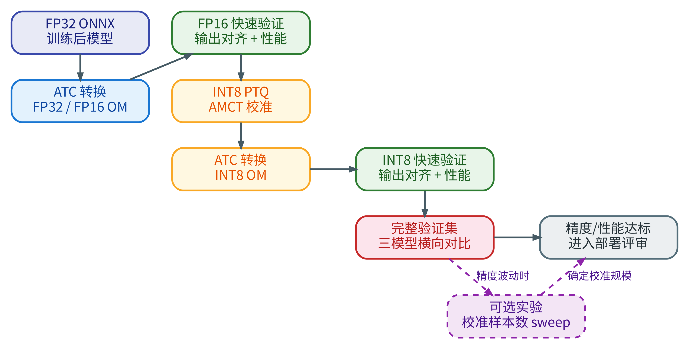

<!-- _class: cover -->

# 第9章：模型量化案例教学

<div class="byline">周贤中 · zhouxzh@gdut.edu.cn</div>

## 从 400 张对齐样本到可回退的量化决策


<div class="source">依据：<a href="../book/chapter9.md">src/book/chapter9.md</a>；样例：<a href="../../samples/chapter9/README.md"><code>samples/chapter9</code></a></div>

<!--
本章不只讲怎么生成 INT8，而是讲量化前如何判断、FP16如何验证、INT8缺哪一层证据，以及失败时如何回退。
-->

---

<!-- _class: center -->

## 本讲目标与路线

- 判断瓶颈是否在模型执行
- 建立 FP32/FP16 可比基线
- 理解 AMCT 校准与 INT8 四阶段
- 保持可回退的量化证据链

> 本讲主线：基线 → FP16 → INT8 → 回退

<div class="source">教材：<a href="../book/chapter9.md"><code>src/book/chapter9.md</code></a></div>

<!--
先给出本讲路线图；后续每一段都对应这里的一行，最后回到路线收束。
-->
---

<!-- _class: center -->

## 先确认瓶颈是否在模型执行

- 采集、解码、CPU 预处理、H2D、后处理都可能主导端到端时间。
- 只有模型执行成为主要瓶颈时，量化才值得进入优化路径。
- FP16 是风险较低的第一阶段。
- INT8 需要校准，风险和验证成本更高。
- 每一阶段都要同时看输出、精度和耗时。

<div class="source">教材：<a href="../book/chapter9.md#src-book-chapter9-h1"><code>src/book/chapter9.md</code> §9.1</a></div>

<!--
先排除预处理、拷贝和后处理瓶颈。如果模型 execute 占比很小，INT8 即使更快也未必改善业务帧率。
-->

---

<!-- _class: section -->

# 01

## 量化路线与数值格式

---

<!-- _class: center -->

## 量化路线：先基准，再 FP16，最后 INT8



<div class="source">图片：<a href="../book/img9/quantization_workflow.png"><code>src/book/img9/quantization_workflow.png</code></a>；出处：<a href="../book/chapter9.md#src-book-chapter9-h1"><code>src/book/chapter9.md</code> 章首</a></div>

<!--
按三层读图：建立 FP32/FP16 基准、快速输出与性能验证、INT8 PTQ 和完整验证。校准 sweep 只有在需要解释波动时才启用。
-->

---

<!-- _class: center -->

## 三种数值格式解决不同问题

| 格式 | 权重与激活表示 | 基准作用 |
|---|---|---|
| FP32 | 32位浮点 | 原始精度参考 |
| FP16 | 16位浮点 | 低精度推理首站 |
| INT8 | 8位整数加 scale/zero-point | 校准后的进一步压缩 |

低精度会降低数据宽度和访存压力，但不会自动保证端到端加速或精度不下降。

<div class="source">教材：<a href="../book/chapter9.md#src-book-chapter9-h2"><code>src/book/chapter9.md</code> §9.2</a></div>

<!--
FP16 和 INT8 的风险不同。FP16 通常不需要校准；INT8 必须通过代表性数据估计激活范围。
-->

---

<!-- _class: center -->

## 校准集和验证集必须分开

| 数据用途 | 数量与来源 | 标签要求 |
|---|---|---|
| 校准 | Tiny-ImageNet 训练图，400张 PNG | 不需要标签 |
| 快速对齐 | 同一批400张 PNG | 与 FP32 输出比较 |
| 完整验证 | 独立验证集，10000张 PNG | 需要真实标签 |

预处理必须统一为 RGB、64×64、NCHW、float32 和同一 mean/std。验证图不得进入校准。

<div class="source">教材：<a href="../book/chapter9.md#src-book-chapter9-h4"><code>src/book/chapter9.md</code> §9.4</a>、§9.5</div>

<!--
400张训练图用于校准和快速输出对齐，不是精度验证集。10000张验证图才用于Top1/Top5。
-->

---

## FP32/FP16 先建立可比基线

来源：`samples/chapter9/README.md` 第 2 节。

```bash
atc --model=model/resnet18_tiny_imagenet.onnx --framework=5 \
  --output=model/resnet18_tiny_imagenet_fp32 \
  --input_shape="input.1:1,3,64,64" \
  --soc_version=Ascend310B4 --precision_mode=force_fp32

# 20T 必须改为 Ascend310B1，并单独保存 OM
```

FP16 使用同一输入合同，把 `--precision_mode` 改为 `allow_fp32_to_fp16`；`--output` 必须另取文件名。

<div class="source">B4 命令：<a href="../../samples/chapter9/README.md"><code>samples/chapter9/README.md</code> 第2节</a>；教材：<a href="../book/chapter9.md#src-book-chapter9-h6"><code>src/book/chapter9.md</code> §9.6</a></div>

本页只给出 8T 示例。20T 后续结果没有保留 ATC 命令和 B1 专用 OM provenance，因此不能用 B4 命令推断跨 SoC 复用成立；20T 要按 `Ascend310B1` 单独转换、记录哈希并重跑。

<!--
两份 OM 从同一个 FP32 ONNX 生成，但目标 SoC 的归属必须逐板记录。不能因为文件名相同就推断 B1 可以复用 B4 OM，也不能替 20T 补造未保留的转换命令。
-->

---

<!-- _class: center -->

## 输出对齐不等于验证集准确率

- Top1 match 只比较两个模型在同一输入上的第一名类别。
- Top5 overlap 比较两个模型候选集合的重合数量，最大为5。
- 最大绝对误差衡量最剧烈的 logits 数值漂移。
- 全量验证才使用真实标签计算 Top1/Top5。

400张对齐样本说明“候选模型像不像 FP32”，不说明分类质量是否达标。

<div class="source">教材：<a href="../book/chapter9.md#src-book-chapter9-h7"><code>src/book/chapter9.md</code> §9.7</a></div>

<!--
强调两种“准确率”的区别。Top1 match 是模型间一致性，不是候选模型相对真标签的 accuracy。
-->

---


<!-- _class: section -->

# 02

## FP16 基线与 INT8 校准

---

<!-- _class: center -->

## 双板 FP16 输出对齐：400张图

| 指标 | 8T 观测 | 20T 观测 | 样本 |
|---|---:|---:|---:|
| Top1 match | 100.00% | 100.00% | 400 |
| Mean Top5 overlap | 4.9975 | 4.9975 | 400 |
| Max absolute diff | 0.008928298950195312 | 0.008928298950195312 | 400 |

两板结果来自同次工具执行记录，但仍是两个独立板卡记录。这里比较的是 FP32 OM 与 FP16 OM 的输出一致性。

<div class="source">原始结果：<a href="../../docs/chapter-board-runs-20261017/tool-execution/chapter9-task-tool.txt"><code>chapter9-task-tool.txt</code> board-8t/board-20t</a></div>

<!--
三个值必须带“400张图”。100% 是模型间Top1匹配，不是验证集准确率；最大误差也不能用截图或均值替代。
-->

---

<!-- _class: center -->

## 双板 10 个计时样本的性能记录

| 精度 | 8T Execute mean | 20T Execute mean | 计时样本 | warmup/命令 |
|---|---:|---:|---:|---|
| FP32 | 6.8647 ms | 5.4605 ms | 10 | 均未记录 |
| FP16 | 6.2755 ms | 6.0932 ms | 10 | 均未记录 |

这里的 10 是计时样本数，不是总执行次数。工具记录只保留 `count=10`，没有保存实际 warmup、启动命令、CANN/driver 和逐样本板况；脚本默认 `warmup=5`、`runs=100` 不能反推本次参数。

这是同一模型路径的 Execute 统计，不含完整端到端业务链路。20T 的 FP16 在这次记录中高于自身 FP32，不能据此推导完整基准或硬件排名。

<div class="source">原始结果：<a href="../../docs/chapter-board-runs-20261017/tool-execution/chapter9-task-tool.txt"><code>chapter9-task-tool.txt</code>；<a href="../../docs/ascend310b-chapter-board-comparison-20261017.md"><code>双板记录</code> §3 chapter9</a></div>

<!--
严格保留四个均值与“10个计时样本”。warmup 缺失必须明确写出。Execute 均值不是端到端，也不是完整性能基准；两板不能混算。
-->

---

<!-- _class: center -->

## 这些数字不能扩大解释

- 400张只覆盖输出对齐，不是10000张验证集精度。
- 10次只覆盖 Execute，不代表长稳、p95 或业务 FPS。
- 8T 与20T是独立记录，不能平均或合成排名。
- FP16 结果不能证明 INT8 可用。
- 当前记录未包含 INT8 OM 输出、精度或性能。

<div class="source">范围：<a href="../../docs/ascend310b-chapter-board-comparison-20261017.md"><code>双板记录</code> §3、§5</a></div>

<!--
性能与精度都必须绑定样本数、阶段和板卡。没有这些字段，数字不可复用。
-->

---

<!-- _class: visual -->

## INT8 需要 AMCT 校准，不是改一个 ATC 参数


<div class="source">图片：<a href="../book/img9/int8_ptq_pipeline.png"><code>src/book/img9/int8_ptq_pipeline.png</code></a>；出处：<a href="../book/chapter9.md#src-book-chapter9-h9"><code>src/book/chapter9.md</code> §9.9</a></div>

<!--
图中路径是文档化流程：FP32 ONNX 与校准集，经配置生成、激活校准、deploy ONNX，再由 ATC 转 INT8 OM。当前双板记录没有执行后续 INT8 步骤。
-->

---

<!-- _class: center -->

## PTQ 的四个关键阶段

1. 生成量化配置，明确校准样本数量和量化层。
2. 插入 fake-quant 与统计节点，运行校准集。
3. 固化 scale/zero-point，生成 deploy ONNX。
4. 交给 ATC 生成 INT8 OM。

校准、输出对齐、性能测试和完整验证必须复用同一套预处理。

<div class="source">样例：<a href="../../samples/chapter9/03_prepare_quantization.py"><code>samples/chapter9/03_prepare_quantization.py</code></a>、<a href="../../samples/chapter9/04_calibrate_quantization.py"><code>04_calibrate_quantization.py</code></a></div>

<!--
PTQ不重新训练，只利用校准数据估计激活范围。校准集与验证集混用会污染精度结论。
-->

---

## INT8 流程命令：文档路径，当前未执行

来源：`samples/chapter9/README.md` 第 4 节。

```bash
python 03_prepare_quantization.py
python 04_calibrate_quantization.py
atc --model=model/resnet18_tiny_imagenet_int8_deploy.onnx \
  --framework=5 --output=model/resnet18_tiny_imagenet_int8 \
  --input_format=NCHW --input_shape="input.1:1,3,64,64" \
  --soc_version=Ascend310B4 --log=info
```

命令存在不代表本次双板已经运行。当前执行集只完成 FP32/FP16 输出对齐与性能记录。

<div class="source">命令：<a href="../../samples/chapter9/README.md"><code>samples/chapter9/README.md</code> 第4节</a>；教材：<a href="../book/chapter9.md#atc-转-int8-om"><code>src/book/chapter9.md</code> §9.9.5</a></div>

<!--
这页展示怎样做，不是展示已经完成。INT8没有deploy ONNX、OM、输出对齐、性能或验证集结果，不能写成板端通过。
-->

---

<!-- _class: center -->

## 当前 INT8 证据状态

| 证据层 | 当前状态 | 缺失内容 |
|---|---|---|
| AMCT 配置与校准 | `untested` | 校准运行与 deploy ONNX |
| INT8 ATC 与 OM | `untested` | 转换日志与 OM 工件 |
| 400张输出对齐 | `untested` | FP32 vs INT8 输出 |
| 10次性能 | `untested` | INT8 Execute 记录 |
| 完整验证集 | `untested` | FP32/FP16/INT8 Top1/Top5 |

结论只有一句：本轮完成 FP32/FP16，INT8 流程与板端结果未测试。

<div class="source">官方记录范围：<a href="../../docs/ascend310b-chapter-board-comparison-20261017.md"><code>双板记录</code> §3 chapter9</a></div>

<!--
这是本章最重要的边界页。不能把文档中的历史INT8数据搬进本轮双板证据，也不能把PTQ流程写成实测通过。
-->

---

<!-- _class: center -->

## 完整验证与 sweep 只用于后续计划

- 完整验证必须在独立10000张验证集上计算 Top1/Top5。
- FP32、FP16、INT8 必须在同一循环、同一预处理下比较。
- `mismatches` 用于检查边界样本排序变化。
- 校准 sweep 是可选实验，不是主流程必需步骤。
- 每个 sweep 点都要重新校准并生成独立 INT8 OM。

<div class="source">流程：<a href="../book/chapter9.md#src-book-chapter9-h11"><code>src/book/chapter9.md</code> §9.11、§9.12</a></div>

<!--
完整验证与400张输出对齐是两种证据。sweep用于解释不同校准规模，不用于把已有INT8 OM复用成多个点。
-->

---

<!-- _class: center -->

## 回退顺序应保持证据可追踪

| 现象 | 优先检查 | 回退动作 |
|---|---|---|
| FP16 输出漂移 | 输入合同、layout、预处理 | 回到 FP32 基准定位 |
| INT8 精度下降 | 校准集代表性、量化层 | 重校准或排除敏感层 |
| INT8 性能无收益 | ATC、Profiling、回退算子 | 保留已验证的 FP16 |
| 小样本正常、全量异常 | 验证集与统计口径 | 重新跑同口径完整验证 |
| 结果波动 | 校准样本、seed、环境 | 固定协议并重复实验 |

如果 INT8 证据不完整或指标不达标，部署回退到已验证的 FP16，而不是继续调参掩盖问题。

<div class="source">教材：<a href="../book/chapter9.md#src-book-chapter9-h13"><code>src/book/chapter9.md</code> §9.13</a></div>

<!--
回退不是失败，而是风险控制。任何 INT8 优化都必须保留原始日志、模型哈希、样本数量和失败原因。
-->

---

<!-- _class: center -->

## 课堂任务：提交一张量化证据卡

| 项目 | 必填内容 |
|---|---|
| 基准 | FP32 OM、路径、哈希、输入合同 |
| 快速对齐 | 400张样本、Top1/Top5 overlap、最大误差 |
| 性能 | 10次 Execute mean，各自板卡单列 |
| INT8 | 校准、OM、对齐、性能、全量验证状态 |
| 结论 | 采用、回退 FP16 或继续测试 |

当前可填 FP32/FP16 的400张对齐和10次性能；INT8 五项必须保留为 `untested`。

<div class="source">作业：<a href="../book/chapter9.md#src-book-chapter9-h1"><code>src/book/chapter9.md</code></a>；样例：<a href="../../samples/chapter9/README.md"><code>samples/chapter9/README.md</code></a></div>

<!--
最后逐项检查样本数和证据层级。没有INT8原始日志、工件和输出，就不能把流程页当成结果页。
-->
