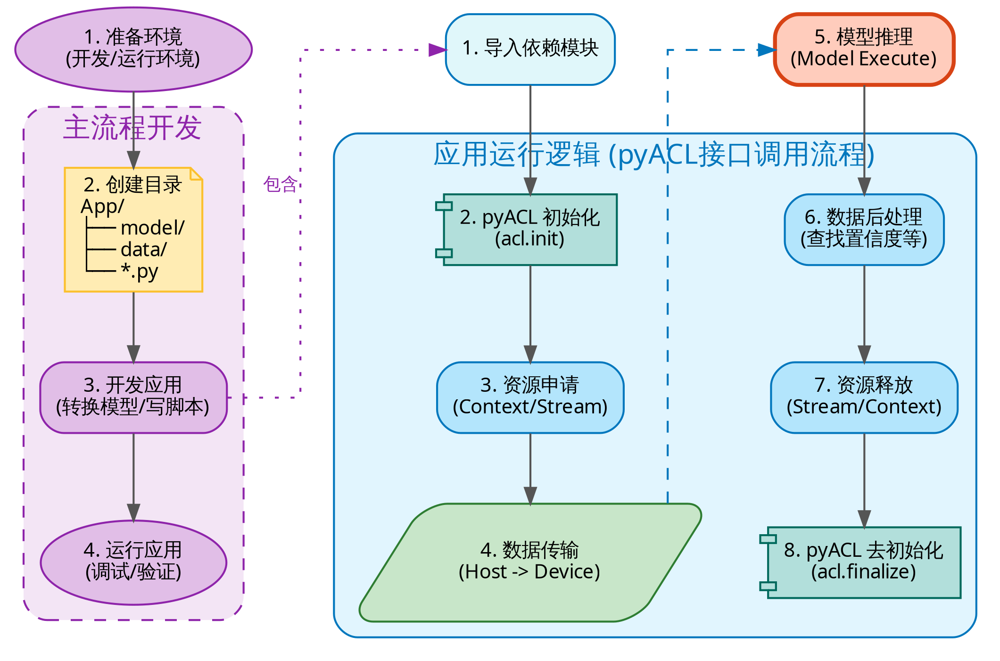

<!-- _class: cover -->

# 第10章：AI项目交付闭环

周贤中 · zhouxzh@gdut.edu.cn

## 从需求契约到可回滚的交付证据

教材：<a href="../book/chapter10.md"><code>src/book/chapter10.md</code></a>；样例：<a href="../../samples/chapter4/SSD/README.md"><code>samples/chapter4/SSD</code></a>

<!--
本章讲的是交付方法，不把 checklist 的存在当成项目已经验收。SSD300 只是贯穿案例，当前课件不宣称它已经完成端到端验收。
-->

---

<!-- _class: center -->

## 本讲目标与路线

- 把需求写成可验收的合同
- 设计分层指标与可复现评测集
- 用 baseline 与看板管理迭代
- 交付可回滚的证据包

> 本讲主线：需求 → 指标 → 交付 → 回归

教材：<a href="../book/chapter10.md"><code>src/book/chapter10.md</code></a>

<!--
先给出本讲路线图；后续每一段都对应这里的一行，最后回到路线收束。
-->
---

<!-- _class: section -->

# 01

## 需求、指标与评测

---

<!-- _class: center -->

## 贯穿案例是 SSD300 实验室告警

| 项目 | 本章采用的边界 |
|---|---|
| 场景 | 实验室入口或设备区摄像头 |
| 模型 | COCO SSD300，复用已有 ONNX/OM |
| 告警 | ROI 闯入、人数统计、遗留物规则 |
| 数据 | 不重新训练模型，不建设专用训练集 |
| 交付 | 需求、指标、基线、报告、回滚与监测 |

这些是设计输入，不是验收结果。样例入口见 `samples/chapter4/SSD`。

教材：<a href="../book/chapter10.md#src-book-chapter10-h1"><code>src/book/chapter10.md</code> §10.1</a>；样例：<a href="../../samples/chapter4/SSD/README.md"><code>samples/chapter4/SSD/README.md</code></a>

<!--
先说明这是贯穿案例。实验室告警、SSD300 和指标目标用于组织方法，不代表当前仓库已经完成摄像头、模型和告警系统的联合验收。
-->

---

<!-- _class: center -->

## 需求 Canvas 把模糊目标变成合同

| 维度 | 必须回答的问题 | 交付物 |
|---|---|---|
| 场景 | 输入源、运行环境、使用者是谁 | 场景边界 |
| 目标 | 业务结果和失败代价是什么 | 目标声明 |
| 指标 | 哪些延迟、吞吐和质量分位数重要 | 指标表 |
| 约束 | 功耗、内存、带宽和成本上限 | 约束清单 |
| 风险 | 低光、遮挡、误报、抖动如何暴露 | 风险项 |
| 合规 | 数据是否脱敏、是否能离开现场 | 合规要求 |

输出应是版本化 `requirement.yaml`，所有变更留下审批记录。

教材：<a href="../book/chapter10.md#src-book-chapter10-h2"><code>src/book/chapter10.md</code> §10.2「需求澄清 Canvas」</a>

<!--
Canvas 不是填表练习。每一项都要能对应验收证据。例如“低光误报”必须对应评测样本、指标和处置策略，而不是只写在风险栏。
-->

---

<!-- _class: center -->

## 指标必须分层，不能只报一个平均值

| 层级 | 关注点 | 示例指标 | 边界 |
|---|---|---|---|
| A 体验 | 用户立即感知 | p95 端到端延迟、稳态 FPS | 需给测试协议 |
| B 质量 | 业务是否正确 | mAP、F1、Top-K | 需固定评测集 |
| B 稳定 | 能否持续运行 | Crash/小时、重启次数 | 需长稳记录 |
| C 资源 | 是否可部署 | 内存峰值、功耗、上行带宽 | 需同一档位 |

教材中的 `<80 ms`、`≥25 FPS`、`mAP≥0.6` 是示例目标，不是本课件测得的 SSD300 结果。

教材：<a href="../book/chapter10.md#src-book-chapter10-h3"><code>src/book/chapter10.md</code> §10.3「指标分层与优先级」</a>

<!--
先 A 后 B 再 C 是排序方法，不是让所有项目照抄数值。最终阈值必须由场景、硬件和风险共同决定，并绑定评测协议。
-->

---

<!-- _class: center -->

## Baseline 回答“改动到底有没有用”

- 固定模型版本、输入尺寸、预处理、精度、线程和 Batch。
- 一次只改变一个变量，其余条件保持可比较。
- 记录硬件档位、温度、软件版本和运行时间窗。
- 同时保存原始输出、指标汇总与失败日志。
- Baseline 不是一次性能数字，而是可重放的实验条件；快照写入 `baseline/<date>-<commit>/metrics.json`。

教材：<a href="../book/chapter10.md#src-book-chapter10-h4"><code>src/book/chapter10.md</code> §10.4「Baseline 策略与控制变量法」</a>

<!--
没有 Baseline 的优化只是故事。先问与哪个版本、在什么协议下比较，再看数字是否值得讨论。
-->

---

<!-- _class: center -->

## 评测集要可代表、可复现、可扩展

| 原则 | 具体做法 |
|---|---|
| 代表性 | 覆盖日间、夜间、遮挡、角度和常见背景 |
| 边界覆盖 | 加入小目标、模糊、密集和极端尺寸 |
| 可再现 | 固定清单、命名规范、哈希和版本号 |
| 可扩展 | 新样本进入新版本，不覆盖旧索引 |
| 标注一致 | 固定标注规范、工具和复核流程 |

评测集版本变化后，旧结果不能直接与新结果拼接。

教材：<a href="../book/chapter10.md#src-book-chapter10-h5"><code>src/book/chapter10.md</code> §10.5「评测集设计原则」</a>

<!--
强调“新样本不能静默替换旧样本”。替换后必须生成新评测集版本，并明确旧版本是否继续回归。
-->

---

<!-- _class: center -->

## 迭代看板把“完成”绑定到证据

| 阶段 | 目标 | 退出证据 |
|---|---|---|
| Sprint 0 | 环境与 Baseline | 版本快照、基线指标 |
| Sprint 1 | 功能与精度 | 评测报告、已知失败 |
| Sprint 2 | 性能与稳定 | 对比报告、长稳记录 |
| Sprint 3 | 交付包装 | 发布包、回滚脚本、发布说明 |

看板使用 Backlog → Doing → Review → Bench → Done；未进入 Bench 并留下报告的任务不能进入 Done。

教材：<a href="../book/chapter10.md#src-book-chapter10-h6"><code>src/book/chapter10.md</code> §10.6「迭代计划与看板」</a>

<!--
Review 不是口头点头，Done 也不是代码合并。性能或精度任务要通过约定脚本并留下报告才能完成。
-->

---

<!-- _class: center -->

## 资产沉淀让下一位维护者能接手

| 资产 | 主要内容 | 更新时机 |
|---|---|---|
| README | 启动、依赖与最短排障 | 使用方式变化 |
| Architecture | 模块边界、数据流与接口 | 结构调整 |
| Model Card | 来源、许可、契约、局限 | 模型更新 |
| Eval Report | 数据集、方法、结果和失败样本 | 每次评测 |
| Perf Report | 协议、环境、统计量 | 每次优化 |
| Changelog | 版本差异与已知问题 | 每次发布 |
| Risk Log | 风险、概率、缓解和状态 | 持续更新 |

教材：<a href="../book/chapter10.md#src-book-chapter10-h7"><code>src/book/chapter10.md</code> §10.7「资产沉淀文档体系」</a>

<!--
文档不是发布后的补作业。Model Card 和评测报告应在发布前生成，并与同一版本、同一提交关联。
-->

---

<!-- _class: section -->

# 02

## 交付、验收与回归

---

<!-- _class: center -->

## 交付目录要保留不可变证据

| 路径 | 应放内容 |
|---|---|
| `manifest.json` | 版本、提交、构建时间、哈希和依赖 |
| `models/` | OM、签名和输入输出契约 |
| `configs/` | 默认配置和硬件配置 |
| `scripts/` | 启动、健康检查、回滚和守护脚本 |
| `docs/` | 快速启动、Model Card 和已知限制 |
| `reports/` | 性能、精度、长稳和失败记录 |

发布目录按版本冻结；修复必须生成新版本，不能静默覆盖旧产物。

教材：<a href="../book/chapter10.md#src-book-chapter10-h8"><code>src/book/chapter10.md</code> §10.8「交付目录与不可变产物」</a>

<!--
manifest.json 是发布包的身份证。路径存在不等于内容正确，必须用哈希、版本和契约共同绑定。
-->

---

<!-- _class: visual -->

## 推理流程不是验收结论

图片只帮助梳理交付对象；SSD300 是否通过，仍要由当前版本的实测证据回答。

图片：<a href="../book/img4/inference.png"><code>src/book/img4/inference.png</code></a>；正文：<a href="../book/chapter4.md#src-book-chapter4-h21"><code>src/book/chapter4.md</code>「模型推理开发流程解析」</a>；样例：<a href="../../samples/chapter4/SSD"><code>samples/chapter4/SSD</code></a>

<!--
这张教材图描述通用推理流程，不是本章项目的验收截图。不要把架构图、示意图或样例路径当成板端执行结果。
-->

---

<!-- _class: center -->

## 上线 Checklist 必须逐项有证据

| 类别 | 检查项 | 通过标准示例 |
|---|---|---|
| 功能 | 核心用例 | 自动化用例全部通过 |
| 性能 | p95 延迟 | 达到项目目标并连续运行 30 分钟 |
| 质量 | mAP/F1/Top-K | 与冻结基线相比不超阈值 |
| 资源 | 内存与温度 | 长稳期无泄漏、无异常降频 |
| 稳定 | 进程与服务 | Crash=0、重启=0 |
| 安全 | 日志、密钥与隐私 | 无敏感字段泄露 |
| 配置 | 模型、依赖与哈希 | 与发布 manifest 一致 |
| 回滚 | 上一版本恢复 | 按演练步骤恢复并验证 |

教材：<a href="../book/chapter10.md#src-book-chapter10-h9"><code>src/book/chapter10.md</code> §10.9「上线前综合 Checklist」</a>

<!--
表格是模板，不是已经打勾的验收单。每一项都需要命令、日志、报告或截图作为证据；没有证据的项应保持未通过或未执行。
-->

---

<!-- _class: center -->

## 验收之后仍要回归和监测漂移

| 阶段 | 必须动作 | 证据 |
|---|---|---|
| 发布前 | 冻结评测集、模型、配置和报告版本 | 发布 manifest 与版本号 |
| 发布后 | 用相同入口做冒烟和关键指标回归 | 日志、指标报告 |
| 持续运行 | 用固定 Shadow Set 每日抽样 | KL、Top-K 变化率趋势 |
| 阈值超限 | 隔离版本、保留现场，再决定回滚 | 告警、回滚演练记录 |

替换评测样本必须创建新版本。教材中的 `KL > 0.05` 是报警阈值示例，不是本章实测结果。

教材：<a href="../book/chapter10.md#src-book-chapter10-h10"><code>src/book/chapter10.md</code> §10.10「验收、回归与漂移监测」</a>

<!--
漂移监测关注模型输出或业务分布变化，不等于单次精度测试。报警后先保留输入、版本与日志，再判断是数据变化、配置变化还是模型问题。
-->

---

<!-- _class: center -->

## 风险和决策都要能追溯

| 风险字段 | 要写清的内容 |
|---|---|
| ID 与描述 | 风险是什么，影响哪条链路 |
| 概率与影响 | 发生可能性及业务后果 |
| 缓解措施 | 监测、隔离、降级或回滚 |
| 负责人 | 谁维护状态与关闭条件 |
| 当前状态 | open、mitigated、accepted 或 closed |

决策日志另记背景、备选方案、选择理由、证据和复审日期。

教材：<a href="../book/chapter10.md#src-book-chapter10-h11"><code>src/book/chapter10.md</code> §10.11「风险管理与决策日志」</a>

<!--
风险登记不是免责声明，ADR 也不是会议纪要。两者都要有负责人、证据和复核条件，才能在版本迭代后继续使用。
-->

---

<!-- _class: center -->

## SSD300 样例路径与验收状态分开记录

| 入口 | 用途 | 当前课件结论 |
|---|---|---|
| `samples/chapter4/SSD/README.md` | 下载、推理与评估入口 | 仅作样例说明 |
| `download_models.py` | 下载 ONNX/OM | 未据此宣称模型已就绪 |
| `inference_npu.py` | 板端 NPU 烟测或完整评估 | 未据此宣称系统已验收 |
| `reports/` 与 `release/` | 评测、长稳与发布证据 | 必须按项目另行生成 |

SSD300 的真实验收需要当前版本的模型哈希、板端运行日志、评测报告、长稳记录和回滚演练。

样例：<a href="../../samples/chapter4/SSD/README.md"><code>samples/chapter4/SSD/README.md</code></a>；教材：<a href="../book/chapter10.md#src-book-chapter10-h1"><code>src/book/chapter10.md</code> 第10章</a>

<!--
这一页专门防止把“存在样例入口”写成“系统已经验收”。下载脚本、推理脚本、架构图和 Checklist 都只是资源或方法，不是实际通过证据。
-->

---

<!-- _class: center -->

## 课堂任务：交付一份可审查的证据包

1. 完成需求 Canvas，并把每个目标写成可测指标。
2. 冻结 Baseline 与 30 张样本的 mini 评测集。
3. 建一个包含 Review 与 Bench 的迭代看板。
4. 生成 Model Card、评测报告和发布 manifest。
5. 模拟一个 Checklist 未通过项，完成风险与回滚记录；评价重点是证据可复现，而不是“代码已写完”。

教材：<a href="../book/chapter10.md#src-book-chapter10-h13"><code>src/book/chapter10.md</code> §10.13「实践任务」</a>；样例入口：<a href="../../samples/chapter4/SSD/README.md"><code>samples/chapter4/SSD</code></a>

<!--
最终交付必须同时包含通过项和未通过项。没有版本、哈希、原始日志和回滚记录的“全部通过”不构成可审查交付。
-->
