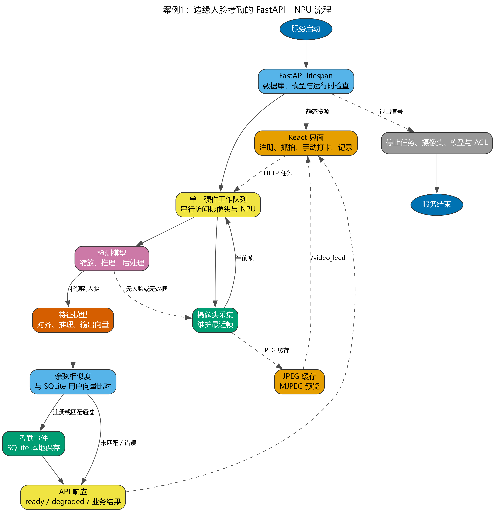
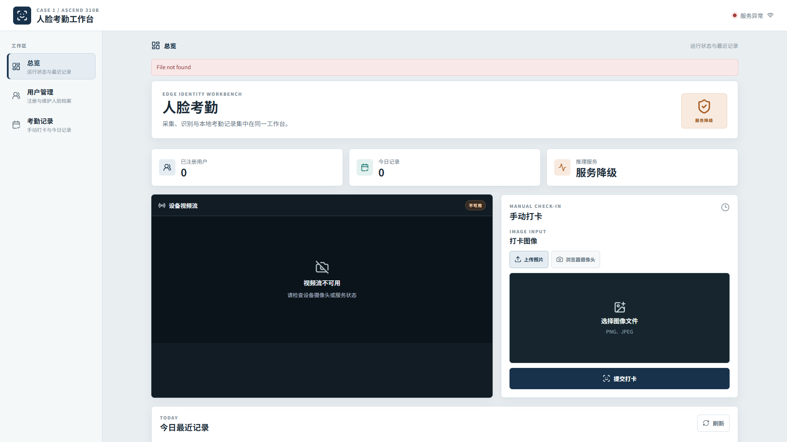

<!-- _class: cover -->

# 案例 1：智能考勤机

周贤中 · zhouxzh@gdut.edu.cn

## 从摄像头图像到本地考勤事件

依据：<a href="../experiment/case1.md">src/experiment/case1.md</a>；实现：<a href="../../samples/case1/README.md"><code>samples/case1</code></a>

<!--
本案例是教学演示，不是生产身份认证系统。课程目标是理解从采集、检测、特征、比对到记录和界面的完整链路。
-->

---

<!-- _class: center -->

## 本讲目标与路线

- 走通采集、检测、特征、比对与记录链路
- 理解 NPU 与 CPU 的职责边界
- 用最小证据验证 8T 前端与推理
- 明确教学演示不是生产身份认证

> 本讲主线：采集 → 检测 → 比对 → 事件

教材：<a href="../experiment/case1.md"><code>src/experiment/case1.md</code></a>

<!--
先给出本讲路线图；后续每一段都对应这里的一行，最后回到路线收束。
-->
---

<!-- _class: section -->

# 01

## 系统链路与边界

---

<!-- _class: center -->

## 系统边界先于功能清单

| 边界 | 本案例承担 | 不用于证明 |
|---|---|---|
| 采集 | 板端USB摄像头或浏览器单图 | 全场景画质与姿态 |
| 推理 | 检测与特征OM在NPU执行 | 公开数据集精度 |
| 比对 | 主机计算余弦相似度 | 法律意义的身份认证 |
| 存储 | SQLite保存用户、特征和事件 | 云端同步与长期档案 |
| Web | FastAPI API与React界面 | 公网安全与高可用 |

陌生人自动登记只是展示完整数据流的教学分支，不是已授权的生产注册。

教材：<a href="../experiment/case1.md#问题背景与系统边界"><code>src/experiment/case1.md</code>「问题背景与系统边界」</a>

<!--
先明确不做什么，再讲怎么做。尤其不能把陌生人自动登记解释为合规身份注册。
-->

---

<!-- _class: visual -->

## 一张图看清四条主线

图片：<a href="../experiment/img1/case1_flow_simple.png"><code>src/experiment/img1/case1_flow_simple.png</code></a>；出处：<a href="../experiment/case1.md#教程定位"><code>src/experiment/case1.md</code>「教程定位」</a>

<!--
按采集、硬件推理、服务与存储、浏览器界面四条线带读。图中每条线都要有各自证据，不能用一个页面截图代替全部。
-->

---

<!-- _class: screenshot -->

## 8T 板端预构建 React 前端

截图：<code>case1-attendance-main-1920x1080.png</code>；来源清单：<a href="screenshots/capture-manifest.json"><code>src/presentation/screenshots/capture-manifest.json</code></a>

<!--
这是 8T/Ascend310B4 上由静态 HTTP 服务加载的预构建 React 页面。画面没有真实人脸；仍可看到顶部服务异常、服务降级和视频流不可用。
-->

---

<!-- _class: center -->

## 截图证据卡：只证明前端已加载

| 字段 | 值 |
|---|---|
| manifest id | `case1-attendance-main` |
| 板卡 | 8T / `Ascend310B4` |
| 视口 | 1920×1080 |
| 文件字节 | 112381 |
| SHA-256 | `af1a51d03b5338bab1f708fbfc7f2154703d963127f9d3648d0282101a610df2` |

截图仅证明预构建 React 前端由 8T 加载。采样时后端未连接，没有摄像头、API或NPU推理，不证明身份识别精度。

清单：<a href="screenshots/capture-manifest.json"><code>capture-manifest.json</code> / case1-attendance-main</a>

<!--
这五组字段必须一起出现。截图中的“服务降级”“视频流不可用”“File not found”正是后端未连接的证据，不是模型识别失败。
-->

---

<!-- _class: section -->

# 02

## 板端运行与证据

---

<!-- _class: center -->

## 四个层次由单一硬件所有者协调

| 层次 | 主要职责 |
|---|---|
| 采集层 | 摄像头保留最近帧；浏览器可提交单图 |
| 硬件工作层 | 单队列串行调度检测、裁剪和特征提取 |
| 服务层 | FastAPI校验请求、提交任务、组织响应 |
| 界面层 | React发起请求并展示健康、结果和记录 |

多 worker 会复制模型和摄像头句柄，因此本案例固定单 worker。

教材：<a href="../experiment/case1.md#系统架构"><code>src/experiment/case1.md</code>「系统架构」</a>

<!--
核心不是 FastAPI 或 React，而是单一硬件所有者。所有推理请求进入同一队列，避免并发使用 ACL context、Device buffer 和摄像头。
-->

---

<!-- _class: center -->

## 一次请求的串行主线

1. FastAPI 接收并限制 multipart 或 base64 图像。
2. OpenCV 解码，拒绝空图和不合法输入。
3. 检测 OM 输出候选框，经阈值、缩放和 NMS 后裁剪最大人脸。
4. 特征 OM 输出向量，主机计算余弦相似度。
5. 只有符合合同和阈值时才写入事件，否则返回明确错误。

教材：<a href="../experiment/case1.md#一次图像请求的逻辑顺序"><code>src/experiment/case1.md</code>「一次图像请求的逻辑顺序」</a>

<!--
这条串行主线用于教学。无脸、空框、越界或尺寸为零时必须在对应层失败，不能把整张图当成有效身份输入。
-->

---

<!-- _class: center -->

## 两个模型各有固定张量合同

| 角色 | ONNX准备文件 | OM运行文件 | 固定输入 |
|---|---|---|---|
| 人脸检测 | `det_500m.onnx` | `face_detection.om` | `1×3×640×640` |
| 特征提取 | `w600k_mbf.onnx` | `face_recognition.om` | `1×3×112×112` |

摄像头 BGR 帧要完成缩放、归一化和 NCHW 转换。输出维度、dtype 和后处理必须与真实 OM 描述一致。

样例：<a href="../../samples/case1/docs/01-model-contract.md"><code>samples/case1/docs/01-model-contract.md</code></a>；教材：<a href="../experiment/case1.md#模型与张量合同"><code>src/experiment/case1.md</code>「模型与张量合同」</a>

<!--
模型文件名不能证明网络来源或输出语义。必须同时检查ONNX、OM描述和板端数值，布局或归一化改变后要重跑合同检查。
-->

---

<!-- _class: center -->

## 四道证据门不能互相替代

| 门槛 | 需要留下什么 |
|---|---|
| 文件检查 | ONNX可解析、路径存在、文件可读 |
| 合同检查 | 输入形状、输出数量、dtype与后处理一致 |
| 转换检查 | ATC命令、日志与目标SoC |
| 运行检查 | ACL加载、单次推理和资源释放 |

只有完成对应门槛，才能在文档中写“已验证”。

教材：<a href="../experiment/case1.md#从-onnx-到-om"><code>src/experiment/case1.md</code>「从ONNX到OM」</a>

<!--
静态检查、转换检查、ACL烟测和UI检查是不同证据。文件能解析、页面能打开或ATC成功，都不能代替完整推理。
-->

---

<!-- _class: center -->

## PyACL资源必须形成闭环

- 启动时完成 ACL 初始化、设备、Context 和 Stream 创建。
- 加载检测与特征 OM，并读取模型描述。
- 输入、输出 Dataset 和 Device buffer 由硬件工作线程管理。
- 请求结束后按合同解释输出，数据库与相似度计算留在主机侧。
- 停止时按 Stream、Context、Device、`acl.finalize` 的逆序释放。

教材：<a href="../experiment/case1.md#pyacl-运行时与资源生命周期"><code>src/experiment/case1.md</code>「PyACL运行时与资源生命周期」</a>

<!--
硬件资源和摄像头都是独占资源。显式 stop 与线程 join 比依赖析构可靠，线程不能按时退出时必须明确失败。
-->

---

<!-- _class: center -->

## FastAPI 与 React 只承担各自边界

| 组件 | 负责 | 不负责 |
|---|---|---|
| React | 上传、抓拍、状态与记录展示 | 直接持有模型或设备 |
| FastAPI | 请求校验、任务提交、响应组织 | 在路由内复制推理 |
| 硬件线程 | 摄像头、两个 OM、PyACL资源 | 网络协议与页面渲染 |
| SQLite | 用户、特征和事件 | 云端同步与多人权限 |

模型缺失、加载失败或输出合同不满足时，推理接口返回HTTP `503`。

教材：<a href="../experiment/case1.md#fastapi-与-react-的协作边界"><code>src/experiment/case1.md</code>「FastAPI与React的协作边界」</a>

<!--
FastAPI使用ASGI不代表硬件调用应并发化。OpenCV、PyACL和sqlite3都是阻塞调用，应通过单一工作队列协调。
-->

---

<!-- _class: center -->

## 检测之后才轮到比对

- 检测输出先过滤分数、恢复坐标并执行 NMS。
- 教学策略选择面积最大的人脸。
- 特征向量与候选向量计算余弦相似度。
- 最高相似度超过阈值才允许打卡。
- 阈值是当前工程参数，不是通用身份认证边界。

教材：<a href="../experiment/case1.md#检测、特征与比对"><code>src/experiment/case1.md</code>「检测、特征与比对」</a>

<!--
最大人脸策略是单人演示的确定性选择，不是多人场景最优方案。阈值也不能从一次成功样例中证明。
-->

---

<!-- _class: center -->

## 生物特征数据默认是敏感数据

- API用户列表不返回 embedding。
- 上传资源使用不透明名称和受控路径。
- 数据库、照片和报告只保留在设备本地。
- 日志不写完整特征、原始图像或调试堆栈。
- 测试使用合成或经同意的图像，结束后删除。

教材：<a href="../experiment/case1.md#数据存储与隐私边界"><code>src/experiment/case1.md</code>「数据存储与隐私边界」</a>

<!--
即使embedding存成BLOB，也不会自动获得匿名性。截图和课堂材料不得包含真实人脸、姓名、特征或数据库内容。
-->

---

<!-- _class: center -->

## 失败状态也是界面合同的一部分

| 状态 | 页面应表达 | 后端语义 |
|---|---|---|
| 模型缺失 | 服务降级 | 推理接口 `503` |
| 摄像头不可用 | 视频流不可用 | 抓拍明确失败 |
| 无匹配 | `match=false` | 不写成功事件 |
| 接口失败 | 可读错误状态 | 不泄露异常堆栈 |
| 服务正常 | 显示就绪与记录 | 硬件任务可进入 |

“页面能打开”和“推理已就绪”是两个独立状态。

教材：<a href="../experiment/case1.md#api-资源"><code>src/experiment/case1.md</code>「API资源」</a>

<!--
当前8T截图正是降级页面：前端加载成功，但File not found、服务异常、服务降级和视频流不可用同时可见。
-->

---

<!-- _class: center -->

## 验收必须逐级进行

| 层级 | 通过条件 |
|---|---|
| 静态 | Python语法、目录与接口测试 |
| 模型 | ONNX合同与ATC日志 |
| ACL | 两个OM各完成一次真实推理 |
| API | health、用户、打卡、记录和错误状态 |
| UI | 导航、上传、抓拍、MJPEG与状态展示 |
| 清理 | 摄像头和ACL资源全部释放 |

任何一层没有证据，都必须标为 `untested` 或 `blocked`。

教材：<a href="../experiment/case1.md#实验步骤与证据记录"><code>src/experiment/case1.md</code>「实验步骤与证据记录」</a>；样例：<a href="../../samples/case1/docs/03-board-acceptance.md"><code>board acceptance</code></a>

<!--
当前截图只覆盖静态前端加载的一小部分UI层，不能填写模型、ACL、API、识别率或性能证据。
-->

---

<!-- _class: center -->

## 课堂交付：功能图与证据图各一张

| 交付物 | 必须说明 |
|---|---|
| 功能链 | 采集、检测、特征、比对、存储、界面 |
| 模型卡 | 两个OM的输入输出合同 |
| 服务卡 | API、单worker和资源生命周期 |
| UI证据 | manifest id、8T档位、视口、字节与哈希 |
| 边界 | 未连接的API、摄像头、NPU与隐私限制 |

最终报告应明确区分“前端已加载”“单次推理通过”“完整考勤通过”和“精度已评估”四种结论。

依据：<a href="../experiment/case1.md#小结"><code>src/experiment/case1.md</code>「小结」</a>；截图清单：<a href="screenshots/capture-manifest.json"><code>capture-manifest.json</code></a>

<!--
最后再次核对截图边界：它只证明预构建React前端由8T加载。后端、摄像头和NPU都没有连接，不能据此扩展出识别或考勤结论。
-->
