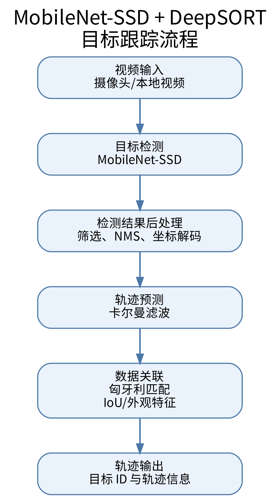
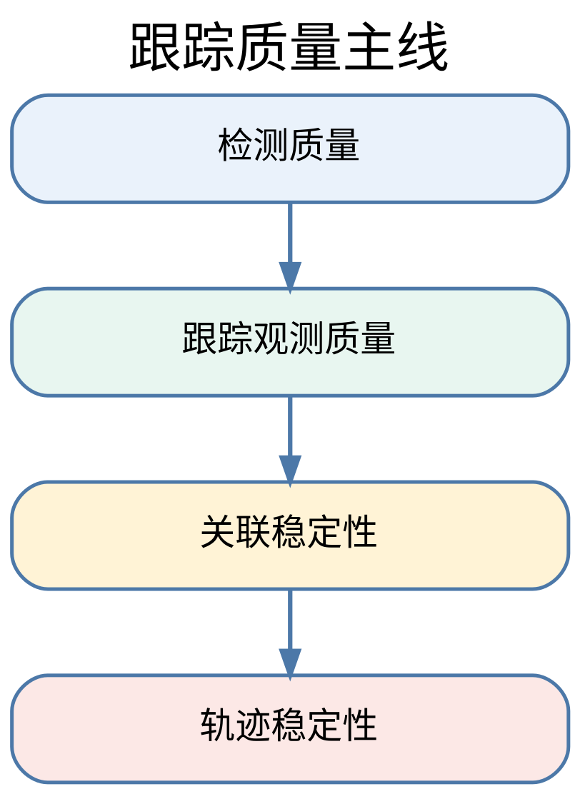
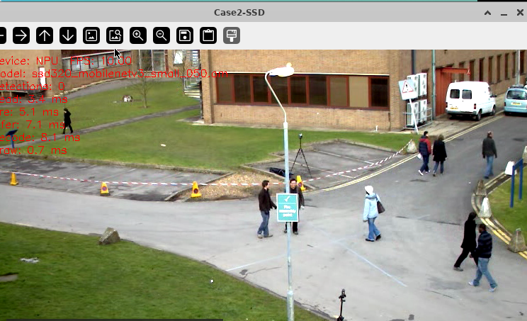

<!-- _class: cover -->

# 案例 2：目标跟踪检测

周贤中 · zhouxzh@gdut.edu.cn

## 检测看见目标，跟踪维持身份

依据：<a href="../experiment/case2.md">src/experiment/case2.md</a>；实现：<a href="../../samples/case2/README.md"><code>samples/case2</code></a>

<!--
本案例先做单帧检测，再把检测结果送入DeepSORT风格跟踪器。课程重点是职责边界、身份关联和证据等级。
-->

---

<!-- _class: center -->

## 本讲目标与路线

- 分清检测与跟踪各自回答的问题
- 理解 SSD 解码、NMS 与轨迹生命周期
- 用同一协议设计基准与参数实验
- 说明单帧截图的证据边界

> 本讲主线：检测 → 跟踪 → 基准 → 边界

教材：<a href="../experiment/case2.md"><code>src/experiment/case2.md</code></a>

<!--
先给出本讲路线图；后续每一段都对应这里的一行，最后回到路线收束。
-->
---

<!-- _class: section -->

# 01

## 检测、跟踪与轨迹

---

<!-- _class: center -->

## 检测回答“在哪”，跟踪回答“是谁”

| 问题 | 检测器 | 跟踪器 |
|---|---|---|
| 当前帧有什么 | 类别、框、分数 | 读取检测结果 |
| 跨帧是否同一目标 | 不处理 | 维护稳定ID |
| 遮挡后如何续上 | 不处理 | 运动预测与关联 |
| 输出 | 单帧框集合 | 带ID的轨迹 |

检测质量直接约束跟踪上限，但跟踪ID不能从单张检测框推导。

教材：<a href="../experiment/case2.md#src-experiment-case2-h4"><code>src/experiment/case2.md</code>「目标跟踪对时序关联的要求」</a>

<!--
先用问题区分检测和跟踪。只有检测框没有时间关联，就不会产生稳定ID。
-->

---

<!-- _class: visual -->

## 从视频帧到检测再到轨迹

图片：<a href="../experiment/img2/流程图.png"><code>src/experiment/img2/流程图.png</code></a>；出处：<a href="../experiment/case2.md#src-experiment-case2-h1"><code>src/experiment/case2.md</code>「教程定位」</a>

<!--
按读取、预处理、NPU推理、解码、NMS、跟踪关联和绘制带读。检测入口和跟踪入口共享前半段，从检测结果转换后分叉。
-->

---

<!-- _class: visual -->

## 案例主线是“检测到跟踪”

图片：<a href="../experiment/img2/主线图.png"><code>src/experiment/img2/主线图.png</code></a>；出处：<a href="../experiment/case2.md#src-experiment-case2-h62"><code>src/experiment/case2.md</code>「运行检测与跟踪」</a>

<!--
图中把检测模型、检测输出、轨迹预测、关联更新、轨迹生命周期和可视化串起来。每个环节都需要自己的验证证据。
-->

---

<!-- _class: center -->

## MobileNet-SSD适合做教学前端

- MobileNet使用深度可分离卷积降低计算量。
- SSD在多尺度特征图上直接预测类别和框偏移。
- 默认框提供尺度与长宽比先验。
- 单阶段结构便于说明检测到跟踪的完整链路。
- 仓库同时支持MobileNet和ResNet骨干。

教材：<a href="../experiment/case2.md#src-experiment-case2-h5"><code>src/experiment/case2.md</code>「MobileNet-SSD作为检测前端的依据」</a>

<!--
深度可分离卷积降低计算量，SSD多尺度检测兼顾大小目标。骨干模型选择需要在速度与表达能力之间取舍。
-->

---

<!-- _class: center -->

## SSD输出必须经过解码与NMS

| 阶段 | 作用 |
|---|---|
| 默认框 | 提供尺度、长宽比先验 |
| 框回归 | 还原中心偏移和宽高缩放 |
| 类别分数 | 为每个候选选择前景类别 |
| 阈值筛选 | 丢弃低置信度候选 |
| NMS | 按类别删除高度重叠框 |
| 最终结果 | `[x1,y1,x2,y2,score,class_id]` |

推理成功只表示原始输出存在，解码和NMS才把它变成可用检测结果。

教材：<a href="../experiment/case2.md#src-experiment-case2-h28"><code>src/experiment/case2.md</code>「decoder.py如何体现SSD的核心思想」</a>

<!--
重点解释先验框、偏移恢复、分数筛选和NMS。模型执行成功不等于检测框编号、类别或坐标一定正确。
-->

---

<!-- _class: center -->

## DeepSORT用运动与几何维持轨迹

- 卡尔曼滤波预测轨迹在下一帧的位置和尺寸。
- 检测框与预测框用IOU衡量几何相似度。
- 匈牙利算法求全局一对一匹配。
- 中心和尺寸平滑降低框抖动。
- 类别约束阻止不同类别错误关联。

教材：<a href="../experiment/case2.md#src-experiment-case2-h17"><code>src/experiment/case2.md</code>「DeepSORT作为跟踪后端的选择依据」</a>

<!--
本案例保留DeepSORT的运动预测、匹配和生命周期主线，但不包含外观ReID。长时间遮挡和身份重识别必须另行验证。
-->

---

<!-- _class: center -->

## 卡尔曼滤波预测，匈牙利算法匹配

| 模块 | 输入 | 输出 |
|---|---|---|
| 卡尔曼预测 | 上一次轨迹状态 | 当前帧预测框 |
| IOU/距离门控 | 预测框与检测框 | 候选代价矩阵 |
| 匈牙利匹配 | 代价矩阵 | 一对一匹配 |
| 轨迹更新 | 匹配检测框 | 新状态与平滑框 |

预测降低搜索范围，全局匹配避免贪心算法在同一目标之间重复分配。

教材：<a href="../experiment/case2.md#src-experiment-case2-h45"><code>src/experiment/case2.md</code>「卡尔曼滤波在做什么」</a>、<a href="../experiment/case2.md#src-experiment-case2-h49"><code>「IOU+匈牙利算法」</a>

<!--
卡尔曼滤波器提供预测，匈牙利算法在当前帧求全局匹配。匹配失败后，还要依据轨迹生命周期创建、保持或删除目标。
-->

---

<!-- _class: center -->

## 轨迹生命周期决定何时显示

- 新检测创建暂定轨迹。
- 命中次数达到`min_hits`后才显示。
- 连续未匹配超过`max_age`后删除。
- `pan ic`/停止需要清理状态。
- 类别过滤减少无关框与后处理。

教材：<a href="../experiment/case2.md#src-experiment-case2-h56"><code>src/experiment/case2.md</code>「轨迹生命周期参数如何影响最终效果」</a>

<!--
轨迹生命周期是ID稳定的重要条件。参数没有通用最优值，应以目标速度、漏检率和遮挡时长设计实验。
-->

---

<!-- _class: center -->

## 检测到跟踪的桥接只有一份合同

1. 检测后端统一预处理与模型执行。
2. 解码器输出框、分数和类别。
3. 后处理转换成`[x1,y1,x2,y2,score,class_id]`。
4. 跟踪器预测轨迹、关联检测框并更新状态。
5. 绘制ID、类别、分数和拖尾；无界面时保存视频。

教材：<a href="../experiment/case2.md#src-experiment-case2-h20"><code>src/experiment/case2.md</code>「代码结构与总体流程」</a>

<!--
detection_app和tracking_app共享检测前半段。跟踪验证必须包含检测输出转换、状态更新和ID可视化。
-->

---

<!-- _class: section -->

# 02

## 板端窗口与证据边界

---

<!-- _class: center -->

## 真实8T NPU OpenCV检测窗口

截图：<a href="screenshots/cases/case2-tracking-window-744x453.png"><code>case2-tracking-window-744x453.png</code></a>；清单：<a href="screenshots/capture-manifest.json"><code>capture-manifest.json</code></a>

<!--
窗口显示Device NPU 0、SoC 310B4、MobileNetV3 Small模型和多段单帧计时。公开测试视频中没有任何可见跟踪ID，因此这是检测窗口，不是跟踪性能证明。
-->

---

<!-- _class: center -->

## 截图证据卡：单帧窗口不是基准

| 字段 | 值 |
|---|---|
| manifest id | `case2-tracking-window` |
| 板卡 | 8T / `Ascend310B4` |
| 视口 | 744×453 |
| 文件字节 | 429686 |
| SHA-256 | `7bde5515c91b8843000cf6a40021347e350e87aa799126ecf3727d83b9820ab1` |
| application digest | `782a224ce9f14c681ffce8dd77e2640cb6aee28ae80cffa4d6fc88146e5d3c6c` |

> 一张窗口截图证明界面与 NPU 路径已加载，不证明跟踪 ID、准确率、长稳或生产性能。

> 截图与基准实验是两份交付物，不能互相替代。

清单：<a href="screenshots/capture-manifest.json"><code>capture-manifest.json</code> / case2-tracking-window</a>

<!--
这些字段必须一起出现。截图证明窗口在8T上显示NPU后端、模型和单帧计时，不能证明准确率、长稳、跟踪ID或生产性能。
-->

---

<!-- _class: center -->

## 一张窗口图能证明什么，不能证明什么

| 可证明 | 不能证明 |
|---|---|
| NPU后端与设备档位 | 检测准确率或mAP |
| 模型文件被程序加载 | 跟踪ID稳定性 |
| 当前帧分段计时可见 | 吞吐、延迟分布或长稳 |
| OpenCV窗口正常显示 | 真实部署的最终性能 |

单帧计时只是运行时显示，没有预热次数、循环数、重复轮次或统计口径。

证据边界：<a href="screenshots/capture-manifest.json"><code>case2-tracking-window</code> evidenceBoundary</a>

<!--
将截图结论压缩成两列。任何性能数字必须来自预先定义的多次实验，不能抄窗口中的单帧数字当基准。
-->

---

<!-- _class: center -->

## 基准实验必须与截图分开设计

- 固定输入源、分辨率、模型、阈值和设备。
- 明确预热、计时循环、重复轮次和统计方法。
- 分别记录预处理、推理、解码、NMS、跟踪和绘制。
- 检测与跟踪实验使用相同后半段口径。
- 保存原始JSON与视频，不只保留截图。

教材：<a href="../experiment/case2.md#src-experiment-case2-h64"><code>src/experiment/case2.md</code>「检测链路的性能拆分实验」</a>

<!--
先定义协议再运行性能测试。单帧窗口适合确认设备和可视链路，平均值、P95、FPS与长稳必须另做。
-->

---

<!-- _class: center -->

## 参数实验一次只改一个变量

| 实验 | 只改变 | 观察 |
|---|---|---|
| 检测基线 | 无 | 阶段耗时与检测框 |
| 启用跟踪 | 增加跟踪器 | ID连续性与额外耗时 |
| 类别过滤 | `track-classes` | 无关框与后处理 |
| 轨迹寿命 | `max_age` | 断轨与错误延续 |
| 初始化显示 | `min_hits` | 误检轨迹与延迟出现 |
| 匹配门限 | IOU/中心距离 | ID switch与失配 |

所有实验都要使用同一视频片段，并保留检测框和轨迹视频。

教材：<a href="../experiment/case2.md#src-experiment-case2-h62"><code>src/experiment/case2.md</code>「实验设计」</a>

<!--
参数实验不能让模型、输入、分辨率和评测片段同时变化。否则无法判断ID变化来自哪个因素。
-->

---

<!-- _class: center -->

## 后端和模型合同先于画面

- `--device npu`只接受对应OM，CPU路径不能作为NPU证据。
- `ssd320_*`通常输入320×320，`ssd300_*`通常输入300×300。
- 预处理必须与训练一致：BGR/RGB、归一化、HWC/CHW。
- NMS阈值和最大检测数属于输出合同的一部分。
- 输入源断开、模型缺失或ACL失败必须明确退出。

样例：<a href="../../samples/case2/README.md"><code>samples/case2/README.md</code> 模型准备、常用参数</a>

<!--
模型文件、后端、输入尺寸和预处理必须成套。同名模型的OM格式不同，不能仅凭文件名判断合同。
-->

---

<!-- _class: center -->

## 验收阶梯与课堂任务

| 层级 | 通过条件 |
|---|---|
| 单帧检测 | NPU后端、模型、输出框和分段日志 |
| 连续检测 | 固定视频无崩溃，输出视频可复核 |
| 跟踪 | 检测框成功转换并产生稳定ID |
| 参数实验 | 单变量、同片段、原始指标 |
| 性能 | 预热、循环、重复、P50/P95和资源状态 |

课堂交付：截图证据卡、检测视频、跟踪视频、参数表和原始指标；单帧截图不能替代后四项。

教材：<a href="../experiment/case2.md#src-experiment-case2-h58"><code>src/experiment/case2.md</code>「如何评价这个案例方案」</a>

<!--
收尾按验收阶梯检查。本轮真实截图只能勾选单帧检测的一部分，连续检测、跟踪ID和性能仍需原始视频与报告。
-->
