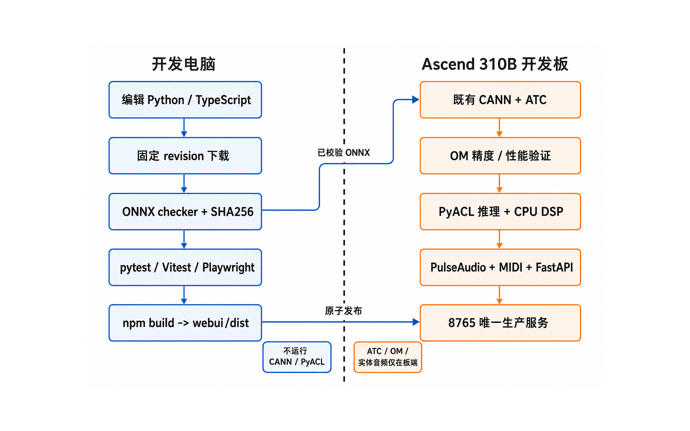
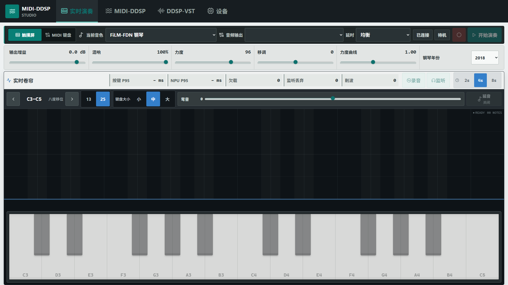
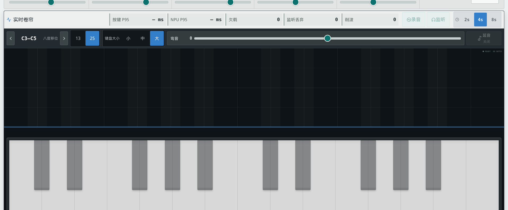
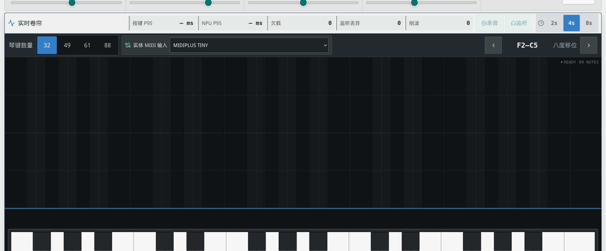
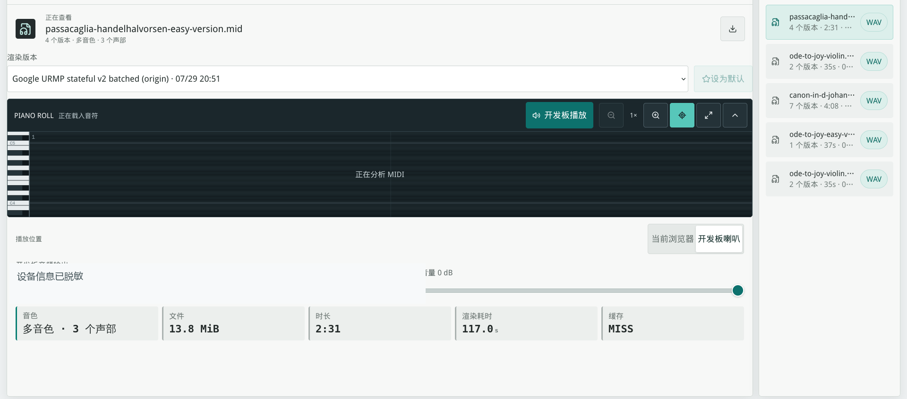
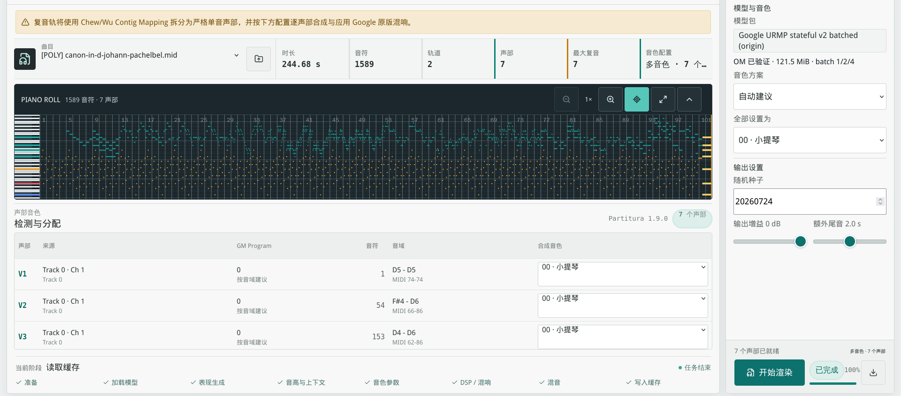
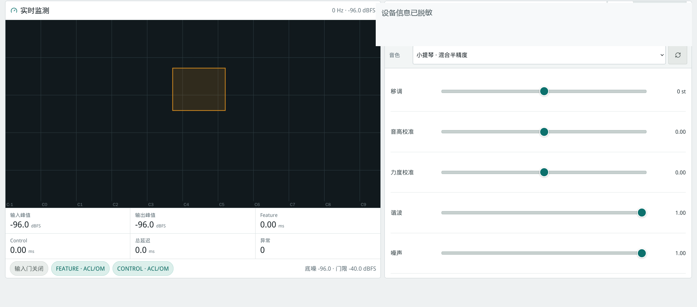
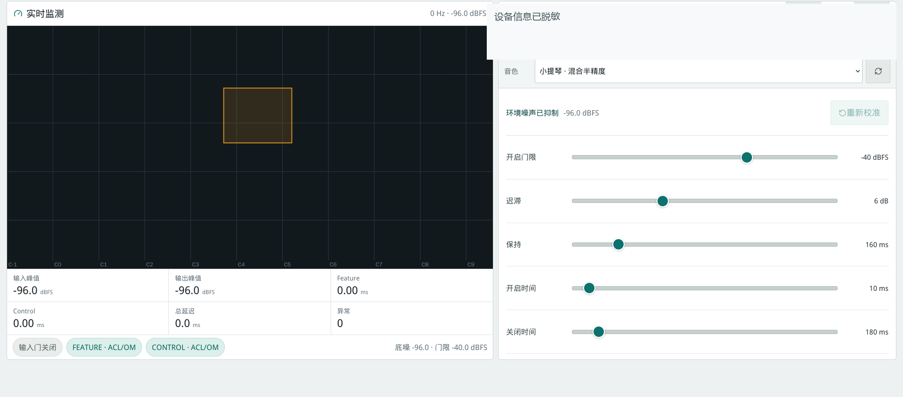

<!-- _class: cover -->

# 案例 3：智能电子琴

周贤中 · zhouxzh@gdut.edu.cn

## 神经网络控制量，CPU 合成声音

依据：<a href="../experiment/case3.md">src/experiment/case3.md</a>；实现：<a href="../../samples/case3/README.md"><code>samples/case3</code></a>

<!--
本案例把实时演奏、MIDI文件渲染和麦克风音色转换分成三条链。神经网络只预测控制量，波形合成与设备路由在CPU侧完成。
-->

---

## 一个工作台，三种时间尺度

| 任务 | 输入 | 模型输出 | 产物 |
|---|---|---|---|
| 实时演奏 | 触摸屏或实体MIDI | Piano-DDSP控制量 | 实时声音 |
| MIDI渲染 | MIDI文件 | Expression与Synthesis控制 | WAV与版本 |
| 音色转换 | 实体麦克风 | Feature与Control控制量 | 实时单音音色 |

设备页只查看和测试资源，不参与音乐生成。三条链共享NPU与音频设备，但状态和验收协议不同。

教材：<a href="../experiment/case3.md#系统功能"><code>src/experiment/case3.md</code>「系统功能」</a>

<!--
先让学生建立三种任务模型。实时演奏关注毫秒级反馈，文件渲染关注整曲上下文，DDSP-VST关注实体音频双工链路。
-->

---

<!-- _class: visual -->

## 开发电脑与板端的职责边界

图片：<a href="../experiment/img3/case3-runtime-boundary.png"><code>src/experiment/img3/case3-runtime-boundary.png</code></a>；出处：<a href="../experiment/case3.md#开发电脑与开发板的职责边界"><code>src/experiment/case3.md</code>「开发电脑与开发板的职责边界」</a>

<!--
左侧负责源码、固定revision、ONNX检查与前端构建；右侧负责ATC、OM、PyACL、音频和FastAPI。不要把CANN或实体音频操作搬到开发电脑。
-->

---

## 三套模型不能互换

| 维度 | Piano-DDSP | MIDI-DDSP | DDSP-VST |
|---|---|---|---|
| 用途 | 实时复音钢琴 | 离线整曲渲染 | 单音音色转换 |
| 复音 | 16声部 | 分声部后混音 | 单音 |
| 控制率 | 250Hz | 250Hz | 50Hz |
| 上下文 | 当前与历史状态 | 整曲双向上下文 | 滑动窗口与GRU状态 |
| DSP | CPU谐波噪声与混响 | CPU合成与stem混音 | CPU合成、增益与混响 |

模型名称相近，不表示输入、状态或输出合同可以互相替代。

教材：<a href="../experiment/case3.md#三套网络对比"><code>src/experiment/case3.md</code>「三套网络对比」</a>

<!--
重点比较时间模型与上下文。MIDI-DDSP需要完整前后文，不能直接塞入4ms实时按键路径；DDSP-VST只处理单音输入。
-->

---

## 模型来源与转换路径

| 模型族 | 上游来源 | ONNX形成 | 板端产物 |
|---|---|---|---|
| Piano-DDSP | PyTorch训练checkpoint | 展开循环状态并导出ONNX | Piano OM bundle |
| MIDI-DDSP | 上游TFLite | 重构8类stateful组件 | 版本化OM包 |
| DDSP-VST | 上游TFLite | Feature与Control分别流式化 | Feature OM与11个Control OM |

MIDI-DDSP和DDSP-VST经历TFLite→ONNX→OM；Piano-DDSP是PyTorch→ONNX→OM，不能混写。

教材：<a href="../experiment/case3.md#模型转换与-ascend-部署"><code>src/experiment/case3.md</code> §6</a>

<!--
上游来源决定迁移方法。把循环状态显式化，并在连续多帧上对齐输出，是两类TFLite模型进入ONNX和OM前的关键。
-->

---

## 后端用资源互斥保护硬件

- 实时钢琴与VST Effect共享同一资源锁。
- MIDI-DDSP播放、麦克风测试和扬声器测试也需独占。
- 冲突请求明确拒绝，不自动切换设备或推理后端。
- 停止、异常和设备断开都释放模型、音频与MIDI资源。
- 浏览器只提交目录ID和有界参数，服务端解析真实路径。

教材：<a href="../experiment/case3.md#资源互斥与实时钢琴"><code>src/experiment/case3.md</code> §7.2、§7.4</a>

<!--
资源锁不是性能优化，而是正确性条件。多个任务同时打开OM或音频设备会产生无法归因的状态。
-->

---

## 界面证据分成“本轮”和“历史”两组

本轮在8T上采集当前Web服务页面；仓库另保留6张历史UI验收派生图。

- 本轮截图：证明页面、服务状态和前端资产可由8T加载。
- 历史派生图：证明当时的功能布局，不冒充本轮音频、时延或模型验收。
- 两组都不替代API、OM、音频设备和听感证据。

本轮清单：`capture-manifest.json`；历史派生清单：<a href="screenshots/historical-derivations.json"><code>historical-derivations.json</code></a>；教材：<a href="../experiment/case3.md#逐页界面与操作说明"><code>src/experiment/case3.md</code> §9</a>

<!--
先总说明再展示。学生必须把“界面可用”与“模型、音频、时延可用”分开，不能根据截图填写性能或音质结论。后续当前截图是唯一本轮8T证据，历史图不得改变这个边界。
-->

---

<!-- _class: screenshot -->

## 本轮8T：实时演奏工作台

manifest id：<code>case3-performance-main</code>；8T / <code>Ascend310B4</code>；1920×1080；94106 bytes；SHA-256：<code>dc85e13522a2cff521d15ffb6c201efc189171d3050551429735d4fd274a945f</code>

<!--
截图来自8T当前运行的服务，系统状态条在截图时隐藏。页面能加载不等于音频设备、Piano OM、MIDI输入或端到端时延已通过；空卷帘只说明当前没有音符事件。
-->

---

<!-- _class: visual -->

## 历史派生图：触摸屏模式

既有UI验收派生图：<a href="screenshots/cases/historical/case3-touch-performance-redacted.png"><code>case3-touch-performance-redacted.png</code></a>；本页引用物理脱敏派生图

<!--
页面主体展示实时卷帘、13/25键选择和触控钢琴。截图不证明按键延迟、音频设备实际出声或Piano OM推理性能。
-->

---

<!-- _class: visual -->

## 实时演奏：实体MIDI模式

既有UI验收派生图：<a href="screenshots/cases/historical/case3-midi-keyboard-redacted.png"><code>case3-midi-keyboard-redacted.png</code></a>；本页引用物理脱敏派生图

<!--
该模式与触摸屏共享Piano-DDSP会话，但键数和输入来源不同。截图只证明界面状态，不证明实体MIDI端口当前仍连接或音符已被听到。
-->

---

<!-- _class: visual -->

## MIDI-DDSP：音频库

既有UI验收派生图：<a href="screenshots/cases/historical/case3-midi-ddsp-library-redacted.png"><code>case3-midi-ddsp-library-redacted.png</code></a>；本页引用物理脱敏派生图

<!--
音频库按MIDI源组织多个渲染版本，卷帘与播放目标必须同步切换。截图不证明WAV已完成、可播放或音质合格。
-->

---

<!-- _class: visual -->

## MIDI-DDSP：新建整曲渲染

既有UI验收派生图：<a href="screenshots/cases/historical/case3-midi-ddsp-render-redacted.png"><code>case3-midi-ddsp-render-redacted.png</code></a>；本页引用物理脱敏派生图

<!--
页面展示声部分离、乐器分配和文件卷帘。渲染任务完成图不等于模型数值一致性或输出音频已在实体设备验收。
-->

---

<!-- _class: visual -->

## DDSP-VST：实时音色控制

既有UI验收派生图：<a href="screenshots/cases/historical/case3-vst-tone-redacted.png"><code>case3-vst-tone-redacted.png</code></a>；本页引用物理脱敏派生图

<!--
页面展示音高、响度和音色控制区域。截图中实体输入未形成可听内容，不能证明Feature/Control OM、麦克风或音箱路径已验收。
-->

---

<!-- _class: visual -->

## DDSP-VST：输入门与安全状态

既有UI验收派生图：<a href="screenshots/cases/historical/case3-vst-gate-redacted.png"><code>case3-vst-gate-redacted.png</code></a>；本页引用物理脱敏派生图

<!--
输入门负责底噪校准、开启阈值、迟滞、保持与开闭时间。截图只证明控件和默认状态，不代表麦克风采到真实声音或安全静音已实测。
-->

---

## 两个钢琴卷帘采用不同时间模型

| 卷帘 | 时间来源 | 绘制策略 | 边界 |
|---|---|---|---|
| 实时卷帘 | WebSocket音符边沿 | 缓存网格，仅更新轨迹 | 限制历史长度，空闲停画 |
| 文件卷帘 | 完整MIDI时间轴 | 静态网格、音符层、光标层 | 只读，不是MIDI编辑器 |
| 短音可见性 | 真实note edge | 保留最小可见高度 | 快按快放不丢失 |
| 长曲目 | 解析后的音符数据 | 分层Canvas，避免逐音符DOM | 控制缩放与重绘成本 |

两个滚帘不共享状态，也不能互相替代。

教材：<a href="../experiment/case3.md#两个钢琴卷帘的时间模型"><code>src/experiment/case3.md</code> §8.2</a>

<!--
实时卷帘服务于现场反馈，文件卷帘服务于整曲定位。引擎和状态必须分开，否则刷新或回放会造成错误轨迹。
-->

---

## 设备选择必须具体到输入与输出

- 触摸屏只提供13或25键屏幕琴键。
- 实体MIDI键盘提供32/49/61/88键视图，输入来自板端端口。
- DDSP-VST只接受实体PulseAudio capture，不接受monitor。
- 设备丢失时明确停止，不静默切换到另一台设备。
- 蓝牙延迟属于音频链路，不能归因于NPU推理。

教材：<a href="../experiment/case3.md#实时演奏--midi-键盘"><code>src/experiment/case3.md</code> §9.2、§9.10</a>

<!--
设备路径必须显式。尤其PulseAudio monitor只是回放监视，不是麦克风；自动改路会破坏实验归因。
-->

---

## FastAPI 用三种通信承载不同状态

| 通信 | 用途 | 约束 |
|---|---|---|
| REST查询 | 模型、设备和状态快照 | 可重复读取，不改资源 |
| REST命令 | 启停、渲染和设备测试 | 有副作用，需校验资源 |
| WebSocket | 音符、进度、设备与指标 | 短暂事件，不能靠轮询补 |
| 文件访问 | MIDI、WAV、录音和报告 | 与实时控制消息分离 |

客户端提交目录ID与有界参数，服务端负责真实模型和设备解析。

教材：<a href="../experiment/case3.md#通信语义"><code>src/experiment/case3.md</code> §7.4</a>

<!--
状态快照与事件流配合使用。断线恢复先读快照，再接续事件；浏览器永远不提交任意文件路径或设备命令。
-->

---

## 证据必须覆盖四层，而不是一张截图

| 证据层 | 需要证明 |
|---|---|
| 前端 | 布局、控件状态、卷帘与错误提示 |
| API/WebSocket | 请求合同、事件顺序和资源锁 |
| 模型 | 连续状态数值、OM加载与输入输出 |
| 音频 | 非静音PCM、设备路由、欠载、削波和听感 |

本课1张本轮截图与6张历史派生图只覆盖第一层。实时延迟、音频质量和模型一致性仍要独立记录。

教材：<a href="../experiment/case3.md#从零复现实验"><code>src/experiment/case3.md</code> §10</a>

<!--
四个证据层不能互相替代。尤其HTTP 200或页面动画不能证明OM推理和实体音频输出。
-->

---

## 隐私与证据发布边界

- 截图裁去IP、主机名、设备序列号和账号信息。
- 不展示真实麦克风波形、录音、说话内容或环境音。
- MIDI曲目只使用公开或确定性测试素材。
- 日志不保留用户音频、模型路径和完整环境变量。
- 发布截图时同时记录页面、视口和证据边界。

AGENTS约束：<a href="../../AGENTS.md#documentation-workflow"><code>AGENTS.md</code>「Documentation workflow」</a>；教材：<a href="../experiment/case3.md#逐页界面与操作说明"><code>src/experiment/case3.md</code> §9</a>

<!--
本轮截图隐藏系统状态条；历史图使用物理裁切/脱敏派生文件，原图不再直链。两类截图都没有真实音频内容；发布新增截图时仍要重新核对设备和隐私字段。
-->

---

## 课堂任务：界面、模型、音频各交一证

| 交付项 | 必填内容 |
|---|---|
| 工作流卡 | 输入、模型、状态、输出与时间尺度 |
| 资源卡 | 共享锁、冲突拒绝、停止与释放 |
| 界面卡 | 截图来源、视口、已有证据边界 |
| 模型卡 | ONNX/OM合同、连续状态对齐 |
| 音频卡 | 设备路由、PCM非零、欠载与削波 |

完成标准是能说明每条证据只证明了哪一层，不能把既有UI验收图扩展成当前8T音频或时延结论。

作业：<a href="../experiment/case3.md#从零复现实验"><code>src/experiment/case3.md</code> §10</a>；样例：<a href="../../samples/case3/doc/02-webui.md"><code>samples/case3/doc/02-webui.md</code></a>

<!--
收尾再次强调“既有UI截图”标签。任何模型、音频或时延结论都需要本轮设备、命令、原始日志和对应验收协议。
-->
