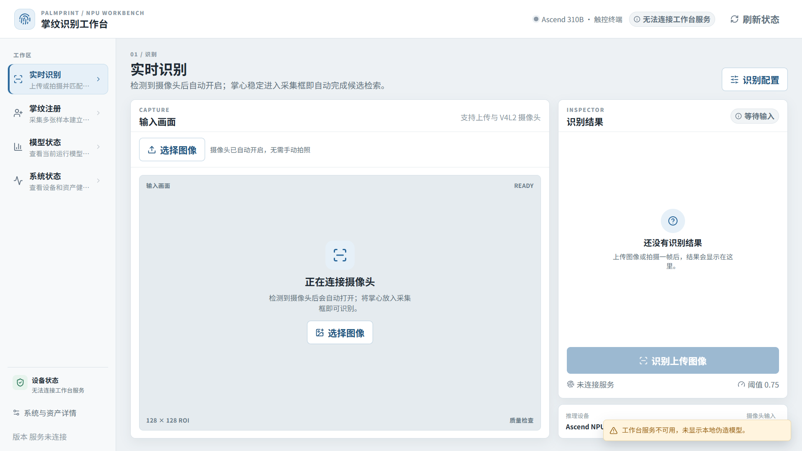
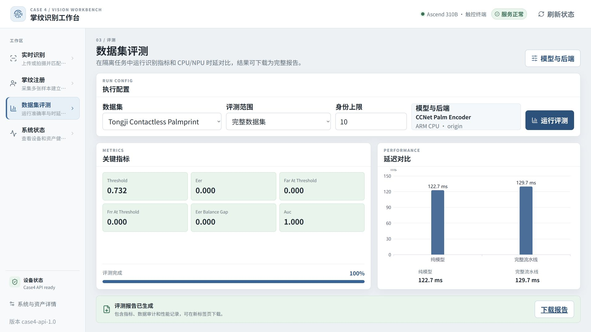

<!-- _class: cover -->

# 案例 4：掌纹识别

<div class="byline">周贤中 · zhouxzh@gdut.edu.cn</div>

## NPU-only 工作台与候选模型边界

案例课件 · 教师授课版

<div class="source">教材：<a href="../experiment/case4.md"><code>src/experiment/case4.md</code></a>；样例：<a href="../../samples/case4/README.md"><code>samples/case4</code></a></div>

<!--
本案例讲的是 8T 板上的 NPU-only 掌纹工作台，不把前端可打开、候选 smoke 或某次数值对照提升为生产验收。
-->

---

## NPU-only 是运行时硬边界

| 边界 | 在线工作台 | 离线研究 |
|---|---|---|
| 推理后端 | Ascend NPU | 可做 CPU、EDCC 等基线 |
| 精度 | `mixed_fp16` | 按研究协议 |
| 候选范围 | registry 中的准入模型 | 28 项候选审计 |
| 失败策略 | 明确失败，不切 CPU | 记录 blocked/untested |
| 部署 | Ascend310B4 / 8T 单独验证 | 结果不自动进入 registry |

在线 API 和模板通道只接受已准入的 NPU embedding。

<div class="source">教材：<a href="../experiment/case4.md#1-案例目标"><code>src/experiment/case4.md</code> §1</a>；样例：<a href="../../samples/case4/README.md"><code>samples/case4/README.md</code></a></div>

<!--
先划清在线与离线边界。CPU 或 EDCC 可以出现在研究记录中，但不能被工作台 API、模板命名空间或前端模型选择器暴露。
-->

---

## 工作台由四层组成

1. React 预构建前端负责识别、注册、模型状态和系统状态页面。
2. FastAPI 提供健康、bootstrap、摄像头、候选与识别接口。
3. 在线推理只加载 NPU `mixed_fp16` embedding。
4. 模板、截图和报告存放在发行目录的数据与报告区域。

前端服务可达不等于后端已连接；API 可达也不等于 NPU 推理已执行。

<div class="source">教材：<a href="../experiment/case4.md#3-api-和界面"><code>src/experiment/case4.md</code> §3</a>；样例：<a href="../../samples/case4/README.md"><code>samples/case4/README.md</code></a></div>

<!--
把 UI、API、推理和存储拆开定位。页面出现空状态时，先确认是前端静态服务、API、模型还是摄像头没有连接。
-->

---

<!-- _class: screenshot -->

## 8T 板载工作台：前端-only 截图



**仅证明预构建 React 工作台布局；服务未连接，不证明摄像头、NPU推理、候选准入、EER或Rank-1。**

<div class="source">manifest id：<code>case4-palmprint-live-idle</code>；8T / <code>Ascend310B4</code>；1920×1080；192060 bytes；SHA-256：<code>0c8bea9ccdd2abf0a6154f27e049cb01bc9b126599bc0db866bbb885d1f3aae0</code></div>

<!--
这张截图显示“无法连接工作台服务”、摄像头未连接、没有识别结果。它只证明预构建 React 静态资产在 8T 上完成布局渲染。
-->

---

## 截图元数据必须与图片绑定

| 字段 | 本次证据 |
|---|---|
| manifest id | `case4-palmprint-live-idle` |
| 图片 | `screenshots/cases/case4-palmprint-live-idle-1920x1080.png` |
| 板卡与视口 | 8T / `Ascend310B4`；1920×1080 |
| 字节数 | 192060 |
| SHA-256 | `0c8bea9ccdd2abf0a6154f27e049cb01bc9b126599bc0db866bbb885d1f3aae0` |
| 结论边界 | 前端布局通过，服务未连接 |

截图不能替代 API、摄像头、NPU 请求、模板闭环或数据集指标。

<div class="source">清单：<a href="screenshots/capture-manifest.json"><code>src/presentation/screenshots/capture-manifest.json</code></a>；样例入口：<a href="../../samples/case4"><code>samples/case4</code></a></div>

<!--
图片字节数、SHA-256 和 application digest 绑定静态资产。它们证明文件身份，不证明服务端已经启动或模型已经加载。
-->

---

## 合成图像与匿名模板是课堂底线

- 截图和课堂演示只使用合成 ROI 或匿名模板。
- 不展示真实掌纹、姓名、人员编号或 embedding。
- 注册数据只保存在受信发行目录，不进入 Git 或截图。
- 原始报告含设备与人员信息时必须脱敏后再引用。
- 删除和清理操作由操作者显式执行；截图中的空结果不是识别失败率或质量指标。

<div class="source">教材：<a href="../experiment/case4.md#4-六模型人工测试"><code>src/experiment/case4.md</code> §4</a>；截图规范：<a href="../experiment/img4/palmprint-ui-capture-manifest.json"><code>src/experiment/img4/palmprint-ui-capture-manifest.json</code></a></div>

<!--
隐私边界要落实到截图和存储。真实掌纹、模板和报告不能作为课件素材，匿名测试结束后还要确认临时模板已清理。
-->

---

## 模型范围：一个默认模型，五个待人工测试候选

| 模型 | profile | 精度 | 准入状态 |
|---|---|---|---|
| `ccnet` | production / manual_test | `mixed_fp16` | 默认与回滚模型 |
| `compnet_tongji_600` | manual_test | `mixed_fp16` | `manual_test_pending` |
| `compnet_iitd_460` | manual_test | `mixed_fp16` | `manual_test_pending` |
| `compnet_rest_358` | manual_test | `mixed_fp16` | `manual_test_pending` |
| `compnet_xjtu_flash_200` | manual_test | `mixed_fp16` | `manual_test_pending` |
| `compnet_xjtu_natural_200` | manual_test | `mixed_fp16` | `manual_test_pending` |

五个 CompNet 不得写成六个模型已通过，也不得自动进入 production。

<div class="source">注册表：<a href="../../samples/case4/models/registry.json"><code>samples/case4/models/registry.json</code></a>；策略：<a href="../../samples/case4/docs/01-model-evaluation-and-deployment-plan.md"><code>docs/01-model-evaluation-and-deployment-plan.md</code></a></div>

<!--
CCNet 是当前默认和回滚模型；五个 CompNet 只在 manual_test profile 中等待人工测试。模型 ID、精度和状态必须一一对应。
-->

---

## 候选清单不等于准入名单

- `candidate_manifest.json` 保留 28 项研究审计。
- 在线/模板通道只暴露 6 个 NPU embedding。
- 五个 CompNet 的 `manual_test_pending=true` 必须显示。
- 其余候选按任务类型单独测试，不共享掌纹 embedding 适配器。
- 下载 OM 或 ACL smoke 不会自动修改 production registry；`blocked`、`untested`、`manual_test_pending` 也不得显示为已准入。

<div class="source">候选：<a href="../../samples/case4/candidate_manifest.json"><code>samples/case4/candidate_manifest.json</code></a>；说明：<a href="../../samples/case4/docs/03-model-candidate-audit.md"><code>docs/03-model-candidate-audit.md</code></a></div>

<!--
候选数量、运行通道数量和准入数量是三个不同概念。不能在汇总页把“有 6 个 OM”写成“6 个模型已通过”。
-->

---

## 准入证据必须逐层通过

| 证据门 | 需要的记录 | 不能替代 |
|---|---|---|
| 资产 | OM 字节数、SHA-256、来源 revision | 一次加载成功 |
| 契约 | 输入 shape/range、输出维度和精度 | 文件存在 |
| 运行 | NPU smoke、退出码、设备状态 | CPU 结果 |
| 数值 | 与参考实现的误差与样本清单 | ACL 初始化 |
| 质量 | 合法数据集上的 EER/Rank-1 协议 | UI 截图 |
| 生命周期 | 重复 load/run/close、无设备异常 | 单次请求 |

任一门缺失，候选只能保持 blocked、untested 或 `manual_test_pending`。

<div class="source">准入方案：<a href="../../samples/case4/docs/01-model-evaluation-and-deployment-plan.md"><code>docs/01-model-evaluation-and-deployment-plan.md</code></a>；OM 清单：<a href="../../samples/case4/om_manifest.json"><code>samples/case4/om_manifest.json</code></a></div>

<!--
把转换、运行、数值、质量和生命周期分成不同门。一次 ACL smoke 或一张界面截图不能填满整张准入表。
-->

---

## 采集页面先区分上传与摄像头

| 输入方式 | 前端动作 | 服务端动作 |
|---|---|---|
| 上传图像 | 选择本地合成或匿名图像 | 校验格式、生成 ROI、提交识别 |
| V4L2 摄像头 | 打开预览、选择实际分辨率 | 串行取帧、关闭预览、释放设备 |

CAMERA 预览优先 MJPG；真实分辨率必须从设备和接口返回，不使用固定猜测值。

<div class="source">教材：<a href="../experiment/case4.md#5-摄像头测试"><code>src/experiment/case4.md</code> §5</a>；样例：<a href="../../samples/case4/README.md"><code>samples/case4/README.md</code></a></div>

<!--
上传和摄像头是两条输入路径。截图中的摄像头未连接状态不能用来判断 V4L2、首帧时间、帧率或设备释放结果。
-->

---

## 注册流程固定模板命名空间

1. 为同一人员分配稳定的本地编号。
2. 左右掌分别使用独立命名空间。
3. 采集并保存规定数量的合格样本。
4. 核对 ROI 质量后生成 `PWST1` embedding 模板。
5. 在 `<model_id>__npu__mixed_fp16` 命名空间中查询、识别、删除并重启验证。

<div class="source">教材：<a href="../experiment/case4.md#4-六模型人工测试"><code>src/experiment/case4.md</code> §4</a>；运行说明：<a href="../../samples/case4/README.md"><code>samples/case4/README.md</code></a></div>

<!--
模板闭环是模型身份的一部分。换模型、换精度或换发行目录后继续使用旧模板，可能得到不可解释的结果。
-->

---

## 识别结果要保留“候选”语义

- 未完成本机阈值校准时，只显示 Top-K 候选和分数。
- Top-K 分数不是身份通过/未通过。
- 单次命中不能替代数据集的 EER 或 Rank-1。
- 未识别、空模板和 API 不可用必须显示不同状态。
- 只有同一模型、同一模板命名空间的闭环才能进入人工测试记录；`Health: Alarm` 不能单独判成败。

<div class="source">教材：<a href="../experiment/case4.md#3-api-和界面"><code>src/experiment/case4.md</code> §3</a>；工作台说明：<a href="../../samples/case4/README.md"><code>samples/case4/README.md</code></a></div>

<!--
尤其要区分“没有识别结果”和“识别未命中”。截图中的空结果只是服务未连接，不是模型拒绝，也不是 EER 结果。
-->

---

<!-- _class: screenshot -->

## 历史评测界面只证明 UI 路径



该图来自受控 UI 截图清单，仅展示评测页面和操作入口，不证明 EER、Rank-1、候选准入或当前服务可用。

<div class="source">图片：<a href="../experiment/img4/palmprint-ui-react-evaluation-1920x1080.png"><code>src/experiment/img4/palmprint-ui-react-evaluation-1920x1080.png</code></a>；清单：<a href="../experiment/img4/palmprint-ui-capture-manifest.json"><code>palmprint-ui-capture-manifest.json</code></a></div>

<!--
这张历史截图只用于讲解评测界面的字段与操作路径。历史清单中的 UI smoke 不等于当前版本的跨域质量结论。
-->

---

## 版本冻结是人工测试的前置条件

| 冻结对象 | 记录方式 |
|---|---|
| 应用与前端 | 版本号、bundle SHA、release manifest |
| 模型 | canonical ID、OM SHA、精度和命名空间 |
| 运行环境 | CANN、PyACL、Python、驱动与板卡档位 |
| 模板数据 | 当前发行目录和人工备份 |
| 配置与策略 | profile、阈值、准入状态 |

人工测试期间不升级 Python、依赖、驱动、CANN，也不修改准入策略。

<div class="source">冻结规则：<a href="../../samples/case4/docs/01-model-evaluation-and-deployment-plan.md"><code>docs/01-model-evaluation-and-deployment-plan.md</code> §6</a>；教材：<a href="../experiment/case4.md#7-版本冻结"><code>src/experiment/case4.md</code> §7</a></div>

<!--
冻结是为了让失败可归因。中途升级软件或切换模型会破坏对比条件，发现问题时只记录并回退，不在同一测试窗口里修复。
-->

---

## 板端最小启动与检查

```bash
source /usr/local/miniconda3/etc/profile.d/conda.sh
conda activate base
source /usr/local/Ascend/ascend-toolkit/set_env.sh
export PALMPRINT_PROFILE=manual_test
python -m palmprint_workbench.tools.verify_assets --strict
python -m palmprint_workbench.api --host 0.0.0.0 --port 7860
```

<div class="source">命令：<a href="../../samples/case4/README.md"><code>samples/case4/README.md</code></a>；教材：<a href="../experiment/case4.md#2-手动环境"><code>src/experiment/case4.md</code> §2</a></div>

随后只读检查 `/api/health`、`/api/bootstrap`、`/api/candidates` 和 `/`，再执行一次合成 ROI 或匿名上传。

<!--
只能在已加载 conda/CANN 的板端 shell 中启动。资产校验失败时停止，不下载、不转换、不切 CPU，也不修改 registry。
-->

---

## 失败时保留现场并回退

- PyACL 不可用：确认同一 shell 的 Python 与 `acl.__file__`。
- 资产哈希不符或模型不在列表：停止服务并核对清单、profile、registry 和 bootstrap。
- 模板异常：保存模板目录，按版本化备份恢复。
- ACL 异常、设备 reset、`err_ret=-512` 或清理失败：停止该候选，保留日志并回退 CCNet。
- `Health: Alarm` 只记录诊断，不能单独判失败或通过。

<div class="source">排障：<a href="../experiment/case4.md#6-常见问题"><code>src/experiment/case4.md</code> §6</a>；验收边界：<a href="../../samples/case4/docs/02-device-deployment-and-acceptance-report.md"><code>docs/02-device-deployment-and-acceptance-report.md</code></a></div>

<!--
回退 CCNet 是版本内恢复策略，不是把五个 CompNet 判为永久不支持。故障候选先阻断，后续用单独版本重新验收。
-->

---

## 课堂交付：一张候选与证据对照卡

| 项目 | 必须提交 |
|---|---|
| 当前页面 | 预构建前端截图与 manifest id |
| 服务链 | health、bootstrap、candidates 输出 |
| 模型 | canonical ID、profile、OM SHA |
| 模板 | 注册、查询、命中、删除、重启结果 |
| 隐私 | 合成/匿名声明与清理记录 |
| 准入 | 五层证据中已完成与仍缺失的项 |

完成标准是能解释“哪些是前端证据、哪些是运行证据”，并明确五个 CompNet 仍为 `manual_test_pending`。

<div class="source">教材：<a href="../experiment/case4.md"><code>src/experiment/case4.md</code></a>；候选清单：<a href="../../samples/case4/candidate_manifest.json"><code>samples/case4/candidate_manifest.json</code></a>；截图清单：<a href="screenshots/capture-manifest.json"><code>capture-manifest.json</code></a></div>

<!--
最终报告不能写“六模型通过”。正确写法是默认模型可回退、五个 CompNet 等待人工测试，前端截图只覆盖布局。
-->
