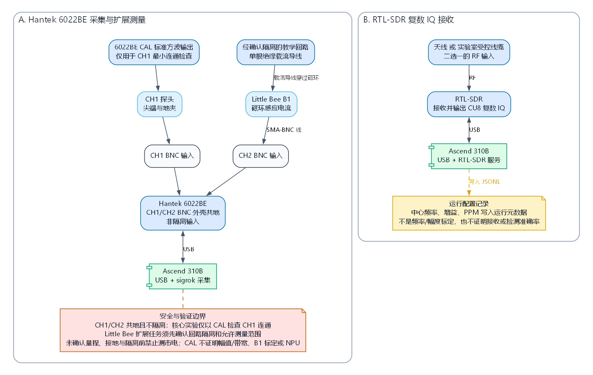
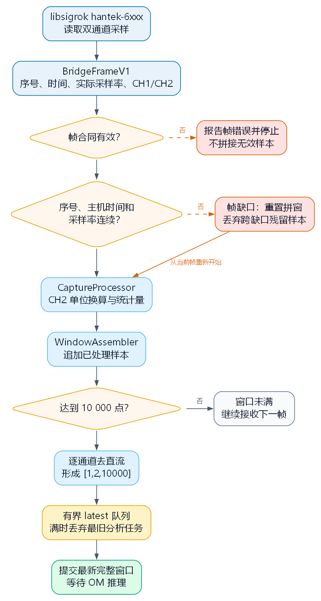
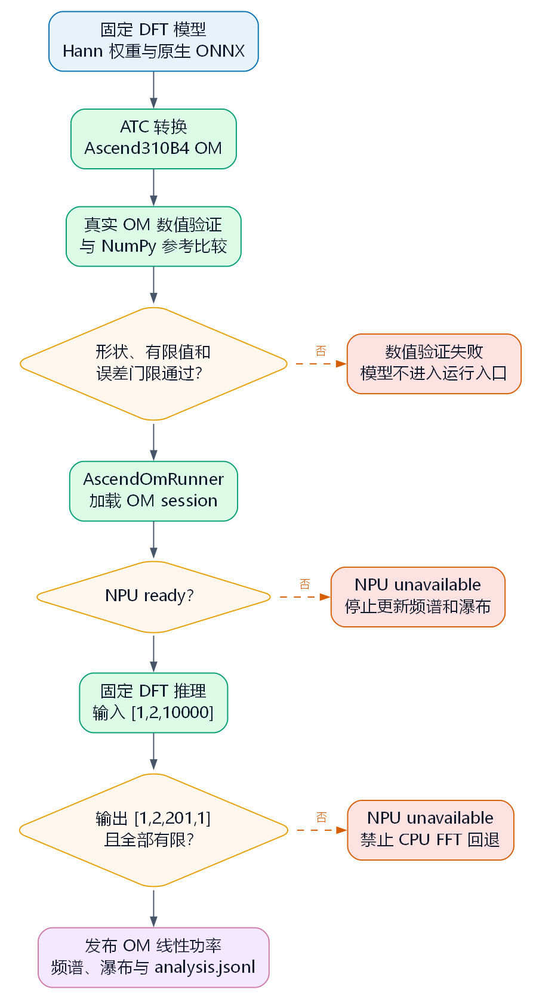
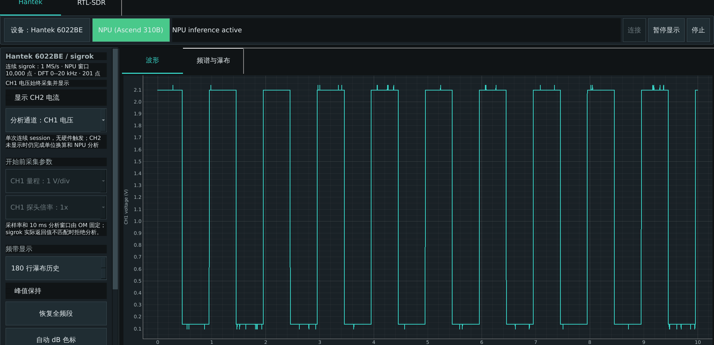
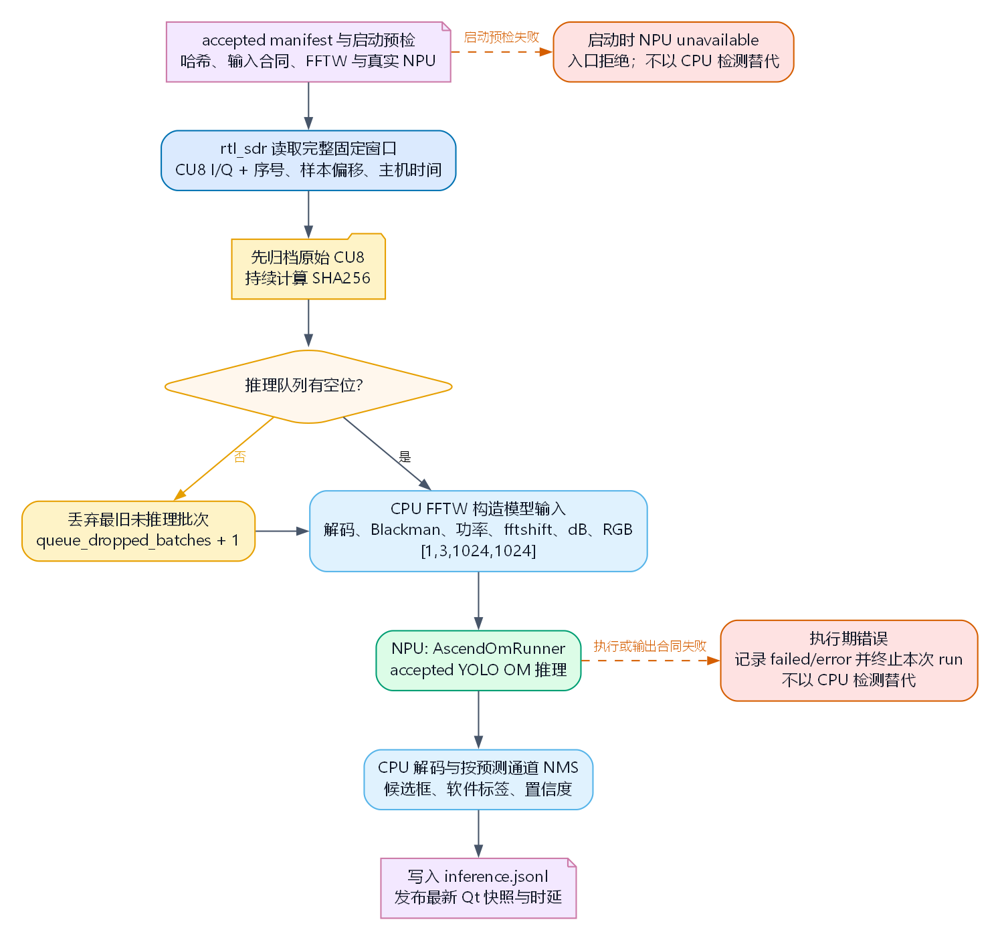
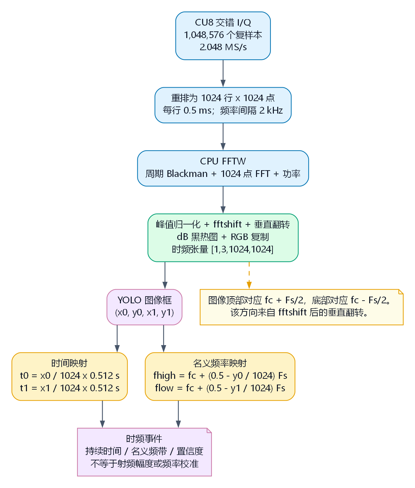
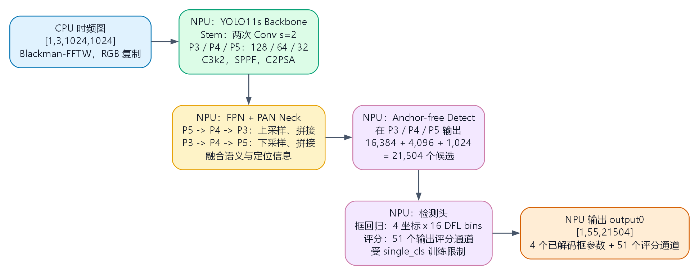
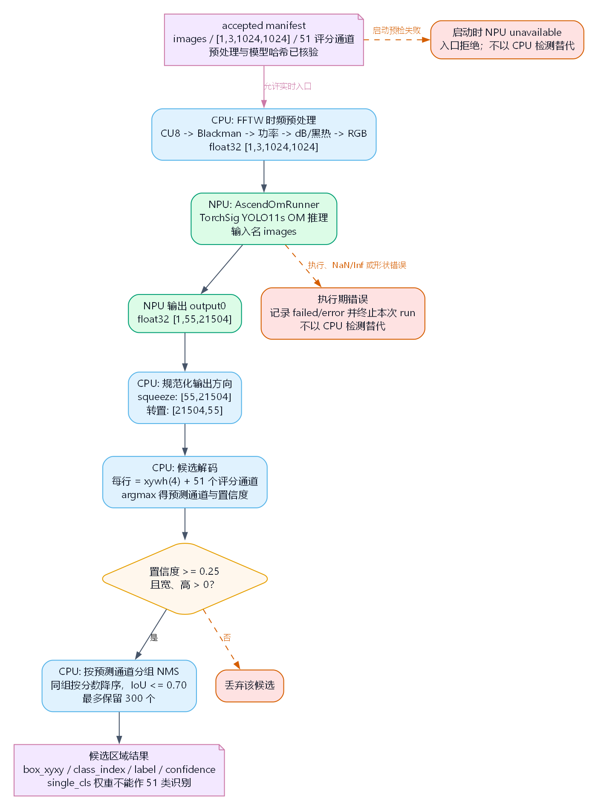

<!-- _class: cover -->

# 案例 5：智能数据采集分析仪

<div class="byline">周贤中 · zhouxzh@gdut.edu.cn</div>

## 从真实信号到可追溯的 NPU 结果


<div class="source">教材：<a href="../experiment/case5.md"><code>src/experiment/case5.md</code></a>；实现：<a href="../../samples/case5/README.md"><code>samples/case5/README.md</code></a></div>

<!--
本讲围绕采集、分析、NPU执行和证据追溯展开。先区分确定性DFT与训练得到的检测网络，再讨论界面截图能证明什么。
-->

---

<!-- _class: center -->

## 本讲要回答的四个问题

1. 连续采样怎样组成固定分析窗口？
2. 实值波形和复数 IQ 为什么需要不同的频谱表示？
3. CPU 与 NPU 各自执行哪一段计算？
4. 一条频谱或检测框怎样追溯到原始数据和模型合同？

<div class="source">教材：<a href="../experiment/case5.md#1-从波形到可解释事件"><code>src/experiment/case5.md</code> 第 1 节</a></div>

<!--
四个问题对应采集合同、信号表示、计算边界和证据链。任何一层没有记录，都不能用一个漂亮的界面代替。
-->

---


<!-- _class: section -->

# 01

## 两条路径与计算合同

---

<!-- _class: center -->

## 两条实验路径，三种计算合同

| 路径 | 硬件与输入 | CPU 工作 | NPU 工作 |
|---|---|---|---|
| Hantek 主线 | 6022BE，CH1/CH2 实值帧 | 组窗、去直流、会话写入 | Hann 窗固定 DFT |
| RTL DFT Demo | CU8 复数 IQ | 解码、去直流、记录 | 固定复数 DFT |
| RTL 检测 | CU8 复数 IQ | FFTW 时频图、解码与 NMS | YOLO11s 区域检测 |

固定 DFT 没有训练参数；YOLO11s 才是学习模型。二者都要求 OM 真正执行。

<div class="source">教材：<a href="../experiment/case5.md#4-双主线系统架构"><code>src/experiment/case5.md</code> §4</a></div>

<!--
先区分算法类别，再区分执行位置。NPU是执行位置，不会把固定DFT变成神经网络，也不会让单类检测自动获得多类语义。
-->

---

<!-- _class: visual -->

## 硬件先服从安全边界

<div class="split"><figure><figcaption>Hantek 与 RTL-SDR 的接线和安全边界</figcaption></figure><div><ul><li>6022BE 双通道共地，不是隔离示波器。</li><li>核心实验只把 CH1 接到低压 <code>CAL</code> 输出。</li><li>Little Bee B1 的 CH2 幅相标定尚未完成。</li><li>仪器与接收机不能同时被多个程序占用。</li></ul></div></div>

<div class="source">图片：<a href="../experiment/img5/case5-hardware-connections.png"><code>src/experiment/img5/case5-hardware-connections.png</code></a>；教材：<a href="../experiment/case5.md#2-实验器材接线与安全"><code>src/experiment/case5.md</code> §2</a></div>

<!--
未确认量程、接地和隔离前禁止接入市电。CAL只证明采集连通，不能证明Little Bee、CH2或计量精度。
-->

---

<!-- _class: visual -->

## 窗口同时决定时间跨度与频率间隔

| 路径 | 采样合同 | 单窗跨度 | 频点间隔 |
|---|---|---:|---:|
| Hantek DFT | 1 MS/s，10,000 点 | 10 ms | 100 Hz |
| RTL 检测 | 2.048 MS/s，每行 1,024 点 | 0.5 ms/行 | 2 kHz |

> 采样率与窗口点数共同决定时间跨度与频点间隔；两者改变，模型输入与实时预算也随之改变。

<div class="source">教材：<a href="../experiment/case5.md#3-读懂时域频域和复数-iq"><code>src/experiment/case5.md</code> §3</a>；公式与固定合同</div>

<!--
窗口点数不是界面刷新参数，而是模型输入和实时预算的一部分。Hantek只保留0到20kHz的201个频点。
-->

---

<!-- _class: center -->

## 三种张量合同不能互换

| 合同 | 输入 | NPU 输出 | 用途 |
|---|---|---|---|
| Hantek DFT | `[1,2,10000]` | `[1,2,201,1]` | 0–20 kHz 频谱 |
| RTL DFT Demo | `[16,2,1024]` | `[16,1024]` | 复数频谱教学 |
| RTL 检测 | `[1,3,1024,1024]` | `[1,55,21504]` | 时频区域检测 |

RTL 检测张量的 55 个值由 4 个框参数和 51 个评分组成，但训练采用单类监督，不能解释为 51 类调制识别。

<div class="source">教材：<a href="../experiment/case5.md#三种模型合同不能混用"><code>src/experiment/case5.md</code> §4.2</a>；样例：<a href="../../samples/case5/README.md"><code>samples/case5/README.md</code> 固定分析契约</a></div>

<!--
这里必须同时讲形状和语义。张量有55个值不等于模型受过51类训练，更不能把部署标签表当作精度证据。
-->

---

<!-- _class: visual -->

## Hantek 先形成连续、可信的窗口

<div class="split"><figure><figcaption>从连续帧形成固定窗口</figcaption></figure><div><ul><li><code>BridgeFrameV1</code> 记录序号、主机时间、采样率和双通道样本。</li><li>序号、时间或采样率不连续时丢弃未完成窗口。</li><li>分析队列容量为 2，满时丢弃最旧任务并记录。</li><li>原始帧、索引、分析结果和摘要分别落盘。</li></ul></div></div>

<div class="source">图片：<a href="../experiment/img5/case5-hantek-acquisition-flow.png"><code>case5-hantek-acquisition-flow.png</code></a>；实现：<a href="../../samples/case5/time_frequency_dashboard/acquisition/frame_protocol.py"><code>frame_protocol.py</code></a></div>

<!--
宁可丢掉跨缺口的半个窗口，也不能把不连续样本拼成正常频谱。桥序号连续只证明用户态链路，不证明ADC绝对无间隙。
-->

---

<!-- _class: visual -->

## Hantek 的 DFT 必须由真实 OM 发布

<div class="split"><figure><figcaption>DFT 的转换、验证与发布门</figcaption></figure><div><ul><li>CPU 按通道去直流，NPU 执行固定 Hann 窗 DFT。</li><li>输入 <code>[1,2,10000]</code>，输出 <code>[1,2,201,1]</code> 线性功率。</li><li>界面再转成相对 <code>1 V²</code> 的未校准 dB。</li><li>OM 失败显示 <code>NPU unavailable</code>，不使用 CPU FFT。</li></ul></div></div>

<div class="source">图片：<a href="../experiment/img5/case5-hantek-om-flow.png"><code>case5-hantek-om-flow.png</code></a>；实现：<a href="../../samples/case5/time_frequency_dashboard/npu.py"><code>time_frequency_dashboard/npu.py</code></a></div>

<!--
ONNX生成、ATC成功和OM发布是三个门。只有真实OM加载并返回有限功率，仪表盘才能发布频谱和瀑布。
-->

---

<!-- _class: screenshot -->

## 历史 Hantek 界面：仅作既有 UI 证据



**historical evidence；不是本轮板端运行。顶部环境条和底部系统条已移除。**

<div class="source">派生图：<code>case5-hantek-dashboard-1920x1010.png</code>；125078 bytes；SHA-256：<code>1b072d0d40e4b6839ad9335cf933f4e6d3368a16ca317ed5d6dfc8a157509d88</code>；来源清单：<a href="screenshots/historical-derivations.json"><code>historical-derivations.json</code></a>；原图不直链</div>

<!--
这张图来自历史UI验收记录，只证明当时页面布局、CH1 CAL波形和NPU DFT状态。不得写成当前8T部署或本轮验收。
-->

---

<!-- _class: visual -->

## 一次分析结果要能回到原始窗口

| 文件 | 追溯内容 |
|---|---|
| `manifest.json` | 采样率、模型、配置和单位 |
| `raw_index.jsonl` | 帧序号到原始块偏移 |
| `analysis.jsonl` | 窗口、后端、功率和时延 |
| `summary.json` | 丢帧、写入错误和总量 |

> 能从结果反查到原始窗口，才算完成一次可复核的分析。

<div class="source">教材：<a href="../experiment/case5.md#8-保存并复核一次会话"><code>src/experiment/case5.md</code> §8</a>；会话文件合同</div>

<!--
结果记录保存线性功率，显示层才做dB转换。追溯时从analysis.jsonl定位窗口，再经raw_index回到原始帧。
-->

---

<!-- _class: section -->

# 02

## RTL-SDR 与实时链路

---

## RTL-SDR：CPU 造图，NPU 检测

<div class="split"><figure><figcaption>CPU 时频预处理与 NPU 检测链路</figcaption></figure><div><ul><li>CPU 归档 CU8，并用 FFTW 生成 Blackman 时频图。</li><li>输入 <code>[1,3,1024,1024]</code>，NPU 执行 YOLO11s。</li><li>NPU 输出框和评分，CPU 完成解码与 NMS。</li><li>推理队列默认容量 4，丢弃最旧批次并记录。</li></ul></div></div>

<div class="source">图片：<a href="../experiment/img5/case5-rtl-service-flow.png"><code>case5-rtl-service-flow.png</code></a>；实现：<a href="../../samples/case5/time_frequency_dashboard/rtl_sdr_service.py"><code>rtl_sdr_service.py</code></a></div>

<!--
CPU生成的是模型输入而非NPU FFT。卷积、特征融合和检测头由OM执行，CPU不能替代这三层。
-->

---

<!-- _class: visual -->
## 时频像素必须绑定物理坐标



在 2.048 MS/s 下，1024 点一行覆盖 0.5 ms，完整 1024 行覆盖 0.512 s；每个频率 bin 为 2 kHz。

<div class="source">图片：<a href="../experiment/img5/case5-iq-to-spectrogram-mapping.png"><code>case5-iq-to-spectrogram-mapping.png</code></a>；教材：<a href="../experiment/case5.md#51-模型看到的是标准化的时频形态"><code>src/experiment/case5.md</code> §5.1</a></div>

<!--
这张图把像素坐标与窗长、采样率绑定。学生先要指出时间轴和频率轴分别从哪里来，不能把热力图颜色直接当作绝对功率。
-->

---

<!-- _class: center -->

## 时频像素必须绑定物理坐标（续）

频率轴经过 `fftshift` 和上下翻转后是名义坐标；每幅图独立归一化，接收增益也未标定，不能据此报告绝对功率。

| 坐标 | 映射来源 | 不能说明 |
|---|---|---|
| 时间 | 图像横坐标 × 0.512 s | 射频链路总延迟 |
| 频率 | 中心频率与 `fftshift` 后的 bin | 未校准的绝对频偏 |
| 功率 | 每幅图自身最大值归一化 | dBm 或绝对接收功率 |

检测框只有绑定采样率、中心频率和图像坐标后才有物理意义。

> 热力图颜色只表示相对强度，不能替代物理坐标、绝对功率与校准信息。

<div class="source">教材：<a href="../experiment/case5.md#51-模型看到的是标准化的时频形态"><code>src/experiment/case5.md</code> §5.1</a></div>

<!--
检测框只有在绑定中心频率、采样率和图像坐标后才有物理意义。名义坐标不等于完成射频计量校准。
-->

---

<!-- _class: visual -->

## YOLO11s 输出候选区域，不直接输出调制类别

<div class="split"><figure><figcaption>YOLO11s 的多尺度时频检测结构</figcaption></figure><div><ul><li>Backbone 提取多尺度时频特征。</li><li>FPN/PAN 融合深浅层语义与定位信息。</li><li>三尺度 Detect Head 共产生 21,504 个候选位置。</li><li><code>[1,55,21504]</code> 是 4 个框参数加 51 个评分通道。</li></ul></div></div>

<div class="source">图片：<a href="../experiment/img5/case5-yolo11s-architecture.png"><code>case5-yolo11s-architecture.png</code></a>；教材：<a href="../experiment/case5.md#53-yolo11s-如何从图像形成候选框"><code>src/experiment/case5.md</code> §5.3</a></div>

<!--
张量形状解释输出布局，不解释类别语义。当前权重采用single_cls=True，不能声称已训练成51类调制识别器。
-->

---

<!-- _class: visual -->

## 后处理保持单类检测语义

<div class="split"><figure><figcaption>从 OM 张量到时间–频率框</figcaption></figure><div><ul><li>CPU 将输出转成候选行并解码框坐标。</li><li>阈值筛选后执行 NMS，再映射到时间与频率。</li><li>单类部署采用单一候选得分和 class-agnostic NMS。</li><li>当前兼容代码的 51 通道索引只是张量布局信息。</li></ul></div></div>

<div class="source">图片：<a href="../experiment/img5/case5-yolo-detection-decode-flow.png"><code>case5-yolo-detection-decode-flow.png</code></a>；教材：<a href="../experiment/case5.md#54-从-npu-张量到候选区域"><code>src/experiment/case5.md</code> §5.4</a></div>

<!--
当前单类监督权重不能被软件标签表扩写成多类模型。无标签空口数据只能评价链路，不能给出检测准确率。
-->

---

<!-- _class: center -->

## 有界队列与设备互斥保护实时性

| 对象 | 容量或策略 | 满时行为 |
|---|---|---|
| Hantek 分析队列 | 2 | 丢弃最旧任务并计数 |
| RTL 推理队列 | 4 | 丢弃最旧批次并记录 |
| 瀑布历史 | 固定行数 | 覆盖最旧显示行 |
| Hantek 原始会话 | 有界写入 | 记录存储丢帧或写入错误 |
| 设备协调 | `InstrumentCoordinator` | 一次只允许一条硬件链 |

有界丢弃保护内存和结果新鲜度，但不会掩盖原始采集缺口。

<div class="source">教材：<a href="../experiment/case5.md#43-实时系统为什么需要有界队列"><code>src/experiment/case5.md</code> §4.3</a>；实现：<a href="../../samples/case5/time_frequency_dashboard/instrument_coordinator.py"><code>instrument_coordinator.py</code></a></div>

<!--
队列满时丢旧任务是一种实时策略，随后必须通过丢帧、丢批和写入错误字段暴露代价。Hantek与RTL不能并行占用设备。
-->

---

<!-- _class: center -->

## 模型准入是五层证据，不是文件存在

| 门槛 | 必须记录 |
|---|---|
| 来源与工件 | revision、ONNX/OM 字节数和 SHA-256 |
| 输入合同 | shape、dtype、采样率和预处理版本 |
| 转换 | ATC 命令、目标 SoC、日志和 OM hash |
| NPU 数值 | 真实 ACL 执行、有限输出与参考误差 |
| 实时预算 | P95 小于一个模型窗口且队列可解释 |

只有 `accepted` manifest 才能进入正式检测入口；CPU 结果不能填充 NPU 证据。

<div class="source">准入流程：<a href="../../samples/case5/docs/07_ascend310b_heterogeneous_signal_processing.md"><code>samples/case5/docs/07_ascend310b_heterogeneous_signal_processing.md</code></a>；教材：<a href="../experiment/case5.md#10-模型准入与真实板端运行"><code>src/experiment/case5.md</code> §10</a></div>

<!--
ATC成功只证明可编译，accepted还要覆盖来源、数值和窗口预算。accepted也不等于完整主机流水线已经连续通过。
-->

---

<!-- _class: center -->

## 性能证据必须绑定运行协议

| 证据 | 已有记录或要求 | 不能证明 |
|---|---|---|
| Hantek UI | 历史 CH1 `CAL` 与 NPU DFT 界面 | 当前 8T、CH2 标定 |
| RTL 短运行 | 历史 10 s 请求，20/20 批，丢弃 0 | 检测准确率或 RF 标定 |
| 连续运行 | 至少 600 s、零丢批、逐批预算 | 尚未由本课件证明 |
| 检测质量 | 带标签独立验证集与指标 | 无标签空口检测框 |

所有时间与后端结论必须同时带模型 hash、板卡档位、CANN 版本和输入状态。

<div class="source">教材：<a href="../experiment/case5.md#93-谁计算时频图谁完成检测"><code>src/experiment/case5.md</code> §9.3</a>；验收：<a href="../../samples/case5/README.md"><code>samples/case5/README.md</code> 测试与验收</a></div>

<!--
短运行能证明采集、预处理和NPU链路连通，但不能替代600秒连续运行或带标签准确率。历史界面也不能冒充本轮板端。
-->

---

## 最小运行入口

```bash
cd ~/Documents/case5
source /usr/local/Ascend/ascend-toolkit/set_env.sh
source /usr/local/miniconda3/etc/profile.d/conda.sh
conda activate base
python -c "import numpy, onnx, onnxruntime, aclruntime"
python -m time_frequency_dashboard.acquisition.usb_diagnostics
bash scripts/build_sigrok_capture_bridge.sh
python -m time_frequency_dashboard.model.prepare_models
python -m time_frequency_dashboard.model.verify_npu_model
bash scripts/run_dashboard.sh --sigrok-bridge build/sigrok_capture_bridge
```

<div class="source">命令来源：<a href="../../samples/case5/README.md"><code>samples/case5/README.md</code></a>；启动脚本：<a href="../../samples/case5/scripts/run_dashboard.sh"><code>scripts/run_dashboard.sh</code></a>、<a href="../../samples/case5/scripts/run_rtl_sdr_npu_inference.sh"><code>run_rtl_sdr_npu_inference.sh</code></a></div>

RTL-SDR 入口需显式给出已准入 manifest、真实 RF 输入状态和运行时长；不要在未验证时省略这些字段。

<!--
这些命令必须在板端已有CANN与base环境执行。命令页只给入口，实际运行仍要按USB、模型哈希和RF输入状态逐项检查。
-->

---

<!-- _class: center -->

## 课堂交付：每个结论绑定一层证据

| 交付项 | 必须提交 |
|---|---|
| 采集 | 设备、采样率、窗口、序号缺口与原始归档 |
| NPU | OM hash、输入形状、输出形状和后端状态 |
| 会话 | `manifest`、原始索引、分析 JSONL 和摘要 |
| RTL | RF 输入状态、accepted manifest、批次和队列记录 |
| 边界 | 单类检测语义、未标定项和未完成验收 |

最终结论只能写到证据覆盖的层级：页面可打开、OM 可执行、短运行连通和连续实时性是四种不同结论。

<div class="source">教材：<a href="../experiment/case5.md#11-测试性能与验收方法"><code>src/experiment/case5.md</code> §11</a>；实现：<a href="../../samples/case5/README.md"><code>samples/case5/README.md</code></a></div>

<!--
收尾让学生逐层勾选，不允许用界面截图填满NPU、连续实时性或检测准确率。historical evidence必须保持历史标签。
-->
