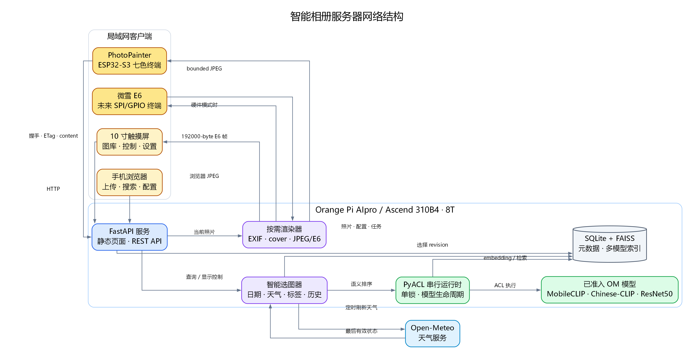
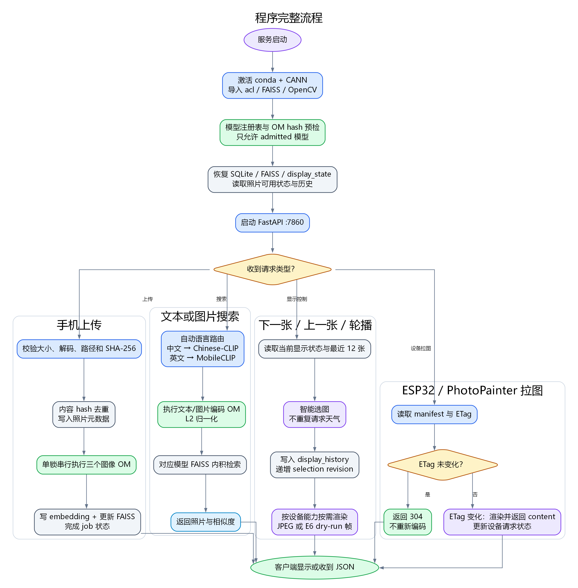
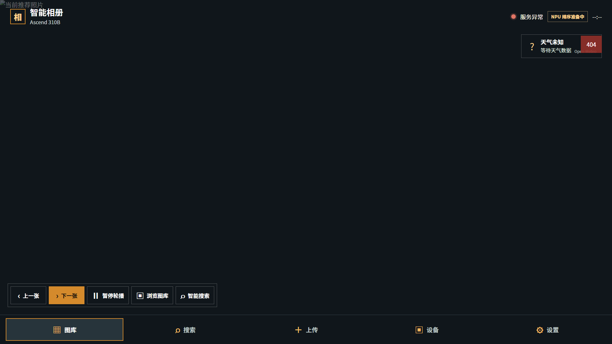

<!-- _class: cover -->

# 案例 7：智能相册

周贤中 · zhouxzh@gdut.edu.cn

## 从照片索引到局域网设备协同

案例课件 · 教师授课版

依据：<a href="../experiment/case7.md">src/experiment/case7.md</a>；实现：<a href="../../samples/case7/README.md"><code>samples/case7</code></a>

<!--
案例7不是单个图像分类脚本，而是手机上传、NPU索引、语义检索、触摸屏显示和ESP32电子纸拉图的完整系统。
-->

---

## 系统的五段链路

| 阶段 | 主要动作 | 输出 |
|---|---|---|
| 照片进入 | 上传、解码、安全检查、去重 | 受管原图与元数据 |
| 照片理解 | 三个已准入模型生成embedding | 向量与索引 |
| 照片选择 | 文本、相似图、日期与天气 | 确定性选择状态 |
| 页面显示 | 按视口生成JPEG | 触摸屏或手机画面 |
| 设备协同 | manifest、ETag、条件拉取 | ESP32或电子纸帧 |

生产推理只接受已准入的Ascend OM，不提供CPU或PyTorch回退。

教材：<a href="../experiment/case7.md#案例目标与问题定义"><code>src/experiment/case7.md</code>「案例目标与问题定义」</a>

<!--
先按五段建立系统全景。每段都有自己的数据和证据，不能用最终页面替代索引或设备拉图验证。
-->

---

<!-- _class: visual -->

## 手机、触摸屏和ESP32共享一台310B服务

图片：<a href="../experiment/img7/network-architecture.png"><code>src/experiment/img7/network-architecture.png</code></a>；出处：<a href="../experiment/case7.md#系统总体架构"><code>src/experiment/case7.md</code>「系统总体架构」</a>

<!--
客户端只通过HTTP访问服务。FastAPI连接SQLite、FAISS、NPU运行时和按需渲染器，设备不直接接触模型或任意文件路径。
-->

---

<!-- _class: visual -->

## 程序流程从模型准入和索引恢复开始

图片：<a href="../experiment/img7/program-flow.png"><code>src/experiment/img7/program-flow.png</code></a>；出处：<a href="../experiment/case7.md#pdf-版结构图"><code>src/experiment/case7.md</code>「PDF版结构图」</a>

<!--
服务启动先检查CANN、模型hash和索引，再开放上传、搜索、显示和设备接口。任何一部分未就绪都应显式暴露状态。
-->

---

## 组件各自守住一条边界

| 组件 | 负责 | 不负责 |
|---|---|---|
| FastAPI | HTTP接口、任务状态和静态页面 | 生成模型输出 |
| PyACL运行时 | 单锁加载与执行OM | 索引业务规则 |
| SQLite | 照片、向量和显示状态真源 | 大规模向量近邻搜索 |
| FAISS | 每模型独立向量索引 | 设备路由 |
| 渲染器 | JPEG或E6帧准备 | 改变选择结果 |

SQLite里的embedding与FAISS索引必须由同一批次、同一模型ID保持可重建关系。

教材：<a href="../experiment/case7.md#核心数据模型"><code>src/experiment/case7.md</code>「核心数据模型」</a>

<!--
SQLite是文件与元数据的关系索引，FAISS是可重建检索缓存。不要把FAISS当作唯一真源，也不要混用模型空间。
-->

---

## 三个模型回答不同问题

| 模型 | 能力 | 输入与输出 |
|---|---|---|
| MobileCLIP-S0 | 英文通用语义 | 图像256×256、文本77 tokens，512维 |
| Chinese-CLIP RN50 | 中文语义 | 图像224×224、文本52 tokens，1024维 |
| ResNet50 | 经典相似图 | 图像224×224，2048维视觉特征 |

ResNet50没有文本编码器。三个模型的向量维度和坐标空间不同，不能相加或共用同一个FAISS索引。

教材：<a href="../experiment/case7.md#多模型语义检索方法"><code>src/experiment/case7.md</code>「多模型语义检索方法」</a>

<!--
按“图像、中文文本、英文文本、相似图”选择模型。模型ID是API和索引的硬边界。
-->

---

## 自动路由只根据输入类型与语言

- 中文文本优先Chinese-CLIP。
- 非中日韩文本优先MobileCLIP。
- 图片自动查询默认MobileCLIP。
- 用户手动选择时必须检查模型已准入且合同匹配。
- 所有候选向量先做L2归一化，再在各自索引内检索。

教材：<a href="../experiment/case7.md#自动路由"><code>src/experiment/case7.md</code>「自动路由」</a>

<!--
客户端可以表达查询语言或模型ID，但真实路径由服务端注册表决定。分数只在同一模型空间内有排序意义。
-->

---

## 索引数据必须能追溯和重建

- 原图以SHA-256去重，EXIF时间缺失时使用上传时间。
- SQLite保存photo_id、文件元数据和每模型embedding。
- FAISS的ID直接使用SQLite的photo_id。
- 每个模型拥有独立`IndexIDMap2`。
- 上传任务完成三模型索引后才标记`completed`。

教材：<a href="../experiment/case7.md#核心数据模型"><code>src/experiment/case7.md</code>「核心数据模型」</a>；实现：<a href="../../samples/case7/photo_index.py"><code>samples/case7/photo_index.py</code></a>

<!--
FAISS是派生缓存，SQLite与受管文件才是可恢复的组合。模型变化时需要建立新索引，不能沿用旧模型向量。
-->

---

## NPU准入不是“文件存在”

| 门槛 | 验收内容 |
|---|---|
| ONNX合同 | 输入名称、shape、dtype、输出维度 |
| ATC转换 | `Ascend310B4`、日志和OM hash |
| ACL数值 | 输入字节、输出有限值、与ONNX参考对齐 |
| 检索 | 重建临时索引并检查Recall |
| 注册 | hash一致且`status=admitted`才可加载 |

没有当前准入报告的模型不能被服务选择，也不能以CPU结果替代。

教材：<a href="../experiment/case7.md#昇腾310b模型迁移方法"><code>src/experiment/case7.md</code>「昇腾310B模型迁移方法」</a>

<!--
准入是模型、板卡、版本和查询合同的联合结论。文件存在、ATC成功或单次输出有限都只是其中一层。
-->

---

## 单锁保内存，模型切换有代价

- ACL资源管理器持有Device、Context、Stream和当前模型。
- 构造输入、执行推理和释放由同一把锁保护。
- 图像与文本模型按需切换，切换前释放旧模型。
- 上传索引任务与即时查询串行化。
- 模型缺失、hash错误或ACL失败直接报错，不回退CPU。

教材：<a href="../experiment/case7.md#npu-运行时与串行资源管理"><code>src/experiment/case7.md</code>「NPU运行时与串行资源管理」</a>；实现：<a href="../../samples/case7/embedding_backend.py"><code>samples/case7/embedding_backend.py</code></a>

<!--
单锁会降低吞吐，但能控制内存峰值和模型切换。生产回退会掩盖准入失败，因此必须失败关闭。
-->

---

<!-- _class: screenshot -->

## 当前静态前端：空库且后端未连接

截图：<code>case7-album-search-1920x1080.png</code>；来源：<a href="screenshots/capture-manifest.json"><code>capture-manifest.json</code></a>

<!--
画面只加载了案例7的web/index.html静态前端。顶部服务异常，天气接口404，主区域没有照片，NPU状态是排队准备中。不能把空库解释成检索结果。
-->

---

## 截图证据卡：只证明静态前端布局

| 字段 | 值 |
|---|---|
| manifest id | `case7-album-search` |
| 板卡 | 8T / `Ascend310B4` |
| 视口 | 1920×1080 |
| 文件字节 | 44830 |
| SHA-256 | `013544c6e8a0b95f399962fec6bb4820683fbd7e8d6871863c4768ca3596fa24` |

采样时FastAPI、数据库和模型服务未连接。截图不证明图库、向量检索、触摸屏控制、NPU、精度或ESP32/电子纸链路。

清单：<a href="screenshots/capture-manifest.json"><code>capture-manifest.json</code> / case7-album-search</a>

<!--
五组字段必须一起出现。空主区域、服务异常和天气404是后端未连接的证据，不是“搜索无结果”或“图库为空”的业务结论。
-->

---

## 空库截图不包含照片或检索结果

| 画面元素 | 实际含义 |
|---|---|
| 大块黑色主区域 | 没有可显示照片 |
| 服务异常 | 静态页面未连上后端 |
| 天气404 | 天气端点不可用 |
| NPU排队准备中 | 仅前端状态文字 |
| 下一张/搜索 | 只能检查控件与布局 |

因此截图不能证明上传、索引、搜索、照片选择或设备拉图成功。

证据边界：<a href="screenshots/capture-manifest.json"><code>case7-album-search</code> evidenceBoundary</a>

<!--
这是案例7最重要的证据边界页。空页面不是搜索零命中，而是没有后端数据源；不能写任何检索成功或准确率。
-->

---

## 触摸屏按五个全屏面板组织

- 首页以照片为第一视觉层，工具栏无操作8秒后隐藏。
- 图库、智能搜索、上传、设备、设置分别为面板。
- 中文自动走Chinese-CLIP，英文自动走MobileCLIP。
- 相似图使用独立ResNet50索引。
- 上一张、下一张、暂停和轮播状态由服务端持久化。

教材：<a href="../experiment/case7.md#触摸屏交互设计"><code>src/experiment/case7.md</code>「触摸屏交互设计」</a>

<!--
当前截图只覆盖1920×1080空库页面。其他视口、照片存在状态、搜索结果和触摸操作仍需独立捕获和验收。
-->

---

## ESP32是独立设备边界

| 项目 | Waveshare PhotoPainter | Seeed reTerminal E1002 |
|---|---|---|
| 显示技术 | E6六色 | ACeP/Spectra 6 |
| 尺寸 | 800×480 | 800×480 |
| 方向 | 横屏或竖屏 | 仅横屏 |
| 拉图 | manifest + ETag条件请求 | 同一设备协议 |
| 刷新证据 | 真实面板刷新 | 真实面板刷新 |

E6 dry-run只证明旋转、裁剪、量化和192000字节帧协议，不证明真实屏幕刷新。

教材：<a href="../experiment/case7.md#esp32-与-photopainter"><code>src/experiment/case7.md</code>「ESP32与PhotoPainter」</a>

<!--
局域网上“发现设备”“注册成功”“设备主动拉图”和“面板实际刷新”是四个状态，不能合并。
-->

---

## 智能选图是策略，不是另一个生成模型

- 自动选图综合Chinese-CLIP语义、日期时段和天气元数据。
- 最近12张照片进入重复抑制窗口。
- 天气请求失败时保留最后有效状态。
- 选择结果以`selection_revision`持久化。
- 连续切图复用预选队列，避免每次重复加载模型。

教材：<a href="../experiment/case7.md#智能选图与天气方法"><code>src/experiment/case7.md</code>「智能选图与天气方法」</a>

<!--
选图是多个信号组合后的确定性状态，不是由LLM随意生成。当前天气404和空库使这部分无法进入业务验证。
-->

---

## 服务接口与验收顺序

| 检查 | 通过条件 |
|---|---|
| 健康 | `/api/health`与模型状态可用 |
| 图库 | `/api/index/stats`显示已索引照片 |
| 搜索 | 语言路由、模型ID和结果revision正确 |
| 显示 | JPEG、E6 dry-run与设备方向正确 |
| ESP32 | 注册后由设备主动拉图并返回200/304 |
| 证据 | 模型hash、日志、视口和隐私边界齐全 |

页面能打开只对应第一列的一部分，不是整条相册链路通过。

样例：<a href="../../samples/case7/README.md"><code>samples/case7/README.md</code> 检查与重启</a>；教材：<a href="../experiment/case7.md#测试性能与验收方法"><code>src/experiment/case7.md</code> §测试</a>

<!--
按健康、索引、搜索、显示、设备拉图的顺序验收。每一步都有独立接口和原始证据。
-->

---

## 照片、向量和设备信息都需保护

- 个人照片放在受管`Pictures`目录，不进入仓库。
- 截图只使用仓库已有空库画面，不含照片或EXIF。
- 手机和ESP32只提交ID与有界参数，不提交文件路径。
- 删除照片要二次确认，并同步维护索引状态。
- 设备地址、硬件ID和序列日志不进入公开材料。

样例：<a href="../../samples/case7/README.md"><code>samples/case7/README.md</code> 能力和边界、保存位置</a>

<!--
当前截图没有真实照片。后续补拍真实图库时必须使用合成或匿名照片，并隐藏EXIF、设备ID和路径。
-->

---

## 课堂任务：用证据证明一条完整链路

| 证据层 | 必须提交 |
|---|---|
| 静态前端 | manifest id、8T档位、视口、字节与哈希 |
| 索引 | 上传任务、照片数、embedding与FAISS状态 |
| 搜索 | 查询语言、模型ID、结果revision |
| 显示 | JPEG或E6 dry-run样本 |
| 设备 | ESP32注册与主动拉图日志 |

当前只可确认静态前端加载；其余四层必须重新执行并保留原始日志。

作业：<a href="../experiment/case7.md#测试性能与验收方法"><code>src/experiment/case7.md</code> §测试</a>；实现：<a href="../../samples/case7/README.md"><code>samples/case7</code></a>

<!--
最终要求学生逐层勾选。空库截图不能填“搜索”或“设备”两栏，后端未连接时也不能填任何NPU证据。
-->
