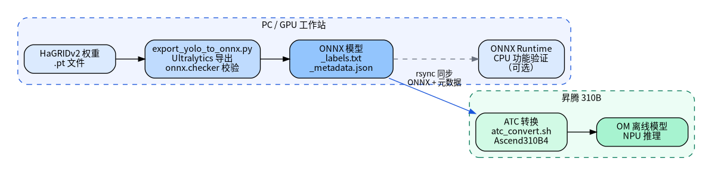
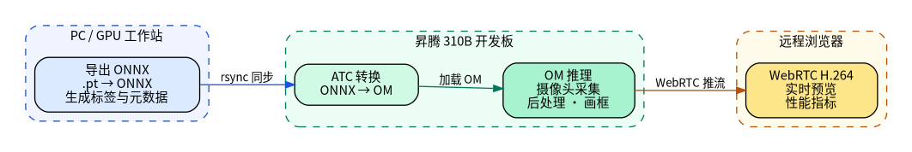
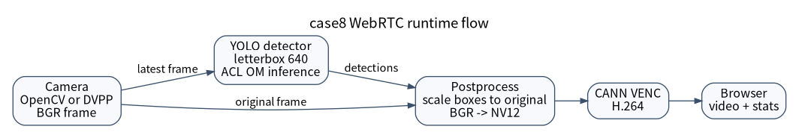
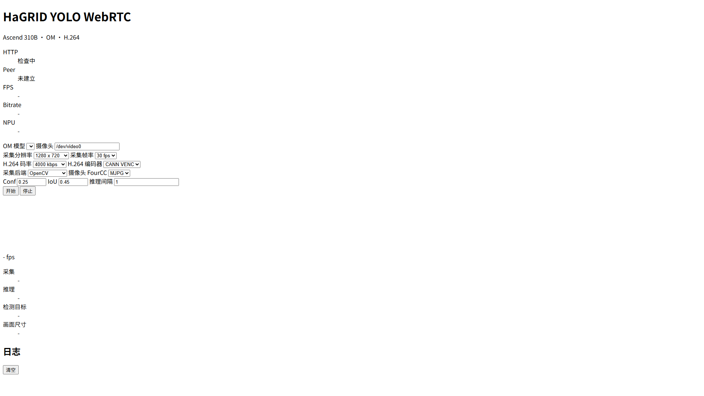

<!-- _class: cover -->

# 案例 8：实时手势识别

<div class="byline">周贤中 · zhouxzh@gdut.edu.cn</div>

## 从 YOLOv10 OM 到 WebRTC 的分层证据


<div class="source">教材：<a href="../experiment/case8.md"><code>src/experiment/case8.md</code></a>；样例：<a href="../../samples/case8/README.md"><code>samples/case8</code></a></div>

<!--
本案例讲清硬件链路和证据边界。当前课件不把静态前端截图、HTTP 服务或一次 OM smoke 提升为完整 WebRTC 验收。
-->

---

<!-- _class: center -->

## 本讲目标与路线

- 理解 YOLOv10 OM 的固定输入契约
- 走通 ONNX 导出与板端 OM 验证
- 区分摄像头、编码与 WebRTC 三层证据
- 按层停止故障，不把静态前端当验收

> 本讲主线：模型 → 推理 → 媒体 → WebRTC

<div class="source">教材：<a href="../experiment/case8.md"><code>src/experiment/case8.md</code></a></div>

<!--
先给出本讲路线图；后续每一段都对应这里的一行，最后回到路线收束。
-->
---


<!-- _class: section -->

# 01

## 从模型到 WebRTC 的五层链路

---

<!-- _class: center -->

## 一条链路，五个独立证据层

| 层级 | 关键对象 | 最低证据 |
|---|---|---|
| 前端 | 浏览器页面与 HTTP 资产 | 页面和资源状态 |
| 信令/媒体 | `/offer`、PeerConnection、RTP | 协商与持续帧 |
| 采集 | V4L2、MJPG、实际分辨率 | FourCC、帧数、释放 |
| 推理 | YOLOv10.v10 OM | 输入输出、输出与耗时 |
| 编码 | CANN VENC、H.264 | 通道、关键帧、持续推流 |

任一层的通过都不能替代下一层，尤其不能用 UI 截图替代媒体或 VENC。

<div class="source">教材：<a href="../experiment/case8.md#系统流程"><code>src/experiment/case8.md</code>「系统流程」</a>；测试：<a href="../../samples/case8/docs/04-deployment-and-testing.md"><code>docs/04-deployment-and-testing.md</code></a></div>

<!--
先建立分层意识。页面显示“HTTP 检查中”或“Peer 未建立”时，不能继续声称摄像头、OM、检测叠加或 VENC 已经通过。
-->

---

<!-- _class: center -->

## HaGRID 模型有固定输入契约

| 项目 | 当前约定 |
|---|---|
| 数据集来源 | HaGRID 手势数据与对应 YOLOv10 权重 |
| 输入 | 静态 `1×3×640×640` |
| 摄像头尺寸 | 可调，但先经 letterbox 进入模型 |
| 默认输出 | YOLOv10n 手势样例 `1×300×6` |
| 标签 | 以同一导出批次的 `*_labels.txt` 为准 |
| 训练 | 本案例不在板端重新训练 |

实际输入名、形状和输出必须从 OM 描述与元数据读取。

<div class="source">教材：<a href="../experiment/case8.md#模型与数据集"><code>src/experiment/case8.md</code>「模型与数据集」</a>；契约：<a href="../../samples/case8/docs/03-model-dataset-and-conversion.md"><code>docs/03-model-dataset-and-conversion.md</code></a></div>

<!--
模型输入尺寸不是网页运行参数。摄像头分辨率变化只影响预处理，最终必须变成 640×640 的 NCHW 张量。
-->

---

<!-- _class: visual -->

## 导出 ONNX，再到板端生成 OM



权重、ONNX、标签、元数据和 OM 必须来自同一次模型导出与转换记录。

<div class="source">图源：<a href="../experiment/img8/case8_model_conversion.png"><code>src/experiment/img8/case8_model_conversion.png</code></a>；转换说明：<a href="../../samples/case8/docs/03-model-dataset-and-conversion.md"><code>docs/03-model-dataset-and-conversion.md</code></a></div>

<!--
强调 ONNX 验证与 OM 验证是两个层。CPU ONNX 推理成功、ATC 打印成功和 ACL 执行成功分别记录，不能互相替代。
-->

---

<!-- _class: center -->

## OM 推理按四道门验证

1. 核对权重、ONNX、标签和元数据路径及 SHA-256。
2. 执行 `onnx.checker` 并记录 CPU 功能验证。
3. 在板端用目标 SoC 执行 ATC，保存完整日志和 OM 哈希。
4. 用 ACL 加载 OM，先 benchmark，再接摄像头验证预处理与后处理。

`ATC run success` 只证明转换完成；ACL 单帧通过也不证明 WebRTC 能持续编码。

<div class="source">教材：<a href="../experiment/case8.md#om-推理"><code>src/experiment/case8.md</code>「OM 推理」</a>；验证顺序：<a href="../../samples/case8/docs/03-model-dataset-and-conversion.md"><code>docs/03-model-dataset-and-conversion.md</code></a></div>

<!--
本页只讲证据顺序，不宣称当前模型文件或所有资产已经存在。模型、ONNX、OM 和报告默认都不进入 Git。
-->

---

<!-- _class: center -->

## 检测后处理决定画面是否可信

- letterbox 保持宽高比，并记录缩放比例与填充偏移。
- 输出逐行解析四个坐标、置信度和类别编号。
- 先按置信度过滤，再做坐标恢复和 NMS。
- 绘制前检查坐标是否仍位于原图范围内。
- 类别文字从同一批次标签文件读取；坐标或 NMS 错误会产生看似正常但错误的框。

<div class="source">教材：<a href="../experiment/case8.md#om-推理"><code>src/experiment/case8.md</code>「OM 推理」</a>；程序说明：<a href="../../samples/case8/docs/02-program-analysis.md"><code>docs/02-program-analysis.md</code></a></div>

<!--
后处理不是绘图附属品，而是检测结果的一部分。预处理、输出解码和绘制必须使用同一套缩放与标签信息。
-->

---

<!-- _class: visual -->

## 从摄像头到 WebRTC 的系统分层



工作站负责导出与同步，板端负责采集、OM 推理、后处理和推流，浏览器负责接收。

<div class="source">图源：<a href="../experiment/img8/case8_system_arch.png"><code>src/experiment/img8/case8_system_arch.png</code></a>；设计：<a href="../../samples/case8/docs/01-project-design.md"><code>docs/01-project-design.md</code></a></div>

<!--
带学生区分工作站、板端和浏览器。模型文件从工作站到板端只解决交付位置，不证明板端已经加载和执行。
-->

---

<!-- _class: visual -->

## 三线程流水线与编码边界



采集、推理和渲染分别推进；H.264 默认走 CANN VENC，失败时必须停止连接。

<div class="source">图源：<a href="../experiment/img8/case8_webrtc_pipeline.png"><code>src/experiment/img8/case8_webrtc_pipeline.png</code></a>；设计：<a href="../../samples/case8/docs/01-project-design.md"><code>docs/01-project-design.md</code></a></div>

<!--
图中的“CPU 回退”必须按代码实际行为理解：默认不自动回退。只有用户明确选择 CPU libx264 时才走另一条编码路径。
-->

---

<!-- _class: center -->

## 编码器选择是显式策略

| 模式 | OM 推理 | H.264 编码 | 失败行为 |
|---|---|---|---|
| CANN VENC | NPU | Ascend VENC | 明确报错并停止连接 |
| CPU libx264 | NPU | CPU | 仅用户显式选择时使用 |

`--no-hardware-encode` 只替换编码器，不把推理迁到 CPU，也不能作为 VENC 失败的隐藏回退。

<div class="source">教材：<a href="../experiment/case8.md#webrtc-推流"><code>src/experiment/case8.md</code>「WebRTC 推流」</a>；样例：<a href="../../samples/case8/README.md"><code>samples/case8/README.md</code></a></div>

<!--
CPU 编码是显式对照，不是自动降级。验收 CANN VENC 时，必须证明连接使用的是硬件编码路径。
-->

---

<!-- _class: screenshot -->

## 8T 静态前端：HTTP 检查中，Peer 未建立



**仅证明静态前端布局；不证明信令、摄像头、OM推理、检测叠加或VENC。**

<div class="source">manifest id：<code>case8-gesture-live</code>；8T / <code>Ascend310B4</code>；1920×1080；54754 bytes；SHA-256：<code>c1cd97fa4c18426933699a936bd21b7a0831ddffc77d750987cd9ae60de6c838</code></div>

<!--
页面明确显示 HTTP“检查中”、Peer“未建立”，模型、摄像头、编码和画面指标均为空。它只能证明静态页面与资产由 8T HTTP 服务加载。
-->

---

<!-- _class: center -->

## 截图清单保留失败边界

| 字段 | 本次证据 |
|---|---|
| manifest id | `case8-gesture-live` |
| 图片 | `screenshots/cases/case8-gesture-live-1920x1080.png` |
| 板卡与视口 | 8T / `Ascend310B4`；1920×1080 |
| 字节数 | 54754 |
| SHA-256 | `c1cd97fa4c18426933699a936bd21b7a0831ddffc77d750987cd9ae60de6c838` |
| HTTP 资产 | HTML 200；`client.js` 与 `styles.css` 为 404 |

> HTML 200 但 JS/CSS 404 说明页面未完成交互初始化，不能写成 WebRTC 端到端通过。

<div class="source">清单：<a href="screenshots/capture-manifest.json"><code>src/presentation/screenshots/capture-manifest.json</code></a>；样例：<a href="../../samples/case8"><code>samples/case8</code></a></div>

<!--
截图清单同时记录 HTML 成功和 JS/CSS 404。缺失资源说明页面没有完成交互初始化，不能把“HTTP 检查中”解释成服务正在做端到端验收。
-->

---


<!-- _class: section -->

# 02

## 板端证据与失败边界

---

<!-- _class: center -->

## 摄像头权限和实际格式分开记录

| 检查 | 正确做法 |
|---|---|
| 用户组 | 将运行用户加入 `video`，重新登录 |
| 设备 | `/dev/video0` 用于采集，避免 metadata 节点 |
| 格式 | 优先 MJPG，并读取实际 FourCC |
| 分辨率 | 先请求，再以日志/接口返回值确认 |
| 帧测试 | 处理有限帧并确认设备释放 |

官方 Atlas 记录中的重新插拔摄像头是该平台的前置步骤，不自动套用到 Orange Pi。

<div class="source">教材：<a href="../experiment/case8.md#摄像头权限"><code>src/experiment/case8.md</code>「摄像头权限」</a>；测试：<a href="../../samples/case8/docs/04-deployment-and-testing.md"><code>docs/04-deployment-and-testing.md</code></a></div>

<!--
权限、设备节点、FourCC 和实际尺寸是四条证据。截图中的摄像头下拉框只是静态控件，不能证明 V4L2 打开成功。
-->

---

<!-- _class: center -->

## 官方 Atlas：单独记录其完整软件栈

| 项目 | 观测值 |
|---|---|
| 平台 | Huawei Atlas 200I A2，Ascend 310B4 / 8T |
| 系统 | Ubuntu 22.04.5 LTS |
| 固件 | `7.8.0.5.216` |
| 驱动与 `npu-smi` | `25.5.0` |
| CANN | `9.2.0-beta.2` |
| 已验证链路 | OM 推理 + CANN VENC H.264 + WebRTC |

该结论是官方 Atlas 平台的 `observed-pass`，不能外推到 Orange Pi 系统。

<div class="source">证据：<a href="../../samples/case8/docs/05-known-issues-and-version-compatibility.md"><code>docs/05-known-issues-and-version-compatibility.md</code>「官方 Atlas 验证」</a>；正文：<a href="../experiment/case8.md#官方-atlas-开发板验证"><code>src/experiment/case8.md</code></a></div>

<!--
官方 Atlas 的固件、驱动和 CANN 必须作为一组记录。不能把这里的成功改写成 Orange Pi 同版本通过，也不能省略硬件平台。
-->

---

<!-- _class: center -->

## Orange Pi：一个板型也要分行记录

| 系统日期 | CANN | 驱动 | 固件 | VENC 结果 |
|---|---|---:|---|---|
| `20241128` | 7.0 | 23.0.0 | B309 | `observed-pass` |
| `20241128` | 8.0 | 未完整记录 | B309 | case8 WebRTC 复测通过 |
| `20250925` | 8.0 | 25.2.0 | B309 | `507018` / IOMMU 失败 |
| `20250925` | 9.0 | 25.2.0 | B309 | 与 8.0 相同失败 |

新系统的失败停在 VENC 通道创建和 IOMMU 分配，不是页面、摄像头或 OM 的首要故障。

<div class="source">证据：<a href="../../samples/case8/docs/05-known-issues-and-version-compatibility.md"><code>docs/05-known-issues-and-version-compatibility.md</code>「环境对照」</a>；正文：<a href="../experiment/case8.md#验收顺序"><code>src/experiment/case8.md</code>「验收顺序」</a></div>

<!--
Orange Pi 的记录必须连同系统日期、驱动、固件和 CANN 一起读。旧系统通过不能覆盖新系统失败，也不能把“固件 B309”当成单独充分条件。
-->

---

## 板端最小验证顺序

```bash
source /usr/local/miniconda3/etc/profile.d/conda.sh
conda activate ascend
export PYTHONNOUSERSITE=1
source /usr/local/Ascend/ascend-toolkit/set_env.sh
python scripts/infer_om_camera.py --benchmark-runs 20 --warmup-runs 5 --print-model-info
python scripts/infer_om_camera.py --source /dev/video0 --max-frames 60 --no-window
python scripts/webrtc_om_app.py
```

<div class="source">命令：<a href="../../samples/case8/docs/04-deployment-and-testing.md"><code>docs/04-deployment-and-testing.md</code></a>；样例：<a href="../../samples/case8/README.md"><code>samples/case8/README.md</code></a></div>

先验证 OM，再接摄像头，最后启动 WebRTC；每步保存输出和失败层。

<!--
命令顺序就是证据顺序。OM benchmark 失败时不要启动 WebRTC；摄像头失败时不要用 CPU 编码结果掩盖；HTTP 健康不能代替 Offer/Answer。
-->

---

<!-- _class: center -->

## 故障按层停止

1. 页面资源或 Peer 异常：检查 HTML、JS、CSS、`/offer`、SDP、ICE 和浏览器日志。
2. 摄像头失败：检查用户组、`/dev/video0`、MJPG 和实际 FourCC。
3. OM 失败：检查 ACL、模型路径、OM 描述和输入字节数。
4. VENC 失败：保存 `507018`、IOMMU/VENC 日志并停止，不自动切 CPU。
5. `Health: Alarm`：记录设备状态，但不能单独判定功能通过或失败。

<div class="source">排障：<a href="../experiment/case8.md#验收顺序"><code>src/experiment/case8.md</code>「验收顺序」</a>；版本边界：<a href="../../samples/case8/docs/05-known-issues-and-version-compatibility.md"><code>docs/05-known-issues-and-version-compatibility.md</code></a></div>

<!--
每层只用自己的证据判断。当前静态截图停在 HTTP/Peer 层，因此既没有摄像头证据，也没有 OM 或 VENC 证据。
-->

---

<!-- _class: center -->

## 课堂交付：手势链路证据卡

| 项目 | 必须提交 |
|---|---|
| 前端 | 当前截图、manifest id、哈希和 HTTP 资源状态 |
| 模型 | HaGRID 权重版本、ONNX/OM 哈希与输入契约 |
| 推理 | benchmark、摄像头输入和检测框输出 |
| 媒体 | `/offer`、Peer 状态、持续 H.264 帧和 `/stats` |
| 设备 | 板型、SoC、固件、驱动、CANN 分行记录 |
| 质量 | 数据集与精度结果，未执行则写 `untested` |

<div class="source">验收：<a href="../../samples/case8/docs/04-deployment-and-testing.md"><code>docs/04-deployment-and-testing.md</code></a>；截图清单：<a href="screenshots/capture-manifest.json"><code>capture-manifest.json</code></a>；教材：<a href="../experiment/case8.md"><code>src/experiment/case8.md</code></a></div>

<!--
最终报告必须写清每一层停在哪里。历史官方 Atlas 通过不等于当前 Orange Pi 通过，静态前端截图也不等于 WebRTC 实时识别通过。
-->

---

<!-- _class: center -->

## 本讲结论边界

- 静态前端已加载，但 HTTP 显示检查中，PeerConnection 未建立。
- OM、摄像头、检测叠加、帧率和 VENC 均未由该截图证明。
- 官方 Atlas 的成功属于独立平台证据集。
- Orange Pi 不同系统日期、CANN、驱动和固件必须逐行保留。
- 五个验收层全部有证据后，才能称为实时手势识别链路通过。

<div class="source">教材：<a href="../experiment/case8.md"><code>src/experiment/case8.md</code></a>；版本证据：<a href="../../samples/case8/docs/05-known-issues-and-version-compatibility.md"><code>docs/05-known-issues-and-version-compatibility.md</code></a></div>

<!--
收束时必须区分“能打开静态页面”和“浏览器持续收到带检测框的 H.264 视频”。后者需要信令、摄像头、OM 推理和 VENC 同时成立。
-->
